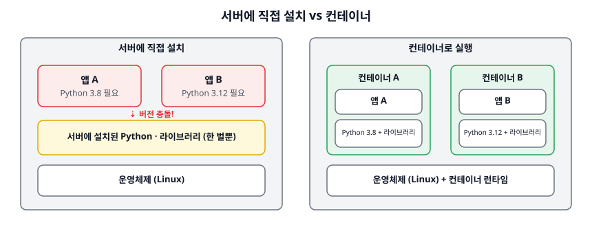
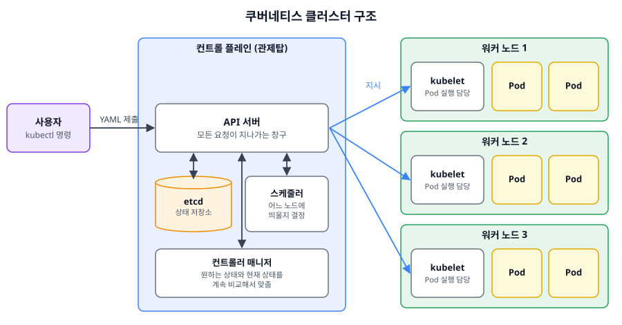
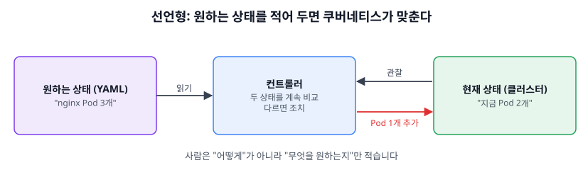

# 00. 시작하기 전에 — 컨테이너와 쿠버네티스

본격적으로 들어가기 전에 "애초에 이게 왜 필요한가"부터 이해하고, 실습할 환경을 준비합니다.

**이 장을 마치면**

- 컨테이너와 쿠버네티스가 어떤 문제를 해결하는지 설명할 수 있습니다.
- 클러스터 구조(컨트롤 플레인, 워커 노드)를 그림으로 떠올릴 수 있습니다.
- 실습용 네임스페이스를 만들고 첫 Pod를 띄웠다 지울 수 있습니다.

---

## 1. 문제: "내 컴퓨터에서는 되는데요?"

Python으로 웹 서버를 하나 만들었다고 합시다.

```python
# app.py
from http.server import HTTPServer, SimpleHTTPRequestHandler
HTTPServer(("0.0.0.0", 8000), SimpleHTTPRequestHandler).serve_forever()
```

내 노트북에서는 잘 돌아갑니다. 그런데 회사 서버에 올리려고 하면 문제가 생깁니다.

- 서버의 Python 버전이 내 노트북과 다르다
- 내가 쓴 라이브러리가 서버에는 설치되어 있지 않다
- 서버에는 다른 팀 프로그램도 돌고 있어서 함부로 패키지를 바꾸면 안 된다

Python의 `venv`(가상환경)가 이 문제를 **파이썬 패키지 수준**에서 해결해 주죠.
**컨테이너(Container)** 는 같은 아이디어를 **운영체제 수준**까지 확장한 것입니다.



## 2. 컨테이너: 프로그램 + 실행 환경을 통째로 포장

컨테이너는 내 프로그램과 그 프로그램이 필요로 하는 **모든 것**(Python 인터프리터, 라이브러리, 리눅스 기본 도구까지)을
하나의 상자에 담은 것입니다. 이 상자의 설계도를 **이미지(Image)** 라고 부릅니다.

| 용어 | 뜻 | Python에 비유하면 |
|---|---|---|
| 이미지(Image) | 설계도. 한 번 만들면 변하지 않음 | 클래스 |
| 컨테이너(Container) | 설계도로 찍어낸, 실행 중인 인스턴스 | 클래스로 만든 객체 |
| 레지스트리(Registry) | 이미지를 올려 두고 내려받는 저장소 (예: Docker Hub) | PyPI |

이미지 이름은 `nginx:1.27-alpine`처럼 **`이름:태그`** 형태로 씁니다. 태그는 버전이라고 생각하면 됩니다.

## 3. 쿠버네티스: 컨테이너 떼를 관리하는 관제탑

컨테이너 하나를 서버 한 대에서 돌리는 건 쉽습니다. 하지만 실제 서비스는 이렇습니다.

- 컨테이너가 수십~수백 개
- 서버도 여러 대
- 서버 한 대가 고장 나도 서비스는 멈추면 안 됨
- 새 버전 배포 중에도 서비스는 멈추면 안 됨

이걸 사람이 손으로 관리하는 건 불가능에 가깝습니다. **쿠버네티스(Kubernetes, 줄여서 k8s)** 는
여러 서버를 하나로 묶어 두고, "이 컨테이너를 3개 띄워 줘"라고 **선언**하면
어느 서버에 띄울지, 죽으면 어떻게 되살릴지를 알아서 처리하는 시스템입니다.

> **k8s라는 약어**: K와 s 사이에 글자가 8개 있어서 k8s라고 씁니다.

## 4. 쿠버네티스 구조



| 용어 | 뜻 |
|---|---|
| 클러스터(Cluster) | 쿠버네티스로 묶인 서버들 전체 |
| 노드(Node) | 클러스터에 속한 서버 한 대 |
| 컨트롤 플레인(Control Plane) | 클러스터를 지휘하는 노드(관제탑). API 서버, 스케줄러 등이 여기서 돈다 |
| 워커 노드(Worker Node) | 실제로 내 컨테이너가 실행되는 노드 |
| API 서버 | 모든 요청이 지나가는 창구. `kubectl`도, 다른 구성 요소도 전부 여기에 말을 건다 |
| etcd | 클러스터의 모든 상태가 저장되는 데이터베이스 |
| 스케줄러 | 새 Pod를 어느 노드에 띄울지 고르는 역할 |
| kubelet | 각 노드에서 실제로 컨테이너를 띄우고 감시하는 일꾼 |
| kubectl | 클러스터에 명령을 보내는 CLI 도구. 우리가 가장 많이 쓸 도구 |

"Pod를 하나 만들어 줘"라고 요청하면 내부에서는 이런 일이 일어납니다.

1. `kubectl`이 **API 서버**에 요청을 보낸다.
2. API 서버가 요청 내용을 **etcd**에 저장한다.
3. **스케줄러**가 "아직 노드가 정해지지 않은 Pod"를 발견하고 적당한 노드를 고른다.
4. 그 노드의 **kubelet**이 컨테이너를 실제로 실행한다.

지금 외울 필요는 없습니다. 실습하다가 "Pod가 왜 안 뜨지?" 싶을 때 이 그림으로 돌아오면 됩니다.

## 5. 선언형(Declarative)이라는 사고방식

쿠버네티스 사용의 핵심은 "명령"이 아니라 "선언"입니다.

- **명령형**: "서버 2번에 접속해서 컨테이너를 실행해" (절차를 지시)
- **선언형**: "이 앱이 항상 3개 떠 있는 상태를 유지해" (원하는 상태를 선언)



원하는 상태를 **YAML 파일**에 적어서 제출하면, 쿠버네티스가 현재 상태와 계속 비교해서 알아서 맞춰 줍니다.
에어컨 온도를 24도로 맞춰 두면, 더워질 때마다 에어컨이 알아서 도는 것과 같습니다.

## 6. YAML 읽는 법 (1분 요약)

쿠버네티스 설정 파일은 모두 YAML로 씁니다. Python의 dict/list와 1:1로 대응합니다.

```yaml
# YAML                              # Python으로 치면
name: web                           # {"name": "web"}
labels:                             # "labels": {"app": "web"}
  app: web
containers:                         # "containers": [ {...}, {...} ]  ← '-'가 리스트 원소
  - name: nginx
    image: nginx:1.27-alpine
```

- **들여쓰기는 공백 2칸**입니다. 탭을 쓰면 오류가 납니다.
- 같은 단계의 항목은 같은 깊이로 맞춥니다.
- `-`로 시작하면 리스트의 원소입니다.

쿠버네티스 YAML은 거의 항상 아래 네 덩어리로 이루어집니다.

```yaml
apiVersion: v1        # 어떤 API 버전의
kind: Pod             # 어떤 종류의 리소스를
metadata:             # 어떤 이름표를 붙여서
  name: web
spec:                 # 어떤 상태로 만들고 싶은가
  containers:
  - name: nginx
    image: nginx:1.27-alpine
```

여기에 쿠버네티스가 관찰한 결과인 `status`가 자동으로 덧붙습니다. **`spec`은 내가 원하는 것, `status`는 실제 모습**입니다.

---

## 7. 실습 환경 준비

실습에는 **kubectl을 쓸 수 있는 터미널**과 **실습용 쿠버네티스 클러스터**가 필요합니다.
이 교재의 예상 출력은 아래 환경에서 실제로 실행한 결과입니다. 버전이나 노드 수가 달라도 따라 하는 데 문제는 없습니다.

| 항목 | 값 |
|---|---|
| Kubernetes | v1.29 (노드 5대: 컨트롤 플레인 1 + 워커 4) |
| 네트워크(CNI) | Calico — [12장 NetworkPolicy](12-networkpolicy.md) 실습에 필요 |
| 기본 StorageClass | `nfs-client` — [06장 PV/PVC](06-pv-pvc.md) 실습에 필요 |
| Ingress 컨트롤러 | ingress-nginx — [10장 Ingress](10-ingress.md) 실습에 필요 |

### 7-1. 클러스터에 연결되는지 확인

```bash
kubectl version
kubectl get nodes
```

```
NAME         STATUS   ROLES           AGE    VERSION
oks1.dd.io   Ready    control-plane   538d   v1.29.15
oks2.dd.io   Ready    <none>          538d   v1.29.15
oks3.dd.io   Ready    <none>          538d   v1.29.15
oks4.dd.io   Ready    <none>          538d   v1.29.15
oks5.dd.io   Ready    <none>          538d   v1.29.15
```

노드 이름은 환경마다 다릅니다. 모든 노드의 `STATUS`가 `Ready`이면 준비된 것입니다.
`ROLES`가 `control-plane`인 노드가 4절 그림의 관제탑이고, 나머지가 워커 노드입니다.

### 7-2. 예제 파일 내려받기

이 교재의 예제 YAML은 모두 `examples/` 디렉터리에 있습니다. 저장소를 내려받고 그 안으로 이동합니다.

```bash
# git이 있으면
git clone https://github.com/kyeongseooh/k8s_edu.git
cd k8s_edu
```

```bash
# git이 없으면
curl -L https://github.com/kyeongseooh/k8s_edu/archive/refs/heads/main.tar.gz | tar xz
cd k8s_edu-main
```

> **이후 모든 실습 명령은 이 디렉터리(`README.md`와 `examples/`가 보이는 곳)에서 실행합니다.**

### 7-3. 실습용 네임스페이스 만들기

**네임스페이스(Namespace)** 는 클러스터 안의 "폴더"입니다. 같은 클러스터를 여러 팀이 같이 쓸 때 리소스가 섞이지 않게 나눠 줍니다.
실습은 다른 서비스와 섞이지 않도록 전용 네임스페이스 `edu-lab`에서 합니다.

```bash
kubectl create namespace edu-lab
```

매번 `-n edu-lab`을 붙이기는 번거로우니, **기본 네임스페이스**를 `edu-lab`으로 바꿔 둡니다.

```bash
kubectl config set-context --current --namespace=edu-lab

# 확인: edu-lab이 출력되어야 합니다
kubectl config view --minify -o jsonpath='{..namespace}{"\n"}'
```

```
edu-lab
```

> **여러 명이 같은 클러스터에서 실습한다면** 이름이 겹치지 않도록 `edu-hong`처럼 자기 이름을 붙여서 만드세요.
> 같은 서버 계정까지 함께 쓴다면 설정 파일도 각자 복사해서 씁니다.
>
> ```text
> cp ~/.kube/config ~/kubeconfig-hong
> export KUBECONFIG=~/kubeconfig-hong      # 새 터미널을 열 때마다 다시 실행
> kubectl create namespace edu-hong
> kubectl config set-context --current --namespace=edu-hong
> ```

## 8. 첫 실습 — Pod 하나 띄웠다가 지우기

YAML을 쓰기 전에, 명령 한 줄로 nginx 웹 서버를 띄워 봅니다.

```bash
kubectl run hello --image=nginx:1.27-alpine
```

```
pod/hello created
```

상태를 확인합니다.

```bash
kubectl get pod
```

```
NAME    READY   STATUS    RESTARTS   AGE
hello   1/1     Running   0          8s
```

`STATUS`가 `ContainerCreating`이면 이미지를 내려받는 중입니다. 몇 초 뒤 다시 조회하면 `Running`으로 바뀝니다.

`-o wide`를 붙이면 Pod의 IP와 어느 노드에서 실행 중인지도 보입니다.

```bash
kubectl get pod -o wide
```

```
NAME    READY   STATUS    RESTARTS   AGE   IP               NODE         NOMINATED NODE   READINESS GATES
hello   1/1     Running   0          20s   192.168.139.74   oks4.dd.io   <none>           <none>
```

방금 한 줄 명령이 실제로는 어떤 YAML을 만들었는지 볼 수 있습니다. 6절에서 본 `apiVersion / kind / metadata / spec`, 그리고 쿠버네티스가 채운 `status`가 보입니다.

```bash
kubectl get pod hello -o yaml | head -20
```

다 봤으면 지웁니다.

```bash
kubectl delete pod hello
```

```
pod "hello" deleted
```

### 모르는 필드가 나오면: `kubectl explain`

YAML을 읽다가 처음 보는 필드가 나오면 검색하기 전에 `explain`부터 써 보세요. 클러스터가 직접 설명해 줍니다.

```bash
kubectl explain pod.spec.containers.image
```

어떤 종류의 리소스가 있는지, 줄임말은 무엇인지는 `api-resources`로 봅니다.

```bash
kubectl api-resources | head -15
```

```
NAME                     SHORTNAMES   APIVERSION   NAMESPACED   KIND
configmaps               cm           v1           true         ConfigMap
namespaces               ns           v1           false        Namespace
nodes                    no           v1           false        Node
persistentvolumeclaims   pvc          v1           true         PersistentVolumeClaim
persistentvolumes        pv           v1           false        PersistentVolume
pods                     po           v1           true         Pod
...
```

`NAMESPACED`가 `true`인 리소스(Pod, ConfigMap 등)는 네임스페이스 안에 속하고, `false`인 리소스(Node, PV 등)는 클러스터 전체에 하나뿐인 이름을 씁니다.

## 9. 이 교재를 읽는 법

- **회색 상자의 명령은 직접 타이핑**해 보세요. 복사해서 붙여 넣어도 되지만, 손으로 쳐 본 명령이 더 오래 남습니다.
- 명령 바로 아래 상자는 **예상 출력**입니다. Pod 이름 뒤의 무작위 문자열, IP, 노드 이름, `AGE`는 환경마다 다릅니다.
- 각 장에는 **일부러 고장 내고 고치는 실습**이 있습니다. 실무에서 가장 많이 쓰는 능력은 "만들기"보다 "왜 안 되는지 찾기"이기 때문입니다.
- 각 장 마지막의 **정리** 단계를 꼭 실행하세요. 다음 장은 깨끗한 상태에서 시작합니다.
- 문제가 생기면 [치트시트](cheatsheet.md)의 증상별 표를 먼저 확인하세요.

모든 실습이 끝난 뒤에는 네임스페이스를 통째로 지우면 그 안의 리소스가 함께 사라집니다.

```text
# 전체 과정을 마친 뒤에만 실행
kubectl delete namespace edu-lab
kubectl config set-context --current --namespace=default
```

## 확인 문제

1. 이미지와 컨테이너의 차이는 무엇인가요?
2. `kubectl`이 보낸 요청을 가장 먼저 받는 구성 요소는 무엇인가요?
3. YAML의 `spec`과 `status`는 각각 누가 채우나요?
4. 네임스페이스를 지정하지 않고 `kubectl get pod`를 실행하면 어느 네임스페이스를 조회하나요?

<details><summary>정답 보기</summary>

1. 이미지는 변하지 않는 설계도, 컨테이너는 그 설계도로 실행한 인스턴스입니다. 이미지 하나로 컨테이너를 여러 개 만들 수 있습니다.
2. API 서버입니다. 모든 구성 요소는 API 서버를 통해서만 상태를 읽고 씁니다.
3. `spec`은 사용자가 원하는 상태를 적고, `status`는 쿠버네티스가 실제로 관찰한 상태를 채웁니다.
4. 현재 컨텍스트에 설정된 기본 네임스페이스입니다. 따로 설정하지 않았다면 `default`, 이 장의 7-3을 따라 했다면 `edu-lab`입니다.
</details>

---

다음 장: [01. Pod — 쿠버네티스의 최소 실행 단위](01-pod.md)
