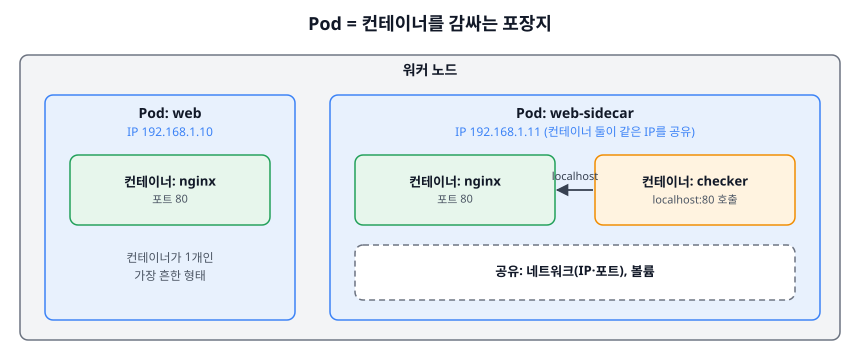
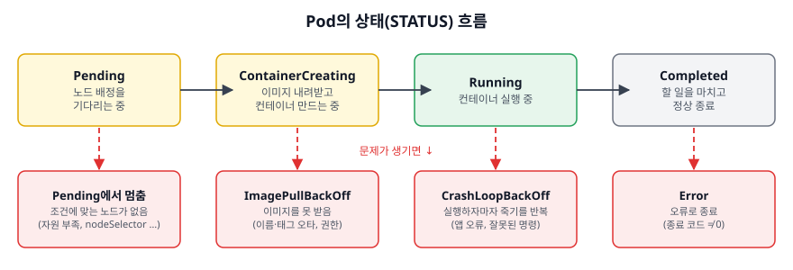

# 01. Pod — 쿠버네티스의 최소 실행 단위

**이 장을 마치면**

- Pod가 무엇이고 컨테이너와 어떻게 다른지 설명할 수 있습니다.
- YAML로 Pod를 만들고, 상태를 보고, 로그를 보고, 안에 들어가 볼 수 있습니다.
- Pod가 뜨지 않을 때 `describe`로 원인을 찾을 수 있습니다.

---

## 1. Pod란?

**Pod(파드)** 는 쿠버네티스에서 컨테이너를 실행하는 가장 작은 단위입니다.
쿠버네티스는 컨테이너를 직접 띄우지 않고, 컨테이너를 **Pod라는 포장지**에 싸서 띄웁니다.



꼭 알아야 할 성질 세 가지입니다.

1. **Pod 하나에 컨테이너가 여러 개 들어갈 수 있다.** (보통은 1개)
   같은 Pod 안의 컨테이너들은 IP와 포트 공간을 공유합니다. 그래서 서로를 `localhost`로 부를 수 있습니다.
   같은 집에 사는 가족이 주소 하나를 공유하는 것과 같습니다.
2. **Pod는 자기만의 IP를 가진다.** 클러스터 안의 다른 Pod가 이 IP로 접속할 수 있습니다.
3. **Pod는 일회용이다.** 지우고 다시 만들면 IP가 바뀌고, 컨테이너 안에 써 둔 파일도 사라집니다.

> **Python에 비유하면**: Pod는 실행 중인 프로세스와 비슷합니다. `python app.py`를 죽이고 다시 실행하면
> PID가 바뀌고 메모리에 있던 값이 사라지듯, Pod도 다시 만들어지면 IP가 바뀌고 내용이 초기화됩니다.

## 2. YAML 뜯어보기

nginx 웹 서버 한 대를 띄우는 Pod입니다. ([examples/01-pod/pod.yaml](../examples/01-pod/pod.yaml))

```yaml
apiVersion: v1          # Pod는 v1 API에 속한다
kind: Pod               # 리소스 종류: Pod
metadata:
  name: web             # Pod 이름. 이 이름으로 조회하고 삭제한다
  labels:
    app: web            # 레이블: 분류용 꼬리표 (5절에서 실습)
spec:                   # 원하는 상태
  containers:           # 이 Pod에 담을 컨테이너 목록
  - name: nginx         # 컨테이너 이름
    image: nginx:1.27-alpine    # 사용할 이미지 (이름:태그)
    ports:
    - containerPort: 80         # 컨테이너가 쓰는 포트 (설명용 표기)
```

`containerPort`는 "이 컨테이너는 80번을 씁니다"라는 메모에 가깝습니다. 적지 않아도 nginx는 80번으로 응답합니다.

## 3. 실습 ① — Pod 만들고 들여다보기

### 3-1. 만들기

```bash
kubectl apply -f examples/01-pod/pod.yaml
```

```
pod/web created
```

> `apply`는 "없으면 만들고, 있으면 YAML대로 수정"합니다. 앞으로 계속 쓸 명령입니다.

### 3-2. 상태 보기 — `get`

```bash
kubectl get pod
```

```
NAME   READY   STATUS              RESTARTS   AGE
web    0/1     ContainerCreating   0          0s
```

이미지를 내려받고 컨테이너를 만드는 중입니다. 준비될 때까지 기다렸다가 다시 조회합니다.

```bash
kubectl wait --for=condition=Ready pod/web --timeout=60s
kubectl get pod -o wide
```

> `kubectl wait --for=condition=Ready`는 Pod가 준비될 때까지 기다려 주는 명령입니다. `get`을 반복해서 치는 대신 씁니다.

```
NAME   READY   STATUS    RESTARTS   AGE   IP               NODE         NOMINATED NODE   READINESS GATES
web    1/1     Running   0          10s   192.168.139.99   oks4.dd.io   <none>           <none>
```

| 열 | 의미 |
|---|---|
| `READY 1/1` | 컨테이너 1개 중 1개가 준비됨 |
| `STATUS` | 현재 상태 (아래 그림 참고) |
| `RESTARTS` | 컨테이너가 죽어서 다시 시작된 횟수. 계속 늘어나면 문제가 있다는 뜻 |
| `IP` | Pod의 IP. 클러스터 안에서만 통한다 |
| `NODE` | 이 Pod가 실행 중인 노드 |



### 3-3. 자세히 보기 — `describe`

```bash
kubectl describe pod web
```

출력이 길지만 **맨 아래 `Events`** 가 가장 중요합니다. Pod가 만들어지는 과정이 시간순으로 적혀 있습니다.

```
Events:
  Type    Reason     Age   From               Message
  ----    ------     ----  ----               -------
  Normal  Scheduled  15s   default-scheduler  Successfully assigned edu-lab/web to oks4.dd.io
  Normal  Pulled     15s   kubelet            Container image "nginx:1.27-alpine" already present on machine
  Normal  Created    15s   kubelet            Created container: nginx
  Normal  Started    15s   kubelet            Started container nginx
```

[00장](00-시작하기-전에.md)의 구조 그림과 맞춰 읽어 보세요. **스케줄러**(`default-scheduler`)가 노드를 고르고, 그 노드의 **kubelet**이 이미지를 준비해 컨테이너를 만들고 시작했습니다.

### 3-4. 로그 보기 — `logs`

컨테이너가 화면(표준 출력)에 찍은 내용을 봅니다. Python의 `print()` 출력이 여기로 나옵니다.

```bash
kubectl logs web
```

```
...
2026/11/20 10:14:51 [notice] 1#1: start worker process 31
2026/11/20 10:14:51 [notice] 1#1: start worker process 32
```

> `kubectl logs -f web`처럼 `-f`를 붙이면 로그를 실시간으로 따라갑니다. 빠져나올 때는 `Ctrl+C`.

### 3-5. 안에서 명령 실행하기 — `exec`

컨테이너 안에서 명령을 실행합니다. 웹 서버가 실제로 응답하는지 컨테이너 안에서 확인해 봅니다.

```bash
kubectl exec web -- hostname
kubectl exec web -- wget -qO- http://127.0.0.1/
```

```
web
<!DOCTYPE html>
<html>
<head>
<title>Welcome to nginx!</title>
...
```

- `--` 뒤가 컨테이너 안에서 실행할 명령입니다.
- 호스트네임이 Pod 이름(`web`)과 같다는 점을 기억해 두세요.

셸로 직접 들어가 볼 수도 있습니다. 나올 때는 `exit`을 입력합니다.

```text
kubectl exec -it web -- sh
/ # ls /usr/share/nginx/html
50x.html    index.html
/ # exit
```

### 3-6. 다른 Pod에서 접속하기

Pod IP는 클러스터 안에서 통합니다. 임시 Pod를 하나 띄워서 `web`에 접속해 봅니다.

```bash
POD_IP=$(kubectl get pod web -o jsonpath='{.status.podIP}')
echo $POD_IP

kubectl run client --rm -i --restart=Never --image=busybox:1.36 -- wget -qO- http://$POD_IP/
```

```
192.168.139.99
<!DOCTYPE html>
<html>
<head>
<title>Welcome to nginx!</title>
...
pod "client" deleted
```

- `-o jsonpath='{...}'`는 YAML에서 원하는 값 하나만 뽑아내는 옵션입니다.
- `--rm`은 명령이 끝나면 임시 Pod를 자동으로 지우라는 뜻입니다. 이 "일회용 클라이언트" 패턴은 앞으로 자주 씁니다.

접속 기록이 `web`의 로그에 남았는지 확인합니다.

```bash
kubectl logs web --tail=2
```

```
127.0.0.1 - - [20/Nov/2026:10:14:52 +0000] "GET / HTTP/1.1" 200 615 "-" "Wget" "-"
192.168.96.73 - - [20/Nov/2026:10:14:53 +0000] "GET / HTTP/1.1" 200 615 "-" "Wget" "-"
```

첫 줄은 3-5에서 컨테이너 안에서 호출한 것(`127.0.0.1`), 둘째 줄은 `client` Pod의 IP에서 온 요청입니다.

## 4. 실습 ② — Pod는 일회용이다

Pod 안의 파일을 바꾼 다음, Pod를 지우고 다시 만들면 어떻게 되는지 봅니다.

```bash
# 첫 페이지 내용을 바꾼다
kubectl exec web -- sh -c 'echo "hello from web" > /usr/share/nginx/html/index.html'
kubectl exec web -- wget -qO- http://127.0.0.1/
```

```
hello from web
```

지금 IP를 기억해 두고(`192.168.139.99`), Pod를 지웠다가 **같은 YAML로** 다시 만듭니다.

```bash
kubectl delete pod web
kubectl apply -f examples/01-pod/pod.yaml
kubectl wait --for=condition=Ready pod/web --timeout=60s
kubectl get pod -o wide
```

```
NAME   READY   STATUS    RESTARTS   AGE   IP              NODE         NOMINATED NODE   READINESS GATES
web    1/1     Running   0          3s    192.168.96.98   oks5.dd.io   <none>           <none>
```

```bash
kubectl exec web -- wget -qO- http://127.0.0.1/ | grep title
```

```
<title>Welcome to nginx!</title>
```

**관찰한 것**

- 이름은 같지만 **IP가 바뀌었습니다** (`192.168.139.99` → `192.168.96.98`). 다른 노드에 뜰 수도 있습니다.
- 바꿔 둔 `hello from web`은 **사라지고** 원래 nginx 페이지로 돌아왔습니다.

그래서 이런 질문이 생깁니다. 이 질문들이 다음 장들의 주제입니다.

| 질문 | 해결책 |
|---|---|
| Pod가 죽으면 누가 다시 띄워 주나? | [02장 Deployment](02-deployment.md) |
| IP가 바뀌는데 어떻게 고정된 주소로 접속하나? | [03장 Service](03-service.md) |
| 파일이 사라지면 데이터는 어디에 저장하나? | [06장 PV/PVC](06-pv-pvc.md) |

## 5. 실습 ③ — Label: 리소스에 붙이는 꼬리표

**레이블(Label)** 은 리소스에 붙이는 `key=value` 꼬리표입니다. 그 자체로는 아무 동작도 하지 않지만,
"이 꼬리표가 붙은 것만 골라 줘"라는 **선택**에 쓰입니다. 앞으로 배울 Deployment와 Service가
전부 레이블로 Pod를 찾기 때문에 매우 중요합니다.

```bash
# 레이블까지 같이 조회
kubectl get pod --show-labels
```

```
NAME   READY   STATUS    RESTARTS   AGE   LABELS
web    1/1     Running   0          2m    app=web
```

```bash
# 레이블 추가
kubectl label pod web env=dev

# env=dev 레이블이 붙은 Pod만 조회 (-l 은 label selector)
kubectl get pod -l env=dev

# 이미 있는 key의 값을 바꿀 때는 --overwrite
kubectl label pod web env=prod --overwrite
kubectl get pod -l app=web --show-labels
```

```
NAME   READY   STATUS    RESTARTS   AGE   LABELS
web    1/1     Running   0          2m    app=web,env=prod
```

```bash
# 레이블 삭제: key 뒤에 - 를 붙인다
kubectl label pod web env-
```

> **Python에 비유하면**: `[p for p in pods if p.labels.get("app") == "web"]` 같은 필터링입니다.

## 6. 실습 ④ — 컨테이너가 2개인 Pod

1절에서 "같은 Pod의 컨테이너는 IP를 공유한다"고 했습니다. 직접 확인해 봅니다.
아래 Pod에는 nginx와, 5초마다 nginx를 `127.0.0.1`로 호출하는 `checker` 컨테이너가 함께 들어 있습니다.
([examples/01-pod/pod-sidecar.yaml](../examples/01-pod/pod-sidecar.yaml))

```yaml
spec:
  containers:
  - name: nginx                 # 웹 서버
    image: nginx:1.27-alpine
  - name: checker               # 5초마다 옆 컨테이너(nginx)를 localhost로 호출
    image: busybox:1.36
    command: ["sh", "-c"]
    args:
    - |
      while true; do
        wget -q -O /dev/null http://127.0.0.1:80/ && echo "$(date +%T) nginx OK" || echo "$(date +%T) nginx FAIL"
        sleep 5
      done
```

```bash
kubectl apply -f examples/01-pod/pod-sidecar.yaml
kubectl wait --for=condition=Ready pod/web-sidecar --timeout=60s
kubectl get pod
```

```
NAME          READY   STATUS    RESTARTS   AGE
web           1/1     Running   0          3m
web-sidecar   2/2     Running   0          5s
```

`READY`가 `2/2`입니다. 컨테이너가 2개이고 둘 다 준비됐다는 뜻입니다.

컨테이너가 여러 개면 `-c 컨테이너이름`으로 대상을 고릅니다.

```bash
kubectl logs web-sidecar -c checker
```

```
10:15:36 nginx OK
10:15:41 nginx OK
10:15:46 nginx OK
```

`checker`는 nginx가 없는 컨테이너인데도 `127.0.0.1:80`으로 nginx에 접속했습니다. 두 컨테이너의 IP도 같습니다.

```bash
kubectl exec web-sidecar -c checker -- hostname -i
kubectl exec web-sidecar -c nginx -- hostname -i
```

```
192.168.30.222
192.168.30.222
```

이렇게 주 컨테이너 옆에서 보조 역할(로그 수집, 프록시 등)을 하는 컨테이너를 **사이드카(sidecar)** 라고 부릅니다.

```bash
kubectl delete pod web-sidecar
```

## 7. 고장 내고 고쳐 보기

실무에서는 "Pod를 만들었는데 안 떠요"가 가장 흔한 질문입니다. 일부러 두 가지 고장을 내 봅니다.

> **문제 해결 순서**: ① `kubectl get pod`로 **STATUS** 확인 → ② `kubectl describe pod`의 **Events** 확인 → ③ `kubectl logs`로 앱 출력 확인.
> 이 순서만 기억해도 대부분의 원인을 찾을 수 있습니다.

### 7-1. 고장 ① — 이미지 이름 오타

```bash
kubectl apply -f examples/01-pod/pod-bad-image.yaml
```

20초쯤 기다린 뒤 상태를 봅니다.

```bash
kubectl get pod
```

```
NAME      READY   STATUS             RESTARTS   AGE
web       1/1     Running            0          5m
web-bad   0/1     ImagePullBackOff   0          25s
```

`ErrImagePull` 또는 `ImagePullBackOff`가 보입니다. "이미지를 내려받는 데 실패했다"는 뜻입니다. 왜 실패했는지는 Events에 있습니다.

```bash
kubectl describe pod web-bad
```

```
Events:
  Type     Reason     Age                From               Message
  ----     ------     ----               ----               -------
  Normal   Scheduled  25s                default-scheduler  Successfully assigned edu-lab/web-bad to oks4.dd.io
  Normal   Pulling    12s (x2 over 25s)  kubelet            Pulling image "nginx:1.27-alpime"
  Warning  Failed     11s (x2 over 24s)  kubelet            Failed to pull image "nginx:1.27-alpime": ... docker.io/library/nginx:1.27-alpime: not found
  Warning  Failed     11s (x2 over 24s)  kubelet            Error: ErrImagePull
  Normal   BackOff    1s                 kubelet            Back-off pulling image "nginx:1.27-alpime"
  Warning  Failed     1s                 kubelet            Error: ImagePullBackOff
```

<details><summary>원인과 해결 방법 (먼저 스스로 생각해 본 뒤 펼쳐 보세요)</summary>

`nginx:1.27-alpime: not found` — 태그가 `alpine`이 아니라 `alpime`으로 잘못 적혀 있습니다.
스케줄링(`Scheduled`)까지는 성공했고, kubelet이 이미지를 받는 단계에서 실패한 것입니다.
`BackOff`는 "실패했으니 간격을 점점 늘려 가며 다시 시도하는 중"이라는 뜻입니다.

YAML의 `image`를 `nginx:1.27-alpine`으로 고쳐서 다시 `apply`하면 됩니다. 여기서는 실습용 Pod이므로 지웁니다.

```bash
kubectl delete pod web-bad
```

</details>

### 7-2. 고장 ② — 조건에 맞는 노드가 없음

`nodeSelector`는 "이 레이블이 붙은 노드에만 띄워 줘"라는 조건입니다.
아래 Pod는 `gpu=true` 레이블이 붙은 노드를 요구하지만, 그런 노드는 없습니다.
([examples/01-pod/pod-nodeselector.yaml](../examples/01-pod/pod-nodeselector.yaml))

```yaml
spec:
  nodeSelector:
    gpu: "true"                  # 이 레이블이 붙은 노드가 없다
```

```bash
kubectl apply -f examples/01-pod/pod-nodeselector.yaml
kubectl get pod
```

```
NAME      READY   STATUS    RESTARTS   AGE
web       1/1     Running   0          6m
web-gpu   0/1     Pending   0          5s
```

아무리 기다려도 `Pending`입니다. 이번에도 Events를 봅니다.

```bash
kubectl describe pod web-gpu
```

```
Events:
  Type     Reason            Age   From               Message
  ----     ------            ----  ----               -------
  Warning  FailedScheduling  5s    default-scheduler  0/5 nodes are available: 1 node(s) had untolerated taint {node-role.kubernetes.io/control-plane: }, 4 node(s) didn't match Pod's node affinity/selector. ...
```

<details><summary>원인과 해결 방법</summary>

이번에는 **스케줄러** 단계에서 멈췄습니다. 메시지를 풀어 읽으면 이렇습니다.

- `0/5 nodes are available` — 노드 5대 중 쓸 수 있는 노드가 0대
- `1 node(s) had untolerated taint {...control-plane}` — 1대는 컨트롤 플레인이라 일반 Pod를 받지 않음 ([15장](15-scheduling.md)에서 다룹니다)
- `4 node(s) didn't match Pod's node affinity/selector` — 나머지 4대는 `nodeSelector` 조건에 맞지 않음

노드에 실제로 어떤 레이블이 있는지는 이렇게 확인합니다.

```bash
kubectl get nodes --show-labels
```

해결 방법은 둘 중 하나입니다. ① YAML의 `nodeSelector`를 실제로 있는 레이블로 고치거나 지운다. ② 정말 GPU 노드가 있어야 하는 Pod라면 노드를 준비한다.
여기서는 실습용 Pod이므로 지웁니다.

```bash
kubectl delete pod web-gpu
```

</details>

**두 고장의 차이**

| | 고장 ① 이미지 오타 | 고장 ② 노드 조건 불일치 |
|---|---|---|
| STATUS | `ImagePullBackOff` | `Pending` |
| 멈춘 단계 | kubelet이 이미지를 받는 단계 | 스케줄러가 노드를 고르는 단계 |
| Events의 Reason | `Failed` (Failed to pull image) | `FailedScheduling` |

## 8. 정리

```bash
kubectl delete pod web
kubectl get pod
```

```
No resources found in edu-lab namespace.
```

## 핵심 요약

- Pod는 컨테이너를 감싸는 최소 실행 단위이고, 자기 IP를 가진다.
- 같은 Pod 안의 컨테이너들은 IP를 공유한다.
- Pod는 일회용이다. 다시 만들면 IP가 바뀌고 안의 파일이 사라진다.
- 레이블은 리소스를 골라내기 위한 꼬리표다.
- 문제가 생기면 `get` → `describe`(Events) → `logs` 순서로 본다.

| 자주 쓰는 명령 | 용도 |
|---|---|
| `kubectl apply -f 파일` | 만들기 / 수정하기 |
| `kubectl get pod [-o wide]` | 목록과 상태 |
| `kubectl describe pod 이름` | 상세 정보와 Events |
| `kubectl logs 이름 [-c 컨테이너] [-f]` | 컨테이너 출력 |
| `kubectl exec [-it] 이름 -- 명령` | 컨테이너 안에서 명령 실행 |
| `kubectl delete pod 이름` | 삭제 |

## 확인 문제

1. Pod를 지우고 같은 이름으로 다시 만들면 IP는 어떻게 되나요? 안에 써 둔 파일은요?
2. 컨테이너가 2개인 Pod에서 두 컨테이너의 IP는 같을까요, 다를까요?
3. `STATUS`가 `ImagePullBackOff`인 Pod의 원인을 찾으려면 어떤 명령의 어느 부분을 봐야 하나요?
4. `nodeSelector` 조건에 맞는 노드가 하나도 없으면 Pod는 어떤 상태가 되나요?

<details><summary>정답 보기</summary>

1. IP는 바뀌는 것이 보통이고, 컨테이너 안에 써 둔 파일은 사라집니다. Pod는 일회용입니다.
2. 같습니다. 같은 Pod의 컨테이너들은 네트워크(IP와 포트 공간)를 공유합니다.
3. `kubectl describe pod 이름`의 맨 아래 `Events`를 봅니다. `Failed to pull image ...` 메시지에 원인이 적혀 있습니다.
4. `Pending`에서 멈춥니다. Events에 `FailedScheduling`과 `didn't match Pod's node affinity/selector`가 나옵니다.
</details>

---

다음 장: [02. Deployment — Pod를 관리해 주는 관리자](02-deployment.md)
