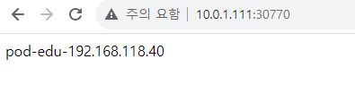

# 01. Pod — 쿠버네티스의 최소 실행 단위

## 1. 개념

**Pod(파드)** 는 쿠버네티스에서 컨테이너를 실행하는 가장 작은 단위입니다.
"컨테이너를 실행해 줘"라고 쿠버네티스에 요청할 때, 컨테이너를 직접 띄우는 게 아니라
컨테이너를 **Pod라는 포장지**에 싸서 띄웁니다.

Pod에 대해 꼭 알아야 할 성질 3가지:

1. **Pod 하나에 컨테이너가 n개 들어갈 수 있다.** (보통은 1개)
   같은 Pod 안의 컨테이너들은 네트워크를 공유해서, 같은 IP·같은 포트 공간을 씁니다.
   같은 집에 사는 가족이 주소 하나를 공유하는 것과 같습니다.
2. **Pod는 자기만의 IP와 호스트네임을 가진다.**
3. **Pod가 재생성되면 IP와 호스트네임이 바뀐다.**
   Pod는 언제든 죽고 다시 만들어질 수 있는 '일회용' 존재입니다.
   그래서 고정된 주소로 접근하려면 Service(3장)가 필요합니다.

> **Python 비유**: Pod는 실행 중인 프로세스와 비슷합니다. `python app.py`를 죽이고 다시 실행하면
> PID가 바뀌듯, Pod도 다시 만들어지면 IP가 바뀝니다. "PID를 외워서 접근"하면 안 되는 것처럼
> "Pod IP를 외워서 접근"하면 안 됩니다.

## 2. YAML 뜯어보기

아래는 아파치 웹 서버 한 대를 띄우는 Pod 정의입니다. ([examples/01-pod/pod-edu.yaml](../examples/01-pod/pod-edu.yaml))

```yaml
apiVersion: v1          # 이 리소스가 속한 API 버전. Pod는 v1
kind: Pod               # 리소스 종류: Pod를 만들겠다
metadata:
  name: pod-edu         # Pod 이름 (클러스터에서 이 이름으로 조회/삭제)
  labels:
    app: edu-app        # 레이블: 분류용 꼬리표 (아래 5절 참고)
spec:                   # "원하는 상태"의 본문
  containers:           # 이 Pod에 담을 컨테이너 목록 (리스트)
  - name: web           # 컨테이너 이름
    image: ubuntu/apache2:latest    # 사용할 이미지
    command:            # 컨테이너가 시작될 때 실행할 명령
      - "/bin/sh"
      - "-c"
      - >               # '>' 는 여러 줄을 한 줄로 이어주는 YAML 문법
        echo "ServerName localhost" > /etc/apache2/conf-available/server-name.conf &&
        a2enconf server-name &&
        echo "$(hostname)-$(hostname -i)" > /var/www/html/index.html &&
        apache2ctl -DFOREGROUND
    ports:
    - containerPort: 80 # 컨테이너가 사용하는 포트 (문서 성격이 강함)
```

`command` 부분이 하는 일: 웹 서버 첫 페이지(index.html)에 **자기 호스트네임과 IP**를 적어 놓습니다.
나중에 접속했을 때 "내가 어느 Pod에 접속했는지" 눈으로 확인하기 위한 장치입니다.

## 3. 실습 ① — Pod 띄우고 접속해 보기

### 3-1. Pod 생성

```bash
kubectl apply -f examples/01-pod/pod-edu.yaml
```

```
pod/pod-edu created
```

> `kubectl create -f`도 되지만, `apply`는 "없으면 만들고 있으면 수정"이라 보통 apply를 씁니다.

### 3-2. 상태 확인

```bash
kubectl get pod
```

```
NAME      READY   STATUS    RESTARTS   AGE
pod-edu   1/1     Running   0          10s
```

- `READY 1/1`: 컨테이너 1개 중 1개 준비됨
- `STATUS Running`: 실행 중. (`ContainerCreating`이면 이미지 내려받는 중이니 잠시 기다리세요)

### 3-3. 외부에서 접속할 수 있게 노출 (맛보기)

Pod IP는 클러스터 안에서만 통하므로, 밖에서 접속하려면 Service가 필요합니다. (자세한 건 3장)

```bash
kubectl expose pod pod-edu --type=NodePort --name=pod-edu-svc
kubectl get svc pod-edu-svc
```

```
NAME          TYPE       CLUSTER-IP    EXTERNAL-IP   PORT(S)        AGE
pod-edu-svc   NodePort   10.111.13.3   <none>        80:30770/TCP   8s
```

`80:30770`의 의미: 모든 노드의 **30770 포트**로 들어온 요청이 Pod의 80 포트로 전달됩니다.
브라우저에서 `http://<노드IP>:30770` 으로 접속하면 Pod의 호스트네임과 IP가 보입니다.



```bash
# 터미널에서 확인해도 됩니다 (30770은 환경마다 다름)
curl http://<노드IP>:30770
# pod-edu-192.168.85.44
```

## 4. 꼭 알아야 할 kubectl 명령 6가지

Pod를 다루는 기본기이자, 이후 모든 리소스에 똑같이 적용되는 패턴입니다.

```bash
# 1) 생성/수정
kubectl apply -f pod-edu.yaml

# 2) 목록 보기
kubectl get pod

# 3) 상세 정보를 YAML로 보기 (현재 상태 포함)
kubectl get pod pod-edu -oyaml

# 4) 상세 설명 + 이벤트 로그 보기 (문제 생기면 제일 먼저 볼 것!)
kubectl describe pod pod-edu

# 5) 컨테이너의 출력(로그) 보기 (print 디버깅의 그 로그)
kubectl logs pod/pod-edu

# 6) 컨테이너 안에 들어가기 (SSH처럼)
kubectl exec pod-edu -it -- bash

# 삭제
kubectl delete pod pod-edu
```

> **트러블슈팅 공식**: Pod가 이상하면 ① `describe`로 이벤트 확인 → ② `logs`로 앱 출력 확인
> → ③ `exec`로 들어가서 직접 확인. 이 순서만 기억해도 웬만한 문제는 원인을 찾습니다.

## 5. Label — 리소스에 붙이는 꼬리표

**레이블(Label)** 은 리소스에 붙이는 `key=value` 꼬리표입니다. 시스템 동작에 직접적인 의미는 없지만,
"이 꼬리표가 붙은 것들만 골라줘"라는 **선택(select)** 에 쓰입니다. 앞으로 배울 Service, Deployment가
전부 레이블로 Pod를 찾아내기 때문에 매우 중요합니다.

> **Python 비유**: 객체마다 붙은 태그로 필터링하는 것과 같습니다.
> `[p for p in pods if p.labels.get("app") == "edu-app"]`

```bash
# 레이블까지 같이 조회
kubectl get pod --show-labels
```

```
NAME      READY   STATUS    RESTARTS   AGE     LABELS
pod-edu   1/1     Running   0          3d17h   app=edu-app
```

```bash
# app이라는 key를 가진 Pod만 조회
kubectl get pod -l app

# app=edu-app 인 것만 조회
kubectl get pod -l app=edu-app

# app 레이블이 없는 것만 조회
kubectl get pod -l '!app'

# 레이블 추가
kubectl label pod pod-edu env=dev

# 레이블 수정 (이미 있는 key는 --overwrite 필요)
kubectl label pod pod-edu env=prod --overwrite
```

## 6. 실습 ② — 특정 노드에 Pod 배치하기 (nodeSelector)

보통은 쿠버네티스 스케줄러가 알아서 노드를 고르지만, "GPU 있는 노드에서만 실행" 같은
요구가 있을 때는 **노드의 레이블**로 지정할 수 있습니다.

```bash
# 1) 노드에 레이블 부여 (노드 이름은 kubectl get nodes 로 확인)
kubectl label nodes ks3.dd.io type=worker
```

Pod 정의에 `nodeSelector`를 추가합니다. ([examples/01-pod/pod-edu-nodeselector.yaml](../examples/01-pod/pod-edu-nodeselector.yaml))

```yaml
spec:
  nodeSelector:         # 이 레이블이 붙은 노드에만 스케줄
    type: "worker"
  containers:
  - name: web
    ...
```

```bash
# 2) 기존 Pod 삭제 후 재생성
kubectl delete pod pod-edu
kubectl apply -f examples/01-pod/pod-edu-nodeselector.yaml

# 3) 어느 노드에 떴는지 확인 (-owide: 노드/IP 컬럼 추가)
kubectl get pod -owide
```

```
NAME      READY   STATUS    RESTARTS   AGE   IP              NODE        ...
pod-edu   1/1     Running   0          54s   192.168.85.44   ks3.dd.io   ...
```

ks3 노드에 배치된 것을 확인할 수 있습니다.

## 7. 실습 정리 (청소)

```bash
kubectl delete pod pod-edu
kubectl delete svc pod-edu-svc
```

## 확인 문제

1. Pod가 죽고 다시 만들어지면 바뀌는 것 2가지는?
2. Pod 안의 컨테이너가 2개면, 두 컨테이너의 IP는 같을까 다를까?
3. Pod가 `Running`이 안 되고 멈춰 있을 때 가장 먼저 쳐야 할 명령은?

<details><summary>정답 보기</summary>

1. IP 주소와 호스트네임
2. 같다. Pod 안의 컨테이너들은 네트워크 네임스페이스를 공유한다 (같은 IP, 같은 포트 공간)
3. `kubectl describe pod <이름>` — 아래쪽 Events에 원인이 찍혀 있는 경우가 대부분
</details>

---

다음 장: [02. Deployment — Pod를 관리해 주는 관리자](02-deployment.md)
