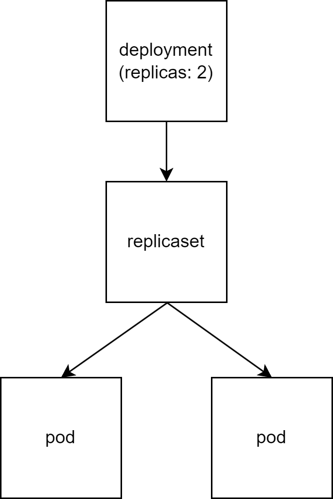

# 02. Deployment — Pod를 지키고, 늘리고, 무중단으로 바꾸는 관리자

## 1. 개념

1장에서 만든 Pod에는 치명적인 약점이 있습니다. **죽으면 끝**이라는 점입니다.
노드가 고장 나거나 실수로 삭제하면 아무도 되살려 주지 않습니다.

**Deployment(디플로이먼트)** 는 Pod를 대신 관리해 주는 상위 리소스입니다.

- Pod 개수를 **보장**한다 — "2개 유지해 줘"라고 선언하면, 하나가 죽어도 자동으로 다시 만들어 2개를 맞춘다
- **롤링 업데이트(rolling update)** — 새 버전 배포 시 Pod를 하나씩 교체해서 서비스 중단이 없다
- **롤백(rollback)** — 새 버전에 문제가 있으면 이전 버전으로 되돌릴 수 있다

내부적으로 Deployment는 **ReplicaSet**이라는 중간 관리자를 만들고, ReplicaSet이 Pod 개수를 유지합니다.



```
Deployment  →  ReplicaSet  →  Pod, Pod
(배포 전략/이력 관리)   (개수 유지)      (실제 실행)
```

실무에서는 **Pod를 직접 만들 일이 거의 없고, 대부분 Deployment로 만듭니다.**

## 2. YAML 뜯어보기

웹 서버를 Deployment로 띄우고 Service까지 함께 정의한 예시입니다.
([examples/02-deployment/deploy-edu.yaml](../examples/02-deployment/deploy-edu.yaml))

```yaml
apiVersion: apps/v1
kind: Deployment
metadata:
  name: deploy-edu02
spec:
  replicas: 2                  # Pod를 몇 개 유지할 것인가
  selector:                    # "어떤 Pod가 내 관리 대상인가"를 레이블로 지정
    matchLabels:
      app: edu02-web           # ← 아래 template의 레이블과 반드시 일치해야 함!
  template:                    # 여기서부터는 "Pod를 찍어낼 틀" (1장의 Pod 정의와 동일한 구조)
    metadata:
      labels:
        app: edu02-web         # 찍혀 나오는 Pod마다 이 레이블이 붙음
    spec:
      containers:
        - name: web
          image: nginx:1.27-alpine
          imagePullPolicy: IfNotPresent
          ports:
            - containerPort: 80
---                            # '---' 는 한 파일에 여러 리소스를 적는 구분선
apiVersion: v1
kind: Service
metadata:
  name: svc-edu02
spec:
  selector:
    app: edu02-web             # app=edu02-web 레이블이 붙은 Pod들에게 트래픽 전달
  ports:
    - protocol: TCP
      port: 80
      targetPort: 80
  type: ClusterIP               # 클러스터 내부에서만 접근 (외부 노출은 3장 Service에서)
```

**핵심 연결 고리**: `selector.matchLabels` = `template.metadata.labels` = Service의 `selector`.
세 곳의 레이블이 맞아야 "Deployment가 Pod를 관리하고, Service가 그 Pod들을 찾는" 체인이 완성됩니다.

## 3. 실습 ① — 정상: 배포와 자동 복구(self-healing)

### 3-1. 생성 및 준비 상태 확인

```bash
k apply -f examples/02-deployment/deploy-edu.yaml
k wait --for=condition=Available deployment/deploy-edu02 --timeout=60s
k get deploy,rs,pod -l app=edu02-web
```

```
NAME                             READY   UP-TO-DATE   AVAILABLE   AGE
deployment.apps/deploy-edu02     2/2     2            2           20s

NAME                                      DESIRED   CURRENT   READY   AGE
replicaset.apps/deploy-edu02-6c7cbd7b6    2         2         2       20s

NAME                                READY   STATUS    RESTARTS   AGE
pod/deploy-edu02-6c7cbd7b6-nlt55    1/1     Running   0          20s
pod/deploy-edu02-6c7cbd7b6-s2jgm    1/1     Running   0          20s
```

Deployment 하나로 ReplicaSet과 Pod 2개가 줄줄이 생긴 게 보입니다.
Pod 이름의 `6c7cbd7b6-nlt55` 같은 부분은 자동으로 붙는 랜덤 해시입니다 — 1장에서 본 것과 달리
**매번 새 이름**이 붙기 때문에, Pod가 재생성될 때마다 호스트네임도 함께 바뀝니다.

### 3-2. 자동 복구 체험

Pod 하나를 **일부러 죽여 봅시다.**

```bash
VICTIM=$(k get pod -l app=edu02-web -o jsonpath='{.items[0].metadata.name}')
k delete pod "$VICTIM"
sleep 3
k get pod -l app=edu02-web
```

```
NAME                          READY   STATUS    RESTARTS   AGE
deploy-edu02-6c7cbd7b6-s2jgm   1/1     Running   0          3m
deploy-edu02-6c7cbd7b6-x9k2p   1/1     Running   0          5s    ← 새로 생김!
```

삭제하자마자 새 Pod가 즉시 생성됩니다. "replicas: 2를 유지하라"는 선언을 쿠버네티스가 지키는 것입니다.

### 3-3. Pod 개수 조절 (스케일링)

```bash
k scale deployment deploy-edu02 --replicas=4
sleep 3
k get pod -l app=edu02-web --no-headers | wc -l   # 4개로 늘어남
k scale deployment deploy-edu02 --replicas=2
```

## 4. 실습 ② — 의도적 오류: 잘못된 이미지로 롤링 업데이트

실무에서 "배포했더니 새 버전 Pod들이 하나도 안 뜬다"는 상황 1순위 원인은 **이미지 태그 오타**입니다.

### 4-1. 업데이트 이력 확인

```bash
k rollout history deployment deploy-edu02
```

```
REVISION  CHANGE-CAUSE
1         <none>
```

`CHANGE-CAUSE`(변경 사유)는 기본으로 비어 있습니다. 변경 사유를 남기려면 annotate를 씁니다.

```bash
k annotate deployment deploy-edu02 kubernetes.io/change-cause="초기 배포" --overwrite
```

### 4-2. 오류 재현 — 존재하지 않는 이미지 태그로 교체

```bash
k set image deployment deploy-edu02 web=nginx:1.27-alpine-typo
k annotate deployment deploy-edu02 kubernetes.io/change-cause="오타난 이미지로 배포(의도적 오류)" --overwrite
k rollout status deployment deploy-edu02 --timeout=20s || echo "==> 제한 시간 내에 끝나지 않음 (예상된 동작)"
```

`--timeout`을 넘기면 `rollout status`가 영원히 매달리지 않고 일정 시간 뒤 에러로 끝납니다.
위 메시지가 보이면 정상적으로 "문제가 있다"는 신호를 받은 것입니다.

### 4-3. 관찰 (힌트)

```bash
k get rs -l app=edu02-web
k get pod -l app=edu02-web
```

```
NAME                            DESIRED   CURRENT   READY   AGE
deploy-edu02-6c7cbd7b6          2         2         2       3m    ← 이전 버전, 그대로 유지됨
deploy-edu02-7d8f9c9c7          1         1         0       10s   ← 새 버전, READY가 0

NAME                             READY   STATUS             RESTARTS   AGE
deploy-edu02-6c7cbd7b6-s2jgm      1/1     Running            0          3m
deploy-edu02-6c7cbd7b6-nlt55      1/1     Running            0          3m
deploy-edu02-7d8f9c9c7-k2m9p      0/1     ImagePullBackOff   0          10s
```

새 ReplicaSet의 Pod가 `ImagePullBackOff`에 멈춰 있고, 옛 ReplicaSet은 **Pod를 하나도 끄지 않고
그대로 살려 둔 채** 대기합니다. 이것이 롤링 업데이트의 안전장치입니다 — 새 버전이 Ready가 되기
전까지는 옛 버전을 줄이지 않습니다(기본값 `maxUnavailable=25%`가 replicas: 2에서는 0으로
내려가기 때문에 더더욱 그렇습니다).
원인을 `describe`로 한 번 더 확인합니다.

```bash
BADPOD=$(k get pod -l app=edu02-web --field-selector=status.phase!=Running -o jsonpath='{.items[0].metadata.name}')
k describe pod "$BADPOD" | grep -A5 "Events:"
```

```
Events:
  Type     Reason   From     Message
  ----     ------   ----     -------
  Warning  Failed   kubelet  Failed to pull image "nginx:1.27-alpine-typo": ... not found
  Warning  BackOff  kubelet  Back-off pulling image "nginx:1.27-alpine-typo"
```

→ 이미지를 못 받아오고 있다는 것이 명확히 보입니다. 이미지 이름/태그 오타가 원인입니다.

### 4-4. 복구 — 롤백

<details><summary>조치하기 전, 원인과 수정할 대상을 먼저 설명해 보세요. 복구 방법 펼치기</summary>

새 버전에 문제가 있다면 한 줄로 되돌립니다.

```bash
k rollout undo deployment deploy-edu02
```

```
deployment.apps/deploy-edu02 rolled back
```

롤백도 롤링 방식으로 진행되어 무중단입니다.

```bash
k rollout history deployment deploy-edu02
```

</details>

### 4-5. 기능 검증

```bash
k rollout status deployment deploy-edu02 --timeout=60s
k get pod -l app=edu02-web
```

```
deployment "deploy-edu02" successfully rolled out
NAME                            READY   STATUS    RESTARTS   AGE
deploy-edu02-6c7cbd7b6-s2jgm     1/1     Running   0          4m
deploy-edu02-6c7cbd7b6-x9k2p     1/1     Running   0          80s
```

Service를 통해서도 정상 응답하는지 확인합니다 (Pod 하나를 빌려 자기 네임스페이스의 Service를
이름으로 호출 — 자세한 내용은 3장).

```bash
# 이름순 첫 Pod는 종료 중일 수 있으므로 정상 배포를 통해 요청한다.
k exec deploy/deploy-edu02 -- wget -qO- http://svc-edu02/ | grep -o "Welcome to nginx"
```

```
Welcome to nginx
```

## 5. 실습 정리

```bash
k delete -f examples/02-deployment/deploy-edu.yaml --ignore-not-found
```

> **팁**: `apply -f`로 만든 것은 `delete -f`로 한 번에 지울 수 있습니다. 파일에 정의된
> 리소스(Deployment + Service)가 모두 삭제됩니다.

## 확인 문제

1. replicas: 2인 Deployment에서 Pod 하나를 `kubectl delete pod`로 지우면 어떻게 되는가?
2. Deployment와 Pod 사이에 있는 중간 관리자의 이름은?
3. 이미지 태그 오타로 새 버전이 전부 `ImagePullBackOff`가 나도 서비스가 멈추지 않는 이유는?

<details><summary>정답 보기</summary>

1. ReplicaSet이 개수 부족(1 < 2)을 감지하고 즉시 새 Pod를 만들어 2개를 복구한다. Pod를 정말 없애려면 Deployment 자체를 지우거나 replicas를 줄여야 한다.
2. ReplicaSet
3. 롤링 업데이트는 새 Pod가 Ready 되기 전까지 옛 ReplicaSet의 Pod를 끄지 않기 때문. 새 버전이 전부 실패해도 옛 버전 Pod가 계속 트래픽을 받는다.
</details>

---

다음 장: [03. Service — 바뀌는 Pod IP 대신 고정 주소로](03-service.md)
