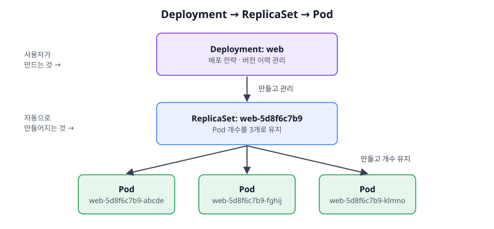
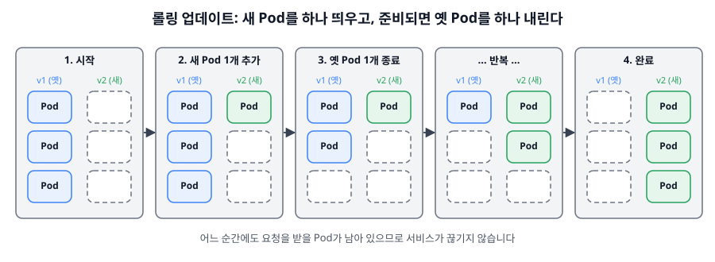

# 02. Deployment — Pod를 지키고, 늘리고, 무중단으로 바꾸는 관리자

**이 장을 마치면**

- Deployment, ReplicaSet, Pod의 관계를 설명할 수 있습니다.
- Pod가 죽었을 때 자동으로 복구되는 것을 확인하고, 개수를 늘리고 줄일 수 있습니다.
- 새 버전으로 무중단 업데이트하고, 문제가 생기면 이전 버전으로 되돌릴 수 있습니다.

---

## 1. 왜 필요한가

[01장](01-pod.md)에서 만든 Pod에는 치명적인 약점이 있습니다. **지우면 끝**이라는 점입니다.
노드가 고장 나거나 누가 실수로 삭제하면 아무도 되살려 주지 않습니다.

**Deployment(디플로이먼트)** 는 Pod를 대신 관리해 주는 관리자입니다.

| 기능 | 설명 |
|---|---|
| 개수 유지 | "3개 유지"라고 선언하면, 하나가 죽어도 자동으로 다시 만들어 3개를 맞춘다 |
| 스케일링 | 숫자만 바꾸면 Pod가 늘거나 줄어든다 |
| 롤링 업데이트 | 새 버전을 배포할 때 Pod를 하나씩 교체해서 서비스가 끊기지 않는다 |
| 롤백 | 새 버전에 문제가 있으면 이전 버전으로 되돌린다 |

실무에서는 **Pod를 직접 만들 일이 거의 없고, 대부분 Deployment로 만듭니다.**

## 2. 구조: Deployment → ReplicaSet → Pod



Deployment는 Pod를 직접 만들지 않습니다. **ReplicaSet**이라는 중간 관리자를 만들고, ReplicaSet이 Pod 개수를 유지합니다.
왜 한 단계를 더 두는지는 4절(롤링 업데이트)에서 알게 됩니다. 버전마다 ReplicaSet이 하나씩 생기기 때문입니다.

## 3. YAML 뜯어보기

([examples/02-deployment/deploy.yaml](../examples/02-deployment/deploy.yaml))

```yaml
apiVersion: apps/v1
kind: Deployment
metadata:
  name: web
spec:
  replicas: 3                  # Pod를 항상 3개로 유지
  selector:                    # 어떤 Pod가 내 관리 대상인지 레이블로 지정
    matchLabels:
      app: web
  template:                    # Pod를 찍어 낼 틀 (01장의 Pod YAML과 같은 모양)
    metadata:
      labels:
        app: web               # selector.matchLabels와 반드시 같아야 한다
    spec:
      containers:
      - name: nginx
        image: nginx:1.26-alpine
        ports:
        - containerPort: 80
```

`template` 아래는 01장의 Pod YAML에서 `apiVersion`, `kind`, `name`만 빠진 모습입니다.
Deployment는 이 틀로 Pod를 찍어 내고, **`app: web` 레이블이 붙은 Pod가 3개인지** 계속 셉니다. 01장에서 배운 레이블이 여기서 쓰입니다.

## 4. 실습 ① — 만들기와 자동 복구

### 4-1. 만들기

```bash
kubectl apply -f examples/02-deployment/deploy.yaml
kubectl rollout status deployment/web
```

```
deployment.apps/web created
Waiting for deployment "web" rollout to finish: 0 of 3 updated replicas are available...
Waiting for deployment "web" rollout to finish: 1 of 3 updated replicas are available...
Waiting for deployment "web" rollout to finish: 2 of 3 updated replicas are available...
deployment "web" successfully rolled out
```

`rollout status`는 배포가 끝날 때까지 진행 상황을 보여 줍니다.

세 종류의 리소스를 한 번에 조회해 봅니다.

```bash
kubectl get deployment,replicaset,pod
```

```
NAME                  READY   UP-TO-DATE   AVAILABLE   AGE
deployment.apps/web   3/3     3            3           8s

NAME                             DESIRED   CURRENT   READY   AGE
replicaset.apps/web-68dc48cd79   3         3         3       8s

NAME                       READY   STATUS    RESTARTS   AGE
pod/web-68dc48cd79-c4hzd   1/1     Running   0          8s
pod/web-68dc48cd79-ht26c   1/1     Running   0          8s
pod/web-68dc48cd79-kz47w   1/1     Running   0          8s
```

이름에 규칙이 있습니다.

```
web                    ← Deployment 이름
web-68dc48cd79         ← ReplicaSet = Deployment 이름 + Pod 틀(template)의 해시
web-68dc48cd79-c4hzd   ← Pod = ReplicaSet 이름 + 무작위 문자열
```

### 4-2. Pod를 지워 보기 (자동 복구)

Pod 하나를 골라 지웁니다. Pod 이름은 각자 출력에 나온 것으로 바꿔 넣으세요.

```text
kubectl delete pod web-68dc48cd79-c4hzd
```

```bash
kubectl get pod
```

```
NAME                   READY   STATUS    RESTARTS   AGE
web-68dc48cd79-ht26c   1/1     Running   0          11s
web-68dc48cd79-kz47w   1/1     Running   0          11s
web-68dc48cd79-tzgpf   1/1     Running   0          3s
```

지운 Pod 대신 **새 이름의 Pod**(`...-tzgpf`, `AGE` 3초)가 생겨서 다시 3개가 됐습니다.
누가 만들었는지는 ReplicaSet의 Events에 남아 있습니다.

```bash
kubectl describe replicaset -l app=web
```

```
Events:
  Type    Reason            Age   From                   Message
  ----    ------            ----  ----                   -------
  Normal  SuccessfulCreate  16s   replicaset-controller  Created pod: web-68dc48cd79-kz47w
  Normal  SuccessfulCreate  16s   replicaset-controller  Created pod: web-68dc48cd79-ht26c
  Normal  SuccessfulCreate  16s   replicaset-controller  Created pod: web-68dc48cd79-c4hzd
  Normal  SuccessfulCreate  8s    replicaset-controller  Created pod: web-68dc48cd79-tzgpf
```

[00장](00-시작하기-전에.md)의 "선언형" 그림 그대로입니다. 원하는 상태(3개)와 현재 상태(2개)가 다르니 컨트롤러가 1개를 더 만들었습니다.

### 4-3. 개수 늘리고 줄이기 (스케일링)

```bash
kubectl scale deployment web --replicas=5
kubectl get pod
```

```
NAME                   READY   STATUS              RESTARTS   AGE
web-68dc48cd79-ht26c   1/1     Running             0          21s
web-68dc48cd79-jr25b   0/1     ContainerCreating   0          5s
web-68dc48cd79-kz47w   1/1     Running             0          21s
web-68dc48cd79-rqr79   1/1     Running             0          5s
web-68dc48cd79-tzgpf   1/1     Running             0          13s
```

```bash
kubectl scale deployment web --replicas=3
kubectl get pod
```

다시 3개로 줄어듭니다. 사라지는 Pod는 잠깐 `Terminating`으로 보입니다.

> YAML 파일의 `replicas`를 고친 뒤 `kubectl apply`해도 결과는 같습니다. 실무에서는 변경 이력이 파일에 남는 이 방법을 더 권장합니다.

## 5. 실습 ② — 롤링 업데이트

nginx를 1.26에서 1.27로 올려 봅니다. Pod를 한꺼번에 바꾸면 그동안 서비스가 끊깁니다.
Deployment는 **새 Pod를 하나 띄우고, 준비되면 옛 Pod를 하나 내리는** 방식으로 교체합니다.



### 5-1. 이력에 메모 남기기

나중에 이력을 볼 때 알아보기 쉽도록, 지금 버전에 설명을 붙여 둡니다.

```bash
kubectl annotate deployment web kubernetes.io/change-cause="nginx 1.26 최초 배포"
```

### 5-2. 이미지 바꾸기

```bash
kubectl set image deployment/web nginx=nginx:1.27-alpine
kubectl rollout status deployment/web
```

```
deployment.apps/web image updated
Waiting for deployment "web" rollout to finish: 1 out of 3 new replicas have been updated...
Waiting for deployment "web" rollout to finish: 2 out of 3 new replicas have been updated...
Waiting for deployment "web" rollout to finish: 1 old replicas are pending termination...
deployment "web" successfully rolled out
```

`nginx=nginx:1.27-alpine`은 "`nginx`라는 이름의 컨테이너 이미지를 `nginx:1.27-alpine`으로 바꿔라"는 뜻입니다.

```bash
kubectl annotate deployment web kubernetes.io/change-cause="nginx 1.27로 업데이트"
```

### 5-3. 무슨 일이 일어났나

```bash
kubectl get replicaset -o wide
```

```
NAME             DESIRED   CURRENT   READY   AGE   CONTAINERS   IMAGES              SELECTOR
web-68dc48cd79   0         0         0       29s   nginx        nginx:1.26-alpine   app=web,pod-template-hash=68dc48cd79
web-6b5cb6d6fb   3         3         3       4s    nginx        nginx:1.27-alpine   app=web,pod-template-hash=6b5cb6d6fb
```

**ReplicaSet이 2개**가 됐습니다. 옛 버전(1.26)의 ReplicaSet은 Pod 0개로 남아 있고, 새 버전(1.27)의 ReplicaSet이 3개를 가지고 있습니다.
옛 ReplicaSet을 지우지 않고 남겨 두는 이유는 **롤백할 때 쓰기 위해서**입니다.

교체 과정은 Deployment의 Events에 그대로 기록되어 있습니다.

```bash
kubectl describe deployment web
```

```
Events:
  Type    Reason             Age   From                   Message
  ----    ------             ----  ----                   -------
  ...
  Normal  ScalingReplicaSet  4s    deployment-controller  Scaled up replica set web-6b5cb6d6fb to 1
  Normal  ScalingReplicaSet  3s    deployment-controller  Scaled down replica set web-68dc48cd79 to 2 from 3
  Normal  ScalingReplicaSet  3s    deployment-controller  Scaled up replica set web-6b5cb6d6fb to 2 from 1
  Normal  ScalingReplicaSet  1s    deployment-controller  Scaled down replica set web-68dc48cd79 to 1 from 2
  Normal  ScalingReplicaSet  1s    deployment-controller  Scaled up replica set web-6b5cb6d6fb to 3 from 2
  Normal  ScalingReplicaSet  0s    deployment-controller  Scaled down replica set web-68dc48cd79 to 0 from 1
```

새 ReplicaSet은 1 → 2 → 3으로 늘고, 옛 ReplicaSet은 3 → 2 → 1 → 0으로 줄었습니다. 위 그림과 같은 순서입니다.

### 5-4. 이력 보기

```bash
kubectl rollout history deployment/web
```

```
deployment.apps/web
REVISION  CHANGE-CAUSE
1         nginx 1.26 최초 배포
2         nginx 1.27로 업데이트
```

## 6. 고장 내고 고쳐 보기 — 잘못된 버전 배포와 롤백

### 6-1. 존재하지 않는 버전으로 업데이트

```bash
kubectl set image deployment/web nginx=nginx:9.99-nope
kubectl annotate deployment web kubernetes.io/change-cause="nginx 9.99로 업데이트 (잘못된 태그)"
kubectl rollout status deployment/web --timeout=30s
```

```
deployment.apps/web image updated
Waiting for deployment "web" rollout to finish: 1 out of 3 new replicas have been updated...
error: timed out waiting for the condition
```

배포가 끝나지 않습니다. 상태를 봅니다.

```bash
kubectl get deployment web
kubectl get replicaset
kubectl get pod
```

```
NAME   READY   UP-TO-DATE   AVAILABLE   AGE
web    3/3     1            3           60s

NAME             DESIRED   CURRENT   READY   AGE
web-68dc48cd79   0         0         0       60s
web-6b5cb6d6fb   3         3         3       35s
web-7fdcf8dc64   1         1         0       30s

NAME                   READY   STATUS             RESTARTS   AGE
web-6b5cb6d6fb-7xrxg   1/1     Running            0          35s
web-6b5cb6d6fb-jbfhk   1/1     Running            0          34s
web-6b5cb6d6fb-lffpx   1/1     Running            0          32s
web-7fdcf8dc64-k2sg2   0/1     ImagePullBackOff   0          30s
```

**여기서 꼭 봐야 할 것:** 새 Pod는 `ImagePullBackOff`로 실패했지만, **기존 Pod 3개는 그대로 `Running`** 입니다.
롤링 업데이트는 새 Pod가 준비되어야 옛 Pod를 내리기 때문에, 잘못된 버전을 배포해도 서비스는 계속됩니다.

<details><summary>원인 확인 방법</summary>

01장에서 본 것과 같습니다. 실패한 Pod를 `describe`합니다. (Pod 이름은 각자 출력에 맞게 바꾸세요)

```text
kubectl describe pod web-7fdcf8dc64-k2sg2
```

```
  Warning  Failed  9s (x2 over 24s)  kubelet  Failed to pull image "nginx:9.99-nope": ... docker.io/library/nginx:9.99-nope: not found
```

</details>

### 6-2. 롤백

```bash
kubectl rollout undo deployment/web
kubectl rollout status deployment/web
```

```
deployment.apps/web rolled back
deployment "web" successfully rolled out
```

```bash
kubectl get deployment web -o wide
kubectl get pod
```

```
NAME   READY   UP-TO-DATE   AVAILABLE   AGE   CONTAINERS   IMAGES              SELECTOR
web    3/3     3            3           61s   nginx        nginx:1.27-alpine   app=web

NAME                   READY   STATUS    RESTARTS   AGE
web-6b5cb6d6fb-7xrxg   1/1     Running   0          36s
web-6b5cb6d6fb-jbfhk   1/1     Running   0          35s
web-6b5cb6d6fb-lffpx   1/1     Running   0          33s
```

이미지가 `nginx:1.27-alpine`으로 돌아왔고, 실패하던 Pod는 사라졌습니다.

### 6-3. 특정 버전으로 되돌리기

```bash
kubectl rollout history deployment/web
```

```
REVISION  CHANGE-CAUSE
1         nginx 1.26 최초 배포
3         nginx 9.99로 업데이트 (잘못된 태그)
4         nginx 1.27로 업데이트
```

롤백도 하나의 새 배포입니다. 그래서 2번이 사라지고 같은 내용이 **4번**으로 다시 등록됐습니다.

`undo`는 기본적으로 바로 이전 버전으로 돌아갑니다. 특정 번호로 돌아가려면 `--to-revision`을 씁니다.

```bash
# 1번이 어떤 내용이었는지 확인
kubectl rollout history deployment/web --revision=1

# 1번(nginx 1.26)으로 되돌리기
kubectl rollout undo deployment/web --to-revision=1
kubectl rollout status deployment/web
kubectl get deployment web -o wide
```

```
NAME   READY   UP-TO-DATE   AVAILABLE   AGE   CONTAINERS   IMAGES              SELECTOR
web    3/3     3            3           65s   nginx        nginx:1.26-alpine   app=web
```

### 6-4. 고장 ② — selector와 template 레이블이 다르면?

3절에서 "`selector.matchLabels`와 `template`의 레이블은 반드시 같아야 한다"고 했습니다. 다르게 쓰면 어떻게 될까요?
([examples/02-deployment/deploy-label-mismatch.yaml](../examples/02-deployment/deploy-label-mismatch.yaml))

```bash
kubectl apply -f examples/02-deployment/deploy-label-mismatch.yaml
```

```
The Deployment "web-mismatch" is invalid: spec.template.metadata.labels: Invalid value: map[string]string{"app":"web-mismatsh"}: `selector` does not match template `labels`
```

이번에는 Pod가 실패하는 것이 아니라 **생성 자체가 거부**됩니다. 자기가 만든 Pod를 자기가 찾지 못하는 Deployment는 의미가 없기 때문입니다.
오류 메시지에 원인(`selector does not match template labels`)이 그대로 적혀 있습니다. 아무것도 만들어지지 않았으므로 치울 것도 없습니다.

## 7. 알아 두면 좋은 것

**Pod를 전부 새로 띄우고 싶을 때** — 이미지는 그대로 두고 재시작만 하고 싶다면 `rollout restart`를 씁니다. 이것도 롤링 방식이라 서비스가 끊기지 않습니다.

```bash
kubectl rollout restart deployment/web
kubectl rollout status deployment/web
```

**한 번에 몇 개씩 교체할지** — `kubectl describe deployment web`에 이런 줄이 있습니다.

```
StrategyType:           RollingUpdate
RollingUpdateStrategy:  25% max unavailable, 25% max surge
```

- `max surge`: 교체 중에 `replicas`보다 **더 띄울 수 있는** Pod 수 (3개의 25% → 올림해서 1개)
- `max unavailable`: 교체 중에 **모자라도 되는** Pod 수 (3개의 25% → 내림해서 0개)

그래서 6-1에서 새 Pod가 1개만 생겼고, 옛 Pod는 하나도 줄지 않았던 것입니다.

## 8. 정리

```bash
kubectl delete -f examples/02-deployment/deploy.yaml
kubectl get all
```

```
No resources found in edu-lab namespace.
```

Deployment를 지우면 그 아래의 ReplicaSet과 Pod도 함께 지워집니다.

## 핵심 요약

- Deployment → ReplicaSet → Pod. 사용자는 Deployment만 만든다.
- Pod가 사라지면 ReplicaSet이 개수를 다시 맞춘다.
- 이미지를 바꾸면 새 ReplicaSet이 생기고 Pod가 하나씩 교체된다(롤링 업데이트).
- 잘못된 버전을 배포해도 기존 Pod는 유지된다. `rollout undo`로 되돌린다.

| 자주 쓰는 명령 | 용도 |
|---|---|
| `kubectl rollout status deployment/이름` | 배포 진행 상황 |
| `kubectl scale deployment 이름 --replicas=N` | 개수 조절 |
| `kubectl set image deployment/이름 컨테이너=이미지` | 이미지 변경 |
| `kubectl rollout history deployment/이름` | 배포 이력 |
| `kubectl rollout undo deployment/이름 [--to-revision=N]` | 롤백 |
| `kubectl rollout restart deployment/이름` | 전체 Pod 재시작 |

## 확인 문제

1. Deployment가 관리하는 Pod 하나를 `kubectl delete pod`로 지우면 어떻게 되나요?
2. 이미지를 바꾼 뒤 ReplicaSet이 2개 보이는 이유는 무엇인가요?
3. 존재하지 않는 이미지로 업데이트했을 때 기존 Pod가 그대로 남아 있던 이유는 무엇인가요?
4. Deployment로 만든 Pod를 완전히 없애려면 무엇을 지워야 하나요?

<details><summary>정답 보기</summary>

1. ReplicaSet이 개수가 모자란 것을 발견하고 새 Pod를 만듭니다. 이름과 IP는 새로 정해집니다.
2. 버전(Pod 틀)마다 ReplicaSet이 하나씩 만들어지기 때문입니다. 옛 ReplicaSet은 Pod 0개로 남아 롤백에 쓰입니다.
3. 롤링 업데이트는 새 Pod가 준비(Ready)되어야 옛 Pod를 내립니다. 새 Pod가 준비되지 못했으므로 옛 Pod가 유지됐습니다.
4. Deployment를 지워야 합니다. Pod만 지우면 다시 만들어집니다.
</details>

---

다음 장: [03. Service — 바뀌는 Pod IP 대신 고정 주소로](03-service.md)
