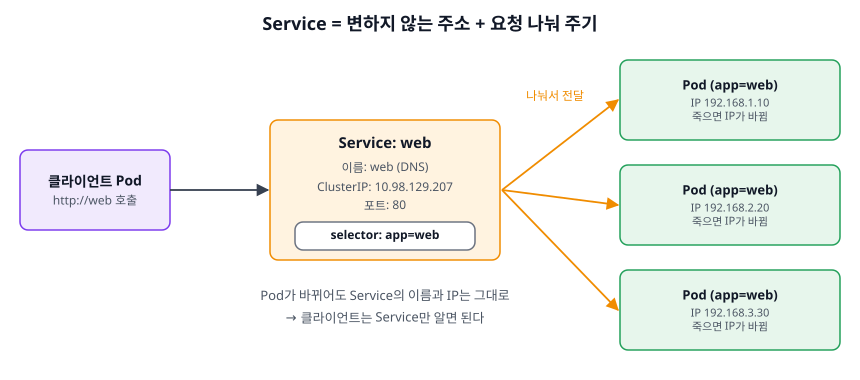
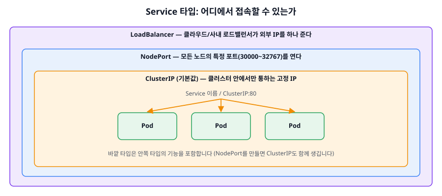
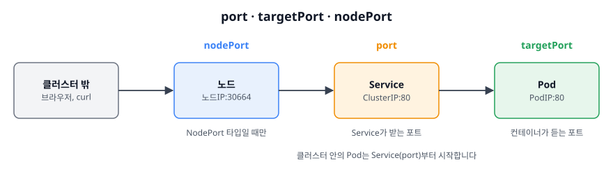

# 03. Service — 바뀌는 Pod IP 대신 고정 주소로

**이 장을 마치면**

- Service가 왜 필요한지, 어떻게 Pod를 찾아내는지 설명할 수 있습니다.
- Service 이름으로 Pod에 접속하고, 요청이 여러 Pod에 나뉘는 것을 확인할 수 있습니다.
- "Service를 만들었는데 접속이 안 돼요"의 대표 원인 두 가지를 찾아낼 수 있습니다.

---

## 1. 왜 필요한가

지금까지 배운 것만으로는 두 가지 문제가 남습니다.

- **Pod IP는 바뀐다.** Pod가 다시 만들어질 때마다 IP가 달라집니다 ([01장](01-pod.md)에서 확인).
- **Pod가 여러 개다.** Deployment로 3개를 띄우면 IP도 3개인데, 어디로 접속해야 할까요?

**Service(서비스)** 는 Pod들 앞에 놓는 **고정된 주소**입니다. 클라이언트는 Service의 이름만 알면 되고,
Service가 뒤에 있는 Pod 중 하나로 요청을 넘겨줍니다.



Service가 Pod를 찾는 방법은 [01장](01-pod.md)에서 배운 **레이블**입니다.
`selector: app=web`이라고 적으면, 그 레이블이 붙은 Pod가 생기고 사라질 때마다 전달 대상 목록이 자동으로 갱신됩니다.
이 목록을 **엔드포인트(Endpoints)** 라고 부릅니다.

> **비유**: 회사 대표번호와 같습니다. 고객은 대표번호(Service)만 알면 되고, 전화는 자리에 있는 상담원(Pod) 중 한 명에게 연결됩니다.
> 상담원이 바뀌어도 대표번호는 그대로입니다.

## 2. Service 타입

"어디에서 접속할 수 있게 할 것인가"에 따라 타입을 고릅니다.



| 타입 | 접속할 수 있는 곳 | 주로 쓰는 곳 |
|---|---|---|
| **ClusterIP** (기본값) | 클러스터 안의 Pod | 내부 서비스끼리 통신 (가장 많이 씀) |
| **NodePort** | 클러스터 밖 → `노드IP:포트` | 테스트, 간단한 외부 노출 |
| **LoadBalancer** | 클러스터 밖 → 전용 외부 IP | 클라우드 등 로드밸런서가 제공되는 환경 |
| ExternalName | (특수) 외부 도메인에 내부 별명을 붙임 | 클러스터 밖 DB 등을 내부 이름으로 부를 때 |

이 장에서는 ClusterIP와 NodePort를 실습합니다. HTTP 서비스를 외부에 공개하는 더 일반적인 방법은 [10장 Ingress](10-ingress.md)에서 다룹니다.

## 3. YAML 뜯어보기

([examples/03-service/svc-clusterip.yaml](../examples/03-service/svc-clusterip.yaml))

```yaml
apiVersion: v1
kind: Service
metadata:
  name: web                # 이 이름이 곧 접속 주소(DNS 이름)가 된다
spec:
  type: ClusterIP          # 생략해도 기본값은 ClusterIP
  selector:
    app: web               # 이 레이블이 붙은 Pod들에게 요청을 나눠 보낸다
  ports:
  - port: 80               # Service가 받는 포트
    targetPort: 80         # Pod(컨테이너)로 전달할 포트
```

포트가 여러 개 나와서 헷갈리기 쉽습니다. 요청이 지나가는 순서대로 보면 됩니다.



## 4. 실습 ① — ClusterIP Service

### 4-1. 준비: 웹 서버 3대

요청을 받으면 **자기 Pod 이름**을 응답하는 웹 서버를 3개 띄웁니다. 어느 Pod가 응답했는지 눈으로 구분하기 위해서입니다.
([examples/03-service/deploy.yaml](../examples/03-service/deploy.yaml))

```bash
kubectl apply -f examples/03-service/deploy.yaml
kubectl rollout status deployment/web
kubectl get pod -o wide
```

```
NAME                   READY   STATUS    RESTARTS   AGE   IP                NODE         NOMINATED NODE   READINESS GATES
web-6559ffcc49-2dmck   1/1     Running   0          2s    192.168.96.102    oks5.dd.io   <none>           <none>
web-6559ffcc49-gbzpm   1/1     Running   0          2s    192.168.139.104   oks4.dd.io   <none>           <none>
web-6559ffcc49-jvws6   1/1     Running   0          2s    192.168.30.230    oks2.dd.io   <none>           <none>
```

### 4-2. Service 만들기

```bash
kubectl apply -f examples/03-service/svc-clusterip.yaml
kubectl get service web
```

```
NAME   TYPE        CLUSTER-IP      EXTERNAL-IP   PORT(S)   AGE
web    ClusterIP   10.98.129.207   <none>        80/TCP    0s
```

Service에 고정 IP(`CLUSTER-IP`)가 생겼습니다. 이 Service가 어떤 Pod들을 찾았는지 봅니다.

```bash
kubectl get endpoints web
```

```
NAME   ENDPOINTS                                                AGE
web    192.168.139.104:80,192.168.30.230:80,192.168.96.102:80   0s
```

4-1에서 본 Pod IP 3개가 그대로 들어 있습니다. **"selector에 맞는 Pod의 IP 목록"이 엔드포인트**입니다.

### 4-3. Service로 접속하기

클러스터 안에서 요청을 보낼 클라이언트 Pod를 하나 띄워 둡니다. 이 장이 끝날 때까지 계속 씁니다.

```bash
kubectl run client --image=busybox:1.36 --restart=Never -- sleep 3600
kubectl wait --for=condition=Ready pod/client --timeout=60s
```

Service 이름 `web`으로 6번 요청합니다.

```bash
kubectl exec client -- sh -c 'for i in 1 2 3 4 5 6; do wget -qO- http://web; done'
```

```
web-6559ffcc49-gbzpm
web-6559ffcc49-2dmck
web-6559ffcc49-jvws6
web-6559ffcc49-2dmck
web-6559ffcc49-gbzpm
web-6559ffcc49-jvws6
```

- IP를 하나도 쓰지 않고 **이름 `web`만으로** 접속했습니다.
- 응답하는 Pod가 매번 다릅니다. Service가 요청을 **나눠 주고(로드밸런싱)** 있습니다. 순서는 무작위입니다.

### 4-4. 이름은 어떻게 IP가 되나 (DNS)

클러스터 안에는 DNS 서버가 있어서, Service를 만들면 이름이 자동으로 등록됩니다.

```bash
kubectl exec client -- nslookup web.edu-lab.svc.cluster.local
```

```
Server:		10.96.0.10
Address:	10.96.0.10:53

Name:	web.edu-lab.svc.cluster.local
Address: 10.98.129.207
```

Service의 정식 이름은 **`서비스이름.네임스페이스.svc.cluster.local`** 입니다.

| 어디서 부르나 | 쓸 수 있는 이름 |
|---|---|
| 같은 네임스페이스의 Pod | `web` |
| 다른 네임스페이스의 Pod | `web.edu-lab` (또는 전체 이름 `web.edu-lab.svc.cluster.local`) |

> 네임스페이스 이름을 `edu-lab`이 아닌 다른 것으로 만들었다면 위 명령의 `edu-lab` 부분을 바꿔서 실행하세요.

### 4-5. Pod가 바뀌어도 Service는 그대로

Pod 하나를 지워 봅니다. (이름은 각자 출력에 맞게 바꾸세요)

```text
kubectl delete pod web-6559ffcc49-2dmck
```

```bash
kubectl get pod -l app=web -o wide
kubectl get endpoints web
```

```
NAME                   READY   STATUS    RESTARTS   AGE   IP                NODE         NOMINATED NODE   READINESS GATES
web-6559ffcc49-gbzpm   1/1     Running   0          14s   192.168.139.104   oks4.dd.io   <none>           <none>
web-6559ffcc49-jvws6   1/1     Running   0          14s   192.168.30.230    oks2.dd.io   <none>           <none>
web-6559ffcc49-q6k2k   1/1     Running   0          5s    192.168.96.104    oks5.dd.io   <none>           <none>

NAME   ENDPOINTS                                                AGE
web    192.168.139.104:80,192.168.30.230:80,192.168.96.104:80   12s
```

새 Pod(`...-q6k2k`)의 IP `192.168.96.104`가 엔드포인트에 **자동으로** 들어왔고, 지워진 Pod의 IP는 빠졌습니다.
클라이언트는 아무것도 바꿀 필요가 없습니다.

```bash
kubectl exec client -- sh -c 'for i in 1 2 3 4 5 6; do wget -qO- http://web; done'
```

## 5. 실습 ② — NodePort로 클러스터 밖에서 접속하기

ClusterIP는 클러스터 안에서만 통합니다. 밖에서 접속하려면 NodePort 타입을 씁니다.
([examples/03-service/svc-nodeport.yaml](../examples/03-service/svc-nodeport.yaml))

```yaml
spec:
  type: NodePort           # 모든 노드의 특정 포트를 열어 클러스터 밖에서 접속할 수 있게 한다
  selector:
    app: web
  ports:
  - port: 80
    targetPort: 80
    # nodePort: 30080      # 생략하면 30000~32767 중 빈 포트가 자동으로 배정된다
```

```bash
kubectl apply -f examples/03-service/svc-nodeport.yaml
kubectl get service
```

```
NAME           TYPE        CLUSTER-IP      EXTERNAL-IP   PORT(S)        AGE
web            ClusterIP   10.98.129.207   <none>        80/TCP         17s
web-nodeport   NodePort    10.98.193.181   <none>        80:30664/TCP   0s
```

`80:30664`는 "**모든 노드의 30664번 포트**로 들어온 요청을 Service의 80번으로 보낸다"는 뜻입니다. 포트 번호는 환경마다 다릅니다.

노드 IP를 확인하고, 이번에는 Pod 안이 아니라 **내 터미널에서** 직접 접속합니다.

```bash
kubectl get nodes -o wide
```

```text
# <노드IP>와 <포트>를 각자 값으로 바꿔서 실행 (예: curl http://10.0.1.182:30664)
curl http://<노드IP>:<포트>
```

```
web-6559ffcc49-jvws6
```

**어느 노드의 IP로 접속해도** 됩니다. 그 노드에 Pod가 없더라도 Pod가 있는 노드로 전달됩니다. 다른 노드 IP로도 시도해 보세요.

```bash
kubectl delete service web-nodeport
```

## 6. 고장 내고 고쳐 보기

"Service를 만들었는데 접속이 안 돼요"의 원인은 대부분 아래 둘 중 하나입니다.

### 6-1. 고장 ① — 접속이 안 된다

```bash
kubectl apply -f examples/03-service/svc-broken-selector.yaml
sleep 2
kubectl exec client -- wget -qO- -T 3 http://web
```

```
wget: can't connect to remote host (10.98.129.207): Connection refused
command terminated with exit code 1
```

이름은 IP로 바뀌었는데(`10.98.129.207`) 연결이 거부됩니다. 4-2에서 했던 확인을 다시 해 봅니다.

```bash
kubectl get endpoints web
```

```
NAME   ENDPOINTS   AGE
web    <none>      18s
```

엔드포인트가 **비어 있습니다.** Service가 Pod를 하나도 찾지 못했다는 뜻입니다. Service의 selector와 Pod의 레이블을 비교합니다.

```bash
kubectl get service web -o wide
kubectl get pod --show-labels
```

```
NAME   TYPE        CLUSTER-IP      EXTERNAL-IP   PORT(S)   AGE   SELECTOR
web    ClusterIP   10.98.129.207   <none>        80/TCP    18s   app=wbe

NAME                   READY   STATUS    RESTARTS   AGE   LABELS
client                 1/1     Running   0          18s   run=client
web-6559ffcc49-dq5w9   1/1     Running   0          3s    app=web,pod-template-hash=6559ffcc49
...
```

<details><summary>원인과 해결 방법</summary>

Service의 selector는 `app=wbe`, Pod의 레이블은 `app=web`입니다. 오타 때문에 일치하는 Pod가 없습니다.
Service를 만들 때는 **오류가 나지 않습니다.** "지금은 맞는 Pod가 없지만 나중에 생길 수도 있다"고 보기 때문입니다. 그래서 더 찾기 어렵습니다.

올바른 YAML을 다시 적용합니다.

```bash
kubectl apply -f examples/03-service/svc-clusterip.yaml
sleep 2
kubectl get endpoints web
kubectl exec client -- wget -qO- -T 3 http://web
```

```
NAME   ENDPOINTS                                                AGE
web    192.168.139.104:80,192.168.30.235:80,192.168.96.103:80   18s
web-6559ffcc49-gbzpm
```

</details>

### 6-2. 고장 ② — 이번에도 접속이 안 된다

```bash
kubectl apply -f examples/03-service/svc-broken-port.yaml
sleep 2
kubectl exec client -- wget -qO- -T 3 http://web
```

```
wget: can't connect to remote host (10.98.129.207): Connection refused
command terminated with exit code 1
```

증상은 같습니다. 엔드포인트를 봅니다.

```bash
kubectl get endpoints web
```

```
NAME   ENDPOINTS                                                      AGE
web    192.168.139.104:8080,192.168.30.235:8080,192.168.96.103:8080   20s
```

<details><summary>원인과 해결 방법</summary>

이번에는 엔드포인트가 있습니다. Pod는 제대로 찾았습니다. 그런데 포트가 **8080**입니다.
nginx는 80번에서 듣고 있는데, Service가 8080번으로 요청을 넘기니 받아 줄 프로그램이 없습니다.

```bash
kubectl describe service web
```

```
Port:              <unset>  80/TCP
TargetPort:        8080/TCP
Endpoints:         192.168.139.104:8080,192.168.30.235:8080,192.168.96.103:8080
```

`targetPort`는 **컨테이너가 실제로 듣는 포트**와 같아야 합니다. 올바른 YAML을 다시 적용합니다.

```bash
kubectl apply -f examples/03-service/svc-clusterip.yaml
sleep 2
kubectl exec client -- wget -qO- -T 3 http://web
```

</details>

### 6-3. Service 문제 해결 순서

| 순서 | 확인할 것 | 명령 |
|---|---|---|
| 1 | 엔드포인트가 있는가? | `kubectl get endpoints 이름` |
| 2 | 비어 있다면 → selector와 Pod 레이블이 같은가? Pod가 `Running`이고 `READY`인가? | `kubectl get svc 이름 -o wide`, `kubectl get pod --show-labels` |
| 3 | 있다면 → `targetPort`가 컨테이너 포트와 같은가? | `kubectl describe svc 이름` |

## 7. 알아 두면 좋은 것

**명령 한 줄로 Service 만들기** — YAML 없이 `expose`로도 만들 수 있습니다. 결과는 같습니다.

```text
kubectl expose deployment web --port=80 --target-port=80 --name=web
```

**ExternalName** — 클러스터 밖의 주소에 내부 별명을 붙입니다. 아래처럼 만들면 Pod들은 `legacy-db`라는 이름으로 `db.example.com`에 접속할 수 있습니다.
외부 주소가 바뀌어도 Service만 고치면 되므로 앱 설정을 건드리지 않아도 됩니다.

```yaml
apiVersion: v1
kind: Service
metadata:
  name: legacy-db
spec:
  type: ExternalName
  externalName: db.example.com
```

## 8. 정리

```bash
kubectl delete pod client
kubectl delete -f examples/03-service/deploy.yaml -f examples/03-service/svc-clusterip.yaml
```

## 핵심 요약

- Service는 Pod들 앞에 놓는 고정 주소(이름 + ClusterIP)이고, 요청을 Pod들에게 나눠 준다.
- Service는 **selector(레이블)** 로 Pod를 찾는다. 찾은 결과가 **엔드포인트**다.
- 같은 네임스페이스에서는 Service 이름만으로 접속한다.
- ClusterIP는 클러스터 안에서만, NodePort는 `노드IP:포트`로 밖에서도 접속할 수 있다.
- 접속이 안 되면 **엔드포인트부터** 확인한다.

## 확인 문제

1. Service는 요청을 보낼 Pod를 무엇으로 찾나요?
2. `kubectl get endpoints`의 결과가 `<none>`이면 무엇을 의심해야 하나요?
3. `port: 80`, `targetPort: 8080`인 Service가 있습니다. 컨테이너는 몇 번 포트에서 듣고 있어야 하나요?
4. `default` 네임스페이스의 Pod가 `edu-lab` 네임스페이스의 `web` Service를 부르려면 어떤 이름을 써야 하나요?

<details><summary>정답 보기</summary>

1. `selector`에 적힌 레이블입니다. 그 레이블이 붙어 있고 준비된(Ready) Pod가 전달 대상이 됩니다.
2. selector와 Pod 레이블이 일치하지 않거나, 일치하는 Pod가 아직 준비되지 않은 경우입니다.
3. 8080번입니다. `port`는 Service가 받는 포트, `targetPort`는 컨테이너가 듣는 포트입니다.
4. `web.edu-lab` 또는 `web.edu-lab.svc.cluster.local`입니다. `web`만 쓰면 자기 네임스페이스(`default`)에서 찾습니다.
</details>

---

다음 장: [04. ConfigMap — 설정을 이미지와 분리하기](04-configmap.md)
