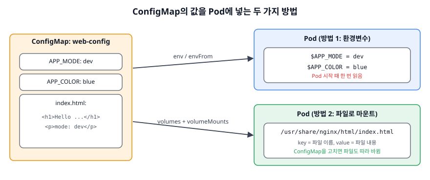

# 04. ConfigMap — 설정을 이미지와 분리하기

**이 장을 마치면**

- 설정을 이미지와 분리해야 하는 이유를 설명할 수 있습니다.
- ConfigMap의 값을 환경변수와 파일, 두 가지 방법으로 Pod에 넣을 수 있습니다.
- ConfigMap을 수정했을 때 Pod에 언제 반영되는지 알고 있습니다.

---

## 1. 왜 필요한가

앱에는 환경마다 달라지는 값이 있습니다. DB 주소, 로그 레벨, 기능 켜고 끄기 같은 것들입니다.
이런 값을 이미지 안에 넣어 버리면 **개발용 이미지, 운영용 이미지를 따로** 만들어야 하고, 값 하나 바꾸려고 이미지를 다시 빌드해야 합니다.

**ConfigMap(컨피그맵)** 은 설정값을 담아 두는 리소스입니다. 이미지는 하나만 만들고, 설정은 ConfigMap으로 바깥에서 넣어 줍니다.

> **Python에 비유하면**: 코드에 `DB_HOST = "10.0.0.5"`라고 박아 넣는 대신 `os.environ["DB_HOST"]`나 `config.yaml`에서 읽는 것과 같습니다.
> ConfigMap은 그 환경변수와 설정 파일을 쿠버네티스가 대신 준비해 주는 장치입니다.

ConfigMap의 값을 Pod에 넣는 방법은 두 가지입니다.



| 방법 | 언제 쓰나 | ConfigMap을 수정하면 |
|---|---|---|
| 환경변수 | 짧은 값 (모드, 주소, 숫자) | 실행 중인 Pod에는 **반영되지 않음** (재시작 필요) |
| 파일로 마운트 | 설정 파일 전체 (`nginx.conf`, `application.yaml` 등) | 잠시 뒤 파일이 **자동으로 바뀜** |

## 2. ConfigMap 만들기

([examples/04-configmap/cm.yaml](../examples/04-configmap/cm.yaml))

```yaml
apiVersion: v1
kind: ConfigMap
metadata:
  name: web-config
data:                        # key: value 모음. 값은 모두 문자열이다
  APP_MODE: dev
  APP_COLOR: blue
  index.html: |              # '|' 아래 여러 줄이 통째로 하나의 값 (파일 내용)
    <h1>Hello from ConfigMap</h1>
    <p>mode: dev</p>
```

`data` 아래에 짧은 값(`APP_MODE`)도, 파일 내용 전체(`index.html`)도 넣을 수 있습니다.

```bash
kubectl apply -f examples/04-configmap/cm.yaml
kubectl describe configmap web-config
```

```
Name:         web-config
Namespace:    edu-lab

Data
====
APP_COLOR:
----
blue
APP_MODE:
----
dev
index.html:
----
<h1>Hello from ConfigMap</h1>
<p>mode: dev</p>
```

> `kubectl get configmap`을 하면 만들지 않은 `kube-root-ca.crt` 같은 것도 보입니다. 쿠버네티스가 네임스페이스마다 자동으로 넣어 주는 것이니 그대로 두면 됩니다.

## 3. 실습 ① — 환경변수로 넣기

([examples/04-configmap/pod-env.yaml](../examples/04-configmap/pod-env.yaml))

```yaml
spec:
  containers:
  - name: app
    image: busybox:1.36
    command: ["sleep", "3600"]
    env:                           # 방법 1: key 하나를 골라서, 원하는 변수 이름으로
    - name: COLOR                  #   컨테이너 안에서 보일 환경변수 이름
      valueFrom:
        configMapKeyRef:
          name: web-config         #   ConfigMap 이름
          key: APP_COLOR           #   가져올 key
    envFrom:                       # 방법 2: ConfigMap의 모든 key를 한꺼번에
    - configMapRef:
        name: web-config
```

- **`env` + `configMapKeyRef`**: key를 하나씩 골라 오고, 변수 이름도 바꿀 수 있습니다 (`APP_COLOR` → `COLOR`).
- **`envFrom`**: ConfigMap의 key 전부가 그 이름 그대로 환경변수가 됩니다.

```bash
kubectl apply -f examples/04-configmap/pod-env.yaml
kubectl wait --for=condition=Ready pod/env-demo --timeout=60s
kubectl exec env-demo -- env | grep -E 'COLOR|APP_'
```

```
COLOR=blue
APP_MODE=dev
APP_COLOR=blue
```

`COLOR`는 `env`로 하나만 가져온 것이고, `APP_MODE`와 `APP_COLOR`는 `envFrom`으로 한꺼번에 들어온 것입니다.

## 4. 실습 ② — 파일로 넣기

이번에는 ConfigMap의 `index.html`을 nginx의 웹 문서 디렉터리에 **파일로** 넣습니다.
([examples/04-configmap/deploy-volume.yaml](../examples/04-configmap/deploy-volume.yaml))

```yaml
    spec:
      containers:
      - name: nginx
        image: nginx:1.27-alpine
        envFrom:                             # 환경변수로도 넣어 둔다 (5절 비교 실습용)
        - configMapRef:
            name: web-config
        volumeMounts:
        - name: html                         # 아래 volumes의 이름과 연결
          mountPath: /usr/share/nginx/html   # 이 디렉터리에 파일이 나타난다
      volumes:
      - name: html
        configMap:
          name: web-config
          items:                             # 이 key만 파일로 만든다 (생략하면 모든 key가 파일이 된다)
          - key: index.html
            path: index.html                 # 만들어질 파일 이름
```

두 부분이 짝을 이룹니다. **`volumes`** 는 "ConfigMap을 볼륨으로 준비한다"이고, **`volumeMounts`** 는 "그 볼륨을 컨테이너의 이 경로에 붙인다"입니다. 둘은 `name: html`로 연결됩니다.
이 `volumes` / `volumeMounts` 구조는 [05장 Secret](05-secret.md), [06장 PV/PVC](06-pv-pvc.md)에서도 똑같이 쓰입니다.

```bash
kubectl apply -f examples/04-configmap/deploy-volume.yaml
kubectl rollout status deployment/web

kubectl exec deploy/web -- ls -l /usr/share/nginx/html
kubectl exec deploy/web -- wget -qO- http://127.0.0.1/
```

```
total 0
lrwxrwxrwx    1 root     root            17 Nov 20 10:24 index.html -> ..data/index.html

<h1>Hello from ConfigMap</h1>
<p>mode: dev</p>
```

이미지에는 없던 `index.html`이 생겼고, nginx가 그 내용을 응답합니다. **이미지는 그대로 두고 내용만 바깥에서 넣은 것**입니다.

> `kubectl exec deploy/web`처럼 Deployment 이름을 쓰면, 그 Deployment의 Pod 중 하나를 알아서 골라 줍니다. Pod 이름을 복사하지 않아도 되어 편리합니다.

ConfigMap으로 마운트한 파일은 읽기 전용입니다. 컨테이너 안에서 고칠 수 없습니다.

```bash
kubectl exec deploy/web -- sh -c 'echo test > /usr/share/nginx/html/index.html'
```

```
sh: can't create /usr/share/nginx/html/index.html: Read-only file system
command terminated with exit code 1
```

## 5. 실습 ③ — ConfigMap을 수정하면?

지금 `web` Pod는 같은 ConfigMap을 **환경변수**(`APP_MODE`)와 **파일**(`index.html`) 두 방식으로 모두 받고 있습니다.
ConfigMap의 값을 `dev` → `prod`로 바꾸고 각각 어떻게 되는지 봅니다. ([examples/04-configmap/cm-v2.yaml](../examples/04-configmap/cm-v2.yaml))

```bash
kubectl apply -f examples/04-configmap/cm-v2.yaml
```

조금 기다린 뒤(길면 1분 정도) 확인합니다.

```bash
# 파일
kubectl exec deploy/web -- wget -qO- http://127.0.0.1/

# 환경변수
kubectl exec deploy/web -- sh -c 'echo $APP_MODE'
```

```
<h1>Hello from ConfigMap</h1>
<p>mode: prod</p>

dev
```

- **파일**은 `prod`로 바뀌었습니다. 아직 `dev`라면 조금 더 기다렸다가 다시 실행해 보세요.
- **환경변수**는 여전히 `dev`입니다. 환경변수는 컨테이너가 시작할 때 한 번 정해지고, 실행 중에는 바뀌지 않습니다.

환경변수에 새 값을 반영하려면 Pod를 다시 띄워야 합니다. [02장](02-deployment.md)에서 배운 `rollout restart`를 씁니다.

```bash
kubectl rollout restart deployment/web
kubectl rollout status deployment/web
kubectl exec deploy/web -- sh -c 'echo $APP_MODE'
```

```
prod
```

> **주의**: 파일이 바뀌어도 **앱이 그 파일을 다시 읽어야** 의미가 있습니다. nginx는 요청마다 `index.html`을 읽으므로 바로 보였지만,
> 시작할 때 설정 파일을 한 번만 읽는 앱이라면 결국 재시작이 필요합니다. 그래서 실무에서는 "ConfigMap을 바꾸면 `rollout restart`"를 습관처럼 함께 합니다.

## 6. 고장 내고 고쳐 보기 — 없는 key 참조

```bash
kubectl apply -f examples/04-configmap/pod-broken-key.yaml
sleep 8
kubectl get pod
```

```
NAME                   READY   STATUS                       RESTARTS   AGE
env-broken             0/1     CreateContainerConfigError   0          8s
env-demo               1/1     Running                      0          45s
web-588f9fd4f4-ppnj4   1/1     Running                      0          40s
```

처음 보는 상태 `CreateContainerConfigError`입니다. 늘 하던 대로 Events를 봅니다.

```bash
kubectl describe pod env-broken
```

```
Events:
  Type     Reason     Age                From               Message
  ----     ------     ----               ----               -------
  Normal   Scheduled  8s                 default-scheduler  Successfully assigned edu-lab/env-broken to oks5.dd.io
  Normal   Pulled     5s (x3 over 8s)    kubelet            Container image "busybox:1.36" already present on machine
  Warning  Failed     5s (x3 over 8s)    kubelet            Error: couldn't find key APP_COLOUR in ConfigMap edu-lab/web-config
```

<details><summary>원인과 해결 방법</summary>

`couldn't find key APP_COLOUR in ConfigMap edu-lab/web-config` — ConfigMap `web-config`에 `APP_COLOUR`라는 key가 없습니다.
실제 key는 `APP_COLOR`입니다. ConfigMap에 어떤 key가 있는지는 이렇게 확인합니다.

```bash
kubectl describe configmap web-config
```

이미지는 받았지만(`Pulled`) 컨테이너에 넣어 줄 설정을 준비하지 못해서 시작조차 못 한 상태입니다.
ConfigMap **이름 자체가 틀렸을 때도** 같은 상태가 되고, 메시지는 `configmap "이름" not found`로 나옵니다.

YAML의 key를 `APP_COLOR`로 고쳐 다시 적용하면 됩니다. 여기서는 실습용 Pod이므로 지웁니다.

```bash
kubectl delete pod env-broken
```

</details>

## 7. 알아 두면 좋은 것

**명령으로 ConfigMap 만들기** — YAML을 쓰지 않고도 만들 수 있습니다.

```text
# 값을 직접 입력
kubectl create configmap cli-config --from-literal=LOG_LEVEL=info --from-literal=TIMEOUT=30

# 파일로부터 (key = 파일 이름, value = 파일 내용)
kubectl create configmap file-config --from-file=app.properties
```

**알아 둘 제약**

- ConfigMap은 **같은 네임스페이스**의 Pod만 사용할 수 있습니다.
- 값은 모두 문자열입니다. YAML에서 숫자나 `true`/`false`를 값으로 쓸 때는 `"30"`, `"true"`처럼 따옴표로 감싸야 합니다.
- 비밀번호 같은 민감한 값은 ConfigMap에 넣지 않습니다. 다음 장의 Secret을 씁니다.

## 8. 정리

```bash
kubectl delete pod env-demo
kubectl delete -f examples/04-configmap/deploy-volume.yaml -f examples/04-configmap/cm.yaml
```

## 핵심 요약

- ConfigMap은 설정값을 이미지 밖에 보관하는 리소스다.
- Pod에 넣는 방법은 환경변수(`env`, `envFrom`)와 파일 마운트(`volumes` + `volumeMounts`) 두 가지다.
- ConfigMap을 수정하면 파일은 잠시 뒤 바뀌지만, 환경변수는 Pod를 다시 띄워야 바뀐다.
- 없는 ConfigMap이나 key를 참조하면 Pod가 `CreateContainerConfigError`로 멈춘다.

## 확인 문제

1. `env`의 `configMapKeyRef`와 `envFrom`의 차이는 무엇인가요?
2. ConfigMap을 수정했는데 Pod의 환경변수가 그대로입니다. 어떻게 해야 하나요?
3. `volumes`와 `volumeMounts`는 각각 무슨 역할이고, 무엇으로 연결되나요?
4. Pod가 `CreateContainerConfigError` 상태입니다. 무엇을 확인해야 하나요?

<details><summary>정답 보기</summary>

1. `configMapKeyRef`는 key 하나를 골라 원하는 변수 이름으로 가져오고, `envFrom`은 ConfigMap의 모든 key를 그 이름 그대로 환경변수로 만듭니다.
2. Pod를 다시 띄웁니다. Deployment라면 `kubectl rollout restart deployment/이름`을 씁니다.
3. `volumes`는 Pod가 쓸 볼륨을 정의하고(무엇을), `volumeMounts`는 그 볼륨을 컨테이너의 경로에 붙입니다(어디에). 둘은 `name`으로 연결됩니다.
4. `kubectl describe pod`의 Events를 봅니다. 참조한 ConfigMap(또는 Secret)의 이름과 key가 실제로 있는지 확인합니다.
</details>

---

다음 장: [05. Secret — 비밀번호 같은 민감한 값 다루기](05-secret.md)
