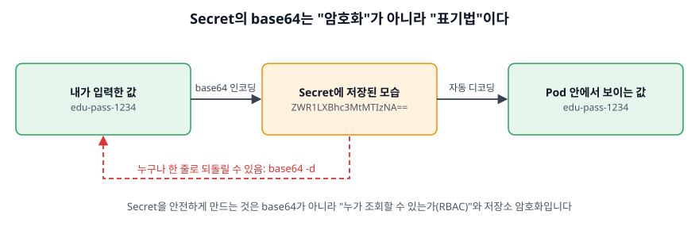

# 05. Secret — 비밀번호 같은 민감한 값 다루기

**이 장을 마치면**

- ConfigMap과 Secret의 차이를 설명할 수 있습니다.
- Secret을 만들고 환경변수와 파일로 Pod에 넣을 수 있습니다.
- "base64는 암호화가 아니다"가 무슨 뜻인지 직접 확인합니다.

---

## 1. ConfigMap과 무엇이 다른가

**Secret(시크릿)** 은 비밀번호, API 키, 인증서처럼 **노출되면 안 되는 값**을 담는 리소스입니다.
쓰는 방법은 [04장 ConfigMap](04-configmap.md)과 거의 같습니다. 필드 이름 몇 개만 다릅니다.

| | ConfigMap | Secret |
|---|---|---|
| 담는 값 | 일반 설정 (모드, 주소, 설정 파일) | 민감한 값 (비밀번호, 토큰, 인증서) |
| 저장된 모습 | 평문 | base64로 인코딩 |
| `kubectl describe` | 값이 그대로 보임 | 값 대신 크기(bytes)만 보임 |
| key 하나를 환경변수로 | `configMapKeyRef` | `secretKeyRef` |
| 전체를 환경변수로 | `configMapRef` | `secretRef` |
| 볼륨으로 | `configMap: { name: ... }` | `secret: { secretName: ... }` |

Secret을 따로 둔 이유는 **다르게 취급하기 위해서**입니다. ConfigMap은 여러 사람이 봐도 되지만 Secret은 조회 권한을 좁게 주고([11장 RBAC](11-rbac.md)),
화면에 값이 바로 찍히지 않게 하고, 노드에서는 디스크가 아닌 메모리에만 올려 둡니다.

## 2. base64는 암호화가 아니다



Secret의 값은 base64로 **인코딩**되어 저장됩니다. base64는 글자를 다른 표기로 바꾸는 규칙일 뿐, 열쇠가 필요한 암호화가 아닙니다.
3절에서 직접 되돌려 봅니다.

## 3. 실습 ① — Secret 만들고 들여다보기

([examples/05-secret/secret.yaml](../examples/05-secret/secret.yaml))

```yaml
apiVersion: v1
kind: Secret
metadata:
  name: db-secret
type: Opaque                 # 일반 용도의 Secret (기본값)
stringData:                  # 평문으로 적으면 저장할 때 자동으로 base64로 바뀐다
  DB_USER: edu_user
  DB_PASSWORD: edu-pass-1234
```

> `stringData` 대신 `data`를 쓰면 값을 직접 base64로 바꿔서 적어야 합니다 (`echo -n 'edu-pass-1234' | base64`). 결과는 같습니다.

```bash
kubectl apply -f examples/05-secret/secret.yaml
kubectl describe secret db-secret
```

```
Name:         db-secret
Namespace:    edu-lab
Type:  Opaque

Data
====
DB_PASSWORD:  13 bytes
DB_USER:      8 bytes
```

ConfigMap과 달리 값은 보이지 않고 크기만 나옵니다. 하지만 YAML로 조회하면 보입니다.

```bash
kubectl get secret db-secret -o yaml
```

```yaml
apiVersion: v1
data:
  DB_PASSWORD: ZWR1LXBhc3MtMTIzNA==
  DB_USER: ZWR1X3VzZXI=
kind: Secret
...
```

알아볼 수 없는 문자열 같지만, 한 줄이면 원래 값으로 돌아옵니다.

```bash
kubectl get secret db-secret -o jsonpath='{.data.DB_PASSWORD}' | base64 -d; echo
```

```
edu-pass-1234
```

**Secret을 조회할 수 있는 사람은 누구나 값을 볼 수 있습니다.** Secret의 안전은 base64가 아니라 "누구에게 조회 권한을 주는가"에 달려 있습니다.

## 4. 실습 ② — 환경변수로 넣기

([examples/05-secret/pod-env.yaml](../examples/05-secret/pod-env.yaml))

```yaml
    env:
    - name: PASSWORD               # key 하나만 골라서
      valueFrom:
        secretKeyRef:              # configMapKeyRef -> secretKeyRef
          name: db-secret
          key: DB_PASSWORD
    envFrom:                       # 모든 key를 한꺼번에
    - secretRef:                   # configMapRef -> secretRef
        name: db-secret
```

```bash
kubectl apply -f examples/05-secret/pod-env.yaml
kubectl wait --for=condition=Ready pod/secret-env --timeout=60s
kubectl exec secret-env -- env | grep -E 'PASSWORD|DB_'
```

```
DB_PASSWORD=edu-pass-1234
DB_USER=edu_user
PASSWORD=edu-pass-1234
```

컨테이너 안에서는 **디코딩된 원래 값**으로 보입니다. 앱은 base64를 신경 쓸 필요가 없습니다.

`describe pod`에는 값이 나오지 않고 "어느 Secret의 어느 key에서 왔는지"만 나옵니다.

```bash
kubectl describe pod secret-env
```

```
    Environment Variables from:
      db-secret  Secret  Optional: false
    Environment:
      PASSWORD:  <set to the key 'DB_PASSWORD' in secret 'db-secret'>  Optional: false
```

## 5. 실습 ③ — 파일로 넣기

인증서나 키 파일처럼 파일 형태로 필요한 값은 볼륨으로 마운트합니다.
([examples/05-secret/pod-volume.yaml](../examples/05-secret/pod-volume.yaml))

```yaml
    volumeMounts:
    - name: db
      mountPath: /etc/db           # /etc/db/DB_USER, /etc/db/DB_PASSWORD 파일이 생긴다
      readOnly: true
  volumes:
  - name: db
    secret:                        # configMap -> secret
      secretName: db-secret        # (ConfigMap은 name, Secret은 secretName)
      defaultMode: 0400            # 파일 권한: 소유자만 읽기
```

```bash
kubectl apply -f examples/05-secret/pod-volume.yaml
kubectl wait --for=condition=Ready pod/secret-file --timeout=60s

kubectl exec secret-file -- ls -lL /etc/db
kubectl exec secret-file -- cat /etc/db/DB_PASSWORD; echo
```

```
total 8
-r--------    1 root     root            13 Nov 20 10:26 DB_PASSWORD
-r--------    1 root     root             8 Nov 20 10:26 DB_USER

edu-pass-1234
```

key 이름이 파일 이름이 되고, 값이 파일 내용이 됐습니다. 권한은 `defaultMode: 0400`대로 소유자만 읽을 수 있습니다.

이 파일들은 디스크가 아니라 **메모리(tmpfs)** 에 있습니다. Pod가 사라지면 노드에 흔적이 남지 않습니다.

```bash
kubectl exec secret-file -- df -h /etc/db
```

```
Filesystem                Size      Used Available Use% Mounted on
tmpfs                    15.4G      8.0K     15.4G   0% /etc/db
```

## 6. 고장 내고 고쳐 보기 — 없는 Secret 참조

```bash
kubectl apply -f examples/05-secret/pod-broken-name.yaml
sleep 8
kubectl get pod
```

```
NAME            READY   STATUS                       RESTARTS   AGE
secret-broken   0/1     CreateContainerConfigError   0          8s
secret-env      1/1     Running                      0          11s
secret-file     1/1     Running                      0          9s
```

04장에서 본 `CreateContainerConfigError`입니다. 원인을 직접 찾아보세요.

```bash
kubectl describe pod secret-broken
```

<details><summary>원인과 해결 방법</summary>

```
Events:
  Type     Reason     Age                From               Message
  ----     ------     ----               ----               -------
  Normal   Scheduled  8s                 default-scheduler  Successfully assigned edu-lab/secret-broken to oks4.dd.io
  Normal   Pulled     5s (x3 over 8s)    kubelet            Container image "busybox:1.36" already present on machine
  Warning  Failed     5s (x3 over 8s)    kubelet            Error: secret "db-secrets" not found
```

`secret "db-secrets" not found` — `db-secrets`라는 Secret이 없습니다. 실제 이름은 `db-secret`입니다.

```bash
kubectl get secret
```

이름 오타 외에 **네임스페이스가 다른 경우**에도 같은 오류가 납니다. Secret도 ConfigMap처럼 같은 네임스페이스의 Pod만 쓸 수 있습니다.
YAML의 이름을 고쳐 다시 적용하면 됩니다. 여기서는 실습용 Pod이므로 지웁니다.

```bash
kubectl delete pod secret-broken
```

</details>

## 7. 알아 두면 좋은 것

### 명령으로 만들기 (실무에서 더 권장)

비밀번호가 적힌 YAML 파일을 Git에 올리면 그 순간 비밀이 아니게 됩니다. 그래서 Secret은 YAML 파일 없이 명령으로 만드는 경우가 많습니다.

```text
kubectl create secret generic api-secret --from-literal=API_KEY=abc123
```

### Secret의 종류

`kubectl create secret` 뒤에 오는 단어에 따라 용도가 다른 Secret이 만들어집니다.

| 명령 | 타입 | 용도 |
|---|---|---|
| `generic` | `Opaque` | 일반 값. 이 장에서 실습한 것 |
| `docker-registry` | `kubernetes.io/dockerconfigjson` | 로그인이 필요한 이미지 저장소에서 이미지를 받을 때. Pod의 `imagePullSecrets`에 지정 |
| `tls` | `kubernetes.io/tls` | HTTPS 인증서와 키. [10장 Ingress](10-ingress.md)에서 사용 |

```text
kubectl create secret docker-registry my-registry \
  --docker-server=<저장소주소> --docker-username=<계정> --docker-password=<비밀번호>

kubectl create secret tls my-tls --cert=server.crt --key=server.key
```

### 주의할 점

- Secret을 **환경변수**로 넣으면 `kubectl exec ... env`나 앱의 디버그 로그로 값이 드러나기 쉽습니다. 민감한 값일수록 파일 마운트가 더 안전합니다.
- Secret을 수정했을 때의 동작은 ConfigMap과 같습니다. 파일은 잠시 뒤 바뀌고, 환경변수는 Pod를 다시 띄워야 바뀝니다.

## 8. 정리

```bash
kubectl delete pod secret-env secret-file
kubectl delete -f examples/05-secret/secret.yaml
```

## 핵심 요약

- Secret은 민감한 값을 담는 리소스이고, 사용법은 ConfigMap과 거의 같다.
- 값은 base64로 저장되지만 누구나 되돌릴 수 있다. 암호화가 아니다.
- Pod 안에서는 디코딩된 원래 값으로 보인다.
- 볼륨으로 마운트한 Secret은 메모리(tmpfs)에 올라간다.
- 비밀번호가 담긴 YAML을 Git에 올리지 않는다.

## 확인 문제

1. Secret의 base64 인코딩은 암호화인가요?
2. ConfigMap의 `configMapKeyRef`에 대응하는 Secret의 필드 이름은 무엇인가요?
3. `kubectl describe secret`으로는 값이 보이지 않습니다. 값을 확인하려면 어떻게 하나요?
4. Pod가 `CreateContainerConfigError`이고 Events에 `secret "x" not found`가 나옵니다. 가능한 원인 두 가지는 무엇인가요?

<details><summary>정답 보기</summary>

1. 아닙니다. 누구나 `base64 -d` 한 줄로 되돌릴 수 있는 표기법입니다. 보안은 조회 권한(RBAC)과 저장소 암호화로 확보합니다.
2. `secretKeyRef`입니다. (`configMapRef` → `secretRef`, 볼륨의 `configMap.name` → `secret.secretName`)
3. `kubectl get secret 이름 -o jsonpath='{.data.키}' | base64 -d`처럼 값을 꺼내 디코딩합니다.
4. Secret 이름이 틀렸거나, Secret이 Pod와 다른 네임스페이스에 있는 경우입니다.
</details>

---

다음 장: [06. PV / PVC — Pod가 사라져도 남는 저장소](06-pv-pvc.md)
