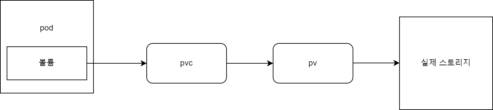

# 06. PV / PVC — Pod가 사라져도 데이터는 남게 하는 저장소

## 0. 이 장의 전제

이 장부터는 `00장`에서 설정한 `EDU_CONTEXT`, `NS`, `k()` 함수를 그대로 씁니다
(`k` = `kubectl --context "$EDU_CONTEXT" -n "$NS"`). 새 셸이라면 00장 6절을 먼저 다시 실행하세요.

```bash
k auth can-i create persistentvolumeclaims
k auth can-i create pods
```

**이 클러스터의 `nfs-client` StorageClass는 `reclaimPolicy: Retain`입니다.** Retain은 "PVC를
지워도 실제 데이터(PV)는 보존한다"는 안전장치지만, 반대로 말하면 **PVC를 지워도 PV(클러스터
범위 자원)가 자동으로 청소되지 않고 남는다**는 뜻입니다. 공유 클러스터에서 실습용으로
Bound PVC를 계속 만들면 아무도 치우지 않는 PV가 쌓입니다. 그래서 이 장에서는:

- **성공적으로 Bound되는 PVC는 실제로 만들지 않습니다.** "정상" 매니페스트는 `--dry-run=server`로
  API 유효성만 확인합니다.
- **Pending에서 멈추는(= 끝까지 바인딩되지 않는) PVC**는 실제로 만들어도 안전합니다. PV가 전혀
  생성되지 않기 때문입니다. 오류 주입은 이쪽만 실제로 실행합니다.
- 노드·PV·StorageClass 같은 클러스터 범위 자원은 `k`로도 격리되지 않으므로, 이 장은 그런
  자원을 직접 만들거나 수정하지 않고 **조회만** 합니다.

## 1. 개념

컨테이너 안에서 파일을 저장하면, 그 파일은 **컨테이너가 사라질 때 함께 사라집니다.**
웹 서버라면 상관없지만 DB라면 재앙이죠. 그래서 데이터는 컨테이너 **밖의 저장소**에 두어야 합니다.

쿠버네티스는 저장소를 두 리소스로 나눠서 다룹니다.

- **PV (PersistentVolume)**: 실제 스토리지 자원. 디스크, NFS, CephFS 같은 "진짜 저장 공간". **네임스페이스가 없는, 클러스터 범위 자원**입니다.
- **PVC (PersistentVolumeClaim)**: 저장소에 대한 **요청서**. "ReadWriteOnce로 1Gi 필요해요". **네임스페이스에 속합니다.**

```
[Pod] --"PVC를 쓸게요"--> [PVC: 1Gi 주세요] --바인딩--> [PV: 실제 NFS/디스크]
```

왜 둘로 나눌까요? **역할 분리** 때문입니다.

> **비유**: PV는 "호텔 방"(인프라 관리자가 준비), PVC는 "투숙객의 예약 요청"(개발자가 작성)입니다.
> 개발자는 "1인실 하나"라고 요청만 하면 되고, 그 방이 몇 층 어느 호실인지(NFS인지 Ceph인지)는
> 몰라도 됩니다. 요청과 실제 자원이 연결되는 것을 **바인딩(binding)** 이라고 합니다.

## 2. 정적 프로비저닝의 구조 (개념만)

PV를 관리자가 손으로 미리 만들어 두고 PVC가 그걸 집어 쓰는 방식을 **정적 프로비저닝**이라
합니다. 실무에서는 `hostPath`(노드 하나의 로컬 디스크) 같은 볼륨은 데이터가 노드에 묶여 버려
거의 쓰지 않고, 보통 아래와 같은 모양의 PV를 NFS/블록스토리지 위에 미리 만들어 둡니다
(이 장에서는 이 구조를 **실제로 적용하지 않고 설명만** 합니다).

```yaml
apiVersion: v1
kind: PersistentVolume
metadata:
  name: demo-pv
spec:
  capacity:
    storage: 5Gi
  accessModes:
    - ReadWriteOnce
  persistentVolumeReclaimPolicy: Retain   # PVC가 삭제돼도 PV(데이터)는 남긴다
  nfs:
    server: nfs.example.invalid                    # 관리자가 준비한 실제 NFS 서버
    path: /export/demo
  claimRef:                               # 이 PV를 특정 PVC 전용으로 예약
    name: demo-pvc
    namespace: some-namespace
```

핵심 구조는 세 가지입니다.

1. **실제 스토리지 주소**(`nfs.server`/`path` 등) — PV마다 다른 실제 저장 위치
2. **`claimRef`** — 이 PV를 특정 PVC 1개 전용으로 미리 엮어 두는 예약
3. **`persistentVolumeReclaimPolicy`** — `Retain`(보존)인지 `Delete`(PVC 삭제 시 PV도 삭제)인지

## 3. 접근 모드 (Access Mode)

| 모드 | 약어 | 의미 |
|------|-----|------|
| ReadWriteOnce | RWO | **한 노드**만 읽기/쓰기 마운트 가능 |
| ReadOnlyMany | ROX | 여러 노드가 읽기 전용으로 마운트 |
| ReadWriteMany | RWX | **여러 노드**가 동시에 읽기/쓰기 (NFS 같은 공유 스토리지 필요) |

ReadWriteOnce — 한 노드에서만 사용:



ReadWriteMany — 여러 노드의 Pod가 같은 볼륨을 공유:


일반 블록 디스크(AWS EBS 등)는 RWO만 되고, 여러 Pod가 공유해야 하면 NFS 같은 RWX 지원 스토리지가
필요합니다.

## 4. 동적 프로비저닝 — StorageClass와 Pending 진단

매번 관리자가 PV를 손으로 만드는 건 번거롭습니다. **동적 프로비저닝(dynamic provisioning)** 은
PVC만 내면 **PV가 자동으로 생성**되는 방식이고, 실무의 기본값입니다. 필요한 것은
**StorageClass**(저장소 등급표)와 그 뒤의 **프로비저너**뿐입니다.

> **Python 비유**: 정적 = 관리자가 미리 만들어 둔 객체 풀에서 꺼내 쓰기,
> 동적 = 요청이 올 때마다 팩토리 함수가 `new`로 만들어 주기.

### 4-1. 사전 확인 — 실제 StorageClass, 그리고 "없는 이름"이 진짜 없는지 확인

```bash
kubectl --context "$EDU_CONTEXT" get storageclass
```

```
NAME                   PROVISIONER                           RECLAIMPOLICY   AGE
nfs-client (default)   .../nfs-subdir-external-provisioner   Retain          72d
```

아래 오류 주입에서 쓸 이름이 **실제로 존재하지 않는지** 먼저 확인합니다 (추측이 아니라 확인).
`--ignore-not-found`를 쓰면 없을 때도 0으로 종료해 스크립트가 중단되지 않습니다 — 결과가
비어 있어야 다음 단계로 진행할 수 있습니다.

```bash
EXISTING=$(kubectl --context "$EDU_CONTEXT" get storageclass ch06-does-not-exist-sc \
  --ignore-not-found -o name)
if [[ -n "$EXISTING" ]]; then
  echo "경고: ch06-does-not-exist-sc 가 실제로 존재합니다 ($EXISTING). 다른 이름으로 바꿔서 실습하세요." >&2
else
  echo "확인됨: ch06-does-not-exist-sc 라는 StorageClass는 없음"
fi
```

```
확인됨: ch06-does-not-exist-sc 라는 StorageClass는 없음
```

### 4-2. "정상" 매니페스트 — 실제로 만들지 않고 API 유효성만 확인

([examples/06-pv-pvc/pvc-dynamic.yaml](../examples/06-pv-pvc/pvc-dynamic.yaml))

```yaml
apiVersion: v1
kind: PersistentVolumeClaim
metadata:
  name: ch06-dyn-pvc
spec:
  accessModes:
    - ReadWriteOnce
  resources:
    requests:
      storage: 1Gi
  storageClassName: nfs-client     # 실제 존재하는 이름 (4-1에서 확인)
```

```bash
k apply --dry-run=server -f examples/06-pv-pvc/pvc-dynamic.yaml
```

```
persistentvolumeclaim/ch06-dyn-pvc created (server dry run)
```

`created (server dry run)` — API 서버가 "이 YAML이면 만들어질 것"이라고 검증까지는 했지만
**실제로는 아무것도 생성되지 않았습니다.** 이 PVC를 실제로 적용하지 않는 이유는 0절에서
설명한 Retain 정책 때문입니다.

### 4-3. 오류 주입 — 존재하지 않는 StorageClass (실제 적용, 안전)

([examples/06-pv-pvc/pvc-bad-storageclass.yaml](../examples/06-pv-pvc/pvc-bad-storageclass.yaml))

이번엔 4-1에서 **존재하지 않음을 직접 확인한** 이름을 그대로 씁니다. 이 PVC는 바인딩될 방법이
없으므로 PV가 전혀 생기지 않아 실제로 적용해도 안전합니다.

```yaml
spec:
  storageClassName: ch06-does-not-exist-sc
```

```bash
# 조회 오류나 이름 충돌이 있으면 PVC를 생성하지 않는다.
if existing=$(kubectl --context "$EDU_CONTEXT" get sc ch06-does-not-exist-sc --ignore-not-found -o name) && [[ -z "$existing" ]]; then
  k apply -f examples/06-pv-pvc/pvc-bad-storageclass.yaml
else
  printf '%s\n' '중단: 존재하지 않는 StorageClass임을 확인할 수 없습니다.' >&2
fi
sleep 5
k get pvc ch06-pvc-badsc
```

```
NAME             STATUS    VOLUME   CAPACITY   ACCESS MODES   STORAGECLASS              AGE
ch06-pvc-badsc   Pending                                      ch06-does-not-exist-sc    5s
```

**관찰**: `Pending`에서 멈춰 있고, 아무리 기다려도 `Bound`가 되지 않습니다.

```bash
k describe pvc ch06-pvc-badsc | tail -6
```

이런 경우 **Events가 아예 비어 있을 수 있습니다** — 존재하지 않는 StorageClass 이름을 지켜보는
프로비저너 자체가 없기 때문입니다. "Pending인데 Events도 조용하다"는 것 자체가 StorageClass
이름이 틀렸을 가능성을 의심해야 하는 신호입니다.

### 4-4. 오류 주입 — 이 Pending PVC에 의존하는 Pod도 함께 멈춤

([examples/06-pv-pvc/pod-pending-pvc.yaml](../examples/06-pv-pvc/pod-pending-pvc.yaml))

```yaml
  volumes:
  - name: data
    persistentVolumeClaim:
      claimName: ch06-pvc-badsc     # 위에서 만든, 영원히 Pending인 PVC
```

```bash
k apply -f examples/06-pv-pvc/pod-pending-pvc.yaml
sleep 5
k get pod ch06-pod-pending
```

```
NAME               READY   STATUS    RESTARTS   AGE
ch06-pod-pending   0/1     Pending   0          5s
```

**관찰**: PVC가 아니라 **Pod까지** `Pending`에 걸립니다. 스케줄러가 "볼륨이 아직 준비되지
않았다"며 아예 노드에 배치하지 않는 것입니다.

### 4-5. 오류 주입 — 아예 존재하지 않는 PVC 이름(오타) 참조

위와는 다른 원인입니다. 이번엔 PVC 자체가 **존재하지도 않는** 경우입니다.

([examples/06-pv-pvc/pod-pvc-badref.yaml](../examples/06-pv-pvc/pod-pvc-badref.yaml))

```yaml
  volumes:
  - name: data
    persistentVolumeClaim:
      claimName: ch06-pvc-typo   # 이런 이름의 PVC는 만든 적이 없음
```

```bash
k apply -f examples/06-pv-pvc/pod-pvc-badref.yaml
sleep 5
k get pod ch06-pod-badref
k describe pod ch06-pod-badref | tail -4
```

```
NAME               READY   STATUS              RESTARTS   AGE
ch06-pod-badref    0/1     Pending            0          5s
...
Events:
  Warning  FailedScheduling  ...  persistentvolumeclaim "ch06-pvc-typo" not found
```

**관찰**: 이번에도 `Pending`입니다. 차이는 **상태 이름이 아니라 Events**에 PVC를
**찾지 못했다**는 메시지가 명확히 찍힙니다. 4-4(PVC는 있지만 안 묶임)와 4-5(PVC 자체가 없음)는
같은 상태로 보일 수 있습니다.

<details><summary>힌트와 복구 — 두 증상 구분하기</summary>

| 증상 | 원인 | 확인 명령 |
|---|---|---|
| Pod가 `Pending`, PVC가 `Pending` | StorageClass가 없거나 틀림 | `k get pvc <이름>` → `k get sc <그 PVC의 storageClassName>` |
| Pod가 `Pending`, Events에 `persistentvolumeclaim ... not found` | claimName 자체가 틀림(오타) | `k get pvc` 로 실제 존재하는 PVC 이름과 대조 |

둘 다 **실제로 바인딩된 적이 없으므로** 정리는 그냥 지우면 됩니다 — 남는 PV가 없습니다.

```bash
k delete pod ch06-pod-pending ch06-pod-badref --ignore-not-found
k delete pvc ch06-pvc-badsc --ignore-not-found
k get pvc
```
</details>

## 5. 기능 확인 — emptyDir로 "앱이 다시 뜨는가"만 복구

실제 Bound PVC는 만들지 않기로 했으므로, 이 장에서 "데이터가 살아남는지"는 테스트하지
않습니다. 대신 **앱이 정상적으로 뜨는지**만 emptyDir로 빠르게 복구/확인합니다
(**영속성 테스트가 아닙니다** — 7장에서 emptyDir과 실제 PVC의 데이터 보존 차이를
자세히 비교합니다).

([examples/06-pv-pvc/pod-recovery-emptydir.yaml](../examples/06-pv-pvc/pod-recovery-emptydir.yaml))

```bash
k apply -f examples/06-pv-pvc/pod-recovery-emptydir.yaml
k wait --for=condition=Ready pod/ch06-pod-recovery --timeout=60s
k exec ch06-pod-recovery -- sh -c "echo ok > /data/test.txt && cat /data/test.txt"
```

```
ok
```

Pod가 `Running`이 되고 파일을 쓰고 읽을 수 있으면 **앱 기능은 정상**입니다. (데이터 보존
여부를 확인하고 싶다면 6장의 다이어그램처럼 실제 네트워크 스토리지가 필요하며, 이 공유
클러스터에서는 PV가 남지 않도록 실제로 만들지 않습니다.)

## 6. 실습 정리

```bash
k delete pod ch06-pod-pending ch06-pod-badref ch06-pod-recovery --ignore-not-found
k delete pvc ch06-pvc-badsc --ignore-not-found
k get pvc
```

## 확인 문제

1. PV와 PVC의 역할을 한 줄씩으로 구분하면?
2. 이 클러스터에서 "성공적으로 Bound되는" PVC를 실습에서 실제로 만들지 않는 이유는?
3. 같은 `Pending` Pod에서 StorageClass 오타와 claimName 오타를 어떤 근거로 구분할까?

<details><summary>정답 보기</summary>

1. PV = 실제 스토리지 자원(공급, 클러스터 범위), PVC = 필요한 스토리지에 대한 요청서(수요, 네임스페이스 범위). 둘이 바인딩되어 사용된다.
2. `nfs-client`의 `reclaimPolicy`가 `Retain`이라 PVC를 지워도 PV(클러스터 범위 자원)가 자동 삭제되지 않고 남기 때문. 공유 클러스터에 치우지 않는 PV가 쌓이는 것을 막기 위해 "정상" 매니페스트는 dry-run으로만 검증한다.
3. 전자는 StorageClass가 없거나 이름이 틀려 PVC 자체가 바인딩되지 못하는 경우, 후자는 PVC는 정상인데 Pod가 참조하는 `claimName` 자체가 오타라 그 이름의 PVC를 찾지 못하는 경우다.
</details>

---

다음 장: [07. StatefulSet — 이름과 데이터가 유지되어야 하는 앱](07-statefulset.md)
