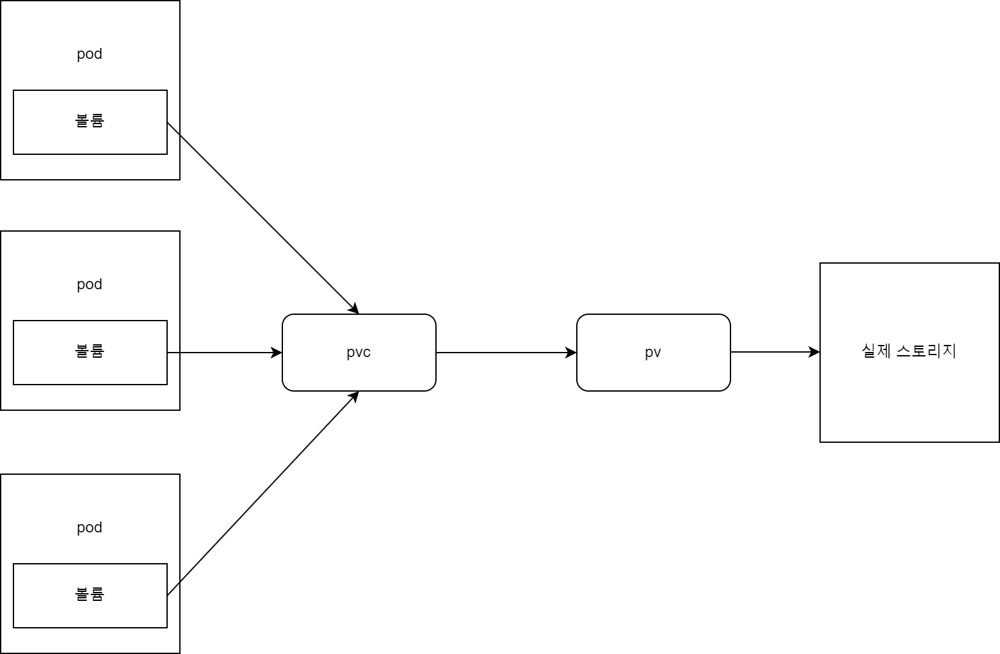

# 06. PV / PVC — Pod가 죽어도 데이터는 남게

## 1. 개념

컨테이너 안에서 파일을 저장하면, 그 파일은 **컨테이너가 사라질 때 함께 사라집니다.**
웹 서버라면 상관없지만 DB라면 재앙이죠. 그래서 데이터는 컨테이너 **밖의 저장소**에 두어야 합니다.

쿠버네티스는 저장소를 두 리소스로 나눠서 다룹니다.

- **PV (PersistentVolume)**: 실제 스토리지 자원. 디스크, NFS, CephFS 같은 "진짜 저장 공간"
- **PVC (PersistentVolumeClaim)**: 저장소에 대한 **요청서**. "ReadWriteOnce로 5Gi 필요해요"

```
[Pod] --"PVC를 쓸게요"--> [PVC: 5Gi 주세요] --바인딩--> [PV: 실제 NFS/디스크]
```

왜 둘로 나눌까요? **역할 분리** 때문입니다.

> **비유**: PV는 "호텔 방"(인프라 관리자가 준비), PVC는 "투숙객의 예약 요청"(개발자가 작성)입니다.
> 개발자는 "2인실 하나"라고 요청만 하면 되고, 그 방이 몇 층 어느 호실인지(NFS인지 Ceph인지)는
> 몰라도 됩니다. 요청과 실제 자원이 연결되는 것을 **바인딩(binding)** 이라고 합니다.

## 2. PV와 PVC를 직접 만들어 보기 (정적 프로비저닝)

### PV — 관리자가 준비하는 실제 저장 공간

([examples/06-pv-pvc/pv.yaml](../examples/06-pv-pvc/pv.yaml))

```yaml
apiVersion: v1
kind: PersistentVolume
metadata:
  name: demo-pv
spec:
  capacity:
    storage: 5Gi                      # 이 볼륨의 크기
  accessModes:
    - ReadWriteOnce                   # 접근 모드 (아래 3절)
  persistentVolumeReclaimPolicy: Delete  # PVC가 삭제되면 PV도 삭제
  hostPath:                           # 저장 위치: 노드의 로컬 경로 (실습용. 운영은 NFS 등)
    path: /tmp/pv
  claimRef:                           # 이 PV를 특정 PVC 전용으로 예약
    name: demo-pvc
    namespace: default
```

### PVC — 개발자가 내는 요청서

([examples/06-pv-pvc/pvc.yaml](../examples/06-pv-pvc/pvc.yaml))

```yaml
apiVersion: v1
kind: PersistentVolumeClaim
metadata:
  name: demo-pvc
  namespace: default
spec:
  accessModes:
    - ReadWriteOnce                   # 요구하는 접근 모드
  resources:
    requests:
      storage: 5Gi                    # 요구하는 용량
  volumeName: demo-pv                 # (선택) 특정 PV를 콕 집어 지정
```

```bash
kubectl apply -f examples/06-pv-pvc/pv.yaml
kubectl apply -f examples/06-pv-pvc/pvc.yaml
kubectl get pv,pvc
```

```
NAME                       CAPACITY   ACCESS MODES   RECLAIM POLICY   STATUS   CLAIM
persistentvolume/demo-pv   5Gi        RWO            Delete           Bound    default/demo-pvc

NAME                             STATUS   VOLUME    CAPACITY   ACCESS MODES
persistentvolumeclaim/demo-pvc   Bound    demo-pv   5Gi        RWO
```

`STATUS: Bound` — 요청서(PVC)와 실제 저장소(PV)가 연결되었습니다.

## 3. 접근 모드 (Access Mode)

| 모드 | 약어 | 의미 |
|------|-----|------|
| ReadWriteOnce | RWO | **한 노드**만 읽기/쓰기 마운트 가능 |
| ReadOnlyMany | ROX | 여러 노드가 읽기 전용으로 마운트 |
| ReadWriteMany | RWX | **여러 노드**가 동시에 읽기/쓰기 (NFS 같은 공유 스토리지 필요) |

ReadWriteOnce — 한 노드에서만 사용:


ReadWriteMany — 여러 노드의 Pod가 같은 볼륨을 공유:



일반 블록 디스크(AWS EBS 등)는 RWO만 되고, 여러 Pod가 공유해야 하면 NFS 같은 RWX 지원 스토리지가 필요합니다.

## 4. 동적 프로비저닝 — 실무의 기본

매번 관리자가 PV를 손으로 만드는 건 번거롭습니다. **동적 프로비저닝(dynamic provisioning)** 은
PVC만 내면 **PV가 자동으로 생성**되는 방식입니다.

필요한 것은 **StorageClass**와 **프로비저너(provisioner)** 입니다.

- StorageClass: "저장소 등급표". PVC에서 `storageClassName`으로 지정
- 프로비저너: PVC를 감지해서 실제 스토리지에 공간을 만들고 PV를 생성해 주는 프로그램
  (NFS를 쓴다면 `nfs-subdir-external-provisioner` 같은 것을 미리 설치)

> **Python 비유**: 정적 = 관리자가 미리 만들어 둔 객체 풀에서 꺼내 쓰기,
> 동적 = 요청이 올 때마다 팩토리 함수가 `new`로 만들어 주기.

### 실습 — NFS 동적 프로비저닝

(클러스터에 nfs-provisioner와 `nfs-client` StorageClass가 설치되어 있다는 전제입니다.
minikube라면 기본 내장된 `standard` StorageClass를 쓰면 됩니다.)

([examples/06-pv-pvc/nfs-pvc.yaml](../examples/06-pv-pvc/nfs-pvc.yaml))

```yaml
apiVersion: v1
kind: PersistentVolumeClaim
metadata:
  name: nfs-pvc
spec:
  accessModes:
    - ReadWriteMany
  resources:
    requests:
      storage: 1G
  storageClassName: 'nfs-client'    # minikube면 'standard' 로 변경 (단, RWO만 지원)
```

```bash
kubectl apply -f examples/06-pv-pvc/nfs-pvc.yaml

# PV를 만든 적이 없는데 자동으로 생겨 있음!
kubectl get pv | grep nfs-pvc
```

```
pvc-20e4854d-bdcc-...   1G   RWX   Delete   Bound   default/nfs-pvc   nfs-client   18s
```

NFS 서버 쪽을 들여다보면 PVC마다 디렉토리가 자동 생성된 것을 볼 수 있습니다.

```
[root@ks5 nfs]# ls
default-nfs-pvc-pvc-20e4854d-...      ← 방금 만든 PVC의 디렉토리
default-www-web-0-pvc-fe4c5bfa-...    ← (7장에서 만들 StatefulSet용)
airflow-airflow-logs-pvc-593b7ad5-... ← 다른 앱들의 볼륨
```

### Pod에서 PVC 사용하기

([examples/06-pv-pvc/pod-with-pvc.yaml](../examples/06-pv-pvc/pod-with-pvc.yaml))

```yaml
apiVersion: v1
kind: Pod
metadata:
  name: pvc-test
spec:
  containers:
  - name: app
    image: busybox
    command: ["sleep", "3600"]
    volumeMounts:
    - name: data
      mountPath: /data              # 컨테이너 안에서 /data 가 영속 저장소
  volumes:
  - name: data
    persistentVolumeClaim:
      claimName: nfs-pvc            # 위에서 만든 PVC
```

```bash
kubectl apply -f examples/06-pv-pvc/pod-with-pvc.yaml

# 파일을 쓰고
kubectl exec pvc-test -- sh -c "echo '살아남을 데이터' > /data/test.txt"

# Pod를 죽였다가 다시 만들어도
kubectl delete pod pvc-test
kubectl apply -f examples/06-pv-pvc/pod-with-pvc.yaml

# 데이터가 살아 있다!
kubectl exec pvc-test -- cat /data/test.txt
# 살아남을 데이터
```

이것이 PV/PVC의 존재 이유입니다. **Pod는 일회용, 데이터는 영구.**

## 5. 실습 정리

```bash
kubectl delete pod pvc-test
kubectl delete pvc nfs-pvc demo-pvc
kubectl delete pv demo-pv 2>/dev/null   # reclaimPolicy에 따라 이미 삭제됐을 수 있음
```

> 그 밖의 볼륨 타입(emptyDir, hostPath, projected 등)은
> [공식 문서](https://kubernetes.io/ko/docs/concepts/storage/)를 참고하세요.

## 확인 문제

1. PV와 PVC의 역할을 한 줄씩으로 구분하면?
2. 여러 노드의 Pod가 같은 볼륨에 동시에 쓰기를 해야 한다면 필요한 접근 모드는?
3. 동적 프로비저닝에서 PVC를 내면 PV를 자동으로 만들어 주는 주체는?

<details><summary>정답 보기</summary>

1. PV = 실제 스토리지 자원(공급), PVC = 필요한 스토리지에 대한 요청서(수요). 둘이 바인딩되어 사용된다.
2. ReadWriteMany (RWX) — NFS 같은 공유 스토리지가 필요
3. 프로비저너(provisioner) — StorageClass에 지정된 프로그램이 PVC를 감지해 PV를 생성
</details>

---

다음 장: [07. StatefulSet — 이름과 데이터가 유지되어야 하는 앱](07-statefulset.md)
