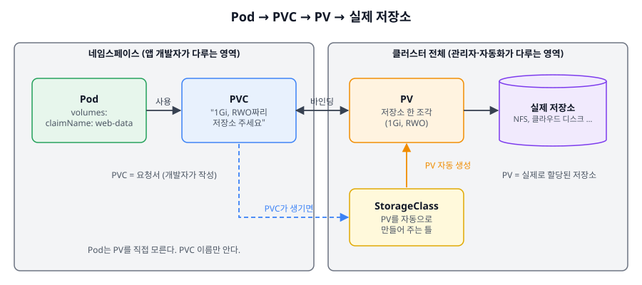
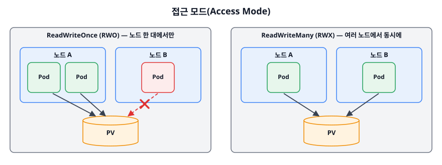
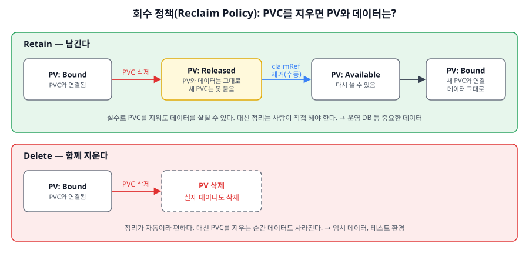

# 06. PV / PVC — Pod가 사라져도 남는 저장소

**이 장을 마치면**

- PV, PVC, StorageClass가 각각 무엇이고 어떻게 연결되는지 설명할 수 있습니다.
- PVC를 만들어 Pod에 붙이고, Pod가 다시 만들어져도 데이터가 남는 것을 확인합니다.
- **회수 정책 Retain과 Delete의 차이**를 직접 실습하고, Retain으로 남은 데이터를 되살릴 수 있습니다.

---

## 1. 왜 필요한가

[01장](01-pod.md)에서 Pod를 지우고 다시 만들었더니 안에 써 둔 파일이 사라졌습니다. 컨테이너의 파일 시스템은 Pod와 운명을 같이하기 때문입니다.
웹 서버라면 괜찮지만, 데이터베이스나 업로드된 파일이라면 큰일입니다.

데이터를 **Pod 바깥의 저장소**에 두고, Pod는 그 저장소를 빌려 쓰게 하면 됩니다. 이때 등장하는 것이 PV와 PVC입니다.

## 2. PV, PVC, StorageClass



| 이름 | 한 줄 설명 | 비유 |
|---|---|---|
| **PV** (PersistentVolume) | 클러스터에 준비된 **저장소 한 조각** | 창고의 사물함 한 칸 |
| **PVC** (PersistentVolumeClaim) | "이만큼의 저장소가 필요해요"라는 **요청서** | 사물함 신청서 |
| **StorageClass** | PVC가 들어오면 PV를 **자동으로 만들어 주는** 틀 | 신청서를 받으면 사물함을 새로 설치해 주는 관리실 |

왜 PV와 PVC로 나눴을까요? **역할을 나누기 위해서**입니다. 앱을 만드는 사람은 "1Gi가 필요하다"만 알면 되고,
그 저장소가 NFS인지 클라우드 디스크인지, 서버 주소가 무엇인지는 몰라도 됩니다. 그런 세부 사항은 PV와 StorageClass 쪽에 있습니다.

PV를 준비하는 방법은 두 가지입니다.

- **정적 프로비저닝**: 관리자가 PV를 미리 만들어 둔다. PVC가 들어오면 조건에 맞는 PV와 연결된다.
- **동적 프로비저닝**: PVC가 들어오면 StorageClass가 PV를 그때그때 만든다. **요즘은 대부분 이 방식**이고, 이 장의 실습도 이 방식입니다.

### 접근 모드 (Access Mode)

PVC를 만들 때 "어떻게 쓸 것인지"를 함께 적습니다.



| 모드 | 줄임 | 의미 |
|---|---|---|
| ReadWriteOnce | RWO | **노드 한 대**에서 읽기/쓰기. 가장 흔함 (DB 등) |
| ReadOnlyMany | ROX | 여러 노드에서 읽기만 |
| ReadWriteMany | RWX | **여러 노드**에서 동시에 읽기/쓰기. NFS 같은 공유 저장소만 지원 |
| ReadWriteOncePod | RWOP | **Pod 하나**만 읽기/쓰기 |

### 회수 정책 (Reclaim Policy)

**PVC를 지웠을 때 PV와 그 안의 데이터를 어떻게 할 것인가**를 정하는 값입니다. PV마다 하나씩 가지고 있습니다. 이 장의 핵심입니다.



| 정책 | PVC를 지우면 | 장점 | 단점 |
|---|---|---|---|
| **Retain** | PV와 데이터가 **남는다** (PV 상태: `Released`) | 실수로 지워도 복구 가능 | 직접 정리해야 함. 방치하면 저장 공간이 계속 쌓임 |
| **Delete** | PV와 데이터가 **함께 지워진다** | 정리가 자동 | 복구 불가 |

동적으로 만들어진 PV는 **StorageClass에 적힌 회수 정책을 물려받습니다.** 4절과 5절에서 두 정책을 차례로 실습합니다.

## 3. 실습 ① — PVC를 만들어 Pod에 붙이기

### 3-1. StorageClass 확인

```bash
kubectl get storageclass
```

```
NAME                   PROVISIONER                                                     RECLAIMPOLICY   VOLUMEBINDINGMODE   ALLOWVOLUMEEXPANSION   AGE
nfs-client (default)   cluster.local/nfs-provisioner-nfs-subdir-external-provisioner   Retain          Immediate           true                   47h
```

- `(default)` 표시가 있는 것이 **기본 StorageClass**입니다. PVC에 StorageClass를 적지 않으면 이것이 쓰입니다.
- `RECLAIMPOLICY`가 이 StorageClass로 만들어지는 PV의 회수 정책입니다. 이 환경은 `Retain`이지만, 클라우드 환경은 `Delete`인 경우가 많습니다.

> 이름과 정책은 환경마다 다릅니다. `(default)`가 붙은 StorageClass가 하나 있으면 이 장의 실습을 그대로 따라 할 수 있습니다.

### 3-2. PVC 만들기

([examples/06-pv-pvc/pvc.yaml](../examples/06-pv-pvc/pvc.yaml))

```yaml
apiVersion: v1
kind: PersistentVolumeClaim
metadata:
  name: web-data
spec:
  accessModes:
  - ReadWriteOnce            # 한 노드에서 읽기/쓰기
  resources:
    requests:
      storage: 1Gi           # 1Gi 크기의 저장소를 요청
  # storageClassName을 생략하면 기본(default) StorageClass를 사용한다
```

```bash
kubectl apply -f examples/06-pv-pvc/pvc.yaml
kubectl get pvc
```

```
NAME       STATUS   VOLUME                                     CAPACITY   ACCESS MODES   STORAGECLASS   VOLUMEATTRIBUTESCLASS   AGE
web-data   Bound    pvc-75a2b39b-66a1-45a0-b7df-7a09834fee69   1Gi        RWO            nfs-client     <unset>                 3s
```

`STATUS`가 **`Bound`** 이면 PV와 연결됐다는 뜻입니다. `VOLUME` 열이 연결된 PV의 이름입니다.
우리는 PV를 만든 적이 없는데 PV가 생겼습니다. StorageClass가 자동으로 만든 것입니다(동적 프로비저닝).

```bash
kubectl get pv | grep -E 'NAME|edu-lab'
```

```
NAME                                       CAPACITY   ACCESS MODES   RECLAIM POLICY   STATUS   CLAIM              STORAGECLASS   ...
pvc-75a2b39b-66a1-45a0-b7df-7a09834fee69   1Gi        RWO            Retain           Bound    edu-lab/web-data   nfs-client     ...
```

> PV는 네임스페이스에 속하지 않는 리소스라서 `kubectl get pv`는 클러스터의 모든 PV를 보여 줍니다. `grep`으로 우리 네임스페이스 것만 골랐습니다.
> `CLAIM` 열은 이 PV가 어느 네임스페이스의 어느 PVC와 연결됐는지 알려 줍니다.

### 3-3. Pod에 붙이기

([examples/06-pv-pvc/deploy.yaml](../examples/06-pv-pvc/deploy.yaml))

```yaml
    spec:
      containers:
      - name: nginx
        image: nginx:1.27-alpine
        volumeMounts:
        - name: data
          mountPath: /usr/share/nginx/html   # 이 경로에 쓰는 파일은 PV에 저장된다
      volumes:
      - name: data
        persistentVolumeClaim:
          claimName: web-data                # 사용할 PVC 이름
```

[04장](04-configmap.md)에서 본 `volumes` + `volumeMounts` 구조와 같습니다. `configMap` 자리에 `persistentVolumeClaim`이 들어갔을 뿐입니다.

```bash
kubectl apply -f examples/06-pv-pvc/deploy.yaml
kubectl rollout status deployment/web
```

### 3-4. 데이터를 쓰고, Pod를 지워 보기

```bash
kubectl exec deploy/web -- sh -c 'echo "saved at $(date +%T)" > /usr/share/nginx/html/index.html'
kubectl exec deploy/web -- wget -qO- http://127.0.0.1/
kubectl get pod -o wide
```

```
saved at 10:28:42

NAME                   READY   STATUS    RESTARTS   AGE   IP               NODE         NOMINATED NODE   READINESS GATES
web-86c64c4859-kw5jw   1/1     Running   0          20s   192.168.96.105   oks5.dd.io   <none>           <none>
```

Pod를 지웁니다. Deployment가 새 Pod를 만들 것입니다.

```bash
kubectl delete pod -l app=web
kubectl rollout status deployment/web
kubectl get pod -o wide
kubectl exec deploy/web -- wget -qO- http://127.0.0.1/
```

```
NAME                   READY   STATUS    RESTARTS   AGE   IP                NODE         NOMINATED NODE   READINESS GATES
web-86c64c4859-zvtqr   1/1     Running   0          3s    192.168.139.117   oks4.dd.io   <none>           <none>

saved at 10:28:42
```

Pod 이름도, IP도, 심지어 노드도 바뀌었지만 **데이터는 그대로**입니다. 01장과 비교해 보세요.

### 3-5. 실습 ① 정리

```bash
kubectl delete deployment web
kubectl delete pvc web-data
kubectl get pv | grep -E 'NAME|edu-lab'
```

```
NAME                                       CAPACITY   ACCESS MODES   RECLAIM POLICY   STATUS     CLAIM              STORAGECLASS   ...
pvc-75a2b39b-66a1-45a0-b7df-7a09834fee69   1Gi        RWO            Retain           Released   edu-lab/web-data   nfs-client     ...
```

PVC를 지웠는데 PV가 `Released` 상태로 남아 있습니다(StorageClass의 정책이 `Delete`인 환경이라면 PV가 사라지고 아무것도 나오지 않습니다).
이것이 바로 회수 정책의 차이입니다. 다음 절에서 하나씩 확인합니다. 남은 PV는 7절에서 한꺼번에 정리합니다.

> **PVC가 지워지지 않고 `Terminating`에서 멈춘다면?** 그 PVC를 쓰는 Pod가 아직 있기 때문입니다.
> 사용 중인 PVC는 보호되어, Pod가 사라진 뒤에야 실제로 지워집니다. 그래서 위에서도 Deployment를 먼저 지웠습니다.

## 4. 실습 ② — Retain: PVC를 지워도 데이터가 남는다

### 4-1. PVC와 Pod 만들기

PVC 하나와 그 PVC를 `/data`에 마운트한 Pod 하나를 만듭니다. ([examples/06-pv-pvc/retain.yaml](../examples/06-pv-pvc/retain.yaml))

```bash
kubectl apply -f examples/06-pv-pvc/retain.yaml
kubectl wait --for=condition=Ready pod/retain-pod --timeout=90s
```

PV 이름은 자동으로 정해지므로, 변수에 담아 두고 씁니다.

```bash
PV=$(kubectl get pvc retain-pvc -o jsonpath='{.spec.volumeName}')
echo $PV
```

```
pvc-2d39fb30-9485-473e-9ce1-3d94376f0d2b
```

### 4-2. 회수 정책을 Retain으로 지정

회수 정책은 PV의 `spec.persistentVolumeReclaimPolicy` 필드입니다. 환경의 기본값이 무엇이든 실습 결과가 같도록 명시적으로 `Retain`으로 설정합니다.

```bash
kubectl patch pv $PV -p '{"spec":{"persistentVolumeReclaimPolicy":"Retain"}}'
kubectl get pv $PV
```

```
NAME                                       CAPACITY   ACCESS MODES   RECLAIM POLICY   STATUS   CLAIM                STORAGECLASS   ...
pvc-2d39fb30-9485-473e-9ce1-3d94376f0d2b   1Gi        RWO            Retain           Bound    edu-lab/retain-pvc   nfs-client     ...
```

> 이미 `Retain`이었다면 `patched (no change)`라고 나옵니다. 정상입니다.
> `kubectl patch`는 리소스의 일부 필드만 바꾸는 명령입니다. **이미 만들어진 PV의 회수 정책은 이렇게 언제든 바꿀 수 있습니다.**

### 4-3. 데이터 쓰기

```bash
kubectl exec retain-pod -- sh -c 'echo "important data" > /data/memo.txt'
kubectl exec retain-pod -- cat /data/memo.txt
```

```
important data
```

### 4-4. Pod와 PVC 지우기

누군가 실수로 PVC를 지웠다고 가정합니다.

```bash
kubectl delete pod retain-pod
kubectl delete pvc retain-pvc
kubectl get pvc
kubectl get pv $PV
```

```
No resources found in edu-lab namespace.

NAME                                       CAPACITY   ACCESS MODES   RECLAIM POLICY   STATUS     CLAIM                STORAGECLASS   ...
pvc-2d39fb30-9485-473e-9ce1-3d94376f0d2b   1Gi        RWO            Retain           Released   edu-lab/retain-pvc   nfs-client     ...
```

PVC는 사라졌지만 **PV는 `Released` 상태로 남았습니다.** 데이터도 저장소에 그대로 있습니다.

| PV 상태 | 의미 |
|---|---|
| `Available` | 아직 아무 PVC와도 연결되지 않음. 쓸 수 있음 |
| `Bound` | PVC와 연결되어 사용 중 |
| `Released` | 연결됐던 PVC가 지워짐. 데이터는 남아 있지만 **다른 PVC가 바로 가져갈 수는 없음** |

`Released` PV를 다른 PVC가 자동으로 가져가지 못하게 막아 둔 이유는, 이전 사용자의 데이터가 엉뚱한 곳에 넘어가는 것을 막기 위해서입니다.
PV는 `CLAIM` 열에 보이는 것처럼 "나는 `edu-lab/retain-pvc`의 것이었다"는 기록(`claimRef`)을 계속 가지고 있습니다.

### 4-5. 데이터 되살리기

남은 PV를 새 PVC에 다시 연결해서 데이터를 꺼내 봅니다. 순서는 세 단계입니다.

**① PV의 예전 연결 기록(`claimRef`)을 지운다** → PV가 `Available`로 돌아옵니다.

```bash
kubectl patch pv $PV --type json -p '[{"op":"remove","path":"/spec/claimRef"}]'
kubectl get pv $PV
```

```
NAME                                       CAPACITY   ACCESS MODES   RECLAIM POLICY   STATUS      CLAIM   STORAGECLASS   ...
pvc-2d39fb30-9485-473e-9ce1-3d94376f0d2b   1Gi        RWO            Retain           Available           nfs-client     ...
```

**② 그 PV를 콕 집어서 요청하는 새 PVC를 만든다.** `volumeName`에 PV 이름을 적으면 새 PV를 만들지 않고 그 PV와 연결됩니다.

```bash
cat <<EOF | kubectl apply -f -
apiVersion: v1
kind: PersistentVolumeClaim
metadata:
  name: recover-pvc
spec:
  accessModes:
  - ReadWriteOnce
  volumeName: $PV            # 이 PV와 연결해 달라고 지정
  resources:
    requests:
      storage: 1Gi
EOF

kubectl wait --for=jsonpath='{.status.phase}'=Bound pvc/recover-pvc --timeout=60s
kubectl get pvc recover-pvc
```

```
persistentvolumeclaim/recover-pvc created
persistentvolumeclaim/recover-pvc condition met

NAME          STATUS   VOLUME                                     CAPACITY   ACCESS MODES   STORAGECLASS   VOLUMEATTRIBUTESCLASS   AGE
recover-pvc   Bound    pvc-2d39fb30-9485-473e-9ce1-3d94376f0d2b   1Gi        RWO            nfs-client     <unset>                 12s
```

> `cat <<EOF | kubectl apply -f -`는 파일을 만들지 않고 YAML을 바로 적용하는 방법입니다. `$PV` 자리에 변수 값이 들어갑니다.

**③ 새 PVC를 쓰는 Pod를 띄워 데이터를 확인한다.** ([examples/06-pv-pvc/recover-pod.yaml](../examples/06-pv-pvc/recover-pod.yaml))

```bash
kubectl apply -f examples/06-pv-pvc/recover-pod.yaml
kubectl wait --for=condition=Ready pod/recover-pod --timeout=90s
kubectl exec recover-pod -- cat /data/memo.txt
```

```
important data
```

PVC를 지웠는데도 데이터를 되찾았습니다. **이것이 Retain을 쓰는 이유입니다.**

<details><summary>①을 건너뛰고 ②부터 하면 어떻게 될까?</summary>

PVC가 `Pending`에서 멈추고, `kubectl describe pvc recover-pvc`의 Events에 이렇게 나옵니다.

```
Warning  FailedBinding  5s  persistentvolume-controller  volume "pvc-2d39fb30-..." already bound to a different claim.
```

PV가 아직 예전 PVC(`retain-pvc`)의 것이라고 기록되어 있기 때문입니다. ①을 실행하면 잠시 뒤 연결됩니다.

</details>

## 5. 실습 ③ — Delete: PVC를 지우면 함께 사라진다

같은 과정을 회수 정책만 `Delete`로 바꿔서 반복합니다. ([examples/06-pv-pvc/delete.yaml](../examples/06-pv-pvc/delete.yaml))

```bash
kubectl apply -f examples/06-pv-pvc/delete.yaml
kubectl wait --for=condition=Ready pod/delete-pod --timeout=90s

PV2=$(kubectl get pvc delete-pvc -o jsonpath='{.spec.volumeName}')
kubectl patch pv $PV2 -p '{"spec":{"persistentVolumeReclaimPolicy":"Delete"}}'
kubectl get pv $PV2
```

```
NAME                                       CAPACITY   ACCESS MODES   RECLAIM POLICY   STATUS   CLAIM                STORAGECLASS   ...
pvc-84955ec4-150c-48a2-8242-79c05878a6e0   1Gi        RWO            Delete           Bound    edu-lab/delete-pvc   nfs-client     ...
```

데이터를 쓰고, Pod와 PVC를 지웁니다.

```bash
kubectl exec delete-pod -- sh -c 'echo "temporary data" > /data/memo.txt'
kubectl exec delete-pod -- cat /data/memo.txt

kubectl delete pod delete-pod
kubectl delete pvc delete-pvc
sleep 5
kubectl get pv $PV2
```

```
temporary data

Error from server (NotFound): persistentvolumes "pvc-84955ec4-150c-48a2-8242-79c05878a6e0" not found
```

**PV 자체가 사라졌습니다.** 저장소에 있던 `memo.txt`도 함께 지워졌습니다. 되살릴 방법이 없습니다.

### 두 정책 비교

| | Retain (실습 ②) | Delete (실습 ③) |
|---|---|---|
| PVC 삭제 후 PV | `Released` 상태로 남음 | 사라짐 |
| 데이터 | 남음 → 되살릴 수 있음 | 삭제됨 |
| 정리 | 사람이 직접 | 자동 |
| 어울리는 곳 | 운영 DB처럼 잃으면 안 되는 데이터 | 캐시, 테스트, 언제든 다시 만들 수 있는 데이터 |

> **실무 팁**: 중요한 데이터가 담긴 PVC를 지우기 전에는 `kubectl get pv`로 `RECLAIM POLICY`부터 확인하세요.
> `Delete`라면 4-2의 `kubectl patch`로 `Retain`으로 바꿔 둔 뒤 작업하면 안전합니다.

## 6. 고장 내고 고쳐 보기 — PVC가 Pending에서 멈춘다

```bash
kubectl apply -f examples/06-pv-pvc/broken.yaml
sleep 5
kubectl get pvc,pod
```

```
NAME                                STATUS    VOLUME                                     CAPACITY   ACCESS MODES   STORAGECLASS   VOLUMEATTRIBUTESCLASS   AGE
persistentvolumeclaim/broken-pvc    Pending                                                                        fast-ssd       <unset>                 6s
persistentvolumeclaim/recover-pvc   Bound     pvc-2d39fb30-9485-473e-9ce1-3d94376f0d2b   1Gi        RWO            nfs-client     <unset>                 47s

NAME              READY   STATUS    RESTARTS   AGE
pod/broken-pod    0/1     Pending   0          6s
pod/recover-pod   1/1     Running   0          23s
```

PVC도 `Pending`, Pod도 `Pending`입니다. 둘 다 `describe`로 Events를 확인해 보세요.

```bash
kubectl describe pod broken-pod
kubectl describe pvc broken-pvc
```

<details><summary>원인과 해결 방법</summary>

**Pod의 Events**

```
Warning  FailedScheduling  6s  default-scheduler  0/5 nodes are available: pod has unbound immediate PersistentVolumeClaims. ...
```

Pod가 쓰려는 PVC가 아직 PV와 연결되지 않아서(`unbound`) 시작할 수 없다는 뜻입니다. Pod는 피해자이고, 원인은 PVC에 있습니다.

**PVC의 Events**

```
Warning  ProvisioningFailed  6s (x2 over 6s)  persistentvolume-controller  storageclass.storage.k8s.io "fast-ssd" not found
```

`fast-ssd`라는 StorageClass가 없습니다. `kubectl get storageclass`로 실제로 있는 이름을 확인합니다.

PVC의 `storageClassName`은 **만든 뒤에는 바꿀 수 없습니다.** 지우고 올바른 값으로 다시 만들어야 합니다.
여기서는 실습용 리소스이므로 지우기만 합니다.

```bash
kubectl delete -f examples/06-pv-pvc/broken.yaml
```

</details>

**PVC가 Pending일 때 확인할 것**

| Events 메시지 | 원인 |
|---|---|
| `storageclass ... not found` | `storageClassName` 오타 |
| `no persistent volumes available for this claim and no storage class is set` | 기본 StorageClass가 없고, 맞는 PV도 없음 |
| `already bound to a different claim` | `volumeName`으로 지정한 PV가 다른 PVC의 것 (4-5 참고) |
| `waiting for first consumer to be created before binding` | 오류가 아님. Pod가 생길 때까지 기다리는 StorageClass 설정(`WaitForFirstConsumer`) |

## 7. 정리

```bash
kubectl delete pod recover-pod
kubectl delete pvc recover-pvc
kubectl get pv | grep -E 'NAME|edu-lab'
```

```
NAME                                       CAPACITY   ACCESS MODES   RECLAIM POLICY   STATUS     CLAIM                 STORAGECLASS   ...
pvc-2d39fb30-9485-473e-9ce1-3d94376f0d2b   1Gi        RWO            Retain           Released   edu-lab/recover-pvc   nfs-client     ...
pvc-75a2b39b-66a1-45a0-b7df-7a09834fee69   1Gi        RWO            Retain           Released   edu-lab/web-data      nfs-client     ...
```

`Retain` 정책의 PV는 이렇게 **`Released` 상태로 계속 남습니다.** 자동으로 지워지지 않으니 직접 정리해야 합니다.
더 이상 필요 없는 PV는 회수 정책을 `Delete`로 바꿔 주면, 저장소의 데이터와 PV가 함께 정리됩니다.

```bash
# edu-lab 네임스페이스의 PVC와 연결됐던 PV를 모두 찾아 Delete 정책으로 바꾼다
for pv in $(kubectl get pv -o jsonpath='{range .items[?(@.spec.claimRef.namespace=="edu-lab")]}{.metadata.name}{"\n"}{end}'); do
  kubectl patch pv $pv -p '{"spec":{"persistentVolumeReclaimPolicy":"Delete"}}'
done

sleep 10
kubectl get pv | grep -E 'NAME|edu-lab'
```

```
NAME   CAPACITY   ACCESS MODES   RECLAIM POLICY   STATUS   CLAIM   STORAGECLASS   ...
```

> 네임스페이스 이름이 `edu-lab`이 아니라면 명령 안의 `edu-lab`을 바꿔서 실행하세요.
> `kubectl delete pv 이름`으로 PV만 지울 수도 있지만, 그러면 쿠버네티스의 기록만 사라지고 **실제 저장소의 데이터는 남습니다.**

## 8. 알아 두면 좋은 것

**정적 프로비저닝의 PV는 이렇게 생겼습니다.** 관리자가 직접 PV를 만들 때 쓰는 YAML입니다. 회수 정책이 PV의 필드라는 것을 확인할 수 있습니다.

```yaml
apiVersion: v1
kind: PersistentVolume
metadata:
  name: manual-pv
spec:
  capacity:
    storage: 1Gi
  accessModes:
  - ReadWriteMany
  persistentVolumeReclaimPolicy: Retain     # 회수 정책
  nfs:                                      # 실제 저장소 정보
    server: 10.0.0.10
    path: /exports/data
```

**StorageClass의 회수 정책**은 `reclaimPolicy` 필드에 적습니다. 이 StorageClass로 만들어지는 PV가 이 값을 물려받습니다. 생략하면 `Delete`입니다.

```yaml
apiVersion: storage.k8s.io/v1
kind: StorageClass
metadata:
  name: example
provisioner: example.com/provisioner
reclaimPolicy: Retain
```

**`emptyDir`** 은 PVC 없이 쓰는 임시 볼륨입니다. Pod와 함께 생기고 Pod가 지워지면 사라집니다. 같은 Pod의 컨테이너끼리 파일을 주고받을 때 씁니다.

## 핵심 요약

- PVC는 저장소 요청서, PV는 실제로 할당된 저장소, StorageClass는 PV를 자동으로 만드는 틀이다.
- Pod는 PVC 이름으로 저장소를 쓴다. Pod가 다시 만들어져도 데이터는 남는다.
- 회수 정책은 PVC를 지웠을 때 PV와 데이터의 운명을 정한다.
  - **Retain**: PV가 `Released`로 남는다. `claimRef`를 지우고 새 PVC에 연결하면 데이터를 되살릴 수 있다. 정리는 수동.
  - **Delete**: PV와 데이터가 함께 지워진다.
- 회수 정책은 StorageClass에서 물려받고, `kubectl patch pv`로 바꿀 수 있다.
- PVC가 `Pending`이면 `kubectl describe pvc`의 Events를 본다.

## 확인 문제

1. PV와 PVC의 차이는 무엇인가요?
2. PV를 직접 만들지 않았는데 PVC가 `Bound`가 됐습니다. PV는 누가 만들었나요?
3. 회수 정책이 `Retain`인 PV에 연결된 PVC를 지우면 PV는 어떤 상태가 되나요? 이 PV를 새 PVC에 연결하려면 무엇을 해야 하나요?
4. 운영 중인 DB의 PVC를 지워야 하는 작업이 있습니다. 작업 전에 무엇을 확인하고 어떻게 대비하면 좋을까요?
5. Pod가 `Pending`이고 Events에 `pod has unbound immediate PersistentVolumeClaims`가 나옵니다. 다음에 무엇을 확인해야 하나요?

<details><summary>정답 보기</summary>

1. PV는 클러스터에 준비된 실제 저장소 조각이고, PVC는 그 저장소를 쓰겠다는 요청서입니다. Pod는 PVC를 통해 PV를 사용합니다.
2. StorageClass(와 그 뒤의 프로비저너)가 자동으로 만들었습니다. 이를 동적 프로비저닝이라고 합니다.
3. `Released` 상태가 됩니다. PV의 `spec.claimRef`를 지워 `Available`로 만든 뒤, `volumeName`으로 그 PV를 지정한 PVC를 만들면 연결됩니다.
4. `kubectl get pv`로 해당 PV의 회수 정책을 확인합니다. `Delete`라면 `kubectl patch pv`로 `Retain`으로 바꿔 두고, 가능하면 백업도 받아 둡니다.
5. Pod가 사용하는 PVC의 상태와 Events(`kubectl describe pvc`)를 확인합니다. 원인은 PVC 쪽에 있습니다.
</details>

---

다음 장: [07. StatefulSet — 이름과 데이터가 유지되어야 하는 앱](07-statefulset.md)
