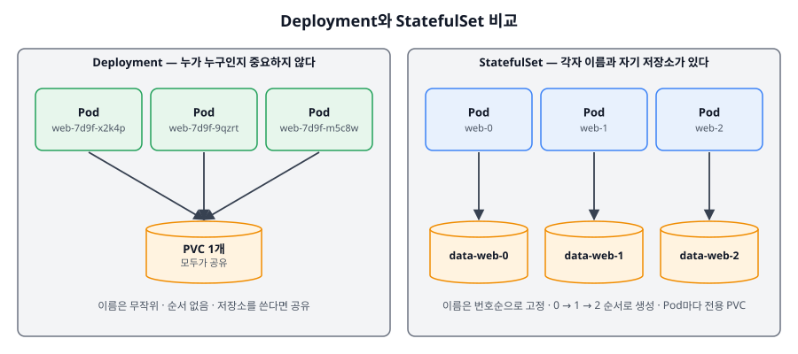

# 07. StatefulSet — 이름과 데이터가 유지되어야 하는 앱

**이 장을 마치면**

- Deployment와 StatefulSet의 차이를 설명하고, 언제 무엇을 쓸지 고를 수 있습니다.
- StatefulSet의 Pod가 고정된 이름과 자기만의 저장소를 갖는 것을 확인합니다.
- Pod를 지우거나 개수를 줄였다 늘려도 데이터가 제자리로 돌아오는 것을 확인합니다.

---

## 1. 왜 필요한가

Deployment의 Pod들은 **서로 구별되지 않습니다.** 이름은 무작위이고, 어느 것이 죽어도 아무 Pod나 새로 만들면 됩니다. 웹 서버처럼 상태가 없는(stateless) 앱에 잘 맞습니다.

하지만 데이터베이스 클러스터 같은 앱은 사정이 다릅니다.

- 각 인스턴스가 **자기 데이터**를 가지고 있어서, 다시 떠도 같은 데이터를 물려받아야 한다.
- "1번이 주(primary), 2번·3번이 복제본"처럼 **누가 누구인지** 구별되어야 한다.
- 주 인스턴스가 먼저 뜨고 복제본이 나중에 뜨는 식으로 **순서**가 필요하다.

**StatefulSet(스테이트풀셋)** 은 이런 상태가 있는(stateful) 앱을 위한 컨트롤러입니다.



| | Deployment | StatefulSet |
|---|---|---|
| Pod 이름 | `web-7d9f-x2k4p` (무작위) | `web-0`, `web-1`, `web-2` (번호 고정) |
| 다시 만들어지면 | 새 이름 | **같은 이름** |
| 저장소 | 모든 Pod가 PVC 하나를 공유 | **Pod마다 전용 PVC** |
| 생성 순서 | 동시에 | 0 → 1 → 2 순서대로 |
| 줄일 때 | 아무거나 | 번호가 큰 것부터 |
| 어울리는 앱 | 웹 서버, API 서버 | DB, 메시지 큐(Kafka), 검색 엔진 |

## 2. YAML 뜯어보기

([examples/07-statefulset/sts.yaml](../examples/07-statefulset/sts.yaml))

```yaml
apiVersion: apps/v1
kind: StatefulSet
metadata:
  name: web
spec:
  serviceName: web             # 짝이 되는 Headless Service의 이름 (08장에서 자세히)
  replicas: 3
  selector:
    matchLabels:
      app: web
  template:                    # 여기까지는 Deployment와 같다
    metadata:
      labels:
        app: web
    spec:
      containers:
      - name: nginx
        image: nginx:1.27-alpine
        volumeMounts:
        - name: data
          mountPath: /usr/share/nginx/html
  volumeClaimTemplates:        # Pod마다 PVC를 하나씩 찍어 내는 틀
  - metadata:
      name: data               # PVC 이름은 data-web-0, data-web-1, ... 이 된다
    spec:
      accessModes:
      - ReadWriteOnce
      resources:
        requests:
          storage: 1Gi
```

Deployment와 다른 점은 두 가지입니다.

- **`serviceName`**: Pod마다 고정된 주소를 주기 위한 Service 이름입니다. 같은 파일에 함께 들어 있습니다. [08장](08-headless-service.md)에서 다룹니다.
- **`volumeClaimTemplates`**: `template`이 Pod를 찍어 내는 틀이듯, 이것은 **PVC를 찍어 내는 틀**입니다. [06장](06-pv-pvc.md)에서는 PVC를 직접 만들었지만, 여기서는 Pod 하나당 PVC 하나가 자동으로 만들어집니다.

## 3. 실습 ① — 순서대로 만들어지는 Pod

```bash
kubectl apply -f examples/07-statefulset/sts.yaml
kubectl get pod
```

```
NAME    READY   STATUS              RESTARTS   AGE
web-0   0/1     ContainerCreating   0          2s
```

몇 초 간격으로 다시 조회해 보세요.

```bash
kubectl get pod
```

```
NAME    READY   STATUS    RESTARTS   AGE
web-0   1/1     Running   0          6s
web-1   1/1     Running   0          3s
web-2   0/1     Pending   0          0s
```

Deployment는 Pod 3개를 한꺼번에 만들지만, StatefulSet은 **`web-0`이 준비된 뒤에 `web-1`, 그다음 `web-2`** 순서로 만듭니다.

```bash
kubectl rollout status statefulset/web
kubectl get statefulset,pod,pvc
```

```
NAME                   READY   AGE
statefulset.apps/web   3/3     9s

NAME        READY   STATUS    RESTARTS   AGE
pod/web-0   1/1     Running   0          9s
pod/web-1   1/1     Running   0          6s
pod/web-2   1/1     Running   0          3s

NAME                               STATUS   VOLUME                                     CAPACITY   ACCESS MODES   STORAGECLASS   ...
persistentvolumeclaim/data-web-0   Bound    pvc-00fc5560-2be6-41fd-aa89-49fe959cc5a1   1Gi        RWO            nfs-client     ...
persistentvolumeclaim/data-web-1   Bound    pvc-fcb1155f-a5d0-4a18-987e-1cb1e11cd638   1Gi        RWO            nfs-client     ...
persistentvolumeclaim/data-web-2   Bound    pvc-680a0b8b-fe3e-43c8-ab5d-9ac476c413f4   1Gi        RWO            nfs-client     ...
```

- Pod 이름은 **`StatefulSet이름-번호`** 입니다. 중간에 ReplicaSet도 없습니다.
- PVC가 3개 생겼습니다. 이름은 **`볼륨이름-Pod이름`** (`data-web-0`)입니다. PVC마다 PV도 하나씩 연결됐습니다.

## 4. 실습 ② — Pod가 다시 만들어져도 이름과 데이터는 그대로

각 Pod가 자기 볼륨에 자기 이름을 적게 합니다.

```bash
for i in 0 1 2; do
  kubectl exec web-$i -- sh -c 'echo "I am $(hostname)" > /usr/share/nginx/html/index.html'
done

for i in 0 1 2; do kubectl exec web-$i -- wget -qO- http://127.0.0.1/; done
```

```
I am web-0
I am web-1
I am web-2
```

Pod마다 내용이 다릅니다. 저장소를 공유하지 않고 **각자 자기 것**을 쓰고 있기 때문입니다.

이제 `web-1`을 지웁니다. 지우기 전에 IP를 봐 둡니다.

```bash
kubectl get pod -o wide
kubectl delete pod web-1
kubectl wait --for=condition=Ready pod/web-1 --timeout=60s
kubectl get pod -o wide
```

```
NAME    READY   STATUS    RESTARTS   AGE   IP                NODE         ...
web-0   1/1     Running   0          13s   192.168.96.115    oks5.dd.io   ...
web-1   1/1     Running   0          2s    192.168.139.113   oks4.dd.io   ...
web-2   1/1     Running   0          7s    192.168.30.234    oks2.dd.io   ...
```

```bash
kubectl exec web-1 -- wget -qO- http://127.0.0.1/
```

```
I am web-1
```

**관찰한 것**

- 새로 만들어진 Pod의 이름이 **똑같이 `web-1`** 입니다 (`AGE`가 2초인 것으로 새 Pod임을 알 수 있습니다).
- IP는 바뀌었습니다 (`192.168.139.80` → `192.168.139.113`).
- 데이터는 그대로 `I am web-1`입니다. 새 `web-1`이 **예전 `web-1`의 PVC(`data-web-1`)를 다시 붙였기** 때문입니다.

```bash
kubectl describe pod web-1 | grep -A4 'Volumes:'
```

```
Volumes:
  data:
    Type:       PersistentVolumeClaim (a reference to a PersistentVolumeClaim in the same namespace)
    ClaimName:  data-web-1
    ReadOnly:   false
```

"이름 → PVC"의 짝이 고정되어 있다는 것이 StatefulSet의 핵심입니다.

## 5. 실습 ③ — 줄였다가 늘리기

```bash
kubectl scale statefulset web --replicas=1
kubectl get pod
```

```
NAME    READY   STATUS        RESTARTS   AGE
web-0   1/1     Running       0          15s
web-1   0/1     Terminating   0          4s
```

**번호가 큰 것부터**(`web-2` → `web-1`) 차례로 사라집니다. 잠시 뒤 Pod와 PVC를 확인합니다.

```bash
kubectl get pod
kubectl get pvc
```

```
NAME    READY   STATUS    RESTARTS   AGE
web-0   1/1     Running   0          25s

NAME         STATUS   VOLUME                                     CAPACITY   ACCESS MODES   STORAGECLASS   ...
data-web-0   Bound    pvc-00fc5560-2be6-41fd-aa89-49fe959cc5a1   1Gi        RWO            nfs-client     ...
data-web-1   Bound    pvc-fcb1155f-a5d0-4a18-987e-1cb1e11cd638   1Gi        RWO            nfs-client     ...
data-web-2   Bound    pvc-680a0b8b-fe3e-43c8-ab5d-9ac476c413f4   1Gi        RWO            nfs-client     ...
```

Pod는 1개로 줄었지만 **PVC 3개는 그대로 남아 있습니다.** StatefulSet은 데이터를 함부로 지우지 않습니다. 다시 3개로 늘려 봅니다.

```bash
kubectl scale statefulset web --replicas=3
kubectl rollout status statefulset/web
kubectl exec web-2 -- wget -qO- http://127.0.0.1/
```

```
I am web-2
```

돌아온 `web-2`가 남아 있던 `data-web-2`를 다시 붙여서, 예전 데이터를 그대로 가지고 있습니다.

## 6. 고장 내고 고쳐 보기 — Pod가 하나만 뜨고 멈췄다

```bash
kubectl apply -f examples/07-statefulset/sts-broken.yaml
sleep 8
kubectl get pod -l app=db
```

```
NAME   READY   STATUS    RESTARTS   AGE
db-0   0/1     Pending   0          8s
```

`replicas: 3`인데 `db-0` 하나만 있고, 그것도 `Pending`입니다. 원인을 찾아보세요. (힌트: [06장](06-pv-pvc.md) 6절)

<details><summary>원인과 해결 방법</summary>

```bash
kubectl describe pod db-0
kubectl get pvc -l app=db
kubectl describe pvc data-db-0
```

```
# Pod의 Events
Warning  FailedScheduling  8s  default-scheduler  0/5 nodes are available: pod has unbound immediate PersistentVolumeClaims. ...

# PVC 상태
NAME        STATUS    VOLUME   CAPACITY   ACCESS MODES   STORAGECLASS   ...
data-db-0   Pending                                      fast-ssd       ...

# PVC의 Events
Warning  ProvisioningFailed  8s  persistentvolume-controller  storageclass.storage.k8s.io "fast-ssd" not found
```

`volumeClaimTemplates`에 없는 StorageClass(`fast-ssd`)가 적혀 있어서 `db-0`의 PVC가 만들어지지 못했습니다.

`db-1`, `db-2`가 아예 보이지 않는 이유도 여기서 나옵니다. StatefulSet은 **앞 번호가 준비되어야 다음 번호를 만들기** 때문에, `db-0`이 멈추면 뒤가 전부 멈춥니다.

`volumeClaimTemplates`는 만든 뒤에 고칠 수 없습니다. StatefulSet을 지우고 YAML을 고쳐 다시 만들어야 합니다.
이때 **이미 만들어진 PVC는 자동으로 지워지지 않으므로** 직접 지워야 합니다. 그대로 두면 다시 만들어도 예전의 잘못된 PVC를 계속 쓰게 됩니다.

```bash
kubectl delete -f examples/07-statefulset/sts-broken.yaml
kubectl delete pvc -l app=db
```

</details>

## 7. 정리

StatefulSet을 지워도 PVC는 남습니다. 따로 지웁니다.

```bash
kubectl delete -f examples/07-statefulset/sts.yaml
kubectl get pvc
kubectl delete pvc -l app=web
```

PV의 회수 정책이 `Retain`인 환경이라면 PV도 `Released` 상태로 남습니다. [06장](06-pv-pvc.md) 7절에서 했던 것처럼 정리합니다.

```bash
kubectl get pv | grep -E 'NAME|edu-lab'

for pv in $(kubectl get pv -o jsonpath='{range .items[?(@.spec.claimRef.namespace=="edu-lab")]}{.metadata.name}{"\n"}{end}'); do
  kubectl patch pv $pv -p '{"spec":{"persistentVolumeReclaimPolicy":"Delete"}}'
done
```

## 8. 알아 두면 좋은 것

- **StatefulSet이 데이터 복제까지 해 주지는 않습니다.** StatefulSet은 "고정된 이름과 전용 저장소"를 제공할 뿐입니다.
  `web-0`의 데이터를 `web-1`로 복제하는 것은 앱(예: MySQL 복제, Kafka)이 스스로 해야 합니다.
- **업데이트는 역순**입니다. 이미지를 바꾸면 번호가 큰 Pod부터(`web-2` → `web-1` → `web-0`) 하나씩 교체됩니다.
- **모든 Pod가 같은 PVC 하나를 공유해도 된다면** StatefulSet이 아니라 Deployment + PVC(`ReadWriteMany`)로 충분합니다.

## 핵심 요약

- StatefulSet의 Pod는 `이름-0`, `이름-1`처럼 번호가 붙은 고정된 이름을 가진다.
- `volumeClaimTemplates`로 Pod마다 전용 PVC가 만들어진다.
- Pod가 다시 만들어지면 같은 이름으로, 같은 PVC를 붙여서 돌아온다. IP는 바뀐다.
- 0번부터 순서대로 만들고, 큰 번호부터 줄인다. 앞 번호가 멈추면 뒤도 멈춘다.
- StatefulSet을 지우거나 줄여도 PVC는 남는다.

## 확인 문제

1. StatefulSet `db`의 `replicas`가 3이면 Pod 이름은 무엇인가요?
2. `db-1`을 지우면 새로 만들어지는 Pod의 이름, IP, 데이터는 각각 어떻게 되나요?
3. `replicas`를 3에서 1로 줄이면 어떤 Pod가 남나요? 사라진 Pod의 PVC는 어떻게 되나요?
4. 웹 서버 5대를 띄우려고 합니다. Deployment와 StatefulSet 중 무엇을 써야 하나요?

<details><summary>정답 보기</summary>

1. `db-0`, `db-1`, `db-2`입니다.
2. 이름은 그대로 `db-1`, IP는 바뀌고, 데이터는 같은 PVC(`볼륨이름-db-1`)를 다시 붙이므로 유지됩니다.
3. `db-0`이 남습니다. 큰 번호부터 사라집니다. 사라진 Pod의 PVC는 남아 있다가, 다시 늘리면 같은 번호의 Pod에 붙습니다.
4. Deployment입니다. 웹 서버는 서로 구별할 필요가 없고 전용 저장소도 필요 없습니다.
</details>

---

다음 장: [08. Headless Service — Pod 하나하나를 이름으로 찾아가기](08-headless-service.md)
