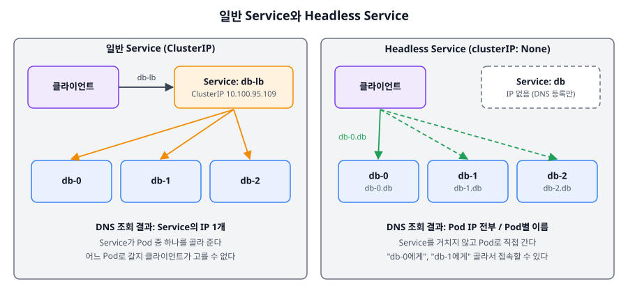

# 08. Headless Service — Pod 하나하나를 이름으로 찾아가기

**이 장을 마치면**

- 일반 Service와 Headless Service의 차이를 DNS 조회 결과로 설명할 수 있습니다.
- StatefulSet의 Pod에 `db-0.db`처럼 고정된 이름으로 접속할 수 있습니다.
- StatefulSet의 `serviceName`이 왜 중요한지 압니다.

---

## 1. 왜 필요한가

[03장](03-service.md)의 Service는 요청을 Pod 중 **아무 하나**에게 넘겨줍니다. 웹 서버라면 그걸로 충분합니다.

하지만 [07장](07-statefulset.md)의 StatefulSet처럼 Pod가 서로 구별되는 경우에는 **특정 Pod를 골라서** 접속해야 할 때가 있습니다.

- 쓰기는 반드시 주(primary) DB인 `db-0`에게 보내야 한다.
- 복제본 `db-1`이 `db-0`에게 접속해서 데이터를 받아 와야 한다.

Pod IP를 직접 쓰면 될 것 같지만, IP는 Pod가 다시 만들어질 때마다 바뀝니다. **이름은 고정인데 IP는 바뀌는** 이 문제를 풀어 주는 것이 Headless Service입니다.

## 2. 일반 Service와 무엇이 다른가

**Headless Service**는 `clusterIP: None`으로 만든 Service입니다. 자기 IP가 없고, 요청을 나눠 주지도 않습니다. 대신 **DNS에 Pod들의 주소를 직접 등록**해 줍니다.



| | 일반 Service | Headless Service |
|---|---|---|
| YAML | `clusterIP` 생략 | `clusterIP: None` |
| Service 자신의 IP | 있음 | **없음** |
| Service 이름을 DNS로 조회하면 | Service IP 1개 | **Pod IP 전부** |
| Pod별 DNS 이름 | 없음 | StatefulSet과 함께 쓰면 `Pod이름.Service이름` |
| 요청 분산 | Service가 해 줌 | 하지 않음 (클라이언트가 Pod를 직접 고름) |

StatefulSet의 Pod에는 이런 DNS 이름이 생깁니다.

```
db-0.db.edu-lab.svc.cluster.local
└─┬┘ └┬┘ └──┬──┘
Pod 이름  │  네임스페이스
    Headless Service 이름
```

같은 네임스페이스 안에서는 짧게 **`db-0.db`** 라고만 써도 됩니다.

## 3. YAML 뜯어보기

비교를 위해 같은 Pod들을 가리키는 Service를 **두 개** 만듭니다. ([examples/08-headless/headless.yaml](../examples/08-headless/headless.yaml))

```yaml
apiVersion: v1
kind: Service
metadata:
  name: db                     # Headless Service
spec:
  clusterIP: None              # 이 한 줄이 Headless Service를 만든다
  selector:
    app: db
  ports:
  - port: 80
---
apiVersion: v1
kind: Service
metadata:
  name: db-lb                  # 비교용: 일반 ClusterIP Service
spec:
  selector:
    app: db
  ports:
  - port: 80
---
apiVersion: apps/v1
kind: StatefulSet
metadata:
  name: db
spec:
  serviceName: db              # Headless Service의 이름과 같아야 한다
  replicas: 3
  ...
```

Pod는 요청을 받으면 자기 이름을 응답하는 nginx입니다(03장과 같은 방식). 실습을 단순하게 하려고 PVC는 넣지 않았습니다.

## 4. 실습 ① — DNS 조회 결과 비교

```bash
kubectl apply -f examples/08-headless/headless.yaml
kubectl rollout status statefulset/db
kubectl get service
kubectl get pod -o wide
```

```
NAME    TYPE        CLUSTER-IP      EXTERNAL-IP   PORT(S)   AGE
db      ClusterIP   None            <none>        80/TCP    4s
db-lb   ClusterIP   10.100.95.109   <none>        80/TCP    4s

NAME   READY   STATUS    RESTARTS   AGE   IP               NODE         ...
db-0   1/1     Running   0          4s    192.168.139.82   oks4.dd.io   ...
db-1   1/1     Running   0          3s    192.168.96.113   oks5.dd.io   ...
db-2   1/1     Running   0          2s    192.168.30.254   oks2.dd.io   ...
```

`db`의 `CLUSTER-IP`가 `None`입니다. 클라이언트 Pod를 띄우고 두 Service의 이름을 DNS로 조회해 봅니다.

```bash
kubectl run client --image=busybox:1.36 --restart=Never -- sleep 3600
kubectl wait --for=condition=Ready pod/client --timeout=60s
```

**일반 Service** — Service의 IP 하나가 나옵니다.

```bash
kubectl exec client -- nslookup db-lb.edu-lab.svc.cluster.local
```

```
Name:	db-lb.edu-lab.svc.cluster.local
Address: 10.100.95.109
```

**Headless Service** — Pod IP 3개가 그대로 나옵니다.

```bash
kubectl exec client -- nslookup db.edu-lab.svc.cluster.local
```

```
Name:	db.edu-lab.svc.cluster.local
Address: 192.168.139.82
Name:	db.edu-lab.svc.cluster.local
Address: 192.168.96.113
Name:	db.edu-lab.svc.cluster.local
Address: 192.168.30.254
```

> 네임스페이스 이름이 `edu-lab`이 아니라면 명령의 `edu-lab` 부분을 바꿔서 실행하세요.

## 5. 실습 ② — Pod를 골라서 접속하기

**Pod별 이름**을 조회합니다.

```bash
kubectl exec client -- nslookup db-0.db.edu-lab.svc.cluster.local
```

```
Name:	db-0.db.edu-lab.svc.cluster.local
Address: 192.168.139.82
```

`db-0`의 IP가 나왔습니다. 이 이름으로 접속합니다.

```bash
kubectl exec client -- wget -qO- http://db-0.db
kubectl exec client -- wget -qO- http://db-2.db
```

```
db-0
db-2
```

일반 Service와 비교해 봅니다. 각각 4번씩 호출합니다.

```bash
# 일반 Service: 어느 Pod가 응답할지 모른다
kubectl exec client -- sh -c 'for i in 1 2 3 4; do wget -qO- http://db-lb; done'

# Pod별 이름: 항상 그 Pod가 응답한다
kubectl exec client -- sh -c 'for i in 1 2 3 4; do wget -qO- http://db-1.db; done'
```

```
db-0
db-0
db-2
db-0

db-1
db-1
db-1
db-1
```

Pod 자신도 자기의 전체 이름을 알고 있고, Pod끼리도 이 이름으로 서로를 부를 수 있습니다. DB 복제본이 주 DB를 찾아갈 때 이 방식을 씁니다.

```bash
kubectl exec db-0 -- hostname -f
kubectl exec db-0 -- wget -qO- http://db-1.db
```

```
db-0.db.edu-lab.svc.cluster.local
db-1
```

## 6. 실습 ③ — Pod가 다시 만들어져도 이름은 그대로

`db-1`을 지우고, 새 IP를 확인합니다.

```bash
kubectl delete pod db-1
kubectl wait --for=condition=Ready pod/db-1 --timeout=60s
kubectl get pod db-1 -o wide
```

```
NAME   READY   STATUS    RESTARTS   AGE   IP              NODE         ...
db-1   1/1     Running   0          1s    192.168.96.70   oks5.dd.io   ...
```

IP가 `192.168.96.113`에서 `192.168.96.70`으로 바뀌었습니다. **30초쯤 기다린 뒤** 같은 이름으로 다시 접속합니다.

```bash
sleep 30
kubectl exec client -- nslookup db-1.db.edu-lab.svc.cluster.local
kubectl exec client -- wget -qO- -T 3 http://db-1.db
```

```
Name:	db-1.db.edu-lab.svc.cluster.local
Address: 192.168.96.70

db-1
```

같은 이름 `db-1.db`가 새 IP를 가리킵니다. 클라이언트는 설정을 바꿀 필요가 없습니다.

> **왜 기다려야 하나요?** 클러스터의 DNS 서버는 조회 결과를 30초 정도 기억해 둡니다(캐시). Pod가 다시 만들어진 직후에는
> 잠깐 예전 IP를 알려 줄 수 있고, 그 사이에 접속하면 실패합니다. 그래서 StatefulSet을 쓰는 앱들은 접속에 실패하면 잠시 뒤 다시 시도하도록 만들어져 있습니다.

## 7. 고장 내고 고쳐 보기 — Pod별 이름이 조회되지 않는다

```bash
kubectl apply -f examples/08-headless/broken.yaml
kubectl rollout status statefulset/cache
kubectl get pod -l app=cache
```

```
NAME      READY   STATUS    RESTARTS   AGE
cache-0   1/1     Running   0          3s
cache-1   1/1     Running   0          1s
```

Pod는 정상입니다. 그런데 Pod별 이름으로 접속이 안 됩니다.

```bash
kubectl exec client -- wget -qO- -T 3 http://cache-0.cache
```

```
wget: bad address 'cache-0.cache'
command terminated with exit code 1
```

`bad address`는 **DNS에서 이름을 찾지 못했다**는 뜻입니다(03장의 `Connection refused`와는 다른 단계입니다). 단서를 모아 봅니다.

```bash
# Service 이름 자체는 조회될까?
kubectl exec client -- nslookup cache.edu-lab.svc.cluster.local

# Pod는 자기 이름을 뭐라고 알고 있을까?
kubectl exec cache-0 -- hostname -f

# StatefulSet의 serviceName과 실제 Service 목록
kubectl get statefulset cache -o jsonpath='{.spec.serviceName}{"\n"}'
kubectl get service
```

<details><summary>원인과 해결 방법</summary>

```
Name:	cache.edu-lab.svc.cluster.local
Address: 192.168.96.123
Name:	cache.edu-lab.svc.cluster.local
Address: 192.168.30.240

cache-0.cache-svc.edu-lab.svc.cluster.local

cache-svc

NAME    TYPE        CLUSTER-IP      EXTERNAL-IP   PORT(S)   AGE
cache   ClusterIP   None            <none>        80/TCP    4s
...
```

- Headless Service `cache`는 있고, Pod IP도 잘 등록되어 있습니다.
- 그런데 Pod는 자기 이름을 `cache-0.cache-svc...`라고 알고 있습니다.
- StatefulSet의 `serviceName`이 `cache-svc`인데, 그런 이름의 Service는 없습니다.

Pod별 DNS 이름은 **StatefulSet의 `serviceName`과 같은 이름의 Headless Service가 있을 때만** 만들어집니다. 둘의 이름이 달라서 `cache-0.cache`도, `cache-0.cache-svc`도 조회되지 않는 것입니다.

`serviceName`은 만든 뒤에 고칠 수 없습니다. StatefulSet을 지우고 올바른 값으로 다시 만듭니다.

```bash
kubectl delete statefulset cache
sed 's/serviceName: cache-svc.*/serviceName: cache/' examples/08-headless/broken.yaml | kubectl apply -f -
kubectl rollout status statefulset/cache

sleep 30
kubectl exec client -- wget -qO- -T 3 http://cache-0.cache
```

```
cache-0
```

`sed`는 파일에서 `serviceName: cache-svc`를 `serviceName: cache`로 바꿔서 넘겨주는 역할입니다. 파일을 직접 고친 뒤 `kubectl apply -f`를 해도 같습니다.
(반대로 `cache-svc`라는 이름의 Headless Service를 하나 더 만드는 방법도 있습니다. 그러면 이름이 `cache-0.cache-svc`가 됩니다.)

</details>

## 8. 정리

```bash
kubectl delete pod client
kubectl delete -f examples/08-headless/headless.yaml -f examples/08-headless/broken.yaml
```

## 핵심 요약

- Headless Service는 `clusterIP: None`인 Service다. 자기 IP가 없고, DNS에 Pod IP를 직접 등록한다.
- StatefulSet과 함께 쓰면 Pod마다 `Pod이름.Service이름`이라는 고정된 DNS 이름이 생긴다.
- Pod가 다시 만들어져 IP가 바뀌어도 이름은 그대로다. DNS 캐시 때문에 반영에 수십 초가 걸릴 수 있다.
- StatefulSet의 `serviceName`은 Headless Service의 이름과 같아야 한다.
- 접속 오류가 `bad address`(이름을 못 찾음)인지 `Connection refused`(찾았지만 연결 실패)인지 구분하면 원인을 빨리 좁힐 수 있다.

## 확인 문제

1. Headless Service를 만드는 YAML 한 줄은 무엇인가요?
2. 일반 Service와 Headless Service의 이름을 각각 DNS로 조회하면 무엇이 나오나요?
3. 네임스페이스 `prod`에 StatefulSet `mysql`(`serviceName: mysql`)이 있습니다. 두 번째 Pod의 전체 DNS 이름은 무엇인가요?
4. Pod는 `Running`인데 `mysql-0.mysql`로 접속하면 `bad address`가 나옵니다. 무엇을 확인해야 하나요?

<details><summary>정답 보기</summary>

1. `clusterIP: None`
2. 일반 Service는 Service의 ClusterIP 1개, Headless Service는 연결된 Pod들의 IP 전부가 나옵니다.
3. `mysql-1.mysql.prod.svc.cluster.local` (번호는 0부터 시작하므로 두 번째는 `mysql-1`)
4. StatefulSet의 `serviceName`과 같은 이름의 Headless Service가 있는지, 그 Service의 selector가 Pod 레이블과 맞는지 확인합니다. Pod가 방금 만들어졌다면 DNS 캐시 때문일 수 있으니 잠시 뒤 다시 시도합니다.
</details>

---

다음 장: [09. DaemonSet — 모든 노드에 하나씩](09-daemonset.md)
