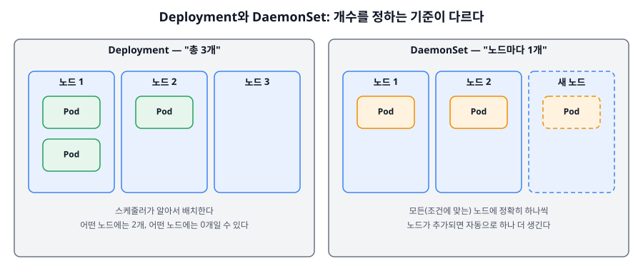

# 09. DaemonSet — 모든 노드에 하나씩

**이 장을 마치면**

- Deployment와 DaemonSet의 차이를 설명하고, DaemonSet이 필요한 상황을 알아볼 수 있습니다.
- DaemonSet의 Pod가 노드마다 하나씩 뜨는 것을 확인합니다.
- "DaemonSet을 만들었는데 Pod가 하나도 없다"의 원인을 찾을 수 있습니다.

---

## 1. 왜 필요한가

어떤 프로그램은 "몇 개"가 아니라 **"노드마다 하나씩"** 있어야 합니다.

- **로그 수집기**: 각 노드에 쌓이는 로그 파일을 읽어서 보내야 한다.
- **모니터링 에이전트**: 각 노드의 CPU, 메모리, 디스크 사용량을 측정해야 한다.
- **네트워크 구성 요소**: 각 노드에서 Pod 네트워크를 만들어 줘야 한다.

Deployment로 `replicas`를 노드 수만큼 지정하면 될 것 같지만, 스케줄러가 한 노드에 2개를 띄우고 다른 노드에는 안 띄울 수 있습니다. 노드가 추가될 때마다 숫자도 고쳐야 합니다.

**DaemonSet(데몬셋)** 은 "조건에 맞는 모든 노드에 Pod를 정확히 하나씩" 유지합니다.



| | Deployment | DaemonSet |
|---|---|---|
| 개수 | `replicas`로 지정 | **노드 수가 정함** (`replicas` 없음) |
| 배치 | 스케줄러가 알아서 | 노드마다 하나씩 |
| 노드가 추가되면 | 변화 없음 | 그 노드에 자동으로 하나 추가 |

지금 쓰고 있는 클러스터에도 이미 DaemonSet이 여러 개 돌고 있습니다.

```bash
kubectl get daemonset -A
```

```
NAMESPACE        NAME                           DESIRED   CURRENT   READY   UP-TO-DATE   AVAILABLE   NODE SELECTOR            AGE
calico-system    calico-node                    5         5         5       5            5           kubernetes.io/os=linux   538d
kube-system      kube-proxy                     5         5         5       5            5           kubernetes.io/os=linux   538d
monitoring       kps-prometheus-node-exporter   5         5         5       5            5           kubernetes.io/os=linux   46h
...
```

`calico-node`(네트워크), `kube-proxy`(Service 동작), `node-exporter`(노드 모니터링) 모두 노드마다 있어야 하는 것들입니다. `-A`는 모든 네임스페이스를 조회하는 옵션입니다.

## 2. YAML 뜯어보기

([examples/09-daemonset/ds.yaml](../examples/09-daemonset/ds.yaml))

```yaml
apiVersion: apps/v1
kind: DaemonSet
metadata:
  name: node-agent
spec:                          # replicas가 없다. 개수는 노드 수가 정한다
  selector:
    matchLabels:
      app: node-agent
  template:
    metadata:
      labels:
        app: node-agent
    spec:
      containers:
      - name: agent
        image: busybox:1.36
        env:
        - name: NODE_NAME            # 자기가 실행 중인 노드 이름을 환경변수로 받는다
          valueFrom:
            fieldRef:
              fieldPath: spec.nodeName
        command: ["sh", "-c"]
        args:                        # 10초마다 "어느 노드에서 일하고 있는지" 출력 (수집기 흉내)
        - while true; do echo "$(date +%T) agent running on $NODE_NAME"; sleep 10; done
```

Deployment와 거의 같고 `replicas`만 없습니다.

`fieldRef`는 Pod 자신의 정보를 환경변수로 넣어 주는 기능입니다. [04장](04-configmap.md)에서 ConfigMap의 값을 넣었던 자리에, 이번에는 "내가 배치된 노드 이름"을 넣었습니다.

## 3. 실습 ① — 노드마다 하나씩

```bash
kubectl get nodes
kubectl apply -f examples/09-daemonset/ds.yaml
kubectl rollout status daemonset/node-agent
kubectl get daemonset node-agent
kubectl get pod -o wide
```

```
NAME         STATUS   ROLES           AGE    VERSION
oks1.dd.io   Ready    control-plane   538d   v1.29.15
oks2.dd.io   Ready    <none>          538d   v1.29.15
oks3.dd.io   Ready    <none>          538d   v1.29.15
oks4.dd.io   Ready    <none>          538d   v1.29.15
oks5.dd.io   Ready    <none>          538d   v1.29.15

NAME         DESIRED   CURRENT   READY   UP-TO-DATE   AVAILABLE   NODE SELECTOR   AGE
node-agent   4         4         4       4            4           <none>          5s

NAME               READY   STATUS    RESTARTS   AGE   IP               NODE         ...
node-agent-prh4h   1/1     Running   0          5s    192.168.96.74    oks5.dd.io   ...
node-agent-sxlzc   1/1     Running   0          5s    192.168.201.85   oks3.dd.io   ...
node-agent-tlgzz   1/1     Running   0          5s    192.168.30.252   oks2.dd.io   ...
node-agent-v84hx   1/1     Running   0          5s    192.168.139.86   oks4.dd.io   ...
```

개수를 지정하지 않았는데 Pod가 4개 생겼고, `NODE` 열을 보면 **서로 다른 노드에 하나씩** 있습니다.

그런데 노드는 5대인데 `DESIRED`는 4입니다. 컨트롤 플레인 노드(`oks1`)가 빠졌습니다. 이유는 4절에서 다룹니다.

각 Pod의 로그를 한 번에 봅니다. `-l`로 레이블을 지정하면 여러 Pod의 로그를 함께 볼 수 있습니다.

```bash
kubectl logs -l app=node-agent --tail=1 --prefix
```

```
[pod/node-agent-v84hx/agent] 10:42:34 agent running on oks4.dd.io
[pod/node-agent-prh4h/agent] 10:42:50 agent running on oks5.dd.io
[pod/node-agent-sxlzc/agent] 10:42:53 agent running on oks3.dd.io
[pod/node-agent-tlgzz/agent] 10:43:07 agent running on oks2.dd.io
```

### Pod를 지우면

Pod 하나를 지워 봅니다. (이름과 노드는 각자 출력에 맞게 확인하세요)

```text
kubectl delete pod node-agent-prh4h
```

```bash
kubectl get pod -o wide
```

```
NAME               READY   STATUS    RESTARTS   AGE   IP               NODE         ...
node-agent-jpskj   1/1     Running   0          5s    192.168.96.80    oks5.dd.io   ...
node-agent-sxlzc   1/1     Running   0          16s   192.168.201.85   oks3.dd.io   ...
node-agent-tlgzz   1/1     Running   0          16s   192.168.30.252   oks2.dd.io   ...
node-agent-v84hx   1/1     Running   0          16s   192.168.139.86   oks4.dd.io   ...
```

새 Pod가 **지워진 Pod가 있던 바로 그 노드**(`oks5`)에 다시 만들어졌습니다. Deployment였다면 어느 노드에 뜰지 알 수 없습니다.

## 4. 실습 ② — 컨트롤 플레인 노드에도 띄우기

컨트롤 플레인 노드에는 "일반 Pod는 받지 않는다"는 표시(**taint**)가 붙어 있습니다.

```bash
kubectl describe nodes | grep -E '^Name:|^Taints:'
```

```
Name:               oks1.dd.io
Taints:             node-role.kubernetes.io/control-plane:NoSchedule
Name:               oks2.dd.io
Taints:             <none>
...
```

이 노드에도 Pod를 띄우려면 "그 표시가 있어도 들어가겠다"는 허가증(**toleration**)을 Pod에 적어 줍니다. 로그 수집기나 모니터링 에이전트는 컨트롤 플레인 노드도 빠뜨리면 안 되기 때문에 실제로 이렇게 설정합니다.
([examples/09-daemonset/ds-all-nodes.yaml](../examples/09-daemonset/ds-all-nodes.yaml))

```yaml
    spec:
      tolerations:                   # "이 taint가 있는 노드에도 들어가겠다"는 허가증 (15장에서 자세히)
      - key: node-role.kubernetes.io/control-plane
        operator: Exists
        effect: NoSchedule
```

```bash
kubectl apply -f examples/09-daemonset/ds-all-nodes.yaml
kubectl rollout status daemonset/node-agent
kubectl get daemonset node-agent
kubectl get pod -o wide
```

```
NAME         DESIRED   CURRENT   READY   UP-TO-DATE   AVAILABLE   NODE SELECTOR   AGE
node-agent   5         5         5       5            5           <none>          49s

NAME               READY   STATUS    RESTARTS   AGE   IP               NODE         ...
node-agent-864n9   1/1     Running   0          33s   192.168.51.135   oks1.dd.io   ...
node-agent-9q8l6   1/1     Running   0          22s   192.168.96.76    oks5.dd.io   ...
node-agent-fkxxd   1/1     Running   0          16s   192.168.30.193   oks2.dd.io   ...
node-agent-gv897   1/1     Running   0          9s    192.168.201.86   oks3.dd.io   ...
node-agent-j9mbk   1/1     Running   0          2s    192.168.139.89   oks4.dd.io   ...
```

`DESIRED`가 5가 됐고 `oks1`에도 Pod가 생겼습니다. taint와 toleration은 [15장](15-scheduling.md)에서 자세히 배웁니다.

> Pod 틀(template)을 바꿨기 때문에 기존 Pod들도 하나씩 새것으로 교체됐습니다(`AGE`가 제각각인 이유). DaemonSet도 Deployment처럼 롤링 업데이트를 합니다.

```bash
kubectl delete -f examples/09-daemonset/ds-all-nodes.yaml
```

## 5. 고장 내고 고쳐 보기 — Pod가 하나도 안 생긴다

SSD가 달린 노드에만 띄우려는 DaemonSet을 만듭니다. ([examples/09-daemonset/ds-selector.yaml](../examples/09-daemonset/ds-selector.yaml))

```bash
kubectl apply -f examples/09-daemonset/ds-selector.yaml
sleep 5
kubectl get daemonset ssd-agent
kubectl get pod -l app=ssd-agent
```

```
daemonset.apps/ssd-agent created

NAME        DESIRED   CURRENT   READY   UP-TO-DATE   AVAILABLE   NODE SELECTOR   AGE
ssd-agent   0         0         0       0            0           disktype=ssd    5s

No resources found in edu-lab namespace.
```

만들어졌다고 나오는데 Pod가 없습니다. [01장](01-pod.md)의 `Pending`과는 다릅니다. 실패한 Pod조차 없습니다.

```bash
kubectl describe daemonset ssd-agent
```

```
Name:           ssd-agent
Selector:       app=ssd-agent
Node-Selector:  disktype=ssd
Desired Number of Nodes Scheduled: 0
Current Number of Nodes Scheduled: 0
...
Events:           <none>
```

<details><summary>원인과 해결 방법</summary>

Events도 비어 있습니다. **오류가 아니기 때문**입니다. `Desired Number of Nodes Scheduled: 0` — DaemonSet은 "조건에 맞는 노드가 0대이니 Pod도 0개"라고 판단했고, 그 상태는 정상입니다.

조건은 `Node-Selector: disktype=ssd`입니다. 이 레이블이 붙은 노드가 있는지 확인합니다.

```bash
kubectl get nodes -l disktype=ssd
```

```
No resources found
```

없습니다. 해결 방법은 두 가지입니다. ① `nodeSelector`가 잘못된 것이라면 YAML을 고친다. ② 조건이 맞다면 대상 노드에 레이블을 붙인다. 여기서는 ②를 해 봅니다.

워커 노드 두 대의 이름을 변수에 담습니다.

```bash
NODE1=$(kubectl get nodes -l '!node-role.kubernetes.io/control-plane' -o jsonpath='{.items[0].metadata.name}')
NODE2=$(kubectl get nodes -l '!node-role.kubernetes.io/control-plane' -o jsonpath='{.items[1].metadata.name}')
echo $NODE1 $NODE2
```

첫 번째 노드에 레이블을 붙입니다.

```bash
kubectl label node $NODE1 disktype=ssd
sleep 5
kubectl get daemonset ssd-agent
kubectl get pod -l app=ssd-agent -o wide
```

```
NAME        DESIRED   CURRENT   READY   UP-TO-DATE   AVAILABLE   NODE SELECTOR   AGE
ssd-agent   1         1         1       1            1           disktype=ssd    11s

NAME              READY   STATUS    RESTARTS   AGE   IP               NODE         ...
ssd-agent-v6smr   1/1     Running   0          7s    192.168.30.199   oks2.dd.io   ...
```

DaemonSet은 건드리지 않았는데, 노드에 레이블을 붙이자마자 그 노드에 Pod가 생겼습니다.

</details>

### 노드가 늘고 줄 때

방금 한 것이 사실상 "조건에 맞는 노드가 하나 추가된 상황"입니다. 두 번째 노드에도 레이블을 붙여 봅니다.

```bash
kubectl label node $NODE2 disktype=ssd
sleep 5
kubectl get pod -l app=ssd-agent -o wide
```

```
NAME              READY   STATUS    RESTARTS   AGE   IP               NODE         ...
ssd-agent-lbjmh   1/1     Running   0          6s    192.168.201.87   oks3.dd.io   ...
ssd-agent-v6smr   1/1     Running   0          13s   192.168.30.199   oks2.dd.io   ...
```

Pod가 자동으로 2개가 됐습니다. 반대로 레이블을 떼면 그 노드의 Pod가 사라집니다.

```bash
kubectl label node $NODE1 disktype-
sleep 8
kubectl get pod -l app=ssd-agent -o wide
```

```
NAME              READY   STATUS    RESTARTS   AGE   IP               NODE         ...
ssd-agent-lbjmh   1/1     Running   0          14s   192.168.201.87   oks3.dd.io   ...
```

## 6. 정리

노드에 붙인 레이블을 반드시 떼어 주세요. 노드는 모두가 함께 쓰는 자원입니다.

```bash
kubectl label node $NODE2 disktype-
kubectl delete -f examples/09-daemonset/ds-selector.yaml
kubectl get nodes -L disktype
```

```
NAME         STATUS   ROLES           AGE    VERSION    DISKTYPE
oks1.dd.io   Ready    control-plane   538d   v1.29.15
oks2.dd.io   Ready    <none>          538d   v1.29.15
...
```

`DISKTYPE` 열이 모두 비어 있으면 정리된 것입니다. (`-L 키`는 그 레이블의 값을 열로 보여 주는 옵션입니다)

## 핵심 요약

- DaemonSet은 조건에 맞는 모든 노드에 Pod를 하나씩 유지한다. `replicas`가 없다.
- 노드가 추가되면 Pod도 자동으로 추가된다.
- 컨트롤 플레인처럼 taint가 있는 노드에 띄우려면 toleration이 필요하다.
- `nodeSelector`로 대상 노드를 좁힐 수 있다. 맞는 노드가 없으면 오류 없이 `DESIRED 0`이 된다.

## 확인 문제

1. DaemonSet에 `replicas` 필드가 없는 이유는 무엇인가요?
2. 워커 노드가 4대인 클러스터에 노드 1대를 추가하면 DaemonSet의 Pod는 어떻게 되나요?
3. 노드는 5대인데 DaemonSet의 `DESIRED`가 4입니다. 가능한 이유는 무엇인가요?
4. DaemonSet을 만들었는데 `DESIRED`가 0이고 Events도 없습니다. 무엇을 확인해야 하나요?

<details><summary>정답 보기</summary>

1. Pod 개수를 사람이 정하지 않고, 조건에 맞는 노드의 수가 정하기 때문입니다.
2. 새 노드에 Pod가 자동으로 하나 만들어져 5개가 됩니다.
3. 한 노드에 taint가 있고(예: 컨트롤 플레인) Pod에 toleration이 없기 때문입니다. `nodeSelector` 조건에 맞지 않는 노드가 있어도 그렇습니다.
4. DaemonSet의 `nodeSelector`(또는 affinity) 조건과, 그 조건에 맞는 레이블을 가진 노드가 있는지 확인합니다 (`kubectl get nodes -l 키=값`).
</details>

---

다음 장: [10. Ingress — 도메인과 경로로 HTTP 요청 나누기](10-ingress.md)
