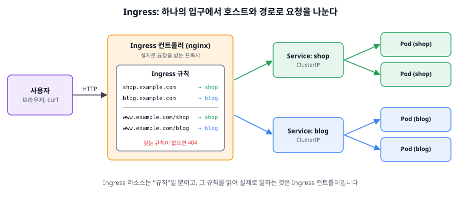

# 10. Ingress — 도메인과 경로로 HTTP 요청 나누기

**이 장을 마치면**

- Ingress와 Ingress 컨트롤러가 각각 무엇인지 설명할 수 있습니다.
- 호스트 이름과 경로로 요청을 서로 다른 Service에 보낼 수 있습니다.
- 404와 503이 각각 무엇을 뜻하는지 구분해서 원인을 찾을 수 있습니다.

---

## 1. 왜 필요한가

[03장](03-service.md)에서 NodePort로 클러스터 밖에서 접속해 봤습니다. 하지만 서비스가 늘어나면 불편해집니다.

- 서비스마다 `30664`, `31124` 같은 포트 번호를 따로 기억해야 한다.
- 사용자에게 `http://10.0.1.182:30664` 같은 주소를 안내할 수는 없다.
- `shop.example.com`, `blog.example.com`처럼 **도메인으로 구분**하고 싶다.

**Ingress(인그레스)** 는 HTTP 요청을 **호스트 이름과 경로**를 보고 알맞은 Service로 보내 주는 규칙입니다. 입구는 하나(80/443 포트)만 두고, 그 뒤에서 여러 서비스로 나눕니다.



### Ingress와 Ingress 컨트롤러

이름이 비슷한 두 가지를 구분해야 합니다.

| | 무엇인가 | 누가 준비하나 |
|---|---|---|
| **Ingress 컨트롤러** | 실제로 요청을 받아서 넘겨주는 프록시 프로그램 (nginx 등). 클러스터에 미리 설치되어 있어야 한다 | 클러스터 관리자 |
| **Ingress** | "이 호스트/경로는 이 Service로"라고 적은 **규칙** | 앱을 배포하는 사람 |

Ingress를 만들면 컨트롤러가 그 규칙을 읽어서 자기 설정에 반영합니다. **컨트롤러가 없으면 Ingress를 만들어도 아무 일도 일어나지 않습니다.**

## 2. 실습 준비

### 2-1. Ingress 컨트롤러 확인

```bash
kubectl get ingressclass
kubectl -n ingress-nginx get service ingress-nginx-controller
```

```
NAME    CONTROLLER             PARAMETERS   AGE
nginx   k8s.io/ingress-nginx   <none>       146d

NAME                       TYPE           CLUSTER-IP       EXTERNAL-IP   PORT(S)                      AGE
ingress-nginx-controller   LoadBalancer   10.106.212.226   10.0.1.230    80:30708/TCP,443:30429/TCP   146d
```

- **IngressClass** `nginx`가 있습니다. Ingress를 만들 때 "어느 컨트롤러가 처리할지"를 이 이름으로 지정합니다.
- 컨트롤러도 결국 Pod이고, 그 앞에 Service가 있습니다. `EXTERNAL-IP`(`10.0.1.230`)가 **클러스터의 HTTP 입구 주소**입니다.

입구 주소를 변수에 담아 둡니다.

```bash
INGRESS_IP=$(kubectl -n ingress-nginx get service ingress-nginx-controller -o jsonpath='{.status.loadBalancer.ingress[0].ip}')
echo $INGRESS_IP
```

```
10.0.1.230
```

> `EXTERNAL-IP`가 `<none>`이나 `<pending>`인 환경이라면 NodePort로 접속합니다. `INGRESS_IP`에 `노드IP:포트`(위 예라면 `10.0.1.182:30708`)를 넣으세요.

### 2-2. 앱 두 개 배포

서로 다른 내용을 응답하는 `shop`과 `blog`를 배포합니다. 각각 Deployment 하나와 ClusterIP Service 하나입니다.
([examples/10-ingress/apps.yaml](../examples/10-ingress/apps.yaml))

```bash
kubectl apply -f examples/10-ingress/apps.yaml
kubectl rollout status deployment/shop
kubectl rollout status deployment/blog
kubectl get deployment,service
```

```
NAME                   READY   UP-TO-DATE   AVAILABLE   AGE
deployment.apps/blog   2/2     2            2           2s
deployment.apps/shop   2/2     2            2           2s

NAME           TYPE        CLUSTER-IP       EXTERNAL-IP   PORT(S)   AGE
service/blog   ClusterIP   10.108.197.231   <none>        80/TCP    2s
service/shop   ClusterIP   10.96.217.98     <none>        80/TCP    2s
```

두 Service 모두 ClusterIP라서 지금은 클러스터 밖에서 접속할 수 없습니다.

## 3. 실습 ① — 호스트 이름으로 나누기

([examples/10-ingress/ingress-host.yaml](../examples/10-ingress/ingress-host.yaml))

```yaml
apiVersion: networking.k8s.io/v1
kind: Ingress
metadata:
  name: web-host
spec:
  ingressClassName: nginx            # 이 규칙을 처리할 Ingress 컨트롤러
  rules:
  - host: shop.edu-lab.example.com   # 이 이름으로 들어온 요청은
    http:
      paths:
      - path: /
        pathType: Prefix
        backend:
          service:
            name: shop               # shop Service의
            port:
              number: 80             # 80번 포트로 보낸다
  - host: blog.edu-lab.example.com
    http:
      paths:
      - path: /
        pathType: Prefix
        backend:
          service:
            name: blog
            port:
              number: 80
```

- `backend.service.port.number`는 **Service의 포트**(`port`)입니다. 컨테이너 포트가 아닙니다.
- `pathType: Prefix`는 "이 경로로 시작하는 모든 요청"이라는 뜻입니다. `/`이면 전부입니다.

```bash
kubectl apply -f examples/10-ingress/ingress-host.yaml
sleep 5
kubectl describe ingress web-host
```

```
Rules:
  Host                      Path  Backends
  ----                      ----  --------
  shop.edu-lab.example.com
                            /   shop:80 (192.168.139.122:80,192.168.96.79:80)
  blog.edu-lab.example.com
                            /   blog:80 (192.168.139.91:80,192.168.30.203:80)
```

규칙마다 연결된 Service와, 그 뒤의 Pod IP(엔드포인트)까지 보입니다.

### 접속해 보기

`shop.edu-lab.example.com`은 실제로 존재하는 도메인이 아닙니다. 그래도 테스트할 수 있습니다.
브라우저가 `http://shop.example.com/`에 접속하면, 요청 안에 **`Host: shop.example.com`** 이라는 헤더를 넣어 보냅니다. Ingress 컨트롤러는 이 헤더를 보고 요청을 나눕니다.
`curl`의 `-H` 옵션으로 이 헤더를 직접 넣어 주면, 도메인을 등록하지 않고도 같은 요청을 만들 수 있습니다.

```bash
curl -H "Host: shop.edu-lab.example.com" http://$INGRESS_IP/
curl -H "Host: blog.edu-lab.example.com" http://$INGRESS_IP/
```

```
shop page (pod shop-6b47cc987d-xtfwq)
blog page (pod blog-c79ffb958-dkvwr)
```

**같은 IP, 같은 포트**로 접속했는데 Host 헤더에 따라 다른 앱이 응답합니다.

규칙에 없는 호스트로 요청하면 어떻게 될까요?

```bash
curl -H "Host: nothing.edu-lab.example.com" http://$INGRESS_IP/
```

```
<html>
<head><title>404 Not Found</title></head>
...
```

맞는 규칙이 없으면 컨트롤러가 **404**를 돌려줍니다.

> **여러 명이 같은 클러스터를 쓴다면** 호스트 이름이 겹치지 않게 `shop.edu-hong.example.com`처럼 바꿔서 쓰세요. 같은 호스트/경로 규칙을 두 사람이 만들면 충돌합니다.

## 4. 실습 ② — 경로로 나누기

이번에는 호스트는 하나로 두고 **경로**로 나눕니다. `www.edu-lab.example.com/shop`은 shop으로, `/blog`는 blog로 보냅니다.
([examples/10-ingress/ingress-path.yaml](../examples/10-ingress/ingress-path.yaml))

```yaml
metadata:
  name: web-path
  annotations:
    # /shop 으로 들어온 요청을 뒤쪽 앱에는 / 로 바꿔서 전달한다 (ingress-nginx 전용 설정)
    nginx.ingress.kubernetes.io/rewrite-target: /
spec:
  ingressClassName: nginx
  rules:
  - host: www.edu-lab.example.com
    http:
      paths:
      - path: /shop
        pathType: Prefix
        backend:
          service:
            name: shop
            port:
              number: 80
      - path: /blog
        pathType: Prefix
        backend:
          service:
            name: blog
            port:
              number: 80
```

`rewrite-target`이 필요한 이유: shop 앱은 `/`에만 페이지가 있고 `/shop`이라는 경로는 모릅니다.
이 설정이 없으면 `/shop` 요청이 그대로 전달되어 앱이 404를 냅니다. 이렇게 `annotations`에 적는 설정은 컨트롤러 종류마다 다릅니다.

```bash
kubectl apply -f examples/10-ingress/ingress-path.yaml
sleep 5
kubectl get ingress
```

```
NAME       CLASS   HOSTS                                               ADDRESS   PORTS   AGE
web-host   nginx   shop.edu-lab.example.com,blog.edu-lab.example.com             80      11s
web-path   nginx   www.edu-lab.example.com                                       80      6s
```

```bash
curl -H "Host: www.edu-lab.example.com" http://$INGRESS_IP/shop
curl -H "Host: www.edu-lab.example.com" http://$INGRESS_IP/blog
```

```
shop page (pod shop-6b47cc987d-xtfwq)
blog page (pod blog-c79ffb958-pzdcs)
```

규칙에 없는 경로(`/`)는 404입니다. `-o /dev/null -w '%{http_code}\n'`은 응답 본문 대신 **상태 코드만** 출력하는 옵션입니다.

```bash
curl -s -o /dev/null -w '%{http_code}\n' -H "Host: www.edu-lab.example.com" http://$INGRESS_IP/
```

```
404
```

## 5. 고장 내고 고쳐 보기 — 한 경로만 503

```bash
kubectl apply -f examples/10-ingress/ingress-broken.yaml
sleep 5
curl -H "Host: www.edu-lab.example.com" http://$INGRESS_IP/shop
curl -H "Host: www.edu-lab.example.com" http://$INGRESS_IP/blog
```

```
shop page (pod shop-6b47cc987d-brsrw)

<html>
<head><title>503 Service Temporarily Unavailable</title></head>
...
```

`/shop`은 정상인데 `/blog`만 **503**입니다. 404가 아니라는 점이 단서입니다. 원인을 찾아보세요.

```bash
kubectl describe ingress web-path
kubectl get service
```

<details><summary>원인과 해결 방법</summary>

```
Rules:
  Host                     Path  Backends
  ----                     ----  --------
  www.edu-lab.example.com
                           /shop   shop:80 (192.168.139.122:80,192.168.96.79:80)
                           /blog   blogs:80 (<error: endpoints "blogs" not found>)

NAME   TYPE        CLUSTER-IP       EXTERNAL-IP   PORT(S)   AGE
blog   ClusterIP   10.108.197.231   <none>        80/TCP    18s
shop   ClusterIP   10.96.217.98     <none>        80/TCP    18s
```

`/blog` 규칙이 `blogs`라는 Service를 가리키는데, 실제 Service 이름은 `blog`입니다. `describe`가 `endpoints "blogs" not found`라고 알려 줍니다.

- `/shop`이 정상이므로 Ingress 컨트롤러 자체는 문제가 없습니다.
- 규칙은 있으니 404가 아닙니다. 규칙이 가리키는 곳에 **보낼 대상이 없어서** 503입니다.
- blog Pod를 재시작해도 소용없습니다. 문제는 Ingress 규칙에 있습니다.

올바른 Ingress를 다시 적용합니다.

```bash
kubectl apply -f examples/10-ingress/ingress-path.yaml
sleep 5
curl -H "Host: www.edu-lab.example.com" http://$INGRESS_IP/blog
```

```
blog page (pod blog-c79ffb958-pzdcs)
```

</details>

### 응답 코드로 원인 좁히기

| 응답 | 뜻 | 확인할 것 |
|---|---|---|
| **404** (컨트롤러가 응답) | 맞는 규칙이 없음 | Ingress의 `host`, `path`, `ingressClassName`. 요청의 Host 헤더 |
| **503** | 규칙은 있는데 보낼 Pod가 없음 | Service 이름·포트, 엔드포인트(`kubectl get endpoints`), Pod 상태 |
| **502 / 504** | Pod로 보냈는데 응답이 이상하거나 없음 | Service의 `targetPort`, 앱 로그 |
| 접속 자체가 안 됨 | 컨트롤러까지 도달하지 못함 | 입구 IP·포트, 컨트롤러 Pod 상태 |

Service 이름이 맞아도, 뒤의 Pod가 하나도 없으면 똑같이 503이 납니다. 직접 확인해 보세요.

```bash
kubectl scale deployment blog --replicas=0
sleep 5
curl -s -o /dev/null -w '%{http_code}\n' -H "Host: www.edu-lab.example.com" http://$INGRESS_IP/blog
```

```
503
```

## 6. 정리

```bash
kubectl delete -f examples/10-ingress/ingress-host.yaml -f examples/10-ingress/ingress-path.yaml
kubectl delete -f examples/10-ingress/apps.yaml
```

## 7. 알아 두면 좋은 것

**브라우저로 보고 싶다면** — 실제 도메인이 없어도 `nip.io`를 쓰면 됩니다. `shop.10.0.1.230.nip.io`처럼 이름 안에 IP를 넣으면 그 IP로 풀리는 공개 DNS 서비스입니다.
Ingress의 `host`를 `shop.<입구IP>.nip.io`로 만들고 브라우저에서 그 주소로 접속합니다.

**HTTPS** — 인증서와 키를 `tls` 타입 Secret([05장](05-secret.md))으로 만들고 Ingress에 지정하면 컨트롤러가 HTTPS를 처리합니다.

```yaml
spec:
  tls:
  - hosts:
    - shop.example.com
    secretName: shop-tls         # kubectl create secret tls 로 만든 Secret
```

**Service 타입은 ClusterIP면 충분합니다.** Ingress 컨트롤러가 클러스터 안에서 Service로 요청을 넘기기 때문에, 뒤쪽 Service를 NodePort로 열 필요가 없습니다.

## 핵심 요약

- Ingress는 호스트 이름과 경로로 HTTP 요청을 Service에 연결하는 규칙이다.
- 규칙을 실제로 처리하는 것은 Ingress 컨트롤러이고, 클러스터에 미리 설치되어 있어야 한다.
- Ingress 컨트롤러는 요청의 Host 헤더를 보고 호스트를 구분한다.
- 404는 "맞는 규칙이 없다", 503은 "규칙은 있는데 보낼 Pod가 없다".
- 문제가 생기면 `kubectl describe ingress`의 Backends를 본다.

## 확인 문제

1. Ingress와 Ingress 컨트롤러의 차이는 무엇인가요?
2. `curl -H "Host: shop.example.com" http://10.0.1.230/`에서 `-H` 옵션은 왜 필요한가요?
3. Ingress의 `backend.service.port.number`에는 어떤 포트를 적어야 하나요?
4. 한 경로만 503이 나옵니다. Ingress 컨트롤러를 재시작해야 할까요?

<details><summary>정답 보기</summary>

1. Ingress는 라우팅 규칙을 적은 리소스이고, Ingress 컨트롤러는 그 규칙을 읽어 실제로 요청을 받아 넘겨주는 프록시입니다.
2. Ingress 컨트롤러가 Host 헤더를 보고 어느 규칙을 적용할지 정하기 때문입니다. 도메인을 등록하지 않았으므로 IP로 접속하면서 헤더를 직접 넣어 준 것입니다.
3. Service의 `port`입니다. 컨테이너 포트(`targetPort`)가 아닙니다.
4. 아닙니다. 다른 경로가 정상이라면 컨트롤러는 문제가 없습니다. 그 경로의 backend Service 이름·포트와 엔드포인트를 확인합니다.
</details>

---

다음 장: [11. RBAC — 누가 무엇을 할 수 있는가](11-rbac.md)
