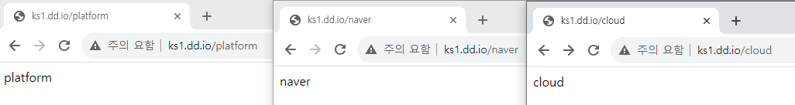

# 10. Ingress — 하나의 입구로 여러 서비스 노출하기

## 1. 개념

서비스가 10개면 NodePort도 10개… 사용자에게 "30770 포트는 쇼핑몰, 31234 포트는 블로그"라고
알려줄 수는 없습니다. 실제 웹 서비스는 **도메인과 URL 경로**로 구분하죠.

**Ingress(인그레스)** 는 클러스터로 들어오는 HTTP(S) 트래픽을 **호스트명/경로 기준으로
적절한 Service에 연결해 주는 라우팅 규칙**입니다.

```
                              ┌─ /naver    → naver 서비스
사용자 → ks1.dd.io (입구 하나) ┤─ /cloud    → cloud 서비스
                              └─ /platform → platform 서비스
```

> **Python 비유**: Flask의 라우팅과 똑같은 개념입니다.
> `@app.route("/naver")`, `@app.route("/cloud")` 처럼 경로마다 다른 핸들러(서비스)로 보내는
> "URL 라우터"를 클러스터 차원에서 제공하는 것입니다.

**중요**: Ingress 리소스는 "규칙 문서"일 뿐이고, 실제로 트래픽을 받아 라우팅하는 일꾼인
**Ingress Controller**(보통 nginx 기반)를 별도로 설치해야 동작합니다.

> **실습 전 준비**: 이 실습은 별도 DNS 없이 진행하므로, 접속 테스트할 PC의 hosts 파일
> (윈도우: `C:\Windows\System32\drivers\etc\hosts`)에 `<노드IP> ks1.dd.io` 처럼
> 노드 IP와 호스트명을 등록해 두어야 브라우저 접속이 됩니다.

## 2. 실습 ① — Ingress Controller 설치

[ingress-nginx 호환성 표](https://github.com/kubernetes/ingress-nginx)에서 클러스터 버전에 맞는
컨트롤러 버전을 확인한 후 설치합니다. (클라우드가 아닌 자체 서버 = baremetal 매니페스트 사용)

```bash
kubectl create -f https://raw.githubusercontent.com/kubernetes/ingress-nginx/controller-v1.8.1/deploy/static/provider/baremetal/deploy.yaml
```

```bash
kubectl get pod -n ingress-nginx
```

```
NAME                                        READY   STATUS      RESTARTS   AGE
ingress-nginx-admission-create-zg4dh        0/1     Completed   0          86m
ingress-nginx-admission-patch-qqgcg         0/1     Completed   1          86m
ingress-nginx-controller-79c7dc9fc5-cnb26   1/1     Running     0          86m
```

controller가 `Running`, admission 잡 2개가 `Completed`면 정상입니다.

> minikube라면 설치가 더 간단합니다: `minikube addons enable ingress`

### 80 포트로 받도록 external IP 추가 (baremetal 환경)

기본 설치 상태에서는 controller가 NodePort(랜덤 포트)로 노출됩니다.

```bash
kubectl get svc -n ingress-nginx
```

```
NAME                       TYPE       CLUSTER-IP      EXTERNAL-IP   PORT(S)
ingress-nginx-controller   NodePort   10.108.35.114   <none>        80:32214/TCP,443:31737/TCP
```

`http://ks1.dd.io` (80 포트)로 바로 접속되게 하려면 Service에 노드 IP들을 externalIPs로 추가합니다.

```bash
kubectl edit -n ingress-nginx svc ingress-nginx-controller
```

편집기에서 `spec:` 아래에 다음을 추가합니다 (IP는 본인 클러스터의 노드 IP들).

```yaml
spec:
  externalIPs:
  - 10.0.1.111
  - 10.0.1.112
  - 10.0.1.113
```

```bash
kubectl get svc -n ingress-nginx
```

```
NAME                       TYPE       CLUSTER-IP      EXTERNAL-IP                        PORT(S)
ingress-nginx-controller   NodePort   10.108.35.114   10.0.1.111,10.0.1.112,10.0.1.113   80:32214/TCP,443:31737/TCP
```

## 3. 실습 ② — 서비스 3개 만들기

경로 라우팅을 보여주기 위해 똑같은 웹 서버를 이름만 다르게 3벌(naver / cloud / platform) 만듭니다.
([examples/10-ingress/deploysvc.yaml](../examples/10-ingress/deploysvc.yaml) — 아래 블록 ×3)

```yaml
apiVersion: v1
kind: Service
metadata:
  name: naver
spec:
  type: NodePort
  selector:
    app: naver
  ports:
    - port: 80
      targetPort: 80
---
apiVersion: apps/v1
kind: Deployment
metadata:
  name: naver
spec:
  replicas: 1
  selector:
    matchLabels:
      app: naver
  template:
    metadata:
      labels:
        app: naver
    spec:
      containers:
        - name: naver
          image: ubuntu/apache2:latest
          ports:
            - containerPort: 80
# --- (cloud, platform 도 같은 구조로 반복) ---
```

```bash
kubectl apply -f examples/10-ingress/deploysvc.yaml
```

```
service/naver created
deployment.apps/naver created
service/cloud created
deployment.apps/cloud created
service/platform created
deployment.apps/platform created
```

각 Pod의 첫 페이지에 자기 이름을 적어서 구분되게 합니다.

```bash
kubectl get pod
# 각 Pod 이름을 확인한 뒤:
kubectl exec <naver-pod이름> -- sh -c "echo naver > /var/www/html/index.html"
kubectl exec <cloud-pod이름> -- sh -c "echo cloud > /var/www/html/index.html"
kubectl exec <platform-pod이름> -- sh -c "echo platform > /var/www/html/index.html"
```

서비스별로 다른 응답이 오는지 먼저 확인:

```bash
kubectl get svc
# 각 서비스의 CLUSTER-IP로
curl 10.103.169.156   # cloud
curl 10.104.47.203    # naver
curl 10.108.225.188   # platform
```

## 4. 실습 ③ — Ingress 규칙 만들기

([examples/10-ingress/ingress.yaml](../examples/10-ingress/ingress.yaml))

```yaml
apiVersion: networking.k8s.io/v1
kind: Ingress
metadata:
  name: path-ingress
  annotations:
    nginx.ingress.kubernetes.io/rewrite-target: /     # /naver로 들어와도 백엔드엔 / 로 전달
    nginx.ingress.kubernetes.io/ssl-redirect: "false" # http 접속을 https로 강제 전환하지 않음
spec:
  ingressClassName: nginx        # 어느 Ingress Controller가 처리할지
  rules:
  - host: ks1.dd.io              # 이 호스트명으로 들어온 요청에 대해
    http:
      paths:
      - path: /naver             # ks1.dd.io/naver → naver 서비스의 80 포트로
        pathType: Prefix
        backend:
          service:
            name: naver
            port:
              number: 80         # ★ 서비스의 port와 일치시켜야 함
      - path: /cloud
        pathType: Prefix
        backend:
          service:
            name: cloud
            port:
              number: 80
      - path: /platform
        pathType: Prefix
        backend:
          service:
            name: platform
            port:
              number: 80
```

```bash
kubectl apply -f examples/10-ingress/ingress.yaml
kubectl get ing
```

```
NAME           CLASS   HOSTS       ADDRESS      PORTS   AGE
path-ingress   nginx   ks1.dd.io   10.0.1.113   80      7s
```

## 5. 브라우저에서 확인

hosts 파일에 `ks1.dd.io`를 등록한 PC의 브라우저에서:

- `http://ks1.dd.io/naver` → `naver`
- `http://ks1.dd.io/cloud` → `cloud`
- `http://ks1.dd.io/platform` → `platform`



**입구는 하나(ks1.dd.io:80), 경로에 따라 다른 서비스**로 연결됩니다. 이것이 Ingress입니다.
실무에서는 여기에 TLS 인증서(5장 tls Secret)를 붙여 HTTPS까지 처리합니다.

## 6. 실습 정리

```bash
kubectl delete -f examples/10-ingress/ingress.yaml
kubectl delete -f examples/10-ingress/deploysvc.yaml
```

## 확인 문제

1. Ingress 리소스만 만들고 Ingress Controller가 없으면 어떻게 되는가?
2. NodePort 노출과 비교해 Ingress의 장점은?
3. `rewrite-target: /` 어노테이션이 하는 일은?

<details><summary>정답 보기</summary>

1. 아무 일도 일어나지 않는다. Ingress는 규칙 문서일 뿐이고 실제 라우팅은 Controller가 수행한다.
2. 서비스마다 포트를 따로 열 필요 없이, 표준 포트(80/443) 하나로 호스트명/경로 기반 라우팅이 가능. TLS 종료도 한 곳에서 처리.
3. `/naver` 로 들어온 요청을 백엔드 서비스에는 `/` 로 바꿔서 전달한다 (백엔드 앱은 /naver라는 경로를 모르기 때문).
</details>

---

다음 장: [11. RBAC — 누가 무엇을 할 수 있는가](11-rbac.md)
