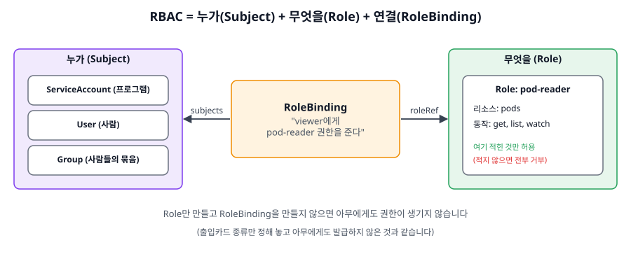

# 11. RBAC — 누가 무엇을 할 수 있는가

**이 장을 마치면**

- Role, RoleBinding, ServiceAccount가 각각 무엇이고 어떻게 연결되는지 설명할 수 있습니다.
- 읽기 전용 계정을 만들고, 허용된 것과 거부되는 것을 직접 확인합니다.
- `Forbidden` 오류가 났을 때 `kubectl auth can-i`로 원인을 찾을 수 있습니다.

---

## 1. 왜 필요한가

지금까지는 무엇이든 할 수 있는 관리자 계정으로 실습했습니다. 하지만 실제 클러스터는 여러 사람과 프로그램이 함께 씁니다.

- 신입 사원이 운영 DB의 Secret을 조회할 수 있으면 안 된다.
- 모니터링 프로그램은 Pod 목록을 **읽기만** 하면 되고, 지울 수 있으면 안 된다.
- 배포 자동화 도구는 자기 팀 네임스페이스에만 배포할 수 있어야 한다.

**RBAC(Role-Based Access Control, 역할 기반 접근 제어)** 은 쿠버네티스의 권한 체계입니다. "필요한 만큼만 허용한다"가 기본 원칙입니다.

## 2. 세 가지 조각



| 조각 | 답하는 질문 | 설명 |
|---|---|---|
| **Subject** (주체) | 누가? | 사람(User), 그룹(Group), 프로그램(**ServiceAccount**) |
| **Role** | 무엇을? | 허용할 **리소스**(pods, secrets…)와 **동작**(get, list, create, delete…)의 목록 |
| **RoleBinding** | 누구에게 무엇을? | Subject와 Role을 연결 |

**ServiceAccount**는 사람이 아니라 **프로그램(Pod)을 위한 계정**입니다. Pod 안의 앱이 쿠버네티스 API를 호출할 때 이 계정의 권한으로 호출합니다. 이 장의 실습은 ServiceAccount로 합니다.

RBAC은 **허용만** 적습니다. Role에 적히지 않은 것은 모두 거부됩니다. "이것은 금지"라고 적는 방법은 없습니다.

### 범위: 네임스페이스 vs 클러스터

| | 네임스페이스 안에서만 | 클러스터 전체 |
|---|---|---|
| 권한 목록 | Role | ClusterRole |
| 연결 | RoleBinding | ClusterRoleBinding |

처음에는 Role과 RoleBinding만 알아도 충분합니다. ClusterRole은 4절에서 한 가지 쓰임새만 봅니다.

## 3. 실습 ① — 읽기 전용 계정 만들기

### 3-1. 지금 내 권한 확인

`kubectl auth can-i`는 "내가 이 동작을 할 수 있나?"를 물어보는 명령입니다.

```bash
kubectl auth can-i list pods
kubectl auth can-i '*' '*'
```

```
yes
yes
```

두 번째는 "모든 리소스에 모든 동작"입니다. 지금 계정은 관리자입니다.

### 3-2. ServiceAccount, Role, RoleBinding 만들기

([examples/11-rbac/rbac.yaml](../examples/11-rbac/rbac.yaml))

```yaml
# 1) 누가: ServiceAccount
apiVersion: v1
kind: ServiceAccount
metadata:
  name: viewer
---
# 2) 무엇을: Role (권한 목록)
apiVersion: rbac.authorization.k8s.io/v1
kind: Role
metadata:
  name: pod-reader
rules:
- apiGroups: [""]                    # ""는 core 그룹 (Pod, Service, ConfigMap 등)
  resources: ["pods"]                # 대상 리소스
  verbs: ["get", "list", "watch"]    # 허용할 동작 (읽기만)
---
# 3) 연결: RoleBinding (viewer에게 pod-reader를 준다)
apiVersion: rbac.authorization.k8s.io/v1
kind: RoleBinding
metadata:
  name: viewer-pod-reader
subjects:                            # 누구에게
- kind: ServiceAccount
  name: viewer
  namespace: edu-lab                 # ServiceAccount가 있는 네임스페이스
roleRef:                             # 어떤 권한을
  kind: Role
  name: pod-reader
  apiGroup: rbac.authorization.k8s.io
```

> 네임스페이스 이름이 `edu-lab`이 아니라면, 이 장의 YAML 파일들에서 `namespace: edu-lab` 부분과 아래 명령의 `edu-lab`을 자기 네임스페이스로 바꾸세요.

**`apiGroups`는 무엇인가요?** 리소스는 그룹에 속해 있습니다. YAML 맨 위의 `apiVersion`에서 알 수 있습니다.

| YAML의 apiVersion | apiGroups에 적을 값 | 예 |
|---|---|---|
| `v1` | `""` (빈 문자열) | pods, services, configmaps, secrets |
| `apps/v1` | `"apps"` | deployments, statefulsets, daemonsets |
| `networking.k8s.io/v1` | `"networking.k8s.io"` | ingresses, networkpolicies |

```bash
kubectl apply -f examples/11-rbac/rbac.yaml
kubectl get serviceaccount,role,rolebinding
```

```
NAME                     SECRETS   AGE
serviceaccount/default   0         38m
serviceaccount/viewer    0         0s

NAME                                        CREATED AT
role.rbac.authorization.k8s.io/pod-reader   2026-11-20T10:48:46Z

NAME                                                      ROLE              AGE
rolebinding.rbac.authorization.k8s.io/viewer-pod-reader   Role/pod-reader   0s
```

> `default` ServiceAccount는 네임스페이스마다 자동으로 생깁니다. Pod에 ServiceAccount를 지정하지 않으면 이것이 쓰입니다.

### 3-3. viewer의 권한 확인

`--as` 옵션을 붙이면 **다른 계정인 척** 명령을 실행해 볼 수 있습니다. ServiceAccount의 정식 이름은 `system:serviceaccount:네임스페이스:이름`입니다.

```bash
SA=system:serviceaccount:edu-lab:viewer

kubectl auth can-i list pods --as=$SA
kubectl auth can-i delete pods --as=$SA
kubectl auth can-i list secrets --as=$SA
kubectl auth can-i list pods --as=$SA -n default
```

```
yes
no
no
no
```

| 질문 | 답 | 이유 |
|---|---|---|
| Pod 목록 조회 | yes | Role에 `pods` + `list`가 있다 |
| Pod 삭제 | no | `verbs`에 `delete`가 없다 |
| Secret 목록 조회 | no | `resources`에 `secrets`가 없다 |
| `default` 네임스페이스의 Pod 조회 | no | Role과 RoleBinding은 `edu-lab` 안에서만 유효하다 |

### 3-4. 실제로 해 보기

`can-i`는 묻기만 합니다. 실제로 명령을 실행해 봅니다.

```bash
kubectl run hello --image=nginx:1.27-alpine

kubectl get pods --as=$SA
kubectl delete pod hello --as=$SA
kubectl get secrets --as=$SA
```

```
NAME    READY   STATUS    RESTARTS   AGE
hello   1/1     Running   0          5s

Error from server (Forbidden): pods "hello" is forbidden: User "system:serviceaccount:edu-lab:viewer" cannot delete resource "pods" in API group "" in the namespace "edu-lab"

Error from server (Forbidden): secrets is forbidden: User "system:serviceaccount:edu-lab:viewer" cannot list resource "secrets" in API group "" in the namespace "edu-lab"
```

**`Forbidden` 메시지에는 필요한 정보가 다 들어 있습니다.** 읽는 법을 익혀 두세요.

```
User "system:serviceaccount:edu-lab:viewer"   ← 누가
cannot delete                                 ← 어떤 동작을 (verb)
resource "pods"                               ← 어떤 리소스에 (resource)
in API group ""                               ← 어느 그룹의 (apiGroups)
in the namespace "edu-lab"                    ← 어느 네임스페이스에서
```

이 다섯 가지를 그대로 Role의 `rules`와 RoleBinding에 채워 넣으면 해결됩니다.

### 3-5. Pod 안에서 확인하기

`--as`는 흉내였습니다. 이번에는 **실제로 `viewer` 계정으로 실행되는 Pod**를 만들어 그 안에서 API를 호출합니다.
([examples/11-rbac/pod-viewer.yaml](../examples/11-rbac/pod-viewer.yaml))

```yaml
spec:
  serviceAccountName: viewer         # 이 Pod는 viewer의 권한으로 API를 호출한다
  containers:
  - name: app
    image: curlimages/curl:8.10.1
    command: ["sleep", "3600"]
```

```bash
kubectl apply -f examples/11-rbac/pod-viewer.yaml
kubectl wait --for=condition=Ready pod/viewer-pod --timeout=90s
kubectl exec viewer-pod -- ls /var/run/secrets/kubernetes.io/serviceaccount
```

```
ca.crt
namespace
token
```

쿠버네티스가 Pod 안에 **`token`** 파일을 넣어 주었습니다. 이것이 `viewer`의 신분증입니다. 앱은 이 토큰을 붙여서 API 서버를 호출합니다.

토큰으로 API를 호출하고 HTTP 상태 코드를 출력하는 스크립트([examples/11-rbac/api-call.sh](../examples/11-rbac/api-call.sh))를 Pod 안에서 실행합니다.

```bash
kubectl exec -i viewer-pod -- sh -s pods < examples/11-rbac/api-call.sh
kubectl exec -i viewer-pod -- sh -s secrets < examples/11-rbac/api-call.sh
```

```
pods: HTTP 200
secrets: HTTP 403
```

Pod 목록 조회는 **200(성공)**, Secret 목록 조회는 **403(Forbidden)** 입니다. 3-3에서 `can-i`로 확인한 결과와 같습니다.

## 4. 실습 ② — 미리 만들어진 권한 묶음 쓰기

리소스마다 Role을 일일이 쓰기는 번거롭습니다. 쿠버네티스에는 자주 쓰는 권한 묶음이 **ClusterRole**로 미리 만들어져 있습니다.

| ClusterRole | 권한 |
|---|---|
| `view` | 대부분의 리소스 **읽기** (Secret 제외) |
| `edit` | 읽기 + 대부분의 리소스 만들기/고치기/지우기 |
| `admin` | `edit` + 그 네임스페이스의 Role/RoleBinding 관리 |
| `cluster-admin` | 클러스터의 모든 것 |

ClusterRole을 **RoleBinding**으로 연결하면, 그 권한이 **그 네임스페이스 안에서만** 적용됩니다.
([examples/11-rbac/rolebinding-view.yaml](../examples/11-rbac/rolebinding-view.yaml))

```yaml
roleRef:
  kind: ClusterRole                  # Role 대신 ClusterRole을 가리킨다
  name: view
  apiGroup: rbac.authorization.k8s.io
```

```bash
kubectl apply -f examples/11-rbac/rolebinding-view.yaml

kubectl auth can-i list services --as=$SA
kubectl auth can-i list deployments --as=$SA
kubectl auth can-i list secrets --as=$SA
kubectl auth can-i create deployments --as=$SA
kubectl auth can-i list services --as=$SA -n default
```

```
yes
yes
no
no
no
```

Service와 Deployment도 읽을 수 있게 됐습니다. Secret은 `view`에 포함되지 않아 여전히 안 되고, 만들기도 안 되고, 다른 네임스페이스도 안 됩니다.

> **주의**: `cluster-admin`을 ClusterRoleBinding으로 연결하면 그 계정은 클러스터의 모든 것을 할 수 있게 됩니다.
> "일단 되게 하려고" 이 권한을 주는 것은 가장 흔하고 위험한 실수입니다.

## 5. 고장 내고 고쳐 보기 — 권한을 줬는데 Forbidden

배포 자동화용 계정 `deployer`에게 Deployment를 관리할 권한을 주려고 합니다.

```bash
kubectl apply -f examples/11-rbac/broken.yaml

D=system:serviceaccount:edu-lab:deployer
kubectl auth can-i create deployments --as=$D
kubectl create deployment test --image=nginx:1.27-alpine --as=$D
```

```
serviceaccount/deployer created
role.rbac.authorization.k8s.io/deploy-manager created
rolebinding.rbac.authorization.k8s.io/deployer-deploy-manager created

no

error: failed to create deployment: deployments.apps is forbidden: User "system:serviceaccount:edu-lab:deployer" cannot create resource "deployments" in API group "apps" in the namespace "edu-lab"
```

세 가지 모두 오류 없이 만들어졌는데 권한이 없습니다. 2절의 그림처럼 **누가 / 무엇을 / 연결** 세 조각을 차례로 확인합니다.

```bash
kubectl get serviceaccount
kubectl describe role deploy-manager
kubectl describe rolebinding deployer-deploy-manager
```

<details><summary>원인과 해결 방법</summary>

```
NAME       SECRETS   AGE
default    0         38m
deployer   0         0s
viewer     0         3s

Name:         deploy-manager
PolicyRule:
  Resources         Non-Resource URLs  Resource Names  Verbs
  ---------         -----------------  --------------  -----
  deployments.apps  []                 []              [get list create update patch delete]

Name:         deployer-deploy-manager
Role:
  Kind:  Role
  Name:  deploy-manager
Subjects:
  Kind            Name     Namespace
  ----            ----     ---------
  ServiceAccount  deployr  edu-lab
```

- ServiceAccount `deployer`는 있습니다.
- Role `deploy-manager`에는 `deployments` + `create`가 있습니다.
- 그런데 RoleBinding의 Subjects가 **`deployr`** 입니다. `e`가 빠졌습니다.

RoleBinding은 **존재하지 않는 계정 이름을 적어도 오류 없이 만들어집니다.** [03장](03-service.md)의 Service selector 오타와 같은 종류의 함정입니다. 권한은 `deployr`라는 없는 계정에게 갔고, `deployer`는 아무 권한도 받지 못했습니다.

RoleBinding의 subjects를 고칩니다.

```bash
kubectl patch rolebinding deployer-deploy-manager --type json \
  -p '[{"op":"replace","path":"/subjects/0/name","value":"deployer"}]'

kubectl auth can-i create deployments --as=$D
kubectl create deployment test --image=nginx:1.27-alpine --as=$D
```

```
rolebinding.rbac.authorization.k8s.io/deployer-deploy-manager patched
yes
deployment.apps/test created
```

YAML 파일의 오타를 고친 뒤 `kubectl apply`를 다시 해도 됩니다.

</details>

고친 뒤, `deployer`로 Pod 목록을 조회해 보세요.

```bash
kubectl get pods --as=$D
```

```
Error from server (Forbidden): pods is forbidden: User "system:serviceaccount:edu-lab:deployer" cannot list resource "pods" in API group "" in the namespace "edu-lab"
```

이것은 고장이 아닙니다. Role에 `deployments`만 적었기 때문에 **Deployment는 만들 수 있지만 Pod는 조회할 수 없습니다.** RBAC은 적힌 것만 허용합니다. 필요하다면 Role의 `rules`에 `pods`를 추가해야 합니다.

### Forbidden 문제 해결 순서

| 순서 | 확인할 것 | 명령 |
|---|---|---|
| 1 | 오류 메시지에서 누가 / 동작 / 리소스 / 그룹 / 네임스페이스를 읽는다 | — |
| 2 | 그 계정이 정말 권한이 없는가 | `kubectl auth can-i 동작 리소스 --as=계정` |
| 3 | RoleBinding의 Subjects(종류, 이름, 네임스페이스)가 정확한가 | `kubectl describe rolebinding 이름` |
| 4 | Role에 그 리소스와 동작이 있는가. `apiGroups`가 맞는가 | `kubectl describe role 이름` |
| 5 | Role과 RoleBinding이 **요청한 네임스페이스에** 있는가 | `kubectl get role,rolebinding -n 네임스페이스` |

## 6. 정리

```bash
kubectl delete deployment test
kubectl delete pod hello viewer-pod
kubectl delete -f examples/11-rbac/rbac.yaml -f examples/11-rbac/rolebinding-view.yaml -f examples/11-rbac/broken.yaml
```

## 7. 알아 두면 좋은 것

- **`roleRef`는 만든 뒤에 바꿀 수 없습니다.** 다른 Role로 바꾸려면 RoleBinding을 지우고 다시 만들어야 합니다. `subjects`는 바꿀 수 있습니다.
- **명령으로도 만들 수 있습니다.**

  ```text
  kubectl create serviceaccount viewer
  kubectl create role pod-reader --verb=get,list,watch --resource=pods
  kubectl create rolebinding viewer-pod-reader --role=pod-reader --serviceaccount=edu-lab:viewer
  ```

- **계정의 모든 권한 보기**: `kubectl auth can-i --list --as=계정`
- **kubectl의 `Forbidden`과 앱의 HTTP 403은 다릅니다.** 앞의 것은 쿠버네티스 API의 권한 문제이고, 뒤의 것은 앱 자체의 인증/인가 문제입니다.

## 핵심 요약

- RBAC은 누가(Subject) + 무엇을(Role) + 연결(RoleBinding)로 이루어진다.
- Role에는 허용할 리소스와 동작만 적는다. 적지 않은 것은 모두 거부된다.
- ServiceAccount는 Pod(프로그램)를 위한 계정이고, Pod 안에 토큰 파일로 전달된다.
- Role/RoleBinding은 네임스페이스 안에서만 유효하다.
- `kubectl auth can-i ... --as=계정`으로 권한을 미리 확인한다.
- `Forbidden` 메시지에는 누가·무엇을·어디서가 모두 적혀 있다.

## 확인 문제

1. Role만 만들고 RoleBinding을 만들지 않으면 어떻게 되나요?
2. Role에 `resources: ["pods"]`, `verbs: ["get", "list"]`만 있습니다. 이 권한으로 Pod를 삭제할 수 있나요?
3. Deployment에 대한 권한을 주려면 `apiGroups`에 무엇을 적어야 하나요?
4. `edu-lab`의 RoleBinding으로 권한을 받은 ServiceAccount가 `default` 네임스페이스의 Pod를 조회할 수 있나요?
5. 권한을 줬는데도 `Forbidden`이 납니다. RoleBinding에서 무엇을 확인해야 하나요?

<details><summary>정답 보기</summary>

1. 아무에게도 권한이 생기지 않습니다. Role은 권한 목록일 뿐이고, RoleBinding으로 누군가에게 연결해야 효력이 생깁니다.
2. 없습니다. `verbs`에 `delete`가 없습니다. RBAC은 적힌 것만 허용합니다.
3. `"apps"`입니다. Deployment의 `apiVersion`이 `apps/v1`이기 때문입니다.
4. 없습니다. RoleBinding은 자기가 있는 네임스페이스 안에서만 권한을 줍니다.
5. `subjects`의 종류(kind), 이름, 네임스페이스가 실제 계정과 정확히 같은지, `roleRef`가 의도한 Role을 가리키는지 확인합니다.
</details>

---

다음 장: [12. NetworkPolicy — Pod 사이의 방화벽](12-networkpolicy.md)
