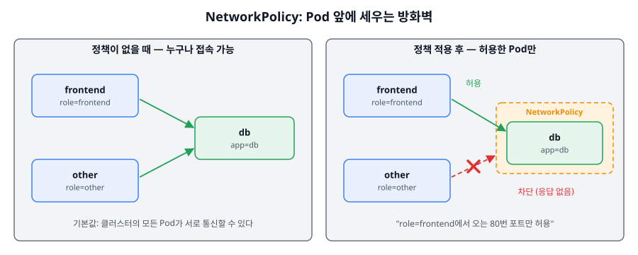

# 12. NetworkPolicy — Pod 사이의 방화벽

**이 장을 마치면**

- 쿠버네티스의 기본 네트워크 동작("모두 허용")과 NetworkPolicy의 역할을 설명할 수 있습니다.
- 특정 Pod에서 오는 접속만 허용하는 정책을 만들고, 차단되는 것을 확인합니다.
- 접속이 "거부"되는 것과 "응답 없음"의 차이로 원인을 좁힐 수 있습니다.

---

## 1. 왜 필요한가

쿠버네티스에서는 기본적으로 **모든 Pod가 서로 통신할 수 있습니다.** 네임스페이스가 달라도 마찬가지입니다.
편리하지만, 이대로라면 아무 Pod나 DB에 접속할 수 있습니다. Pod 하나가 해킹당하면 클러스터 안의 다른 모든 서비스가 위험해집니다.

**NetworkPolicy(네트워크 폴리시)** 는 Pod 앞에 세우는 방화벽입니다. "이 Pod에는 저 Pod만 접속할 수 있다"를 정합니다.



[11장 RBAC](11-rbac.md)과 헷갈리기 쉽습니다. 둘은 막는 대상이 다릅니다.

| | 무엇을 제어하나 | 예 |
|---|---|---|
| RBAC | **쿠버네티스 API** 호출 (kubectl, API 요청) | "이 계정은 Pod를 삭제할 수 없다" |
| NetworkPolicy | **Pod 사이의 네트워크** 통신 | "이 Pod는 DB의 3306 포트에 접속할 수 없다" |

### 알아야 할 규칙 세 가지

1. **정책이 없으면 전부 허용.** 어떤 정책에도 선택되지 않은 Pod는 누구와도 통신할 수 있습니다.
2. **정책에 선택되면 "허용 목록" 방식으로 바뀐다.** 정책이 선택한 Pod는, 정책에 적힌 것만 받고 나머지는 전부 차단합니다.
3. **대상은 레이블로 고른다.** Service, Deployment와 마찬가지로 Pod를 레이블로 지정합니다.

> **전제**: NetworkPolicy는 클러스터의 네트워크 플러그인(CNI)이 지원해야 동작합니다. Calico, Cilium 등은 지원합니다.
> 지원하지 않는 CNI에서는 정책을 만들어도 **오류 없이 무시**됩니다. 이 교재의 실습 환경은 Calico를 사용합니다.

## 2. YAML 뜯어보기

([examples/12-networkpolicy/netpol-db.yaml](../examples/12-networkpolicy/netpol-db.yaml))

```yaml
apiVersion: networking.k8s.io/v1
kind: NetworkPolicy
metadata:
  name: db-allow-frontend
spec:
  podSelector:                   # 이 정책을 적용할 대상 Pod
    matchLabels:
      app: db
  policyTypes:
  - Ingress                      # 들어오는 트래픽을 제어한다
  ingress:
  - from:                        # 아래 조건에 맞는 곳에서 오는 것만 허용
    - podSelector:
        matchLabels:
          role: frontend
    ports:
    - protocol: TCP
      port: 80
```

소리 내어 읽으면 이렇습니다. "**`app=db` Pod로 들어오는** 트래픽은, **`role=frontend` Pod에서 오는 TCP 80번**만 허용한다."

| 필드 | 의미 |
|---|---|
| `spec.podSelector` | 정책을 **적용받는** Pod (보호 대상) |
| `policyTypes` | `Ingress`(들어오는 것), `Egress`(나가는 것) 중 무엇을 제어할지 |
| `ingress[].from` | 접속을 허용할 출발지 |
| `ingress[].ports` | 허용할 포트 |

> 여기서 `Ingress`는 "들어오는 방향"이라는 뜻의 일반 단어입니다. [10장](10-ingress.md)의 Ingress 리소스와는 관계없습니다.

## 3. 실습 ① — 정책이 없을 때

DB 역할을 하는 Pod `db`(와 Service), 그리고 클라이언트 두 개를 만듭니다. ([examples/12-networkpolicy/apps.yaml](../examples/12-networkpolicy/apps.yaml))

```bash
kubectl apply -f examples/12-networkpolicy/apps.yaml
kubectl wait --for=condition=Ready pod/db pod/frontend pod/other --timeout=90s
kubectl get pod --show-labels
```

```
NAME       READY   STATUS    RESTARTS   AGE   LABELS
db         1/1     Running   0          2s    app=db
frontend   1/1     Running   0          2s    role=frontend
other      1/1     Running   0          2s    role=other
```

두 클라이언트에서 각각 `db`에 접속합니다.

```bash
kubectl exec frontend -- wget -qO- -T 3 http://db
kubectl exec other -- wget -qO- -T 3 http://db
```

```
db data
db data
```

정책이 없으니 둘 다 접속됩니다. (`-T 3`은 3초 안에 응답이 없으면 포기하라는 옵션입니다)

## 4. 실습 ② — frontend만 허용하기

```bash
kubectl apply -f examples/12-networkpolicy/netpol-db.yaml
kubectl describe networkpolicy db-allow-frontend
```

```
Spec:
  PodSelector:     app=db
  Allowing ingress traffic:
    To Port: 80/TCP
    From:
      PodSelector: role=frontend
  Not affecting egress traffic
  Policy Types: Ingress
```

다시 접속해 봅니다.

```bash
kubectl exec frontend -- wget -qO- -T 3 http://db
kubectl exec other -- wget -qO- -T 3 http://db
```

```
db data

wget: download timed out
command terminated with exit code 1
```

`frontend`는 그대로 접속되고, `other`는 **3초를 기다리다 실패**했습니다.

**오류 모양을 기억해 두세요.** [03장](03-service.md)에서 Service가 잘못됐을 때는 `Connection refused`가 **즉시** 나왔습니다. NetworkPolicy가 막으면 요청이 조용히 버려져서 **응답 없이 시간이 초과**됩니다.

| 증상 | 의미 | 의심할 것 |
|---|---|---|
| `bad address` | 이름을 IP로 바꾸지 못함 | Service 이름, DNS |
| `Connection refused` (즉시) | 도착은 했는데 받아 줄 곳이 없음 | Service의 selector / targetPort, 앱이 떠 있는지 |
| `timed out` (한참 뒤) | 중간에서 버려짐 | **NetworkPolicy**, 방화벽 |

### 레이블로 판단한다는 것

정책은 Pod의 이름이 아니라 **레이블**을 봅니다. `other`의 레이블을 `role=frontend`로 바꾸면 어떻게 될까요?

```bash
kubectl label pod other role=frontend --overwrite
sleep 3
kubectl exec other -- wget -qO- -T 3 http://db
```

```
db data
```

접속됩니다. 정책도 Pod도 다시 만들지 않았는데, 레이블만 바꿨더니 즉시 허용 대상이 됐습니다. 원래대로 돌려놓습니다.

```bash
kubectl label pod other role=other --overwrite
sleep 3
kubectl exec other -- wget -qO- -T 3 http://db
```

```
wget: download timed out
command terminated with exit code 1
```

> 그래서 실무에서는 "누가 Pod에 레이블을 붙일 수 있는가"(RBAC)도 함께 관리해야 합니다. 레이블만 바꾸면 방화벽을 통과할 수 있기 때문입니다.

## 5. 고장 내고 고쳐 보기 — frontend도 접속이 안 된다

누군가 정책을 수정한 뒤, `frontend`에서도 DB 접속이 안 된다는 신고가 들어왔습니다.

```bash
kubectl apply -f examples/12-networkpolicy/netpol-broken.yaml
sleep 3
kubectl exec frontend -- wget -qO- -T 3 http://db
```

```
wget: download timed out
command terminated with exit code 1
```

원인을 찾아보세요. 먼저 [03장](03-service.md)에서 배운 순서대로 Service 쪽을 확인하고, 그다음 정책을 봅니다.

```bash
kubectl get pod db
kubectl get endpoints db
kubectl describe networkpolicy db-allow-frontend
kubectl get pod frontend --show-labels
```

<details><summary>원인과 해결 방법</summary>

```
NAME   READY   STATUS    RESTARTS   AGE
db     1/1     Running   0          39s

NAME   ENDPOINTS           AGE
db     192.168.139.92:80   39s

  Allowing ingress traffic:
    To Port: 80/TCP
    From:
      PodSelector: role=front-end

NAME       READY   STATUS    RESTARTS   AGE   LABELS
frontend   1/1     Running   0          39s   role=frontend
```

- `db` Pod는 정상이고 엔드포인트도 있습니다. Service 문제가 아닙니다.
- 증상이 `timed out`입니다. 네트워크 정책을 의심할 차례입니다.
- 정책은 `role=front-end`를 허용하는데, 실제 Pod의 레이블은 `role=frontend`입니다. 하이픈(`-`) 하나 차이로 **허용 대상이 아무도 없는 정책**이 됐습니다.

NetworkPolicy도 맞는 Pod가 없다고 해서 오류를 내지 않습니다. Service selector([03장](03-service.md)), RoleBinding subjects([11장](11-rbac.md))와 같은 종류의 함정입니다.

올바른 정책을 다시 적용합니다. Pod를 재시작할 필요는 없습니다.

```bash
kubectl apply -f examples/12-networkpolicy/netpol-db.yaml
sleep 3
kubectl exec frontend -- wget -qO- -T 3 http://db
```

```
db data
```

</details>

## 6. 정리

```bash
kubectl delete -f examples/12-networkpolicy/netpol-db.yaml
kubectl delete -f examples/12-networkpolicy/apps.yaml
```

## 7. 알아 두면 좋은 것

### "기본 차단" 정책

실무에서는 먼저 **네임스페이스 전체를 차단**해 두고, 필요한 통신만 하나씩 허용하는 방식을 많이 씁니다.
([examples/12-networkpolicy/netpol-default-deny.yaml](../examples/12-networkpolicy/netpol-default-deny.yaml))

```yaml
apiVersion: networking.k8s.io/v1
kind: NetworkPolicy
metadata:
  name: default-deny-ingress
spec:
  podSelector: {}                # {} = 이 네임스페이스의 모든 Pod
  policyTypes:
  - Ingress
  # ingress 규칙이 하나도 없다 = 허용하는 것이 없다 = 전부 차단
```

정책은 **더해집니다.** 이 정책과 4절의 `db-allow-frontend`가 함께 있으면, `db`는 `frontend`의 접속만 받고 나머지 Pod는 아무 접속도 받지 못합니다. 허용 정책을 추가할수록 열리는 문이 늘어나는 구조입니다. "이것은 금지"라는 정책은 없습니다.

### 출발지를 지정하는 세 가지 방법

```yaml
ingress:
- from:
  - podSelector:                 # 같은 네임스페이스의, 이 레이블을 가진 Pod
      matchLabels:
        role: frontend
  - namespaceSelector:           # 이 레이블을 가진 네임스페이스의 모든 Pod
      matchLabels:
        team: payments
  - ipBlock:                     # 이 IP 대역 (클러스터 밖의 주소 등)
      cidr: 10.0.0.0/24
```

### 나가는 트래픽(Egress)을 막을 때 주의할 점

`policyTypes`에 `Egress`를 넣으면 Pod에서 **나가는** 통신도 제어할 수 있습니다. 이때 DNS 조회(UDP/TCP 53번)를 허용하지 않으면
Service 이름을 IP로 바꾸지 못해서 모든 접속이 `bad address`로 실패합니다. Egress 정책을 쓸 때 가장 흔한 실수입니다.

## 핵심 요약

- 기본값은 모든 Pod가 서로 통신할 수 있다.
- NetworkPolicy에 선택된 Pod는 정책에 적힌 통신만 허용하고 나머지는 차단한다.
- 대상과 허용 출발지 모두 레이블로 지정한다.
- NetworkPolicy가 막으면 `timed out`(응답 없음)으로 나타난다.
- 정책은 더해지는 방식이다. 허용만 있고 금지는 없다.
- CNI가 지원해야 동작한다.

## 확인 문제

1. NetworkPolicy가 하나도 없는 네임스페이스에서 Pod 사이의 통신은 어떻게 되나요?
2. `spec.podSelector`와 `ingress[].from[].podSelector`는 각각 무엇을 가리키나요?
3. 접속 시도가 `Connection refused`로 즉시 실패할 때와 `timed out`으로 실패할 때, 각각 무엇을 먼저 의심해야 하나요?
4. `podSelector: {}`이고 `ingress` 규칙이 없는 정책은 어떤 효과를 내나요?

<details><summary>정답 보기</summary>

1. 모두 허용됩니다. 다른 네임스페이스의 Pod와도 통신할 수 있습니다.
2. `spec.podSelector`는 정책을 적용받는(보호되는) Pod, `from`의 `podSelector`는 접속이 허용되는 출발지 Pod입니다.
3. `Connection refused`는 Service의 selector·targetPort나 앱 상태를, `timed out`은 NetworkPolicy(또는 방화벽)를 먼저 의심합니다.
4. 그 네임스페이스의 모든 Pod에 대해 들어오는 트래픽을 전부 차단합니다(기본 차단).
</details>

---

다음 장: [13. Cordon / Drain — 노드를 안전하게 비우기](13-cordon-drain.md)
