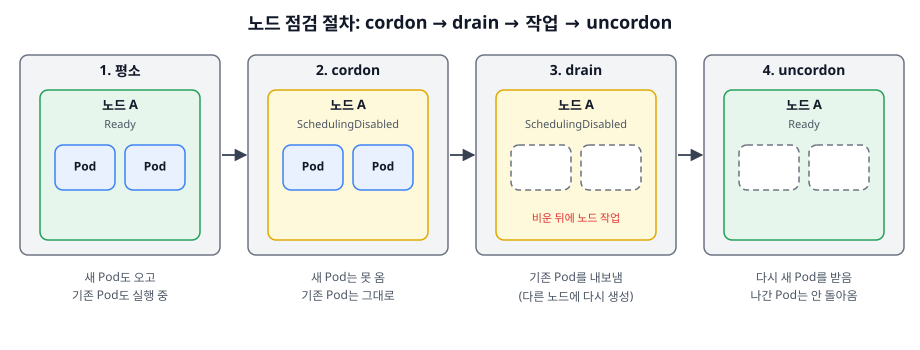
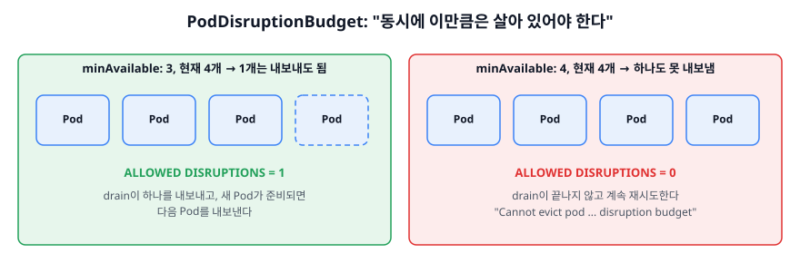

# 13. Cordon / Drain — 노드를 안전하게 비우기

**이 장을 마치면**

- 노드 점검 절차(cordon → drain → 작업 → uncordon)를 설명하고 따라 할 수 있습니다.
- cordon과 drain의 차이를 직접 확인합니다.
- PodDisruptionBudget(PDB)이 무엇을 지켜 주는지, drain이 멈췄을 때 무엇을 봐야 하는지 압니다.

---

## 1. 왜 필요한가

노드도 결국 서버입니다. OS 패치, 커널 업그레이드, 디스크 교체, 쿠버네티스 버전 업그레이드를 하려면 서버를 재부팅해야 할 때가 있습니다.
그 노드에서 Pod가 돌고 있는 채로 전원을 내리면 서비스가 갑자기 끊깁니다.

그래서 작업 전에 **그 노드의 Pod를 다른 노드로 옮겨 두는** 절차가 필요합니다.



| 명령 | 하는 일 | 기존 Pod |
|---|---|---|
| `kubectl cordon 노드` | 이 노드에 **새 Pod를 배치하지 않게** 한다 | 그대로 실행 |
| `kubectl drain 노드` | cordon + **기존 Pod를 내보낸다** | 다른 노드에 다시 만들어짐 |
| `kubectl uncordon 노드` | 다시 새 Pod를 받게 한다 | — |

> **비유**: cordon은 식당 입구에 "신규 손님 받지 않습니다" 팻말을 거는 것, drain은 안에 있는 손님에게도 자리를 옮겨 달라고 안내하는 것입니다.

"Pod를 옮긴다"고 하지만, 실제로는 **기존 Pod를 지우고 Deployment 같은 컨트롤러가 다른 노드에 새로 만드는** 것입니다. [02장](02-deployment.md)에서 Pod를 지웠을 때 일어난 일과 같습니다.

> **이 장의 실습에 대해**: 실습 클러스터의 노드에는 다른 서비스의 Pod도 함께 돌고 있습니다. 노드를 통째로 비우면 그 서비스들까지 영향을 받습니다.
> 그래서 3절부터는 `--pod-selector` 옵션으로 **우리가 만든 Pod만** 내보냅니다. 노드 상태를 바꾸는 명령이므로, 각 단계의 `uncordon`을 빠뜨리지 마세요.

## 2. 실습 ① — cordon: 새 Pod를 받지 않게 하기

Pod 4개짜리 Deployment를 만듭니다. ([examples/13-cordon-drain/web.yaml](../examples/13-cordon-drain/web.yaml))

```bash
kubectl apply -f examples/13-cordon-drain/web.yaml
kubectl rollout status deployment/web
kubectl get pod -o wide
```

```
NAME                  READY   STATUS    RESTARTS   AGE   IP               NODE         ...
web-b7b9944c8-mztcv   1/1     Running   0          2s    192.168.96.127   oks5.dd.io   ...
web-b7b9944c8-q4dl8   1/1     Running   0          2s    192.168.30.206   oks2.dd.io   ...
web-b7b9944c8-tfgpb   1/1     Running   0          2s    192.168.201.73   oks3.dd.io   ...
web-b7b9944c8-xs99w   1/1     Running   0          2s    192.168.139.71   oks4.dd.io   ...
```

우리 Pod가 있는 노드 하나를 골라 변수에 담습니다.

```bash
NODE=$(kubectl get pod -l app=web -o jsonpath='{.items[0].spec.nodeName}')
echo $NODE
```

```
oks5.dd.io
```

이 노드를 cordon합니다.

```bash
kubectl cordon $NODE
kubectl get nodes
```

```
node/oks5.dd.io cordoned

NAME         STATUS                     ROLES           AGE    VERSION
oks1.dd.io   Ready                      control-plane   538d   v1.29.15
oks2.dd.io   Ready                      <none>          538d   v1.29.15
oks3.dd.io   Ready                      <none>          538d   v1.29.15
oks4.dd.io   Ready                      <none>          538d   v1.29.15
oks5.dd.io   Ready,SchedulingDisabled   <none>          538d   v1.29.15
```

`STATUS`에 **`SchedulingDisabled`** 가 붙었습니다. 그 노드에 있던 Pod는 어떻게 됐을까요?

```bash
kubectl get pod -o wide --field-selector spec.nodeName=$NODE
```

```
NAME                  READY   STATUS    RESTARTS   AGE   IP               NODE         ...
web-b7b9944c8-mztcv   1/1     Running   0          10s   192.168.96.127   oks5.dd.io   ...
```

**그대로 실행 중**입니다. cordon은 기존 Pod를 건드리지 않습니다.

Pod를 8개로 늘려서 새 Pod가 어디에 생기는지 봅니다.

```bash
kubectl scale deployment web --replicas=8
kubectl rollout status deployment/web
kubectl get pod -o wide --sort-by=.spec.nodeName
```

```
NAME                  READY   STATUS    RESTARTS   AGE   IP               NODE         ...
web-b7b9944c8-bjrsv   1/1     Running   0          2s    192.168.30.207   oks2.dd.io   ...
web-b7b9944c8-q4dl8   1/1     Running   0          14s   192.168.30.206   oks2.dd.io   ...
web-b7b9944c8-qx2vk   1/1     Running   0          2s    192.168.201.72   oks3.dd.io   ...
web-b7b9944c8-tfgpb   1/1     Running   0          14s   192.168.201.73   oks3.dd.io   ...
web-b7b9944c8-6c89l   1/1     Running   0          2s    192.168.139.73   oks4.dd.io   ...
web-b7b9944c8-mrhkv   1/1     Running   0          2s    192.168.139.98   oks4.dd.io   ...
web-b7b9944c8-xs99w   1/1     Running   0          14s   192.168.139.71   oks4.dd.io   ...
web-b7b9944c8-mztcv   1/1     Running   0          14s   192.168.96.127   oks5.dd.io   ...
```

새로 생긴 4개(`AGE` 2초)는 전부 다른 노드로 갔습니다. cordon한 노드(`oks5`)에는 원래 있던 1개뿐입니다.

원래대로 되돌립니다.

```bash
kubectl uncordon $NODE
kubectl scale deployment web --replicas=4
kubectl rollout status deployment/web
kubectl get nodes
```

## 3. 실습 ② — drain: 기존 Pod 내보내기

우리 Pod가 있는 노드를 다시 고릅니다(Pod가 바뀌었을 수 있으므로 다시 조회합니다).

```bash
kubectl get pod -o wide
NODE=$(kubectl get pod -l app=web -o jsonpath='{.items[0].spec.nodeName}')
echo $NODE
```

drain합니다.

```bash
kubectl drain $NODE --ignore-daemonsets --pod-selector=app=web
```

```
node/oks5.dd.io cordoned
evicting pod edu-lab/web-b7b9944c8-mztcv
pod/web-b7b9944c8-mztcv evicted
node/oks5.dd.io drained
```

| 옵션 | 의미 |
|---|---|
| `--ignore-daemonsets` | DaemonSet의 Pod는 내보내지 않고 넘어간다. 노드마다 있어야 하는 Pod라서 내보내도 다시 생기기 때문이다 ([09장](09-daemonset.md)). 거의 항상 붙인다 |
| `--pod-selector=app=web` | 이 레이블의 Pod만 내보낸다. **실습용 제한**이다. 실제 점검에서는 이 옵션 없이 노드의 모든 Pod를 내보낸다 |

출력을 보면 drain이 한 일이 순서대로 나옵니다. ① 노드를 cordon하고 ② Pod를 내보냈습니다(`evicted`).

```bash
kubectl get nodes
kubectl get pod -o wide
```

```
NAME         STATUS                     ROLES           AGE    VERSION
...
oks5.dd.io   Ready,SchedulingDisabled   <none>          538d   v1.29.15

NAME                  READY   STATUS    RESTARTS   AGE   IP               NODE         ...
web-b7b9944c8-cjnf8   1/1     Running   0          2s    192.168.139.99   oks4.dd.io   ...
web-b7b9944c8-q4dl8   1/1     Running   0          13s   192.168.30.206   oks2.dd.io   ...
web-b7b9944c8-qx2vk   1/1     Running   0          11s   192.168.201.72   oks3.dd.io   ...
web-b7b9944c8-tfgpb   1/1     Running   0          13s   192.168.201.73   oks3.dd.io   ...
```

`oks5`에 있던 Pod가 사라지고, **새 Pod**(`...-cjnf8`, `AGE` 2초)가 다른 노드에 생겼습니다. Pod는 여전히 4개입니다.

실제 점검이라면 이 시점에 노드를 재부팅하거나 패치합니다. 작업이 끝났다고 치고 노드를 되돌립니다.

```bash
kubectl uncordon $NODE
kubectl get pod -o wide
```

**uncordon을 해도 나갔던 Pod가 돌아오지는 않습니다.** 이미 다른 노드에서 잘 돌고 있기 때문입니다. 이 노드에는 앞으로 새로 만들어지는 Pod가 배치됩니다.

## 4. PodDisruptionBudget — 한꺼번에 너무 많이 내보내지 않게

drain은 노드의 Pod를 내보냅니다. 만약 앱의 Pod 4개 중 3개가 같은 노드에 있었다면, drain 한 번에 3개가 동시에 사라집니다. 남은 1개로 버티지 못하면 장애입니다.

**PodDisruptionBudget(PDB)** 은 "이 앱의 Pod는 **동시에 최소 몇 개는 살아 있어야 한다**"는 약속입니다. drain은 이 약속을 지키면서 Pod를 내보냅니다.



([examples/13-cordon-drain/pdb.yaml](../examples/13-cordon-drain/pdb.yaml))

```yaml
apiVersion: policy/v1
kind: PodDisruptionBudget
metadata:
  name: web-pdb
spec:
  minAvailable: 3              # app=web Pod는 항상 3개 이상 준비 상태여야 한다
  selector:
    matchLabels:
      app: web
```

`minAvailable` 대신 `maxUnavailable: 1`(동시에 1개까지만 빠져도 된다)처럼 쓸 수도 있습니다.

## 5. 고장 내고 고쳐 보기 — drain이 끝나지 않는다

누군가 "절대 끊기면 안 되는 서비스"라며 PDB를 이렇게 만들었습니다. ([examples/13-cordon-drain/pdb-strict.yaml](../examples/13-cordon-drain/pdb-strict.yaml))

```bash
kubectl apply -f examples/13-cordon-drain/pdb-strict.yaml
kubectl get pdb
```

```
NAME      MIN AVAILABLE   MAX UNAVAILABLE   ALLOWED DISRUPTIONS   AGE
web-pdb   4               N/A               0                     2s
```

이 상태에서 노드를 drain합니다. 끝나지 않을 수 있으니 `--timeout=20s`로 20초만 시도합니다.

```bash
NODE=$(kubectl get pod -l app=web -o jsonpath='{.items[0].spec.nodeName}')
kubectl drain $NODE --ignore-daemonsets --pod-selector=app=web --timeout=20s
```

```
node/oks4.dd.io cordoned
evicting pod edu-lab/web-b7b9944c8-cjnf8
error when evicting pods/"web-b7b9944c8-cjnf8" -n "edu-lab" (will retry after 5s): Cannot evict pod as it would violate the pod's disruption budget.
evicting pod edu-lab/web-b7b9944c8-cjnf8
error when evicting pods/"web-b7b9944c8-cjnf8" -n "edu-lab" (will retry after 5s): Cannot evict pod as it would violate the pod's disruption budget.
...
error when evicting pods/"web-b7b9944c8-cjnf8" -n "edu-lab": global timeout reached: 20s
```

5초마다 다시 시도하지만 계속 실패합니다. `--timeout`이 없었다면 영원히 반복했을 것입니다. 원인을 확인해 보세요.

```bash
kubectl describe pdb web-pdb
kubectl get nodes
```

<details><summary>원인과 해결 방법</summary>

```
Name:           web-pdb
Min available:  4
Selector:       app=web
Status:
    Allowed disruptions:  0
    Current:              4
    Desired:              4
    Total:                4
```

Pod가 4개인데 "항상 4개 이상"을 요구합니다. **`Allowed disruptions: 0`** — 하나도 내보낼 수 없습니다.
"절대 끊기면 안 된다"는 의도였겠지만, 결과적으로 **노드 점검 자체를 불가능하게** 만든 설정입니다.

그리고 drain은 실패했지만 **노드는 cordon된 상태로 남아 있습니다**(`SchedulingDisabled`). drain이 중간에 멈추면 노드 상태를 꼭 확인해야 합니다.

PDB를 "4개 중 3개 유지"로 고치고 다시 drain합니다.

```bash
kubectl apply -f examples/13-cordon-drain/pdb.yaml
kubectl get pdb
kubectl drain $NODE --ignore-daemonsets --pod-selector=app=web --timeout=90s
```

```
NAME      MIN AVAILABLE   MAX UNAVAILABLE   ALLOWED DISRUPTIONS   AGE
web-pdb   3               N/A               1                     25s

node/oks4.dd.io already cordoned
evicting pod edu-lab/web-b7b9944c8-cjnf8
pod/web-b7b9944c8-cjnf8 evicted
node/oks4.dd.io drained
```

`ALLOWED DISRUPTIONS`가 1이 되자 drain이 바로 성공했습니다. 노드를 되돌립니다.

```bash
kubectl uncordon $NODE
```

</details>

> **PDB를 만들 때의 원칙**: `minAvailable`은 반드시 `replicas`보다 작아야 합니다. Pod가 1개뿐인 앱에 `minAvailable: 1`을 걸어도 같은 문제가 생깁니다.

## 6. 정리

```bash
kubectl delete -f examples/13-cordon-drain/web.yaml -f examples/13-cordon-drain/pdb.yaml
kubectl get nodes
```

**모든 노드의 `STATUS`가 `Ready`인지 꼭 확인하세요.** `SchedulingDisabled`가 남아 있는 노드가 있다면 `kubectl uncordon 노드이름`으로 되돌립니다.

## 7. 알아 두면 좋은 것

### 실제 점검 절차

```text
kubectl cordon <노드>                                   # 1. 새 Pod 차단
kubectl get pod -A -o wide --field-selector spec.nodeName=<노드>   # 2. 이 노드에 무엇이 있는지 확인
kubectl drain <노드> --ignore-daemonsets --delete-emptydir-data    # 3. 비우기
# 4. 노드 작업 (패치, 재부팅 등)
kubectl uncordon <노드>                                 # 5. 복귀
kubectl get nodes                                       # 6. Ready 확인
```

### drain이 거부하는 Pod

| 상황 | drain의 반응 | 필요한 옵션 |
|---|---|---|
| DaemonSet의 Pod가 있다 | 중단 | `--ignore-daemonsets` |
| `emptyDir` 볼륨을 쓰는 Pod가 있다 | 중단 (Pod가 지워지면 그 데이터도 사라지므로) | `--delete-emptydir-data` |
| Deployment 등이 관리하지 않는 **단독 Pod**가 있다 | 중단 (지우면 아무도 다시 만들어 주지 않으므로) | `--force` (그 Pod는 사라진다) |
| PDB 때문에 내보낼 수 없다 | 5초마다 재시도 | PDB나 `replicas`를 조정 |

단독 Pod가 있을 때는 이런 메시지가 나옵니다. [01장](01-pod.md)에서 "Pod를 직접 만들지 말고 Deployment를 쓰라"고 한 이유 중 하나입니다.

```
error: unable to drain node "oks4.dd.io" due to error: cannot delete Pods declare no controller (use --force to override): edu-lab/solo
```

### cordon의 정체

cordon된 노드를 `describe`하면 taint가 하나 붙어 있습니다. cordon은 결국 "이 노드에는 스케줄하지 말라"는 taint를 붙이는 것입니다. taint는 [15장](15-scheduling.md)에서 배웁니다.

```
Taints:             node.kubernetes.io/unschedulable:NoSchedule
Unschedulable:      true
```

## 핵심 요약

- cordon은 새 Pod를 막고, drain은 기존 Pod까지 내보낸다. 작업 후에는 uncordon으로 되돌린다.
- drain은 Pod를 옮기는 것이 아니라 지우는 것이다. 컨트롤러가 다른 노드에 다시 만든다.
- uncordon을 해도 나갔던 Pod가 돌아오지는 않는다.
- PDB는 동시에 살아 있어야 하는 최소 Pod 수를 보장한다. drain은 PDB를 지킨다.
- `minAvailable`이 `replicas`와 같으면 drain이 끝나지 않는다.
- drain이 실패해도 노드는 cordon 상태로 남는다.

## 확인 문제

1. cordon과 drain의 차이는 무엇인가요?
2. 노드를 drain하고 작업을 마친 뒤 uncordon했습니다. 원래 그 노드에 있던 Pod들은 돌아오나요?
3. `replicas: 2`인 Deployment에 `minAvailable: 2`인 PDB가 있습니다. 이 Pod가 있는 노드를 drain하면 어떻게 되나요?
4. drain할 때 `--ignore-daemonsets`를 붙이는 이유는 무엇인가요?
5. drain이 PDB 때문에 실패했습니다. 노드의 상태는 어떻게 되어 있나요?

<details><summary>정답 보기</summary>

1. cordon은 새 Pod가 배치되지 않게만 하고 기존 Pod는 그대로 둡니다. drain은 cordon을 한 뒤 기존 Pod까지 내보냅니다.
2. 돌아오지 않습니다. 이미 다른 노드에 다시 만들어져 실행 중이기 때문입니다. 이후 새로 만들어지는 Pod가 그 노드에 배치될 수 있습니다.
3. 내보낼 수 있는 Pod가 0개이므로 drain이 계속 재시도하며 끝나지 않습니다. `minAvailable`을 1로 낮추거나 `replicas`를 늘려야 합니다.
4. DaemonSet의 Pod는 노드마다 하나씩 있어야 하는 것이라 내보내도 같은 노드에 다시 생깁니다. 이 옵션이 없으면 drain이 중단됩니다.
5. cordon된 상태(`SchedulingDisabled`)로 남아 있습니다. drain을 다시 성공시키거나, 포기한다면 uncordon해야 합니다.
</details>

---

다음 장: [14. etcd 백업과 복원 — 클러스터의 기억 지키기](14-etcd-backup-restore.md)
