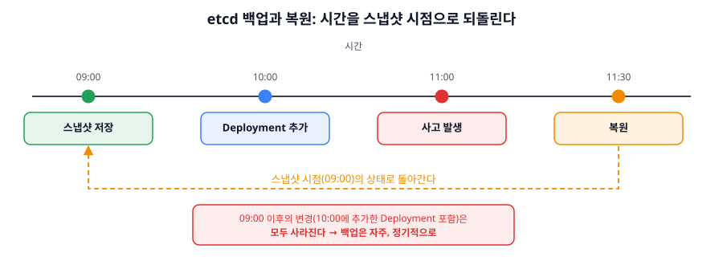
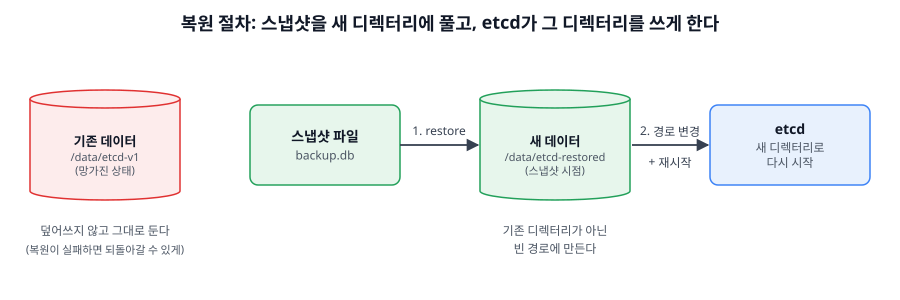

# 14. etcd 백업과 복원 — 클러스터의 기억 지키기

**이 장을 마치면**

- etcd가 무엇을 저장하고, 왜 백업이 중요한지 설명할 수 있습니다.
- etcd 스냅샷을 만들고, 스냅샷으로 데이터를 복원할 수 있습니다.
- 복원하면 "스냅샷 이후의 변경은 사라진다"는 것을 직접 확인합니다.

---

## 1. 왜 필요한가

[00장](00-시작하기-전에.md)의 구조 그림에 **etcd**가 있었습니다. 지금까지 만든 모든 것 — Deployment, Service, ConfigMap, Secret, RBAC 설정 — 은 전부 etcd에 저장됩니다.
`kubectl apply`는 결국 "API 서버를 거쳐 etcd에 기록하는 것"이고, `kubectl get`은 "etcd에서 읽어 오는 것"입니다.

**etcd는 클러스터의 기억입니다.** etcd의 데이터를 잃으면 노드와 컨테이너가 멀쩡해도 클러스터는 "무엇을 실행해야 하는지"를 전부 잊어버립니다.
그래서 etcd는 정기적으로 백업해야 합니다. 백업 파일을 **스냅샷(snapshot)** 이라고 부릅니다.

| etcd에 들어 있는 것 | etcd에 들어 있지 않은 것 |
|---|---|
| 모든 쿠버네티스 리소스의 정의와 상태 (Pod, Deployment, Service, Secret …) | PV 안의 실제 데이터 (DB 파일, 업로드 파일) |
| | 컨테이너 이미지 |
| | 앱의 로그 |

> etcd를 복원해도 **PV 안의 데이터는 돌아오지 않습니다.** 그것은 스토리지 쪽에서 따로 백업해야 합니다.

### 복원은 "시간을 되돌리는 것"



스냅샷으로 복원하면 클러스터는 **스냅샷을 찍은 시점**으로 돌아갑니다. 그 뒤에 만든 것은 모두 사라집니다.
그래서 "얼마나 자주 백업하는가"가 곧 "사고가 났을 때 얼마만큼의 작업을 잃는가"입니다.

## 2. 실습 방법

실제 클러스터의 etcd를 복원하는 것은 클러스터 전체를 과거로 되돌리는 위험한 작업입니다. 여럿이 쓰는 클러스터에서 연습할 수 없습니다.

그래서 이 장에서는 **실습 전용 etcd를 Pod로 하나 띄워서**, 그 안에서 백업과 복원을 처음부터 끝까지 해 봅니다. 사용하는 명령(`etcdctl`)과 절차는 실제 클러스터와 같습니다.
그다음 5절에서 **실제 클러스터의 etcd를 읽기 전용으로** 들여다봅니다.

## 3. 실습 ① — 스냅샷 만들기

### 3-1. 실습용 etcd 띄우기

([examples/14-etcd-backup-restore/etcd-lab.yaml](../examples/14-etcd-backup-restore/etcd-lab.yaml))

```yaml
      containers:
      - name: etcd
        image: registry.k8s.io/etcd:3.5.16-0
        env:
        - name: DATA_DIR                     # etcd가 데이터를 저장할 디렉터리
          value: /data/etcd-v1
        command:
        - etcd
        - --data-dir=$(DATA_DIR)
        - --listen-client-urls=http://0.0.0.0:2379
        - --advertise-client-urls=http://127.0.0.1:2379
        volumeMounts:
        - name: data
          mountPath: /data                   # PVC를 마운트
```

etcd는 `--data-dir`로 지정한 디렉터리에 데이터를 저장합니다. 이 경로를 환경변수 `DATA_DIR`로 빼 둔 것은 4절에서 복원할 때 바꾸기 위해서입니다.
`/data`는 PVC라서 Pod가 다시 만들어져도 내용이 남습니다([06장](06-pv-pvc.md)).

```bash
kubectl apply -f examples/14-etcd-backup-restore/etcd-lab.yaml
kubectl rollout status deployment/etcd-lab
kubectl exec deploy/etcd-lab -- etcdctl endpoint health
```

```
127.0.0.1:2379 is healthy: successfully committed proposal: took = 2.890859ms
```

`etcdctl`은 etcd를 다루는 명령줄 도구입니다. etcd 이미지 안에 들어 있어서 `kubectl exec`로 실행합니다.

### 3-2. 데이터 넣기

etcd는 **키-값 저장소**입니다. Python의 dict처럼 키로 값을 넣고 꺼냅니다.

```bash
kubectl exec deploy/etcd-lab -- etcdctl put /shop/config "mode=prod"
kubectl exec deploy/etcd-lab -- etcdctl put /shop/users/alice "admin"
kubectl exec deploy/etcd-lab -- etcdctl put /shop/users/bob "viewer"

kubectl exec deploy/etcd-lab -- etcdctl get /shop --prefix
```

```
/shop/config
mode=prod
/shop/users/alice
admin
/shop/users/bob
viewer
```

`--prefix`는 "`/shop`으로 시작하는 모든 키"라는 뜻입니다. 키와 값이 한 줄씩 번갈아 나옵니다.

### 3-3. 스냅샷 저장

```bash
kubectl exec deploy/etcd-lab -- etcdctl snapshot save /data/backup.db
```

```
...
Snapshot saved at /data/backup.db
```

스냅샷이 제대로 만들어졌는지 확인합니다. **백업은 만든 뒤 반드시 확인해야 합니다.** 깨진 백업은 없는 것과 같습니다.

```bash
kubectl exec deploy/etcd-lab -- etcdctl snapshot status /data/backup.db -w table
```

```
+----------+----------+------------+------------+
|   HASH   | REVISION | TOTAL KEYS | TOTAL SIZE |
+----------+----------+------------+------------+
| 9c09be26 |        4 |          9 |      20 kB |
+----------+----------+------------+------------+
```

| 열 | 의미 |
|---|---|
| `HASH` | 스냅샷 내용의 지문. 파일이 손상되면 값이 달라진다 |
| `REVISION` | 이 스냅샷이 담고 있는 시점. etcd는 변경이 있을 때마다 이 숫자를 1씩 올린다 |
| `TOTAL KEYS` | 들어 있는 키의 수 |

> `Deprecated: Use etcdutl snapshot status instead.`라는 안내가 나올 수 있습니다. 최신 버전에서는 `status`와 `restore`가 `etcdutl`이라는 별도 도구로 옮겨 가는 중이라는 뜻이고, 동작에는 문제가 없습니다.

## 4. 실습 ② — 사고와 복원

### 4-1. 사고 발생

누군가 실수로 사용자 정보를 지우고 설정을 망가뜨렸습니다.

```bash
kubectl exec deploy/etcd-lab -- etcdctl del /shop/users --prefix
kubectl exec deploy/etcd-lab -- etcdctl put /shop/config "mode=BROKEN"

kubectl exec deploy/etcd-lab -- etcdctl get /shop --prefix
```

```
2
OK

/shop/config
mode=BROKEN
```

사용자 2명이 사라졌고 설정도 바뀌었습니다.

### 4-2. 복원 절차



**① 스냅샷을 새 디렉터리에 푼다.**

```bash
kubectl exec deploy/etcd-lab -- etcdctl snapshot restore /data/backup.db --data-dir /data/etcd-restored
```

```
...
info  snapshot/v3_snapshot.go:293  restored snapshot  {"path": "/data/backup.db", ... "data-dir": "/data/etcd-restored", ...}
```

`restore`는 실행 중인 etcd를 건드리지 않습니다. **스냅샷 파일로부터 새 데이터 디렉터리를 만들 뿐**입니다. 그래서 아직 아무것도 바뀌지 않았습니다.

```bash
kubectl exec deploy/etcd-lab -- etcdctl get /shop --prefix
```

```
/shop/config
mode=BROKEN
```

**② etcd가 새 디렉터리를 쓰도록 바꾸고 다시 시작한다.**

`DATA_DIR` 환경변수를 바꾸면 Deployment가 Pod를 새로 만들고, 새 etcd는 복원된 디렉터리로 시작합니다.

```bash
kubectl set env deployment/etcd-lab DATA_DIR=/data/etcd-restored
kubectl rollout status deployment/etcd-lab
```

**③ 확인한다.**

```bash
kubectl exec deploy/etcd-lab -- etcdctl get /shop --prefix
```

```
/shop/config
mode=prod
/shop/users/alice
admin
/shop/users/bob
viewer
```

지워졌던 사용자가 돌아왔고 설정도 `mode=prod`로 돌아왔습니다.

### 4-3. 복원의 대가: 스냅샷 이후의 변경은 사라진다

1절의 그림을 직접 확인해 봅니다. 새 스냅샷을 찍고, 그 **뒤에** 정상적인 데이터를 하나 추가한 다음, 복원해 봅니다.

```bash
# 스냅샷을 찍고
kubectl exec deploy/etcd-lab -- etcdctl snapshot save /data/backup2.db

# 그 뒤에 새 사용자를 추가 (정상적인 변경)
kubectl exec deploy/etcd-lab -- etcdctl put /shop/users/carol "editor"
kubectl exec deploy/etcd-lab -- etcdctl get /shop/users --prefix --keys-only
```

```
/shop/users/alice
/shop/users/bob
/shop/users/carol
```

```bash
# 복원
kubectl exec deploy/etcd-lab -- etcdctl snapshot restore /data/backup2.db --data-dir /data/etcd-restored2
kubectl set env deployment/etcd-lab DATA_DIR=/data/etcd-restored2
kubectl rollout status deployment/etcd-lab

kubectl exec deploy/etcd-lab -- etcdctl get /shop/users --prefix --keys-only
```

```
/shop/users/alice
/shop/users/bob
```

스냅샷 뒤에 추가한 `carol`이 **사라졌습니다.** 복원은 "나쁜 변경만 골라서 되돌리는" 기능이 아닙니다. 스냅샷 이후의 모든 변경을, 좋은 것이든 나쁜 것이든 함께 되돌립니다.

## 5. 실습 ③ — 실제 클러스터의 etcd 들여다보기

이번에는 지금 쓰고 있는 클러스터의 진짜 etcd를 봅니다. **읽기만** 합니다.

> 이 절은 `kube-system` 네임스페이스에 접근할 수 있는 관리자 권한이 필요합니다. 또 etcd가 Pod로 실행되는(kubeadm으로 설치한) 클러스터를 기준으로 합니다.

```bash
kubectl -n kube-system get pod -l component=etcd -o wide
```

```
NAME              READY   STATUS    RESTARTS   AGE   IP           NODE         ...
etcd-oks1.dd.io   1/1     Running   0          46h   10.0.1.181   oks1.dd.io   ...
```

etcd도 컨트롤 플레인 노드에서 Pod로 돌고 있습니다. 실습용 etcd와 달리 **인증서**가 있어야 접속할 수 있어서, 옵션 세 개가 더 붙습니다. 자주 쓸 것이므로 변수에 담아 둡니다.

```bash
ETCD_POD=$(kubectl -n kube-system get pod -l component=etcd -o jsonpath='{.items[0].metadata.name}')
CERTS="--cacert=/etc/kubernetes/pki/etcd/ca.crt --cert=/etc/kubernetes/pki/etcd/server.crt --key=/etc/kubernetes/pki/etcd/server.key"

kubectl -n kube-system exec $ETCD_POD -- etcdctl $CERTS endpoint health
kubectl -n kube-system exec $ETCD_POD -- etcdctl $CERTS endpoint status -w table
```

```
127.0.0.1:2379 is healthy: successfully committed proposal: took = 9.199389ms

+----------------+------------------+---------+---------+-----------+------------+-----------+------------+--------------------+--------+
|    ENDPOINT    |        ID        | VERSION | DB SIZE | IS LEADER | IS LEARNER | RAFT TERM | RAFT INDEX | RAFT APPLIED INDEX | ERRORS |
+----------------+------------------+---------+---------+-----------+------------+-----------+------------+--------------------+--------+
| 127.0.0.1:2379 | c451c73042fbd006 |  3.5.16 |   67 MB |      true |      false |        12 |  122423543 |          122423543 |        |
+----------------+------------------+---------+---------+-----------+------------+-----------+------------+--------------------+--------+
```

클러스터 전체의 상태가 67MB짜리 데이터베이스 하나에 들어 있습니다.

쿠버네티스 리소스가 어떤 키로 저장되어 있는지 봅니다. 우리 네임스페이스의 Pod를 찾아봅니다.

```bash
kubectl -n kube-system exec $ETCD_POD -- etcdctl $CERTS get /registry/pods/edu-lab --prefix --keys-only
kubectl get pod
```

```
/registry/pods/edu-lab/etcd-lab-79b6bcd9df-nrm7h

NAME                        READY   STATUS    RESTARTS   AGE
etcd-lab-79b6bcd9df-nrm7h   1/1     Running   0          2m
```

`kubectl get pod`이 보여 주는 Pod가 etcd에는 **`/registry/pods/네임스페이스/이름`** 이라는 키로 저장되어 있습니다. 모든 리소스가 이런 식으로 `/registry/종류/네임스페이스/이름` 아래에 들어 있습니다.

### 실제 클러스터의 백업 명령

실제 백업은 3-3과 같은 명령에 인증서 옵션만 더한 것입니다. 스냅샷은 컨트롤 플레인 노드의 디스크에 저장됩니다.

```text
kubectl -n kube-system exec $ETCD_POD -- etcdctl $CERTS snapshot save /var/lib/etcd/snapshot-20261120.db
kubectl -n kube-system exec $ETCD_POD -- etcdctl $CERTS snapshot status /var/lib/etcd/snapshot-20261120.db -w table
```

```
+----------+-----------+------------+------------+
|   HASH   | REVISION  | TOTAL KEYS | TOTAL SIZE |
+----------+-----------+------------+------------+
| fcdddc2d | 113174332 |       5733 |      67 MB |
+----------+-----------+------------+------------+
```

스냅샷 저장은 클러스터에 영향을 주지 않는 안전한 작업입니다. 다만 파일이 컨트롤 플레인 노드에 남으므로, 연습으로 만들었다면 그 노드에서 지워야 합니다.

### 실제 클러스터의 복원 절차 (읽기만 하세요)

kubeadm으로 설치한 클러스터에서의 복원 절차입니다. 4절에서 한 것과 구조가 같습니다. **연습 삼아 실행하지 마세요.**

```text
# 컨트롤 플레인 노드에서 실행

# 0. API 서버와 etcd를 멈춘다 (매니페스트 파일을 치우면 kubelet이 Pod를 내린다)
mv /etc/kubernetes/manifests/kube-apiserver.yaml /etc/kubernetes/manifests/etcd.yaml /root/

# 1. 스냅샷을 새 디렉터리에 푼다
etcdutl snapshot restore /backup/snapshot.db --data-dir /var/lib/etcd-restored

# 2. etcd.yaml 에서 데이터 디렉터리(hostPath)를 /var/lib/etcd-restored 로 바꾼다

# 3. 매니페스트를 되돌려 etcd와 API 서버를 다시 시작한다
mv /root/etcd.yaml /root/kube-apiserver.yaml /etc/kubernetes/manifests/

# 4. 확인
kubectl get nodes
kubectl get pod -A
```

| 실습(4절) | 실제 클러스터 |
|---|---|
| `etcdctl snapshot restore ... --data-dir /data/etcd-restored` | 같음 (새 디렉터리에 복원) |
| `kubectl set env ... DATA_DIR=...` | `etcd.yaml`의 데이터 디렉터리 경로 수정 |
| Deployment가 Pod를 다시 만듦 | kubelet이 etcd Pod를 다시 만듦 |

## 6. 정리

```bash
kubectl delete -f examples/14-etcd-backup-restore/etcd-lab.yaml
```

PV가 `Released`로 남았다면 [06장](06-pv-pvc.md) 7절과 같은 방법으로 정리합니다.

```bash
for pv in $(kubectl get pv -o jsonpath='{range .items[?(@.spec.claimRef.namespace=="edu-lab")]}{.metadata.name}{"\n"}{end}'); do
  kubectl patch pv $pv -p '{"spec":{"persistentVolumeReclaimPolicy":"Delete"}}'
done
```

## 7. 알아 두면 좋은 것

**백업 운영에서 정해야 하는 것들**

| 질문 | 설명 |
|---|---|
| 얼마나 자주? | 사고가 났을 때 잃어도 되는 작업량으로 정한다. 보통 CronJob이나 스케줄러로 자동화한다 |
| 어디에 보관? | etcd와 **같은 디스크에만 두면 안 된다.** 그 서버가 고장 나면 백업도 함께 사라진다. 다른 서버나 오브젝트 스토리지에 복사한다 |
| 몇 개를 보관? | 최신 1개만 두면, 그 파일이 손상됐을 때 대안이 없다. 여러 세대를 보관한다 |
| 복원이 되는가? | 백업만 하고 복원을 해 본 적이 없다면 그 백업은 믿을 수 없다. 정기적으로 별도 환경에 복원해 본다 |

**스냅샷 파일에는 모든 Secret이 들어 있습니다.** [05장](05-secret.md)에서 본 것처럼 Secret은 암호화가 아니라 base64이므로, 스냅샷 파일을 가진 사람은 클러스터의 모든 비밀번호를 볼 수 있습니다. 백업 파일의 접근 권한도 엄격히 관리해야 합니다.

## 핵심 요약

- etcd는 클러스터의 모든 리소스 정의와 상태를 저장하는 키-값 저장소다.
- `etcdctl snapshot save`로 스냅샷을 만들고, `snapshot status`로 확인한다.
- 복원은 ① 스냅샷을 **새 디렉터리**에 풀고 ② etcd가 그 디렉터리를 쓰게 한 뒤 다시 시작하는 것이다.
- 복원하면 스냅샷 이후의 모든 변경이 사라진다.
- etcd 백업에는 PV 안의 데이터가 들어 있지 않다.
- 백업은 다른 곳에 보관하고, 복원이 되는지 주기적으로 확인한다.

## 확인 문제

1. etcd에는 무엇이 저장되나요? PVC에 저장한 DB 데이터도 etcd 백업으로 복원되나요?
2. `etcdctl snapshot restore`를 실행하면 실행 중인 etcd의 데이터가 바로 바뀌나요?
3. 09:00에 스냅샷을 찍고, 10:00에 새 Deployment를 만들고, 11:00에 09:00 스냅샷으로 복원했습니다. 10:00에 만든 Deployment는 어떻게 되나요?
4. 스냅샷 파일을 etcd와 같은 서버의 같은 디스크에만 보관하면 무엇이 문제인가요?

<details><summary>정답 보기</summary>

1. 쿠버네티스 리소스의 정의와 상태가 저장됩니다. PV 안의 실제 데이터는 etcd에 없으므로 etcd 백업으로는 복원되지 않습니다.
2. 아닙니다. 스냅샷으로부터 새 데이터 디렉터리를 만들 뿐입니다. etcd가 그 디렉터리를 쓰도록 설정을 바꾸고 다시 시작해야 반영됩니다.
3. 사라집니다. 복원은 스냅샷 시점으로 돌아가는 것이므로 그 이후의 변경은 모두 없어집니다.
4. 그 서버나 디스크가 고장 나면 etcd와 백업을 동시에 잃습니다. 백업은 다른 서버나 외부 저장소에 보관해야 합니다.
</details>

---

다음 장: [15. 스케줄링 — Pod가 놓일 노드 정하기](15-scheduling.md)
