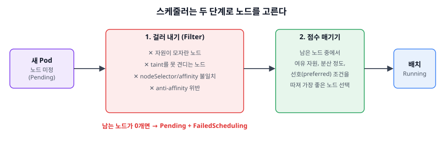
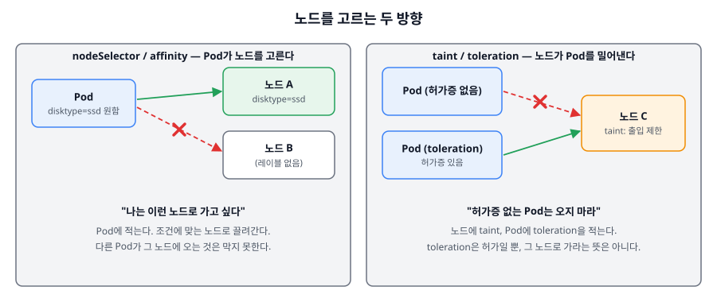

# 15. 스케줄링 — Pod가 놓일 노드 정하기

**이 장을 마치면**

- 스케줄러가 노드를 고르는 과정을 설명할 수 있습니다.
- nodeSelector, taint/toleration, anti-affinity로 Pod의 배치를 조절할 수 있습니다.
- `FailedScheduling` 메시지를 읽고 Pod가 `Pending`인 이유를 찾을 수 있습니다.

---

## 1. 스케줄러는 어떻게 노드를 고르나

지금까지는 Pod를 만들면 "어딘가의 노드"에 알아서 떴습니다. 그 "알아서"를 하는 것이 **스케줄러**입니다.



1. **걸러 내기**: 이 Pod를 실행할 수 없는 노드를 제외합니다.
2. **점수 매기기**: 남은 노드 중 가장 적당한 노드를 고릅니다.

걸러 내고 나서 **남는 노드가 하나도 없으면** Pod는 `Pending`에 머물고, Events에 `FailedScheduling`이 남습니다. [01장](01-pod.md)에서 이미 한 번 봤습니다.

대부분의 Pod는 스케줄러에게 맡기면 됩니다. 하지만 이런 요구가 생기면 직접 조건을 걸어야 합니다.

- GPU나 SSD가 달린 **특정 노드에만** 띄우고 싶다.
- 어떤 노드는 **특정 팀 전용**으로 쓰고 싶다.
- 같은 앱의 Pod가 **한 노드에 몰리지 않게** 하고 싶다.

## 2. 조건을 거는 방법



| 방법 | 어디에 적나 | 뜻 | 방향 |
|---|---|---|---|
| **nodeSelector** | Pod | "이 레이블이 있는 노드로 가겠다" | Pod → 노드 (끌어당김) |
| **nodeAffinity** | Pod | nodeSelector의 확장판. "가능하면"(선호) 같은 조건도 쓸 수 있다 | Pod → 노드 (끌어당김) |
| **taint** | 노드 | "허가 없는 Pod는 오지 마라" | 노드 → Pod (밀어냄) |
| **toleration** | Pod | "그 taint가 있어도 나는 들어갈 수 있다"는 허가증 | taint와 짝 |
| **podAntiAffinity** | Pod | "이런 Pod가 있는 노드는 피하겠다" | Pod ↔ Pod |

> **이 장의 실습에 대해**: 노드에 레이블과 taint를 붙였다 뗍니다. 노드는 모두가 함께 쓰는 자원이니 각 실습 끝의 **되돌리기 명령을 빠뜨리지 마세요.**

실습에 쓸 워커 노드 하나를 변수에 담아 둡니다.

```bash
NODE=$(kubectl get nodes -l '!node-role.kubernetes.io/control-plane' -o jsonpath='{.items[0].metadata.name}')
echo $NODE
```

```
oks2.dd.io
```

## 3. 실습 ① — nodeSelector: 특정 노드로 보내기

`disktype=ssd` 레이블이 붙은 노드에만 가겠다는 Deployment입니다. ([examples/15-scheduling/nodeselector.yaml](../examples/15-scheduling/nodeselector.yaml))

```yaml
    spec:
      nodeSelector:
        disktype: ssd              # Pod가 노드를 고른다
```

아직 그런 레이블이 붙은 노드가 없는 상태에서 만들어 봅니다.

```bash
kubectl apply -f examples/15-scheduling/nodeselector.yaml
sleep 4
kubectl get pod -o wide
```

```
NAME                       READY   STATUS    RESTARTS   AGE   IP       NODE     ...
ssd-app-68b6cbd544-8kvm6   0/1     Pending   0          4s    <none>   <none>   ...
ssd-app-68b6cbd544-bckwz   0/1     Pending   0          4s    <none>   <none>   ...
ssd-app-68b6cbd544-ppt4m   0/1     Pending   0          4s    <none>   <none>   ...
```

전부 `Pending`이고 `NODE`가 비어 있습니다. 노드에 레이블을 붙입니다.

```bash
kubectl label node $NODE disktype=ssd
kubectl rollout status deployment/ssd-app
kubectl get pod -o wide
```

```
NAME                       READY   STATUS    RESTARTS   AGE   IP               NODE         ...
ssd-app-68b6cbd544-8kvm6   1/1     Running   0          6s    192.168.30.208   oks2.dd.io   ...
ssd-app-68b6cbd544-bckwz   1/1     Running   0          6s    192.168.30.209   oks2.dd.io   ...
ssd-app-68b6cbd544-ppt4m   1/1     Running   0          6s    192.168.30.210   oks2.dd.io   ...
```

기다리던 Pod 3개가 **모두 그 노드**에 떴습니다. 스케줄러는 `Pending`인 Pod를 계속 다시 시도하고 있었고, 조건에 맞는 노드가 생기자 바로 배치했습니다.

**되돌리기**

```bash
kubectl delete -f examples/15-scheduling/nodeselector.yaml
kubectl label node $NODE disktype-
```

## 4. 실습 ② — taint와 toleration: 전용 노드 만들기

nodeSelector는 "내 Pod를 그 노드로 보내는" 것까지만 합니다. **다른 Pod가 그 노드에 오는 것은 막지 못합니다.**
노드를 특정 용도 전용으로 쓰려면, 노드 쪽에서 다른 Pod를 밀어내야 합니다. 그것이 taint입니다.

### 4-1. 지금 있는 taint 보기

```bash
kubectl describe nodes | grep -E '^Name:|^Taints:'
```

```
Name:               oks1.dd.io
Taints:             node-role.kubernetes.io/control-plane:NoSchedule
Name:               oks2.dd.io
Taints:             <none>
...
```

컨트롤 플레인 노드에는 이미 taint가 있습니다. 지금까지 우리 Pod가 한 번도 `oks1`에 뜨지 않은 이유입니다. taint의 형식은 **`키=값:효과`** 입니다(값은 생략할 수 있습니다).

| 효과(effect) | 의미 |
|---|---|
| `NoSchedule` | toleration이 없는 Pod는 **새로 배치하지 않는다.** 이미 있는 Pod는 그대로 둔다 |
| `PreferNoSchedule` | 가능하면 배치하지 않는다 (다른 곳이 없으면 배치한다) |
| `NoExecute` | 새로 배치하지 않고, **이미 실행 중인 Pod도 내보낸다** |

### 4-2. 노드에 taint 붙이기

```bash
kubectl taint node $NODE dedicated=edu:NoSchedule
kubectl describe node $NODE | grep Taints
```

```
node/oks2.dd.io tainted
Taints:             dedicated=edu:NoSchedule
```

아무 조건 없는 평범한 Deployment(Pod 8개)를 만들어 봅니다. ([examples/15-scheduling/web.yaml](../examples/15-scheduling/web.yaml))

```bash
kubectl apply -f examples/15-scheduling/web.yaml
kubectl rollout status deployment/web
kubectl get pod -o wide --sort-by=.spec.nodeName
```

```
NAME                   READY   STATUS    RESTARTS   AGE   IP                NODE         ...
web-76f47dbd5b-85c6r   1/1     Running   0          2s    192.168.201.91    oks3.dd.io   ...
web-76f47dbd5b-dt7hk   1/1     Running   0          2s    192.168.201.90    oks3.dd.io   ...
web-76f47dbd5b-8vkbq   1/1     Running   0          2s    192.168.139.94    oks4.dd.io   ...
web-76f47dbd5b-cfbrv   1/1     Running   0          2s    192.168.139.103   oks4.dd.io   ...
web-76f47dbd5b-zzgr8   1/1     Running   0          2s    192.168.139.107   oks4.dd.io   ...
web-76f47dbd5b-2n8l6   1/1     Running   0          2s    192.168.96.95     oks5.dd.io   ...
web-76f47dbd5b-dklr9   1/1     Running   0          2s    192.168.96.86     oks5.dd.io   ...
web-76f47dbd5b-m5kmb   1/1     Running   0          2s    192.168.96.94     oks5.dd.io   ...
```

8개가 나머지 세 노드에만 나뉘었고, **taint를 붙인 노드(`oks2`)에는 하나도 없습니다.**

### 4-3. toleration으로 들어가기

이 노드에 들어가려면 Pod에 toleration이 있어야 합니다. ([examples/15-scheduling/dedicated.yaml](../examples/15-scheduling/dedicated.yaml))

```yaml
    spec:
      tolerations:                 # 허가증: dedicated=edu taint가 있는 노드에도 들어갈 수 있다
      - key: dedicated
        operator: Equal
        value: edu
        effect: NoSchedule
      nodeSelector:                # 지정: dedicated=edu 레이블이 있는 노드로만 간다
        dedicated: edu
```

**toleration은 "들어갈 수 있다"는 허가일 뿐, "그 노드로 가라"는 지시가 아닙니다.** toleration만 있으면 이 Pod는 다른 노드에도 뜰 수 있습니다.
"이 노드에서만 돌게" 하려면 `nodeSelector`를 함께 써야 합니다. 그래서 전용 노드는 **taint + 레이블** 두 가지를 붙이고, Pod에는 **toleration + nodeSelector** 두 가지를 적습니다.

```bash
kubectl label node $NODE dedicated=edu
kubectl apply -f examples/15-scheduling/dedicated.yaml
kubectl rollout status deployment/batch
kubectl get pod -o wide --field-selector spec.nodeName=$NODE
```

```
NAME                    READY   STATUS    RESTARTS   AGE   IP               NODE         ...
batch-f8cc5489d-bd9bx   1/1     Running   0          1s    192.168.30.213   oks2.dd.io   ...
batch-f8cc5489d-csspt   1/1     Running   0          1s    192.168.30.212   oks2.dd.io   ...
batch-f8cc5489d-kt2nr   1/1     Running   0          1s    192.168.30.211   oks2.dd.io   ...
```

이 노드에는 `batch`만 있고 `web`은 없습니다. 전용 노드가 됐습니다.

| | 노드에 | Pod에 | 효과 |
|---|---|---|---|
| 다른 Pod를 막는다 | taint | (허가받을 Pod에만) toleration | `web`이 못 온다 |
| 내 Pod를 보낸다 | 레이블 | nodeSelector | `batch`가 이 노드로만 간다 |

[09장](09-daemonset.md)에서 DaemonSet을 컨트롤 플레인 노드에도 띄울 때 쓴 것이 바로 이 toleration입니다. `operator: Exists`는 값과 상관없이 그 키의 taint를 모두 허용한다는 뜻입니다.

**되돌리기**

```bash
kubectl delete -f examples/15-scheduling/web.yaml -f examples/15-scheduling/dedicated.yaml
kubectl taint node $NODE dedicated-
kubectl label node $NODE dedicated-
```

## 5. 고장 내고 고쳐 보기 — Pod 하나가 계속 Pending

웹 서버 5개를 "노드마다 하나씩" 흩어 놓으려고 합니다. 한 노드가 고장 나도 나머지가 살아 있게 하려는 것입니다.
([examples/15-scheduling/spread.yaml](../examples/15-scheduling/spread.yaml))

```yaml
      affinity:
        podAntiAffinity:           # "이런 Pod가 있는 곳은 피한다"
          requiredDuringSchedulingIgnoredDuringExecution:    # 필수: 못 지키면 배치하지 않는다
          - labelSelector:
              matchLabels:
                app: spread        # app=spread Pod가 이미 있는
            topologyKey: kubernetes.io/hostname              # 같은 노드에는 가지 않는다
```

```bash
kubectl apply -f examples/15-scheduling/spread.yaml
sleep 8
kubectl get deployment spread
kubectl get pod -o wide
```

```
NAME     READY   UP-TO-DATE   AVAILABLE   AGE
spread   4/5     5            4           8s

NAME                      READY   STATUS    RESTARTS   AGE   IP                NODE         ...
spread-7685c99456-4wlg9   1/1     Running   0          8s    192.168.201.89    oks3.dd.io   ...
spread-7685c99456-86qsd   1/1     Running   0          8s    192.168.30.194    oks2.dd.io   ...
spread-7685c99456-qn7bv   0/1     Pending   0          8s    <none>            <none>       ...
spread-7685c99456-vx5l7   1/1     Running   0          8s    192.168.96.97     oks5.dd.io   ...
spread-7685c99456-xt5xq   1/1     Running   0          8s    192.168.139.104   oks4.dd.io   ...
```

4개는 서로 다른 노드에 잘 흩어졌는데, 하나가 `Pending`입니다. 이유를 찾아보세요.

```bash
kubectl describe pod -l app=spread | grep FailedScheduling
```

<details><summary>원인과 해결 방법</summary>

```
Warning  FailedScheduling  8s  default-scheduler  0/5 nodes are available: 1 node(s) had untolerated taint {node-role.kubernetes.io/control-plane: }, 4 node(s) didn't match pod anti-affinity rules. ...
```

메시지를 노드 수대로 나눠 읽습니다. **숫자를 다 더하면 전체 노드 수(5)** 가 됩니다.

| 메시지 | 뜻 |
|---|---|
| `0/5 nodes are available` | 노드 5대 중 쓸 수 있는 곳이 0대 |
| `1 node(s) had untolerated taint {...control-plane}` | 1대는 컨트롤 플레인 taint 때문에 제외 |
| `4 node(s) didn't match pod anti-affinity rules` | 4대는 이미 `app=spread` Pod가 있어서 제외 |

"노드마다 최대 하나"를 **필수**로 걸었는데, 쓸 수 있는 노드는 4대이고 Pod는 5개입니다. 다섯 번째 Pod가 갈 곳이 없습니다.

**해결 방법 A — 개수를 노드 수에 맞춘다.**

```bash
kubectl scale deployment spread --replicas=4
kubectl get pod -o wide
```

**해결 방법 B — "필수"를 "가능하면"으로 바꾼다.** ([examples/15-scheduling/spread-preferred.yaml](../examples/15-scheduling/spread-preferred.yaml))

```yaml
        podAntiAffinity:
          preferredDuringSchedulingIgnoredDuringExecution:   # 선호: 가능하면 지키고, 안 되면 그냥 배치한다
          - weight: 100
            podAffinityTerm:
              labelSelector:
                matchLabels:
                  app: spread
              topologyKey: kubernetes.io/hostname
```

```bash
kubectl delete -f examples/15-scheduling/spread.yaml
kubectl apply -f examples/15-scheduling/spread-preferred.yaml
kubectl rollout status deployment/spread
kubectl get pod -o wide --sort-by=.spec.nodeName
```

```
NAME                      READY   STATUS    RESTARTS   AGE   IP                NODE         ...
spread-5b66f54c9d-l8hrb   1/1     Running   0          3s    192.168.30.216    oks2.dd.io   ...
spread-5b66f54c9d-p7l6v   1/1     Running   0          3s    192.168.201.93    oks3.dd.io   ...
spread-5b66f54c9d-qfmgg   1/1     Running   0          3s    192.168.139.106   oks4.dd.io   ...
spread-5b66f54c9d-c7w56   1/1     Running   0          3s    192.168.96.101    oks5.dd.io   ...
spread-5b66f54c9d-m76j2   1/1     Running   0          3s    192.168.96.106    oks5.dd.io   ...
```

5개가 모두 떴습니다. 최대한 흩어 놓되, 남는 하나는 어쩔 수 없이 다른 Pod와 같은 노드(`oks5`)에 들어갔습니다.

> **왜 지우고 다시 만들었나요?** `필수` anti-affinity가 걸린 Pod가 모든 노드를 차지하고 있으면, 롤링 업데이트로 새 Pod를 띄우려 해도 새 Pod가 갈 노드가 없어서 업데이트가 멈춥니다.
> "필수" 조건은 이렇게 예상하지 못한 곳에서 발목을 잡을 수 있으므로, 꼭 필요한 경우가 아니면 "선호"를 쓰는 편이 안전합니다.

</details>

### 조건 이름 읽는 법

`requiredDuringSchedulingIgnoredDuringExecution`은 길지만 두 부분으로 나누면 쉽습니다.

| 부분 | 의미 |
|---|---|
| `required` / `preferred` **DuringScheduling** | 배치할 때: 반드시 지킨다 / 가능하면 지킨다 |
| **IgnoredDuringExecution** | 실행 중에는: 조건이 깨져도(예: 노드 레이블이 바뀌어도) 이미 뜬 Pod는 내보내지 않는다 |

## 6. 정리

```bash
kubectl delete deployment spread --ignore-not-found
kubectl describe nodes | grep -E '^Name:|^Taints:'
kubectl get nodes -L disktype,dedicated
```

```
Name:               oks1.dd.io
Taints:             node-role.kubernetes.io/control-plane:NoSchedule
Name:               oks2.dd.io
Taints:             <none>
...

NAME         STATUS   ROLES           AGE    VERSION    DISKTYPE   DEDICATED
oks1.dd.io   Ready    control-plane   538d   v1.29.15
oks2.dd.io   Ready    <none>          538d   v1.29.15
...
```

워커 노드의 `Taints`가 `<none>`이고 `DISKTYPE`, `DEDICATED` 열이 비어 있으면 정리된 것입니다. 남아 있다면 4절과 3절의 되돌리기 명령을 실행하세요.

## 7. `FailedScheduling` 메시지 사전

`Pending`인 Pod를 만나면 `kubectl describe pod`의 Events에서 아래 문구를 찾으세요.

| 메시지 | 원인 | 다룬 곳 |
|---|---|---|
| `didn't match Pod's node affinity/selector` | nodeSelector/nodeAffinity에 맞는 노드가 없다 | 이 장 3절, [01장](01-pod.md) |
| `had untolerated taint {키: 값}` | 노드에 taint가 있고 Pod에 toleration이 없다 | 이 장 4절 |
| `didn't match pod anti-affinity rules` | anti-affinity 때문에 갈 노드가 없다 | 이 장 5절 |
| `Insufficient cpu` / `Insufficient memory` | 요청한 자원을 줄 수 있는 노드가 없다 | [17장](17-resources.md) |
| `pod has unbound immediate PersistentVolumeClaims` | PVC가 아직 PV와 연결되지 않았다 | [06장](06-pv-pvc.md) |
| `node(s) were unschedulable` | 노드가 cordon되어 있다 | [13장](13-cordon-drain.md) |

## 핵심 요약

- 스케줄러는 실행할 수 없는 노드를 걸러 낸 뒤, 남은 노드 중 하나를 고른다. 남는 노드가 없으면 `Pending`이다.
- nodeSelector는 Pod가 노드를 고르는 것, taint는 노드가 Pod를 밀어내는 것이다.
- toleration은 허가일 뿐 지정이 아니다. 전용 노드에는 taint + 레이블, toleration + nodeSelector를 함께 쓴다.
- podAntiAffinity로 같은 앱의 Pod를 여러 노드에 흩어 놓을 수 있다. "필수" 조건은 Pod를 `Pending`으로 만들 수 있다.
- `FailedScheduling` 메시지의 노드 수를 더하면 전체 노드 수가 된다. 노드마다 제외된 이유가 적혀 있다.

## 확인 문제

1. nodeSelector와 taint의 차이는 무엇인가요?
2. 노드에 `gpu=true:NoSchedule` taint를 붙였습니다. 이 taint에 대한 toleration만 가진 Pod는 반드시 그 노드에 뜨나요?
3. 워커 노드가 3대인 클러스터에서, 필수(required) podAntiAffinity로 "노드당 하나"를 건 Deployment의 `replicas`를 5로 하면 어떻게 되나요?
4. `0/5 nodes are available: 1 node(s) had untolerated taint ..., 4 node(s) didn't match Pod's node affinity/selector.` 이 메시지를 해석해 보세요.

<details><summary>정답 보기</summary>

1. nodeSelector는 Pod에 적어서 Pod를 특정 노드로 보내는 것이고, taint는 노드에 붙여서 허가(toleration) 없는 Pod가 오지 못하게 막는 것입니다.
2. 아닙니다. toleration은 그 노드에 들어갈 수 있다는 허가일 뿐입니다. 다른 노드에도 뜰 수 있습니다. 그 노드에만 띄우려면 nodeSelector(또는 nodeAffinity)를 함께 써야 합니다.
3. 3개만 뜨고 2개는 `Pending`으로 남습니다. Events에 `didn't match pod anti-affinity rules`가 나옵니다.
4. 노드 5대 중 1대는 taint(보통 컨트롤 플레인) 때문에, 나머지 4대는 Pod의 nodeSelector/nodeAffinity 조건에 맞지 않아서 제외되어 배치할 곳이 없다는 뜻입니다.
</details>

---

다음 장: [16. Probe — 살아 있는지, 준비됐는지 확인하기](16-probes.md)
