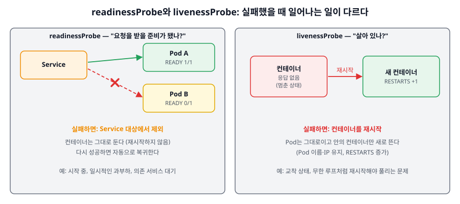

# 16. Probe — 살아 있는지, 준비됐는지 확인하기

**이 장을 마치면**

- `Running`이라고 해서 정상은 아니라는 것, 그래서 Probe가 필요하다는 것을 설명할 수 있습니다.
- readinessProbe와 livenessProbe의 차이를 직접 확인합니다.
- Probe 설정이 잘못되어 Pod가 계속 재시작될 때 원인을 찾을 수 있습니다.

---

## 1. 왜 필요한가

쿠버네티스가 기본적으로 아는 것은 "컨테이너의 프로세스가 **떠 있는가**"뿐입니다. 그런데 프로세스가 떠 있어도 정상이 아닌 경우가 많습니다.

- 앱이 **시작하는 중**이라 아직 요청을 받을 수 없다 (데이터 로딩, DB 연결 등).
- 앱이 **멈춰 버렸다** (교착 상태, 무한 루프). 프로세스는 살아 있지만 응답하지 않는다.
- 일시적으로 **과부하**라서 지금은 요청을 더 받으면 안 된다.

이런 상태를 쿠버네티스가 알 수 있도록, "이렇게 물어봐서 대답이 오면 정상"이라는 검사 방법을 알려 주는 것이 **Probe(프로브)** 입니다. kubelet이 주기적으로 검사합니다.

## 2. 세 가지 Probe



| Probe | 묻는 것 | 실패하면 |
|---|---|---|
| **readinessProbe** | 지금 요청을 받을 수 있나? | Service의 대상(엔드포인트)에서 **제외**. 재시작하지 않는다 |
| **livenessProbe** | 살아 있나? | 컨테이너를 **재시작** |
| **startupProbe** | 시작이 끝났나? | 성공할 때까지 위 두 검사를 미룬다. 너무 오래 걸리면 재시작 |

> **비유**: readiness는 식당의 "준비 중" 팻말입니다. 손님을 잠시 안 받을 뿐 가게는 그대로입니다. liveness는 쓰러진 직원을 발견하고 교대시키는 것입니다.

검사하는 방법도 세 가지가 있습니다.

| 방법 | 성공 조건 | 쓰는 곳 |
|---|---|---|
| `httpGet` | HTTP 요청의 응답 코드가 200~399 | 웹 앱 (가장 흔함) |
| `tcpSocket` | 포트에 연결이 된다 | DB, 메시지 큐처럼 HTTP가 아닌 서버 |
| `exec` | 컨테이너 안에서 명령을 실행해 종료 코드가 0 | 그 밖의 경우 |

## 3. YAML 뜯어보기

([examples/16-probes/web.yaml](../examples/16-probes/web.yaml))

```yaml
      containers:
      - name: nginx
        image: nginx:1.27-alpine
        command: ["sh", "-c"]
        args:                        # 시작할 때 검사용 파일 두 개와 첫 페이지를 만든다
        - |
          cd /usr/share/nginx/html
          echo ok > healthz
          echo ok > ready
          echo "$(hostname)" > index.html
          exec nginx -g 'daemon off;'
        readinessProbe:              # "요청을 받을 준비가 됐나?" -> 실패하면 Service 대상에서 제외
          httpGet:
            path: /ready
            port: 80
          periodSeconds: 3           # 3초마다 검사
          failureThreshold: 2        # 2번 연속 실패하면 "준비 안 됨"
        livenessProbe:               # "살아 있나?" -> 실패하면 컨테이너를 재시작
          httpGet:
            path: /healthz
            port: 80
          periodSeconds: 5           # 5초마다 검사
          failureThreshold: 2        # 2번 연속 실패하면 재시작
```

실습을 위해 검사 대상을 **파일**로 만들었습니다. `/ready` 파일이 있으면 준비된 것, `/healthz` 파일이 있으면 살아 있는 것으로 칩니다.
파일을 지우면 nginx가 404를 응답하고, Probe가 실패합니다. 이렇게 고장을 흉내 냅니다.

| 설정 | 의미 | 기본값 |
|---|---|---|
| `periodSeconds` | 검사 주기 | 10초 |
| `failureThreshold` | 몇 번 연속 실패해야 실패로 볼지 | 3 |
| `timeoutSeconds` | 응답을 기다리는 시간 | 1초 |
| `initialDelaySeconds` | 컨테이너 시작 후 첫 검사까지 기다리는 시간 | 0초 |

한 번 실패했다고 바로 조치하지 않고 **연속으로 여러 번** 실패해야 조치합니다. 순간적인 지연 때문에 멀쩡한 앱을 재시작하지 않기 위해서입니다.

## 4. 실습 ① — readinessProbe: 준비 안 된 Pod는 요청을 받지 않는다

```bash
kubectl apply -f examples/16-probes/web.yaml
kubectl rollout status deployment/web
kubectl get pod -o wide
kubectl get endpoints web
```

```
NAME                   READY   STATUS    RESTARTS   AGE   IP                NODE         ...
web-5d96cfd7b8-4l77q   1/1     Running   0          4s    192.168.139.108   oks4.dd.io   ...
web-5d96cfd7b8-hpcq4   1/1     Running   0          4s    192.168.96.107    oks5.dd.io   ...

NAME   ENDPOINTS                              AGE
web    192.168.139.108:80,192.168.96.107:80   4s
```

Pod 2개가 모두 `READY 1/1`이고, Service의 엔드포인트에도 둘 다 들어 있습니다. 클라이언트를 띄워서 요청이 나뉘는 것을 확인합니다.

```bash
kubectl run client --image=busybox:1.36 --restart=Never -- sleep 3600
kubectl wait --for=condition=Ready pod/client --timeout=60s
kubectl exec client -- sh -c 'for i in 1 2 3 4 5 6; do wget -qO- -T 2 http://web; done'
```

```
web-5d96cfd7b8-hpcq4
web-5d96cfd7b8-4l77q
web-5d96cfd7b8-4l77q
web-5d96cfd7b8-hpcq4
...
```

이제 Pod 하나를 "준비 안 됨" 상태로 만듭니다. Pod 하나의 이름을 변수에 담고, 그 Pod의 `/ready` 파일을 지웁니다.

```bash
POD=$(kubectl get pod -l app=web -o jsonpath='{.items[0].metadata.name}')
echo $POD

kubectl exec $POD -- rm /usr/share/nginx/html/ready
sleep 9
kubectl get pod -l app=web -o wide
kubectl get endpoints web
```

```
NAME                   READY   STATUS    RESTARTS   AGE   IP                NODE         ...
web-5d96cfd7b8-4l77q   0/1     Running   0          13s   192.168.139.108   oks4.dd.io   ...
web-5d96cfd7b8-hpcq4   1/1     Running   0          13s   192.168.96.107    oks5.dd.io   ...

NAME   ENDPOINTS           AGE
web    192.168.96.107:80   13s
```

**세 가지를 확인하세요.**

- `STATUS`는 여전히 `Running`이지만 `READY`가 **`0/1`** 이 됐습니다.
- `RESTARTS`는 `0`입니다. **재시작되지 않았습니다.**
- 엔드포인트에서 그 Pod의 IP(`192.168.139.108`)가 **빠졌습니다.**

```bash
kubectl exec client -- sh -c 'for i in 1 2 3 4 5 6; do wget -qO- -T 2 http://web; done'
```

```
web-5d96cfd7b8-hpcq4
web-5d96cfd7b8-hpcq4
web-5d96cfd7b8-hpcq4
web-5d96cfd7b8-hpcq4
web-5d96cfd7b8-hpcq4
web-5d96cfd7b8-hpcq4
```

요청이 전부 정상인 Pod로만 갑니다. 사용자는 문제를 느끼지 못합니다.

[03장](03-service.md)에서 "엔드포인트는 selector에 맞는 Pod의 IP 목록"이라고 했습니다. 정확히는 **selector에 맞고 준비된(Ready) Pod**의 목록입니다.

이유는 Events에 남아 있습니다.

```bash
kubectl describe pod $POD | grep Unhealthy
```

```
Warning  Unhealthy  10s (x4 over 16s)  kubelet  Readiness probe failed: HTTP probe failed with statuscode: 404
```

파일을 되돌리면 자동으로 복귀합니다.

```bash
kubectl exec $POD -- sh -c 'echo ok > /usr/share/nginx/html/ready'
sleep 6
kubectl get pod -l app=web
kubectl get endpoints web
```

```
NAME                   READY   STATUS    RESTARTS   AGE
web-5d96cfd7b8-4l77q   1/1     Running   0          19s
web-5d96cfd7b8-hpcq4   1/1     Running   0          19s

NAME   ENDPOINTS                              AGE
web    192.168.139.108:80,192.168.96.107:80   19s
```

## 5. 실습 ② — livenessProbe: 죽은 컨테이너는 재시작한다

이번에는 같은 Pod의 `/healthz` 파일을 지웁니다.

```bash
kubectl exec $POD -- rm /usr/share/nginx/html/healthz
sleep 15
kubectl get pod -l app=web
```

```
NAME                   READY   STATUS    RESTARTS      AGE
web-5d96cfd7b8-4l77q   1/1     Running   1 (5s ago)    34s
web-5d96cfd7b8-hpcq4   1/1     Running   0             34s
```

이번에는 **`RESTARTS`가 1**이 됐습니다. kubelet이 컨테이너를 죽이고 다시 시작한 것입니다.

```bash
kubectl describe pod $POD | grep -E 'Unhealthy|Killing'
```

```
Warning  Unhealthy  36s (x2 over 41s)  kubelet  Liveness probe failed: HTTP probe failed with statuscode: 404
Normal   Killing    36s                kubelet  Container nginx failed liveness probe, will be restarted
```

컨테이너가 다시 시작되면서 시작 스크립트가 `/healthz` 파일을 다시 만들었고, 그래서 정상으로 돌아왔습니다.

```bash
kubectl exec $POD -- cat /usr/share/nginx/html/healthz
```

```
ok
```

Pod 이름이 그대로라는 점도 보세요. [02장](02-deployment.md)에서 Pod를 지웠을 때는 새 이름의 Pod가 생겼지만, liveness 실패는 **같은 Pod 안에서 컨테이너만** 다시 시작합니다.

**두 실습 비교**

| | 실습 ① (`/ready` 삭제) | 실습 ② (`/healthz` 삭제) |
|---|---|---|
| 실패한 Probe | readiness | liveness |
| `READY` | `0/1`로 바뀜 | 잠깐 바뀌었다가 복귀 |
| `RESTARTS` | 그대로 | **1 증가** |
| Service 엔드포인트 | 제외됨 | (재시작하는 동안만 제외) |
| 복구 | 조건이 다시 맞으면 자동 복귀 | 재시작으로 복구 |

## 6. 고장 내고 고쳐 보기 — 멀쩡한 앱이 계속 재시작된다

```bash
kubectl apply -f examples/16-probes/broken.yaml
sleep 45
kubectl get pod -l app=api
```

```
NAME                   READY   STATUS             RESTARTS     AGE
api-554cc7757d-sh5mk   0/1     CrashLoopBackOff   3 (0s ago)   45s
```

45초 만에 3번 재시작됐고 `CrashLoopBackOff`입니다. 앱(nginx)에 문제가 있는 걸까요? 로그와 Events를 봅니다.

```bash
kubectl logs deploy/api --tail=3
kubectl describe pod -l app=api | grep -E 'Liveness|Unhealthy|Killing|Port:'
```

<details><summary>원인과 해결 방법</summary>

```
2026/11/20 11:06:22 [notice] 1#1: worker process 31 exited with code 0
2026/11/20 11:06:22 [notice] 1#1: worker process 32 exited with code 0
2026/11/20 11:06:22 [notice] 1#1: exit

    Port:           80/TCP
    Liveness:       http-get http://:8080/ delay=0s timeout=1s period=5s #success=1 #failure=2
  Warning  Unhealthy  0s (x8 over 35s)  kubelet  Liveness probe failed: Get "http://192.168.30.202:8080/": dial tcp 192.168.30.202:8080: connect: connection refused
  Normal   Killing    0s (x4 over 30s)  kubelet  Container nginx failed liveness probe, will be restarted
```

- 로그에 오류가 없습니다. nginx는 `exited with code 0`, 즉 **종료하라는 요청을 받고 정상적으로** 꺼졌습니다. 스스로 죽은 것이 아닙니다.
- Events를 보면 kubelet이 죽였습니다: `failed liveness probe, will be restarted`.
- 이유는 `connection refused` — Probe가 **8080번** 포트를 검사하는데, nginx는 **80번**(`Port: 80/TCP`)에서 듣고 있습니다.

앱은 멀쩡한데 **검사 방법이 틀려서** 계속 죽임을 당한 것입니다. 잘못 설정한 livenessProbe는 없는 것보다 훨씬 위험합니다.

Probe의 포트를 고칩니다.

```bash
kubectl patch deployment api --type json \
  -p '[{"op":"replace","path":"/spec/template/spec/containers/0/livenessProbe/httpGet/port","value":80}]'
kubectl rollout status deployment/api
sleep 15
kubectl get pod -l app=api
```

```
NAME                  READY   STATUS    RESTARTS   AGE
api-dbb4f99f8-frtlk   1/1     Running   0          17s
```

`RESTARTS`가 0에서 멈춰 있으면 고쳐진 것입니다. YAML 파일의 `port: 8080`을 `80`으로 고쳐 다시 `apply`해도 같습니다.

</details>

### `CrashLoopBackOff`의 두 가지 원인

| 원인 | 구별하는 법 |
|---|---|
| **앱이 스스로 죽는다** (설정 오류, 예외 등) | `kubectl logs --previous`에 오류 메시지가 있다. Events에 `Killing`이 없다 |
| **livenessProbe가 죽인다** | Events에 `Liveness probe failed`와 `Killing`이 있다. 로그는 정상 종료처럼 보인다 |

> `kubectl logs 이름 --previous`는 **재시작되기 직전** 컨테이너의 로그를 보여 줍니다. 재시작이 반복될 때 꼭 필요한 옵션입니다.

## 7. 정리

```bash
kubectl delete pod client
kubectl delete -f examples/16-probes/web.yaml -f examples/16-probes/broken.yaml
```

## 8. 알아 두면 좋은 것

### startupProbe — 시작이 느린 앱

시작하는 데 1분이 걸리는 앱에 livenessProbe를 걸면, 시작이 끝나기도 전에 "죽었다"고 판단해 재시작하고, 영원히 뜨지 못할 수 있습니다.
startupProbe는 "시작이 끝날 때까지는 liveness와 readiness 검사를 하지 않는다"는 장치입니다.

```yaml
        startupProbe:
          httpGet:
            path: /healthz
            port: 80
          periodSeconds: 5
          failureThreshold: 30       # 5초 × 30번 = 최대 150초까지 시작을 기다린다
```

### Probe를 만들 때의 원칙

- **readinessProbe는 거의 항상 넣습니다.** 없으면 컨테이너가 뜨자마자 요청을 받기 시작해서, 배포할 때마다 순간적인 오류가 납니다. [02장](02-deployment.md)의 롤링 업데이트가 "새 Pod가 준비되면" 옛 Pod를 내리는데, 그 "준비"를 판단하는 기준이 readinessProbe입니다.
- **livenessProbe는 신중하게 넣습니다.** "재시작하면 나아지는 문제"만 검사해야 합니다.
- **livenessProbe에서 외부 서비스(DB 등)를 검사하지 않습니다.** DB가 잠깐 느려졌다고 모든 앱 Pod가 동시에 재시작되면 장애가 더 커집니다. 그런 검사는 readinessProbe에 넣습니다.

## 핵심 요약

- `Running`은 프로세스가 떠 있다는 뜻일 뿐, 정상이라는 뜻이 아니다.
- readinessProbe가 실패하면 Service 대상에서 빠진다. 재시작하지 않는다.
- livenessProbe가 실패하면 컨테이너를 재시작한다. `RESTARTS`가 늘어난다.
- startupProbe는 시작이 느린 앱을 위해 다른 검사를 미뤄 준다.
- Probe의 경로나 포트가 틀리면 멀쩡한 앱이 계속 재시작된다.
- 재시작이 반복되면 Events의 `Killing`과 `kubectl logs --previous`로 "스스로 죽었는지, 죽임을 당했는지"를 구분한다.

## 확인 문제

1. Pod가 `Running`인데 `READY`가 `0/1`입니다. 어떤 Probe가 실패한 것이고, 이 Pod는 Service의 요청을 받나요?
2. readinessProbe 실패와 livenessProbe 실패의 가장 큰 차이는 무엇인가요?
3. 시작에 2분이 걸리는 앱에 `periodSeconds: 10`, `failureThreshold: 3`인 livenessProbe만 걸면 어떻게 되나요? 무엇을 추가해야 하나요?
4. Pod가 `CrashLoopBackOff`입니다. 앱 문제인지 Probe 문제인지 어떻게 구분하나요?

<details><summary>정답 보기</summary>

1. readinessProbe가 실패한 것입니다. Service의 엔드포인트에서 제외되어 요청을 받지 않습니다. 컨테이너는 재시작되지 않습니다.
2. readiness 실패는 요청만 끊고 컨테이너를 그대로 두지만, liveness 실패는 컨테이너를 재시작합니다.
3. 30초(10초 × 3번) 뒤에 죽었다고 판단해 재시작하고, 그 과정이 반복되어 앱이 끝내 뜨지 못합니다. startupProbe를 추가해 시작이 끝날 때까지 liveness 검사를 미뤄야 합니다.
4. `kubectl describe pod`의 Events에 `Liveness probe failed`와 `Killing`이 있으면 Probe가 죽인 것이고, 없으면 앱이 스스로 죽은 것입니다. 후자는 `kubectl logs --previous`에서 오류를 찾습니다.
</details>

---

다음 장: [17. Requests / Limits — 자원 예약과 상한](17-resources.md)
