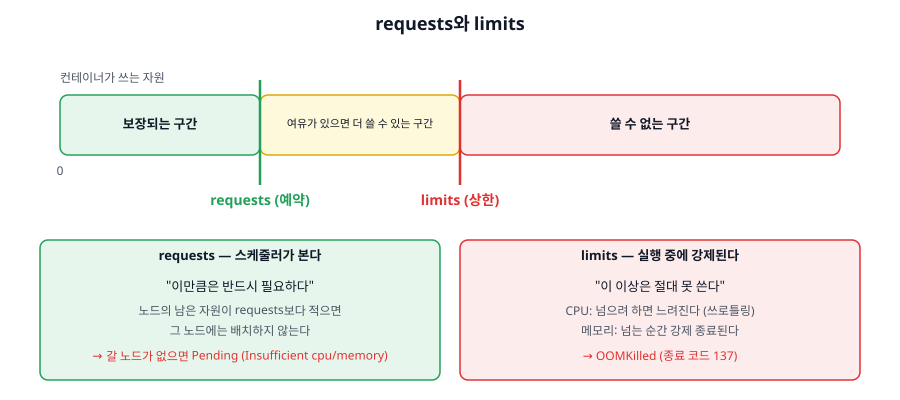

# 17. Requests / Limits — 자원 예약과 상한

**이 장을 마치면**

- requests와 limits의 차이를 설명하고, CPU와 메모리 단위를 정확히 쓸 수 있습니다.
- CPU 상한을 넘으면 느려지고, 메모리 상한을 넘으면 죽는다는 것을 직접 확인합니다.
- `Insufficient cpu`와 `OOMKilled`의 원인을 찾을 수 있습니다.

---

## 1. 왜 필요한가

노드 한 대에는 여러 Pod가 함께 삽니다. 아무 제한이 없다면 이런 일이 생깁니다.

- 한 Pod가 메모리를 계속 먹어서 **같은 노드의 다른 Pod까지 죽는다.**
- 스케줄러가 이미 꽉 찬 노드에 Pod를 계속 올린다. 얼마나 필요한지 모르기 때문이다.

그래서 컨테이너마다 두 가지 숫자를 적습니다.



| | requests (예약) | limits (상한) |
|---|---|---|
| 의미 | 최소한 이만큼은 필요하다 | 이 이상은 쓰면 안 된다 |
| 누가 쓰나 | **스케줄러** — 노드를 고를 때 | **노드(kubelet)** — 실행 중에 |
| 모자라면/넘으면 | 줄 수 있는 노드가 없으면 `Pending` | CPU: 느려짐 / 메모리: 강제 종료 |

> **비유**: requests는 식당 예약 인원입니다. 자리가 모자라면 예약을 받지 않습니다. limits는 "1인당 최대 3접시"라는 규칙입니다.

### 단위

| 자원 | 쓰는 법 | 의미 |
|---|---|---|
| CPU | `1` | 코어 1개 |
| CPU | `500m` | 0.5 코어 (`m`은 1/1000. "밀리코어"라고 읽는다) |
| CPU | `100m` | 0.1 코어 |
| 메모리 | `128Mi` | 128 메비바이트 (128 × 1024 × 1024 바이트) |
| 메모리 | `1Gi` | 1 기비바이트 |

**단위를 빠뜨리거나 잘못 쓰면 전혀 다른 값이 됩니다.** 가장 흔한 실수 두 가지입니다.

- `cpu: 500` → 0.5 코어가 아니라 **500 코어** (6절에서 실습)
- `memory: 128m` → 128 메가바이트가 아니라 **0.128 바이트**. 메모리에는 `Mi`, `Gi`를 씁니다

## 2. 실습 ① — requests와 limits 지정하기

([examples/17-resources/pod.yaml](../examples/17-resources/pod.yaml))

```yaml
spec:
  containers:
  - name: nginx
    image: nginx:1.27-alpine
    resources:
      requests:              # 예약: 이만큼은 보장해 달라 (스케줄러가 이 값으로 노드를 고른다)
        cpu: 100m            #   0.1 코어
        memory: 64Mi
      limits:                # 상한: 이 이상은 쓰지 못한다
        cpu: 200m            #   0.2 코어
        memory: 128Mi
```

`resources`는 **컨테이너마다** 적습니다. Pod에 컨테이너가 2개면 각각 적어야 합니다.

```bash
kubectl apply -f examples/17-resources/pod.yaml
kubectl wait --for=condition=Ready pod/web --timeout=60s
kubectl describe pod web | grep -A5 'Limits:'
```

```
    Limits:
      cpu:     200m
      memory:  128Mi
    Requests:
      cpu:        100m
      memory:     64Mi
```

이 Pod가 배치된 노드에서 자원이 얼마나 예약되어 있는지 봅니다.

```bash
NODE=$(kubectl get pod web -o jsonpath='{.spec.nodeName}')
kubectl describe node $NODE | grep -A6 '^Allocatable'
kubectl describe node $NODE | grep -A5 'Allocated resources'
```

```
Allocatable:
  cpu:                4
  ephemeral-storage:  88009706965
  hugepages-1Gi:      0
  hugepages-2Mi:      0
  memory:             16146924Ki
  pods:               110

Allocated resources:
  (Total limits may be over 100 percent, i.e., overcommitted.)
  Resource           Requests      Limits
  --------           --------      ------
  cpu                2215m (55%)   25850m (646%)
  memory             5366Mi (34%)  17960Mi (113%)
```

- **Allocatable**: 이 노드가 Pod에게 줄 수 있는 총량 (CPU 4코어, 메모리 약 16Gi)
- **Allocated resources**: 이 노드의 모든 Pod가 적어 낸 requests와 limits의 합계

스케줄러는 **requests의 합계**만 봅니다. 이 노드는 CPU 4코어 중 2.2코어(55%)가 예약되어 있으니, 새 Pod는 requests가 1.8코어 이하여야 이 노드에 올 수 있습니다.

**limits의 합계는 100%를 넘어도 됩니다** (위에서 646%). 모든 Pod가 동시에 상한까지 쓰는 일은 드물다고 보고, 겹쳐서 허용하는 것입니다.

> 스케줄러가 보는 것은 **실제 사용량이 아니라 적어 낸 requests**입니다. Pod가 실제로는 CPU를 거의 안 쓰더라도 requests를 크게 적으면 그만큼 자리를 차지합니다.

```bash
kubectl delete pod web
```

## 3. 실습 ② — CPU 상한: 넘으면 느려진다

CPU 상한만 다른 Pod 두 개에 같은 계산을 시키고 걸리는 시간을 비교합니다. ([examples/17-resources/cpu-limit.yaml](../examples/17-resources/cpu-limit.yaml))

| Pod | CPU limit |
|---|---|
| `cpu-fast` | `1` (1 코어) |
| `cpu-slow` | `100m` (0.1 코어) |

```bash
kubectl apply -f examples/17-resources/cpu-limit.yaml
kubectl wait --for=condition=Ready pod/cpu-fast pod/cpu-slow --timeout=60s
```

두 Pod에서 "0부터 30만까지 세기"를 실행하고 시간을 잽니다.

```bash
kubectl exec cpu-fast -- sh -c 'time sh -c "i=0; while [ \$i -lt 300000 ]; do i=\$((i+1)); done"'
```

```
real	0m 0.61s
user	0m 0.61s
sys	0m 0.00s
```

```bash
kubectl exec cpu-slow -- sh -c 'time sh -c "i=0; while [ \$i -lt 300000 ]; do i=\$((i+1)); done"'
```

```
real	0m 6.38s
user	0m 0.63s
sys	0m 0.00s
```

같은 계산인데 **약 10배** 오래 걸렸습니다. 재미있는 점은 `user`(실제로 CPU를 쓴 시간)는 0.6초로 같다는 것입니다.
`cpu-slow`는 0.1코어만 쓸 수 있어서, CPU를 조금 쓰고 **강제로 쉬고**, 다시 조금 쓰고 쉬기를 반복했습니다. 이것을 **쓰로틀링(throttling)** 이라고 합니다.

CPU 상한을 넘는다고 컨테이너가 죽지는 않습니다. **느려질 뿐입니다.** "앱이 이유 없이 느리다"면 CPU limit이 너무 낮지 않은지 확인해 보세요.

```bash
kubectl delete -f examples/17-resources/cpu-limit.yaml
```

## 4. 실습 ③ — 메모리 상한: 넘으면 죽는다

메모리는 CPU와 다릅니다. "조금 천천히 쓰게" 할 방법이 없기 때문에, 상한을 넘으면 **즉시 강제 종료**됩니다.

메모리를 끝없이 쓰는 Pod를 띄웁니다. 상한은 64Mi입니다. ([examples/17-resources/oom.yaml](../examples/17-resources/oom.yaml))

```yaml
    command: ["sh", "-c"]
    args:                        # 문자열을 계속 두 배로 늘려서 메모리를 점점 더 많이 쓴다
    - |
      echo "start: allocating memory..."
      a=0123456789abcdef
      while true; do a=$a$a; done
    resources:
      limits:
        cpu: 100m
        memory: 64Mi
```

```bash
kubectl apply -f examples/17-resources/oom.yaml
sleep 12
kubectl get pod mem-hog
```

```
NAME      READY   STATUS      RESTARTS      AGE
mem-hog   0/1     OOMKilled   1 (5s ago)    12s
```

`STATUS`가 **`OOMKilled`** 입니다(시점에 따라 `CrashLoopBackOff`로 보일 수도 있습니다). OOM은 Out Of Memory의 줄임말입니다.

```bash
kubectl describe pod mem-hog | grep -A10 'State:'
```

```
    State:          Terminated
      Reason:       OOMKilled
      Exit Code:    137
      Started:      Fri, 20 Nov 2026 20:11:32 +0900
      Finished:     Fri, 20 Nov 2026 20:11:33 +0900
    Last State:     Terminated
      Reason:       OOMKilled
      Exit Code:    137
      Started:      Fri, 20 Nov 2026 20:11:29 +0900
      Finished:     Fri, 20 Nov 2026 20:11:31 +0900
    Ready:          False
```

| 단서 | 의미 |
|---|---|
| `Reason: OOMKilled` | 메모리 상한을 넘어서 강제 종료됨 |
| `Exit Code: 137` | 강제 종료(SIGKILL)됐을 때의 종료 코드. 128 + 9 |
| `Last State` | 직전에 죽었을 때의 정보. 재시작이 반복될 때 여기를 본다 |

앱 로그에는 아무 오류도 남지 않습니다. 앱이 스스로 죽은 것이 아니라 **밖에서 죽인** 것이기 때문입니다.
그래서 "로그에 아무것도 없는데 컨테이너가 재시작된다"면 `describe`의 `Last State`에서 `OOMKilled`를 찾아야 합니다.

**하지만 이 Pod 덕분에 같은 노드의 다른 Pod는 무사합니다.** 상한이 없었다면 노드의 메모리를 전부 먹고 다른 Pod들까지 죽였을 것입니다. limits가 있는 이유입니다.

```bash
kubectl delete pod mem-hog
```

### CPU와 메모리의 차이

| | 상한을 넘으려 하면 | 증상 |
|---|---|---|
| CPU | 강제로 쉬게 한다 (쓰로틀링) | 느려진다. 죽지 않는다 |
| 메모리 | 강제 종료한다 | `OOMKilled`, 종료 코드 137, `RESTARTS` 증가 |

## 5. QoS 등급

노드의 메모리가 정말로 바닥나면 쿠버네티스는 Pod를 내보내야 합니다. 그때 **누구부터 내보낼지**를 정하는 등급이 QoS(Quality of Service)입니다. requests와 limits를 어떻게 적었는지에 따라 자동으로 정해집니다.

| QoS 등급 | 조건 | 내보내는 순서 |
|---|---|---|
| `Guaranteed` | 모든 컨테이너의 requests = limits (CPU와 메모리 모두) | 가장 나중 |
| `Burstable` | requests나 limits를 적었지만 위 조건은 아님 | 중간 |
| `BestEffort` | 아무것도 안 적음 | **가장 먼저** |

```text
kubectl get pod 이름 -o jsonpath='{.status.qosClass}{"\n"}'
```

지금까지 이 교재에서 `resources` 없이 만든 Pod들은 모두 `BestEffort`였습니다. 실습에서는 괜찮지만, 실제 서비스에는 반드시 requests와 limits를 적습니다.

## 6. 고장 내고 고쳐 보기 — Pod가 Pending에서 멈춘다

0.5코어를 예약하려던 Deployment입니다.

```bash
kubectl apply -f examples/17-resources/broken.yaml
sleep 5
kubectl get pod -l app=calc
```

```
NAME                   READY   STATUS    RESTARTS   AGE
calc-6f8bd74bc-4ggb5   0/1     Pending   0          5s
```

[15장](15-scheduling.md)에서 배운 대로 Events를 읽어 보세요.

```bash
kubectl describe pod -l app=calc | grep -A4 '^Events'
kubectl describe pod -l app=calc | grep -A5 'Limits:'
```

<details><summary>원인과 해결 방법</summary>

```
Warning  FailedScheduling  5s  default-scheduler  0/5 nodes are available: 1 node(s) had untolerated taint {node-role.kubernetes.io/control-plane: }, 4 Insufficient cpu. ...

    Limits:
      cpu:     500
      memory:  128Mi
    Requests:
      cpu:        500
      memory:     64Mi
```

`4 Insufficient cpu` — 워커 노드 4대 모두 CPU가 모자랍니다. 그런데 2절에서 본 것처럼 노드에는 여유가 있었습니다.

요청량을 보면 `cpu: 500`입니다. **`m`이 빠졌습니다.** 0.5코어(`500m`)가 아니라 **500코어**를 요청한 것입니다. 노드는 4코어뿐이니 어디에도 갈 수 없습니다.

`kubectl set resources`로 고칩니다(YAML을 고쳐 다시 `apply`해도 됩니다).

```bash
kubectl set resources deployment calc --requests=cpu=500m,memory=64Mi --limits=cpu=500m,memory=128Mi
kubectl rollout status deployment/calc
kubectl get pod -l app=calc
```

```
NAME                    READY   STATUS    RESTARTS   AGE
calc-758c49497f-978gs   1/1     Running   0          2s
```

</details>

**`Insufficient cpu` / `Insufficient memory`를 만났을 때**

| 확인할 것 | 명령 |
|---|---|
| Pod가 요청한 양이 맞는가 (단위 실수는 없는가) | `kubectl describe pod 이름` 의 `Requests` |
| 노드에 남은 예약 여유가 얼마인가 | `kubectl describe node 이름` 의 `Allocated resources` |
| 정말 자원이 모자란 것이라면 | requests를 줄이거나, 다른 Pod를 정리하거나, 노드를 추가한다 |

## 7. 정리

```bash
kubectl delete -f examples/17-resources/broken.yaml
kubectl get pod
```

## 8. 알아 두면 좋은 것

- **얼마로 정해야 하나?** 처음에는 정답이 없습니다. 실제 사용량을 관찰한 뒤 맞춥니다. 클러스터에 metrics-server가 설치되어 있으면 `kubectl top pod`로 현재 사용량을 볼 수 있습니다.
- **메모리는 requests = limits로** 맞추는 것을 많이 권장합니다. 메모리가 모자랄 때의 동작(강제 종료)이 워낙 치명적이라, 예약한 만큼만 쓰게 하는 편이 예측하기 쉽습니다.
- **네임스페이스 단위의 제한**도 있습니다. `LimitRange`는 `resources`를 적지 않은 Pod에 기본값을 넣어 주고, `ResourceQuota`는 네임스페이스 전체가 쓸 수 있는 총량을 제한합니다.
  Pod를 만들었는데 `exceeded quota`나 `must specify limits` 같은 오류가 나면 이 둘 때문입니다.

## 핵심 요약

- requests는 예약(스케줄러가 사용), limits는 상한(실행 중 강제)이다.
- CPU는 `m`(밀리코어), 메모리는 `Mi`/`Gi`로 쓴다. 단위 실수에 주의한다.
- 스케줄러는 실제 사용량이 아니라 requests의 합계를 본다.
- CPU 상한을 넘으면 느려지고, 메모리 상한을 넘으면 `OOMKilled`(종료 코드 137)로 죽는다.
- `OOMKilled`는 앱 로그에 남지 않는다. `kubectl describe pod`의 `State`/`Last State`를 본다.
- requests와 limits를 적지 않은 Pod는 `BestEffort`이고, 노드 자원이 모자랄 때 가장 먼저 내보내진다.

## 확인 문제

1. requests와 limits는 각각 언제, 누가 사용하나요?
2. `cpu: 250m`은 몇 코어인가요? `memory: 512m`이라고 쓰면 무엇이 문제인가요?
3. 컨테이너가 CPU limit을 넘으려 할 때와 메모리 limit을 넘으려 할 때 각각 어떻게 되나요?
4. Pod가 계속 재시작되는데 로그에는 오류가 없습니다. `describe`에서 `Exit Code: 137`을 발견했습니다. 무엇을 의심해야 하나요?
5. 노드의 실제 CPU 사용률은 10%인데 새 Pod가 `Insufficient cpu`로 `Pending`입니다. 어떻게 이런 일이 가능한가요?

<details><summary>정답 보기</summary>

1. requests는 스케줄러가 Pod를 배치할 노드를 고를 때 사용하고, limits는 Pod가 실행되는 동안 노드에서 강제됩니다.
2. 0.25 코어입니다. `512m`은 메모리에서 0.512 바이트를 뜻하므로 의도와 전혀 다른 값입니다. `512Mi`라고 써야 합니다.
3. CPU는 강제로 쉬게 해서 느려지고(쓰로틀링), 메모리는 컨테이너가 강제 종료됩니다(`OOMKilled`).
4. 메모리 limit 초과(`OOMKilled`)를 의심합니다. `Reason: OOMKilled`인지 확인하고, 메모리 limit을 늘리거나 앱의 메모리 사용을 줄입니다. (livenessProbe 실패로 죽은 경우에도 137이 나올 수 있으니 Events의 `Killing`도 함께 봅니다)
5. 스케줄러는 실제 사용량이 아니라 requests의 합계를 봅니다. 기존 Pod들이 requests를 크게 적어 두었다면, 실제로는 한가해도 예약상으로는 꽉 찬 것입니다.
</details>

---

다음 장: [18. Job / CronJob — 한 번 실행하고 끝나는 작업](18-batch.md)
