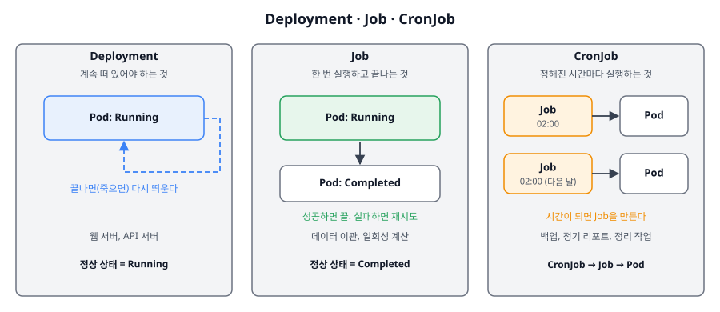

# 18. Job / CronJob — 한 번 실행하고 끝나는 작업

**이 장을 마치면**

- Deployment, Job, CronJob을 언제 쓰는지 구분할 수 있습니다.
- Job을 실행해 결과를 확인하고, 여러 개를 병렬로 돌릴 수 있습니다.
- 실패한 Job의 원인을 찾고, CronJob으로 주기적인 작업을 만들 수 있습니다.

---

## 1. 왜 필요한가

지금까지 다룬 Deployment, StatefulSet, DaemonSet은 모두 **계속 떠 있어야 하는** 앱을 위한 것입니다. 컨테이너가 끝나면 "죽었다"고 보고 다시 띄웁니다.

하지만 끝나는 것이 정상인 작업도 많습니다.

- DB 백업, 데이터 이관
- 매일 새벽에 돌리는 통계 리포트
- 오래된 파일 정리

이런 작업을 Deployment로 돌리면, 작업이 잘 끝날 때마다 쿠버네티스가 "죽었네" 하고 다시 실행해서 **끝없이 반복**됩니다.



| | 목적 | 컨테이너가 끝나면 | 정상 상태 |
|---|---|---|---|
| Deployment | 계속 실행 | 다시 띄운다 | `Running` |
| **Job** | 한 번 실행해서 **끝내기** | 성공이면 그대로 끝, 실패면 다시 시도 | `Completed` |
| **CronJob** | 정해진 시간마다 Job을 만든다 | — | — |

## 2. 실습 ① — Job 실행하기

1부터 100까지 더하고 끝나는 Job입니다. ([examples/18-batch/job.yaml](../examples/18-batch/job.yaml))

```yaml
apiVersion: batch/v1
kind: Job
metadata:
  name: sum
spec:
  template:                      # 실행할 Pod의 틀
    spec:
      restartPolicy: Never       # Job의 Pod는 Never 또는 OnFailure만 쓸 수 있다
      containers:
      - name: calc
        image: busybox:1.36
        command: ["sh", "-c"]
        args:                    # 1부터 100까지 더하고 끝난다
        - |
          echo "start"
          sum=0; i=1
          while [ $i -le 100 ]; do sum=$((sum+i)); i=$((i+1)); done
          sleep 5
          echo "1 + 2 + ... + 100 = $sum"
```

`replicas`도 `selector`도 없습니다. **`restartPolicy`** 는 반드시 적어야 합니다. Pod의 기본값인 `Always`("끝나면 항상 다시 시작")는 "끝내는 것"이 목적인 Job과 맞지 않기 때문입니다.

```bash
kubectl apply -f examples/18-batch/job.yaml
kubectl get job,pod
```

```
NAME            COMPLETIONS   DURATION   AGE
job.batch/sum   0/1           3s         3s

NAME            READY   STATUS    RESTARTS   AGE
pod/sum-nttv2   1/1     Running   0          3s
```

끝날 때까지 기다립니다.

```bash
kubectl wait --for=condition=complete job/sum --timeout=60s
kubectl get job,pod
```

```
job.batch/sum condition met

NAME            COMPLETIONS   DURATION   AGE
job.batch/sum   1/1           8s         8s

NAME            READY   STATUS      RESTARTS   AGE
pod/sum-nttv2   0/1     Completed   0          8s
```

- Job의 `COMPLETIONS`가 **`1/1`** 이 됐습니다. 필요한 성공 횟수 1번 중 1번을 채웠습니다.
- Pod의 `STATUS`는 **`Completed`**, `READY`는 `0/1`입니다. Job에서는 이것이 **정상**입니다. 컨테이너가 할 일을 마치고 종료 코드 0으로 끝났다는 뜻입니다.

끝난 Pod는 지워지지 않고 남아 있습니다. **결과(로그)를 볼 수 있게** 하기 위해서입니다.

```bash
kubectl logs job/sum
```

```
start
1 + 2 + ... + 100 = 5050
```

> `kubectl logs job/이름`처럼 쓰면 그 Job의 Pod를 알아서 찾아 줍니다.

## 3. 실습 ② — 여러 번, 동시에 실행하기

같은 작업을 여러 번 돌려야 할 때가 있습니다(예: 파일 6개를 하나씩 처리). ([examples/18-batch/job-parallel.yaml](../examples/18-batch/job-parallel.yaml))

```yaml
spec:
  completions: 6                 # 성공한 Pod가 6개가 될 때까지 실행한다
  parallelism: 2                 # 동시에 2개씩 실행한다
```

```bash
kubectl apply -f examples/18-batch/job-parallel.yaml
sleep 5
kubectl get pod -l job-name=batch-work
```

```
NAME               READY   STATUS    RESTARTS   AGE
batch-work-h2xdn   1/1     Running   0          5s
batch-work-x47bl   1/1     Running   0          5s
```

**2개만** 실행 중입니다(`parallelism: 2`). 10초쯤 뒤에 다시 봅니다.

```bash
sleep 12
kubectl get pod -l job-name=batch-work
kubectl get job batch-work
```

```
NAME               READY   STATUS      RESTARTS   AGE
batch-work-6nk7r   1/1     Running     0          6s
batch-work-h2xdn   0/1     Completed   0          18s
batch-work-prs58   1/1     Running     0          6s
batch-work-x47bl   0/1     Completed   0          18s

NAME         COMPLETIONS   DURATION   AGE
batch-work   2/6           18s        18s
```

처음 2개가 끝나자 다음 2개가 시작됐습니다. 이렇게 2개씩 세 번 돌아 6개를 채웁니다.

```bash
kubectl wait --for=condition=complete job/batch-work --timeout=90s
kubectl get job batch-work
```

```
NAME         COMPLETIONS   DURATION   AGE
batch-work   6/6           34s        34s
```

> Pod에 `job-name=Job이름` 레이블이 자동으로 붙습니다. `-l job-name=batch-work`로 그 Job의 Pod만 골라 볼 수 있습니다.

```bash
kubectl delete job sum batch-work
```

Job을 지우면 그 Job이 만든 Pod도 함께 지워집니다.

## 4. 고장 내고 고쳐 보기 — 실패하는 Job

입력 파일을 읽어 처리하는 배치입니다.

```bash
kubectl apply -f examples/18-batch/job-broken.yaml
sleep 45
kubectl get job report
kubectl get pod -l job-name=report
```

```
NAME     COMPLETIONS   DURATION   AGE
report   0/1           48s        48s

NAME           READY   STATUS   RESTARTS   AGE
report-2svl7   0/1     Error    0          41s
report-bwnzt   0/1     Error    0          45s
report-rj656   0/1     Error    0          48s
```

`COMPLETIONS`가 `0/1`에서 멈췄고, `Error` 상태의 Pod가 **3개** 있습니다. Job이 실패한 Pod를 대신해 새 Pod를 만들어 다시 시도한 것입니다.

원인을 찾아보세요. Job의 Events와 Pod의 로그를 봅니다.

```bash
kubectl describe job report | grep -A8 '^Events'
kubectl logs -l job-name=report --prefix
```

<details><summary>원인과 해결 방법</summary>

```
Events:
  Type     Reason                Age   From            Message
  ----     ------                ----  ----            -------
  Normal   SuccessfulCreate      48s   job-controller  Created pod: report-rj656
  Normal   SuccessfulCreate      45s   job-controller  Created pod: report-bwnzt
  Normal   SuccessfulCreate      41s   job-controller  Created pod: report-2svl7
  Warning  BackoffLimitExceeded  38s   job-controller  Job has reached the specified backoff limit

[pod/report-2svl7/report] report: reading input...
[pod/report-2svl7/report] wc: /data/input.csv: No such file or directory
[pod/report-bwnzt/report] report: reading input...
[pod/report-bwnzt/report] wc: /data/input.csv: No such file or directory
[pod/report-rj656/report] report: reading input...
[pod/report-rj656/report] wc: /data/input.csv: No such file or directory
```

- **Job의 Events**: Pod를 3번 만들었고, 마지막에 `BackoffLimitExceeded` — 재시도 한도(`backoffLimit: 2`)를 다 써서 Job이 **실패로 확정**됐습니다. 처음 1번 + 재시도 2번 = 3번입니다.
- **Pod의 로그**: 세 번 모두 같은 이유로 실패했습니다. `/data/input.csv: No such file or directory` — 입력 파일이 없습니다.

몇 번을 다시 해도 결과가 같은 문제입니다. 재시도는 "일시적인 실패"(네트워크 순단 등)에만 도움이 됩니다.

Job의 Pod 틀(template)은 **만든 뒤에 고칠 수 없습니다.** 실패한 Job을 지우고, 고친 내용으로 다시 만듭니다. 고친 버전은 입력 파일을 먼저 준비합니다. ([examples/18-batch/job-fixed.yaml](../examples/18-batch/job-fixed.yaml))

```bash
kubectl delete job report
kubectl apply -f examples/18-batch/job-fixed.yaml
kubectl wait --for=condition=complete job/report --timeout=60s
kubectl logs job/report
```

```
report: reading input...
3 /data/input.csv
report: done
```

</details>

### Job은 "종료 코드"만 본다

Job이 성공과 실패를 판단하는 기준은 하나입니다. **컨테이너의 종료 코드가 0이면 성공, 아니면 실패.**

위 예제의 스크립트 첫 줄에 `set -e`가 있습니다. "명령이 하나라도 실패하면 즉시 멈추라"는 뜻입니다. 이 줄이 없으면 `wc`가 실패해도 스크립트는 계속 진행해서 마지막 `echo`까지 실행하고, 종료 코드 0으로 끝납니다.
그러면 **파일을 못 읽었는데도 Job은 `Complete`** 가 됩니다. 실패한 배치가 성공으로 기록되는 것은 실패보다 더 위험합니다.

| 상황 | Job의 판단 |
|---|---|
| 종료 코드 0 | 성공 (`Completed`) |
| 종료 코드 0이 아님 | 실패 (`Error`) → `backoffLimit`까지 재시도 |
| 재시도 한도 초과 | Job 실패 확정 (`BackoffLimitExceeded`) |

배치 스크립트를 만들 때는 "실패했을 때 0이 아닌 코드로 끝나는가"를 꼭 확인하세요.

```bash
kubectl delete job report
```

## 5. 실습 ③ — CronJob: 정해진 시간마다 실행하기

([examples/18-batch/cronjob.yaml](../examples/18-batch/cronjob.yaml))

```yaml
apiVersion: batch/v1
kind: CronJob
metadata:
  name: hello
spec:
  schedule: "* * * * *"          # 분 시 일 월 요일. "* * * * *" = 매분
  concurrencyPolicy: Forbid      # 이전 실행이 아직 안 끝났으면 이번 차례는 건너뛴다
  successfulJobsHistoryLimit: 3  # 성공한 Job은 최근 3개만 남긴다
  failedJobsHistoryLimit: 1      # 실패한 Job은 최근 1개만 남긴다
  jobTemplate:                   # 시간이 되면 이 틀로 Job을 만든다
    spec:
      template:
        spec:
          restartPolicy: Never
          containers:
          - name: hello
            image: busybox:1.36
            command: ["sh", "-c", "echo \"hello at $(date +%T)\""]
```

Deployment가 `template`으로 Pod를 찍어 내듯, CronJob은 **`jobTemplate`으로 Job을 찍어 냅니다.** CronJob → Job → Pod의 3단 구조입니다.

### schedule 읽는 법

리눅스의 cron과 같은 형식입니다. 다섯 칸이 차례로 **분, 시, 일, 월, 요일**입니다.

```
┌───────── 분 (0-59)
│ ┌─────── 시 (0-23)
│ │ ┌───── 일 (1-31)
│ │ │ ┌─── 월 (1-12)
│ │ │ │ ┌─ 요일 (0-6, 0=일요일)
* * * * *
```

| schedule | 의미 |
|---|---|
| `* * * * *` | 매분 |
| `*/5 * * * *` | 5분마다 |
| `0 * * * *` | 매시 정각 |
| `0 2 * * *` | 매일 02:00 |
| `30 9 * * 1-5` | 평일(월~금) 09:30 |
| `0 0 1 * *` | 매월 1일 00:00 |

> 시간대는 기본적으로 클러스터(컨트롤 플레인)의 시간대를 따릅니다. `spec.timeZone: Asia/Seoul`처럼 명시할 수 있습니다.

### 실행해 보기

```bash
kubectl apply -f examples/18-batch/cronjob.yaml
kubectl get cronjob
```

```
NAME    SCHEDULE    SUSPEND   ACTIVE   LAST SCHEDULE   AGE
hello   * * * * *   False     0        <none>          0s
```

아직 실행된 적이 없습니다(`LAST SCHEDULE`이 `<none>`). **2분쯤 기다린 뒤** 다시 봅니다.

```bash
sleep 120
kubectl get cronjob
kubectl get job
kubectl get pod
```

```
NAME    SCHEDULE    SUSPEND   ACTIVE   LAST SCHEDULE   AGE
hello   * * * * *   False     0        20s             2m10s

NAME             COMPLETIONS   DURATION   AGE
hello-29919554   1/1           3s         80s
hello-29919555   1/1           3s         20s

NAME                   READY   STATUS      RESTARTS   AGE
hello-29919554-9c58m   0/1     Completed   0          81s
hello-29919555-w4kgr   0/1     Completed   0          21s
```

매분 Job이 하나씩 만들어졌고, 각 Job이 Pod를 하나씩 실행했습니다. 이름에 규칙이 있습니다.

```
hello                  ← CronJob
hello-29919554         ← Job = CronJob 이름 + 실행 시각(숫자)
hello-29919554-9c58m   ← Pod = Job 이름 + 무작위 문자열
```

각 실행의 결과를 봅니다. (Job 이름은 각자 출력에 맞게 바꾸세요)

```text
kubectl logs job/hello-29919554
```

```
hello at 11:13:48
```

### 지금 바로 한 번 실행하기

"새벽 2시에 도는 배치를 지금 한 번 돌려 보고 싶다"는 요구는 아주 흔합니다. CronJob의 틀로 Job을 직접 만들면 됩니다.

```bash
kubectl create job hello-manual --from=cronjob/hello
sleep 6
kubectl logs job/hello-manual
```

```
job.batch/hello-manual created
hello at 11:14:54
```

### 잠시 멈추기

CronJob을 지우지 않고 예약 실행만 멈출 수 있습니다. 점검 기간에 배치를 잠시 세워 둘 때 씁니다.

```bash
kubectl patch cronjob hello -p '{"spec":{"suspend":true}}'
kubectl get cronjob
```

```
NAME    SCHEDULE    SUSPEND   ACTIVE   LAST SCHEDULE   AGE
hello   * * * * *   True      0        27s             98s
```

`SUSPEND`가 `True`이면 시간이 되어도 새 Job을 만들지 않습니다. 다시 켜려면 `false`로 바꿉니다.

## 6. 정리

```bash
kubectl delete -f examples/18-batch/cronjob.yaml
kubectl get cronjob,job,pod
```

```
No resources found in edu-lab namespace.
```

CronJob을 지우면 그 CronJob이 만든 Job과 Pod도 함께 지워집니다. `--from=cronjob/hello`로 만든 `hello-manual`도 그 CronJob에 속한 것으로 기록되어 있어서 함께 지워집니다.

## 7. 알아 두면 좋은 것

**`restartPolicy`: `Never` vs `OnFailure`**

| 값 | 실패했을 때 | 특징 |
|---|---|---|
| `Never` | **새 Pod**를 만들어 재시도 | 실패한 Pod가 남아서 각각의 로그를 볼 수 있다 (4절에서 본 모습) |
| `OnFailure` | **같은 Pod 안에서** 컨테이너를 재시작 | Pod가 하나만 남는다. `RESTARTS`가 늘어난다 |

**끝난 Job 자동으로 지우기** — 끝난 Job과 Pod는 계속 남아서 쌓입니다. `ttlSecondsAfterFinished`를 주면 끝난 뒤 지정한 시간이 지나 자동으로 지워집니다.

```yaml
spec:
  ttlSecondsAfterFinished: 3600    # 끝나고 1시간 뒤 자동 삭제
```

**너무 오래 걸리는 Job 끊기** — `activeDeadlineSeconds`를 주면 그 시간을 넘긴 Job을 실패로 처리하고 중단합니다.

**`concurrencyPolicy`** — 이전 실행이 끝나지 않았는데 다음 시간이 됐을 때의 동작입니다.

| 값 | 동작 |
|---|---|
| `Allow` (기본값) | 겹쳐서 실행한다 |
| `Forbid` | 이번 차례를 건너뛴다 |
| `Replace` | 이전 실행을 중단하고 새로 시작한다 |

같은 데이터를 건드리는 배치(백업, 정산 등)는 겹쳐 돌면 사고가 나므로 `Forbid`를 많이 씁니다.

## 핵심 요약

- Job은 한 번 실행해서 끝내는 작업이다. 정상 상태는 `Completed`다.
- `completions`는 필요한 성공 횟수, `parallelism`은 동시에 실행할 개수다.
- Job은 종료 코드로 성공과 실패를 판단한다. 실패하면 `backoffLimit`까지 재시도한다.
- 실패한 Job은 `kubectl describe job`의 Events와 Pod의 로그로 원인을 찾는다.
- CronJob은 `schedule`에 따라 Job을 만든다. CronJob → Job → Pod.
- `kubectl create job 이름 --from=cronjob/이름`으로 CronJob을 즉시 한 번 실행할 수 있다.

## 확인 문제

1. Job이 만든 Pod의 상태가 `Completed`, `READY 0/1`입니다. 문제가 있는 건가요?
2. `completions: 10`, `parallelism: 3`인 Job은 어떻게 실행되나요?
3. `backoffLimit: 3`인 Job이 계속 실패하면 Pod는 모두 몇 번 실행되나요? Job은 최종적으로 어떤 상태가 되나요?
4. `schedule: "0 3 * * 1"`은 언제 실행되나요?
5. 매일 새벽에 도는 CronJob을 지금 바로 한 번 실행해 보고 싶습니다. 어떻게 하나요?

<details><summary>정답 보기</summary>

1. 아닙니다. Job의 Pod는 할 일을 마치고 종료 코드 0으로 끝나는 것이 정상입니다. `Completed`가 성공입니다.
2. 동시에 최대 3개씩 실행하면서, 성공한 Pod가 10개가 될 때까지 계속합니다.
3. 4번(처음 1번 + 재시도 3번) 실행됩니다. 그 뒤 `BackoffLimitExceeded`로 실패가 확정됩니다.
4. 매주 월요일 03:00입니다. (분=0, 시=3, 요일=1)
5. `kubectl create job 원하는이름 --from=cronjob/CronJob이름`으로 같은 틀의 Job을 직접 만듭니다.
</details>

---

여기까지가 기초 과정입니다. 막힐 때는 [증상별 치트시트](cheatsheet.md)를 참고하세요.

다음 과정: [Kubernetes 위에서 데이터 플랫폼 운영하기](../platform/README.md)
