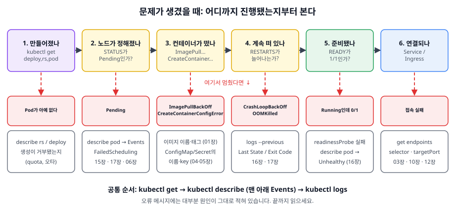

# 치트시트 — 막혔을 때 먼저 보는 곳

## 1. 기본 순서



```text
kubectl get pod -o wide                 # 1) 상태 확인: STATUS, READY, RESTARTS
kubectl describe pod <이름>              # 2) 맨 아래 Events 확인
kubectl logs <이름>                      # 3) 앱 출력 확인
kubectl logs <이름> --previous           #    재시작됐다면: 직전 컨테이너의 로그
kubectl get events --sort-by=.lastTimestamp   # 네임스페이스 전체에서 최근 일어난 일
```

**오류 메시지를 끝까지 읽으세요.** 대부분 원인이 그대로 적혀 있습니다.

## 2. Pod 상태별 원인

| STATUS | 뜻 | 먼저 볼 것 | 장 |
|---|---|---|---|
| `Pending` | 배치할 노드를 찾지 못함 | `describe pod` → `FailedScheduling` 메시지 | [15](15-scheduling.md) |
| `ContainerCreating`에서 멈춤 | 볼륨이나 이미지 준비 중 | `describe pod` → Events (볼륨 마운트 실패 등) | [06](06-pv-pvc.md) |
| `ErrImagePull` / `ImagePullBackOff` | 이미지를 받지 못함 | 이미지 이름·태그 오타, 저장소 로그인 필요 여부 | [01](01-pod.md) |
| `CreateContainerConfigError` | 컨테이너에 넣을 설정을 준비하지 못함 | ConfigMap/Secret의 이름과 key | [04](04-configmap.md), [05](05-secret.md) |
| `CrashLoopBackOff` | 시작했다가 죽기를 반복 | `logs --previous`, `describe pod`의 `Last State` | [16](16-probes.md) |
| `OOMKilled` | 메모리 상한 초과로 강제 종료 | 메모리 `limits`, 종료 코드 137 | [17](17-resources.md) |
| `Error` | 0이 아닌 코드로 종료 | `logs` | [18](18-batch.md) |
| `Completed` | 정상 종료 | Job이라면 정상 | [18](18-batch.md) |
| `Running`인데 `READY 0/1` | readinessProbe 실패 | `describe pod` → `Unhealthy` | [16](16-probes.md) |
| `Terminating`에서 멈춤 | 종료 대기 중 | PVC라면 사용 중인 Pod가 있는지 | [06](06-pv-pvc.md) |

### `FailedScheduling` 메시지

| 메시지 | 원인 | 장 |
|---|---|---|
| `didn't match Pod's node affinity/selector` | nodeSelector/affinity에 맞는 노드 없음 | [15](15-scheduling.md) |
| `had untolerated taint` | 노드의 taint를 견디는 toleration 없음 | [15](15-scheduling.md) |
| `didn't match pod anti-affinity rules` | anti-affinity 때문에 갈 노드 없음 | [15](15-scheduling.md) |
| `Insufficient cpu` / `Insufficient memory` | requests를 줄 수 있는 노드 없음 (단위 실수 확인) | [17](17-resources.md) |
| `unbound immediate PersistentVolumeClaims` | PVC가 `Pending` | [06](06-pv-pvc.md) |
| `node(s) were unschedulable` | 노드가 cordon됨 | [13](13-cordon-drain.md) |

## 3. 접속 문제

| 증상 | 뜻 | 먼저 볼 것 | 장 |
|---|---|---|---|
| `bad address` / `could not resolve host` | 이름을 IP로 바꾸지 못함 | Service 이름·네임스페이스, StatefulSet의 `serviceName` | [03](03-service.md), [08](08-headless-service.md) |
| `Connection refused` (즉시) | 도착했지만 받아 줄 곳이 없음 | `kubectl get endpoints`, selector, `targetPort` | [03](03-service.md) |
| `timed out` (한참 뒤) | 중간에서 버려짐 | NetworkPolicy | [12](12-networkpolicy.md) |
| HTTP `404` (Ingress) | 맞는 규칙이 없음 | Ingress의 host·path, 요청의 Host 헤더 | [10](10-ingress.md) |
| HTTP `503` (Ingress) | 규칙은 있는데 보낼 Pod가 없음 | backend Service 이름·포트, 엔드포인트 | [10](10-ingress.md) |
| `Forbidden` (kubectl) | 쿠버네티스 API 권한 없음 | `kubectl auth can-i`, RoleBinding의 subjects | [11](11-rbac.md) |

**Service 점검 순서**

```text
kubectl get endpoints <서비스>             # 비어 있나?
kubectl get svc <서비스> -o wide           # selector는?
kubectl get pod --show-labels             # Pod 레이블과 같은가? READY인가?
kubectl describe svc <서비스>              # targetPort가 컨테이너 포트와 같은가?
```

## 4. 리소스별 자주 걸리는 곳

| 리소스 | 증상 | 원인 | 장 |
|---|---|---|---|
| Deployment | `apply`가 거부됨 | selector와 template 레이블 불일치 | [02](02-deployment.md) |
| Deployment | 배포가 끝나지 않음 | 새 Pod가 준비되지 못함 (이미지, Probe) → `rollout undo` | [02](02-deployment.md) |
| PVC | `Pending` | StorageClass 이름 오타, 기본 StorageClass 없음 | [06](06-pv-pvc.md) |
| PV | `Released`로 남음 | 회수 정책이 `Retain` | [06](06-pv-pvc.md) |
| StatefulSet | Pod가 하나만 뜨고 멈춤 | 앞 번호 Pod가 준비되지 못함 (PVC 확인) | [07](07-statefulset.md) |
| DaemonSet | `DESIRED 0` | nodeSelector에 맞는 노드 없음 | [09](09-daemonset.md) |
| RoleBinding | 권한을 줬는데 `Forbidden` | subjects의 이름·네임스페이스 오타 | [11](11-rbac.md) |
| drain | 끝나지 않음 | PDB의 `ALLOWED DISRUPTIONS`가 0 | [13](13-cordon-drain.md) |
| Job | `BackoffLimitExceeded` | Pod가 계속 실패 → 각 Pod의 로그 | [18](18-batch.md) |

## 5. 명령 모음

### 조회

```text
kubectl get <종류>                         # 목록
kubectl get <종류> -o wide                 # IP, 노드 등 추가 정보
kubectl get <종류> <이름> -o yaml          # 전체 정의와 상태
kubectl get pod -l app=web                # 레이블로 고르기
kubectl get pod --show-labels             # 레이블 함께 보기
kubectl get pod -A                        # 모든 네임스페이스
kubectl get <종류> <이름> -o jsonpath='{.spec.nodeName}'   # 값 하나만 뽑기
kubectl describe <종류> <이름>             # 상세 정보와 Events
kubectl explain pod.spec.containers       # 필드 설명
kubectl api-resources                     # 리소스 종류와 줄임말
```

### 만들기 · 고치기 · 지우기

```text
kubectl apply -f <파일>                    # 만들기 / 수정
kubectl apply -f <파일> --dry-run=server   # 실제로 만들지 않고 검사만
kubectl delete -f <파일>                   # 파일에 적힌 것 지우기
kubectl delete <종류> <이름>
kubectl edit <종류> <이름>                 # 편집기로 직접 수정
kubectl patch <종류> <이름> -p '<JSON>'    # 일부 필드만 수정
kubectl label <종류> <이름> key=value      # 레이블 붙이기 (key- 로 떼기)
```

### Pod 들여다보기

```text
kubectl logs <Pod> [-c <컨테이너>] [-f] [--previous] [--tail=50]
kubectl logs -l app=web --prefix          # 여러 Pod의 로그를 한 번에
kubectl exec <Pod> -- <명령>
kubectl exec -it <Pod> -- sh              # 셸로 들어가기
kubectl exec deploy/<이름> -- <명령>       # Deployment의 Pod 하나를 골라 실행
kubectl run client --rm -it --restart=Never --image=busybox:1.36 -- sh   # 일회용 클라이언트
```

### Deployment

```text
kubectl rollout status deployment/<이름>
kubectl rollout history deployment/<이름>
kubectl rollout undo deployment/<이름> [--to-revision=N]
kubectl rollout restart deployment/<이름>
kubectl scale deployment <이름> --replicas=N
kubectl set image deployment/<이름> <컨테이너>=<이미지>
```

### 노드

```text
kubectl get nodes -o wide
kubectl describe node <노드>                # Taints, Allocated resources, 이 노드의 Pod
kubectl get pod -A -o wide --field-selector spec.nodeName=<노드>
kubectl cordon <노드> / kubectl uncordon <노드>
kubectl drain <노드> --ignore-daemonsets --delete-emptydir-data
kubectl taint node <노드> key=value:NoSchedule   # key- 로 제거
```

### 권한

```text
kubectl auth can-i <동작> <리소스> [--as=system:serviceaccount:<네임스페이스>:<이름>]
kubectl auth can-i --list
```

## 6. 실습 후 원상 복구 점검

노드와 PV는 네임스페이스 밖에 있는, 모두가 함께 쓰는 자원입니다. 실습을 마치면 확인하세요.

```bash
kubectl get nodes                                         # 모두 Ready인가 (SchedulingDisabled 없음)
kubectl describe nodes | grep -E '^Name:|^Taints:'        # 워커 노드의 Taints가 <none>인가
kubectl get nodes -L disktype,dedicated                   # 실습용 레이블이 남아 있지 않은가
kubectl get pv | grep -E 'NAME|edu-lab'                   # Released로 남은 PV가 없는가
kubectl get all,pvc,configmap,secret,ingress,networkpolicy,role,rolebinding,pdb   # 네임스페이스에 남은 것
```

| 남아 있는 것 | 되돌리는 명령 |
|---|---|
| `SchedulingDisabled` 노드 | `kubectl uncordon <노드>` |
| 실습용 taint | `kubectl taint node <노드> dedicated-` |
| 실습용 레이블 | `kubectl label node <노드> disktype- dedicated-` |
| `Released` PV | [06장 7절](06-pv-pvc.md)의 정리 명령 |
