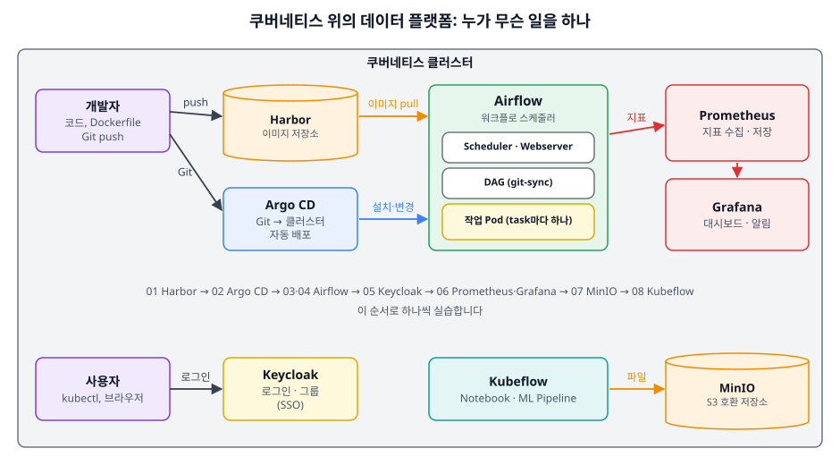

# Kubernetes 위에서 데이터 플랫폼 운영하기

[기초 과정](../README.md)에서 쿠버네티스를 배웠다면, 이 과정에서는 그 위에 올라가 있는 플랫폼 도구들을 **실제 업무 순서대로** 사용해 봅니다.
내 코드를 이미지로 만들어 저장소에 올리고, Git으로 배포하고, 스케줄러로 실행하고, 권한을 통제하고, 모니터링합니다.



## 목차

| 장 | 내용 | 직접 해 보는 것 |
|---|---|---|
| [00. 한눈에 보기와 준비](docs/00-overview.md) | 각 시스템의 역할, 접속 정보, 실습 준비 | 화면 접속, 네임스페이스 준비 |
| [01. Harbor](docs/01-harbor.md) | 이미지 저장소 | Docker 이미지 빌드 → push → 쿠버네티스에서 pull |
| [02. Argo CD](docs/02-argocd.md) | GitOps 배포 | Git 수정으로 배포·변경·복구 |
| [03. Airflow 설치](docs/03-airflow.md) | Argo CD + Helm | Git에 적은 설정으로 Airflow 만들기 |
| [04. Airflow DAG](docs/04-airflow-dag.md) | 워크플로 실행 | DAG 배포, 작업 Pod 관찰, 내 이미지로 작업 실행 |
| [05. Keycloak과 kubectl](docs/05-keycloak-kubectl.md) | 로그인과 권한 | Keycloak 계정으로 kubectl 로그인, 그룹별 권한 |
| [06. Prometheus · Grafana](docs/06-monitoring.md) | 모니터링 | 쿠버네티스와 Airflow 지표 조회, 대시보드, 알림 |
| [07. MinIO](docs/07-minio.md) | S3 호환 저장소 | 버킷과 객체 다루기, Pod에서 S3 사용 |
| [08. Kubeflow](docs/08-kubeflow.md) | ML 플랫폼 | Keycloak 로그인, Notebook 만들고 쓰기 |

각 장은 기초 과정과 같은 순서로 진행합니다: **왜 필요한가 → 그림으로 보는 개념 → 따라 하는 실습 → 고장 내고 고치기 → 정리**.

## 저장소 구성

```
platform/docs/       장별 교재
platform/examples/   실습용 소스와 YAML
platform/gitops/     Argo CD가 읽어 가는 배포 설정
images/platform/     교재에 쓰인 그림과 화면 캡처
```
