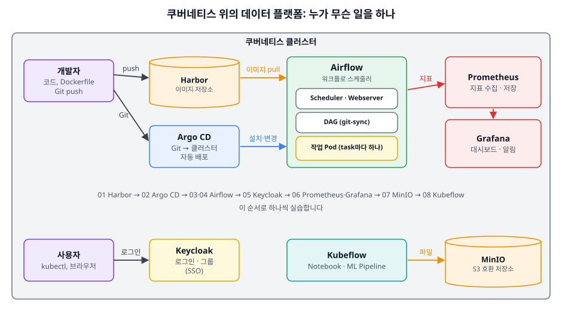

# 00. 플랫폼 한눈에 보기와 실습 준비

**이 장을 마치면**

- 플랫폼을 이루는 각 시스템이 무슨 일을 하고, 서로 어떻게 이어지는지 설명할 수 있습니다.
- 각 시스템의 화면에 접속할 수 있습니다.
- 실습에 쓸 작업 서버와 네임스페이스가 준비됩니다.

---

## 1. 이 과정에서 하는 일

[기초 과정](../../README.md)에서는 쿠버네티스 자체를 배웠습니다. 이 과정에서는 **쿠버네티스 위에 올라가 있는 플랫폼 도구들**을 실제 업무 순서대로 사용해 봅니다.

> 내가 만든 프로그램을 이미지로 만들어 저장소에 올리고(Harbor) → Git에 적은 설정대로 클러스터에 배포하고(Argo CD) → 그 프로그램을 정해진 시간에 실행하고(Airflow) → 누가 무엇을 할 수 있는지 통제하고(Keycloak) → 잘 돌고 있는지 지켜본다(Prometheus, Grafana).



| 시스템 | 한 줄 설명 | 비유 | 다루는 장 |
|---|---|---|---|
| **Harbor** | 컨테이너 이미지 저장소 | 사내 전용 앱 스토어 | [01](01-harbor.md) |
| **Argo CD** | Git에 적힌 대로 클러스터를 맞춰 주는 배포 도구 | 설계도대로 지어졌는지 계속 점검하는 감리 | [02](02-argocd.md), [03](03-airflow.md) |
| **Airflow** | 작업을 정해진 순서와 시간에 실행하는 스케줄러 | 공장의 작업 지시서와 생산 일정표 | [03](03-airflow.md), [04](04-airflow-dag.md) |
| **Keycloak** | 로그인과 사용자·그룹을 한곳에서 관리 (SSO) | 회사 출입증 발급 창구 | [05](05-keycloak-kubectl.md) |
| **Prometheus** | 숫자로 된 상태 정보(지표)를 모아 저장 | 계기판의 측정 센서와 기록 장치 | [06](06-monitoring.md) |
| **Grafana** | 지표를 그래프와 대시보드로 보여 줌 | 계기판 화면 | [06](06-monitoring.md) |
| **MinIO** | 파일(객체)을 저장하는 S3 호환 저장소 | 사내 클라우드 드라이브 | [07](07-minio.md) |
| **Kubeflow** | 노트북과 머신러닝 파이프라인 | 데이터 과학자의 작업실 | [08](08-kubeflow.md) |

이 도구들도 결국 **쿠버네티스 위에서 Pod로 실행**됩니다. 기초 과정에서 배운 Deployment, Service, Ingress, PVC, RBAC가 그대로 쓰입니다. 문제가 생겼을 때 `kubectl get pod`, `describe`, `logs`로 들여다보는 방법도 같습니다.

```bash
kubectl get pod -A | grep -E 'harbor|argocd|airflow|keycloak|monitoring' | head -20
```

## 2. 접속 정보

| 시스템 | 주소 | 계정 |
|---|---|---|
| Harbor | `https://harbor.10.0.1.230.nip.io` | `admin` |
| Argo CD | `http://argocd.10.0.1.230.nip.io` | `admin` |
| Airflow (공용) | `http://airflow.10.0.1.230.nip.io` | `admin` |
| Keycloak 관리 콘솔 | `http://keycloak.10.0.1.230.nip.io/admin/master/console/#/datalake` | `admin` |
| Grafana | `http://grafana.10.0.1.230.nip.io` | `admin` |
| Prometheus | `http://prometheus.10.0.1.230.nip.io` | 로그인 없음 |
| MinIO 콘솔 | `http://10.0.1.185:9025` | 별도 안내 |
| Kubeflow | `http://kubeflow.10.0.1.231.nip.io` | 별도 안내 |

**비밀번호는 이 문서에 적지 않습니다.** 공개 저장소에 비밀번호를 올리면 안 되기 때문입니다. 별도로 전달받은 값을 사용하세요.

### 주소가 이렇게 생긴 이유

`harbor.10.0.1.230.nip.io`에서 `10.0.1.230`은 Ingress 컨트롤러의 주소입니다(기초 과정 [10장](../../docs/10-ingress.md)).
`nip.io`는 이름 안에 들어 있는 IP를 그대로 돌려주는 공개 DNS 서비스입니다. 그래서 `무엇이든.10.0.1.230.nip.io`는 전부 `10.0.1.230`으로 연결되고,
Ingress 컨트롤러가 맨 앞의 이름(`harbor`, `argocd` …)을 보고 알맞은 서비스로 보냅니다. 클러스터의 Ingress 목록에서 확인할 수 있습니다.

```bash
kubectl get ingress -A
```

```
NAMESPACE    NAME               CLASS   HOSTS                            ADDRESS      PORTS     AGE
airflow      airflow-ingress    nginx   airflow.10.0.1.230.nip.io        10.0.1.230   80        46h
argocd       argocd-server      nginx   argocd.10.0.1.230.nip.io         10.0.1.230   80        46h
harbor       harbor-ingress     nginx   harbor.10.0.1.230.nip.io         10.0.1.230   80, 443   46h
keycloak     keycloak           nginx   keycloak.10.0.1.230.nip.io       10.0.1.230   80        46h
monitoring   kps-grafana        nginx   grafana.10.0.1.230.nip.io        10.0.1.230   80        46h
monitoring   kps-prometheus     nginx   prometheus.10.0.1.230.nip.io     10.0.1.230   80        46h
...
```

## 3. 실습 준비

### 3-1. 작업 서버

실습 명령은 **`kubectl`과 `docker`를 둘 다 쓸 수 있는 서버**에서 실행합니다. 이 교재는 컨트롤 플레인 노드에 접속해서 작업하는 것을 기준으로 합니다.

```bash
kubectl get nodes
docker version --format '{{.Server.Version}}'
```

```
NAME         STATUS   ROLES           AGE    VERSION
oks1.dd.io   Ready    control-plane   538d   v1.29.15
oks2.dd.io   Ready    <none>          538d   v1.29.15
...
26.1.3
```

화면 접속(Harbor, Argo CD, Grafana 등)은 **내 PC의 브라우저**에서 합니다. PC에서 위 주소들이 열리는지 확인하세요.

### 3-2. 예제 파일

기초 과정에서 내려받은 저장소를 그대로 씁니다. 처음이라면 내려받습니다.

```text
curl -L https://github.com/kyeongseooh/k8s_edu/archive/refs/heads/main.tar.gz | tar xz
cd k8s_edu-main
```

> **이 과정의 모든 명령은 저장소 디렉터리(`README.md`와 `platform/`이 보이는 곳)에서 실행합니다.** 다른 디렉터리로 이동하는 실습은 끝에 돌아오는 명령이 있습니다.

### 3-3. 네임스페이스

이 과정의 실습용 네임스페이스는 `edu-platform`입니다.

```bash
kubectl create namespace edu-platform
kubectl config set-context --current --namespace=edu-platform
kubectl config view --minify -o jsonpath='{..namespace}{"\n"}'
```

```
edu-platform
```

플랫폼 도구들은 각자의 네임스페이스(`harbor`, `argocd`, `monitoring` …)에 있습니다. 그쪽을 볼 때는 `-n 네임스페이스`를 붙입니다.

### 3-4. GitHub 계정 (02장부터 필요)

[02장](02-argocd.md)부터는 **Git 저장소의 파일을 고치면 클러스터가 바뀌는** 실습을 합니다. 파일을 고치려면 내가 쓸 수 있는 저장소가 필요합니다.

1. GitHub에 로그인하고 <https://github.com/kyeongseooh/k8s_edu> 를 엽니다.
2. 오른쪽 위 **Fork** → **Create fork**. 내 계정 아래에 같은 저장소가 복사됩니다.
3. 내 저장소 주소(`https://github.com/<내 계정>/k8s_edu.git`)를 기억해 둡니다.

파일 수정은 GitHub 웹 화면의 연필 아이콘으로 하면 됩니다. `git` 명령을 몰라도 실습할 수 있습니다.

## 4. 이 과정의 약속

- **공용 시스템은 건드리지 않습니다.** 이미 돌고 있는 `airflow` 네임스페이스의 Airflow 등은 구경만 하고, 실습용은 따로 만듭니다.
- **만든 것은 지웁니다.** 각 장 끝의 정리 단계를 실행합니다. 다음 장에서 이어 쓰는 것은 본문에 따로 적어 두었습니다.
- **비밀번호를 Git에 올리지 않습니다.** Secret은 `kubectl`로 직접 만들고, YAML 파일에 비밀번호를 적지 않습니다.
- 막히면 기초 과정의 [치트시트](../../docs/cheatsheet.md)를 먼저 봅니다. 플랫폼 도구의 문제도 대부분 Pod, Service, Ingress, 권한 중 하나에서 생깁니다.

## 확인 문제

1. Harbor, Argo CD, Airflow는 각각 무슨 일을 하나요?
2. `grafana.10.0.1.230.nip.io`로 접속하면 어떤 경로로 Grafana에 도달하나요?
3. 플랫폼 도구에 문제가 생겼을 때 가장 먼저 쓸 수 있는 명령은 무엇인가요?

<details><summary>정답 보기</summary>

1. Harbor는 컨테이너 이미지를 저장하고, Argo CD는 Git에 적힌 설정대로 클러스터에 배포하며, Airflow는 작업을 정해진 순서와 시간에 실행합니다.
2. `nip.io`가 이름을 `10.0.1.230`(Ingress 컨트롤러)으로 바꿔 주고, Ingress 컨트롤러가 호스트 이름을 보고 `monitoring` 네임스페이스의 Grafana Service로 요청을 넘깁니다.
3. `kubectl get pod -n <네임스페이스>`로 Pod 상태를 보고, `describe`와 `logs`로 원인을 찾습니다. 플랫폼 도구도 Pod로 실행되기 때문입니다.
</details>

---

다음 장: [01. Harbor — 이미지를 만들어 올리고, 쿠버네티스에서 받아 쓰기](01-harbor.md)
