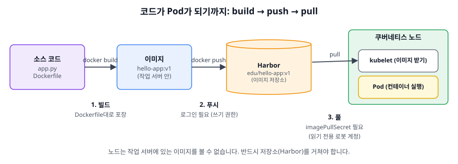
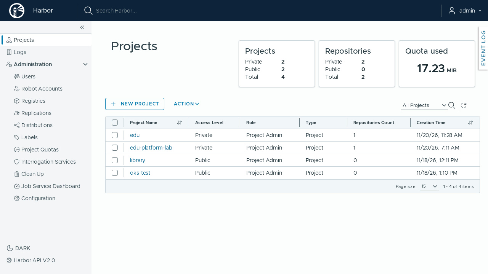
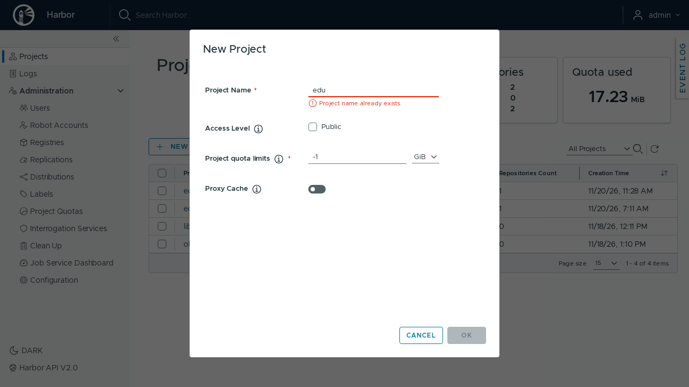
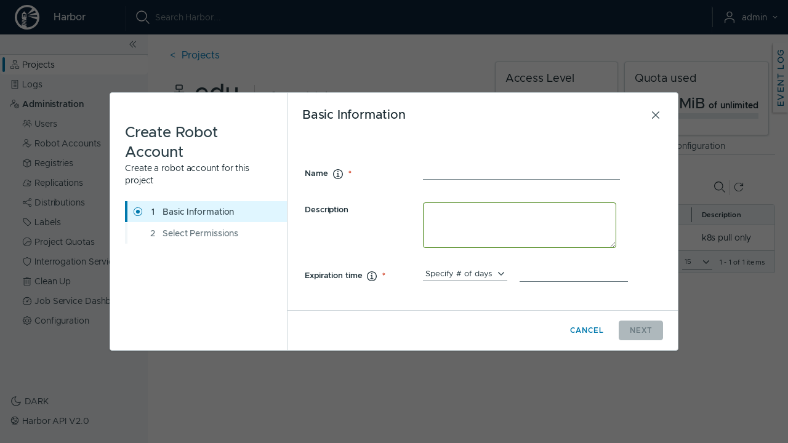
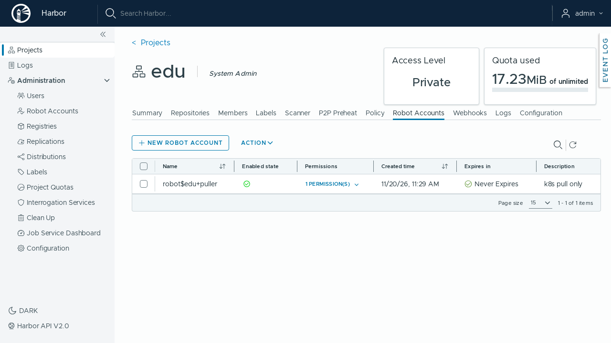
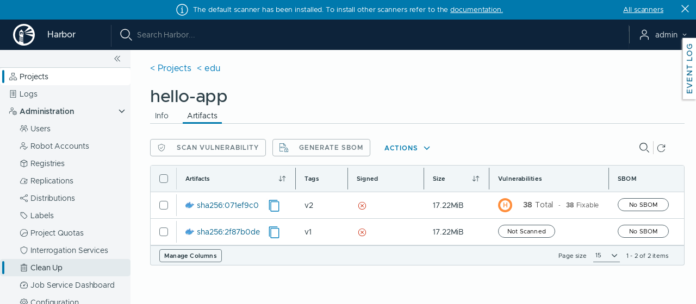

# 01. Harbor — 이미지를 만들어 올리고, 쿠버네티스에서 받아 쓰기

**이 장을 마치면**

- Dockerfile로 내 코드를 이미지로 만들 수 있습니다.
- 이미지를 Harbor에 올리고(push), 쿠버네티스가 그 이미지를 받아(pull) 실행하게 할 수 있습니다.
- `x509`, `ImagePullBackOff` 같은 이미지 관련 오류의 원인을 구분할 수 있습니다.

---

## 1. 왜 이미지 저장소가 필요한가

기초 과정에서는 `nginx:1.27-alpine`처럼 인터넷(Docker Hub)에 공개된 이미지를 썼습니다. 하지만 회사에서 만든 앱은 그럴 수 없습니다.

- 회사 코드를 공개 저장소에 올릴 수 없다.
- 내 PC에서 만든 이미지는 **내 PC 안에만** 있다. 쿠버네티스 노드는 그 이미지를 볼 수 없다.

그래서 회사 안에 **비공개 이미지 저장소(레지스트리)** 를 둡니다. **Harbor**는 그런 저장소를 제공하는 오픈소스입니다. 이미지 보관뿐 아니라 프로젝트별 권한, 취약점 검사 기능도 있습니다.



| 단계 | 명령 | 하는 일 |
|---|---|---|
| 빌드 | `docker build` | Dockerfile에 적힌 대로 코드와 실행 환경을 이미지로 포장 |
| 푸시 | `docker push` | 이미지를 Harbor에 올림 |
| 풀 | (kubelet이 자동으로) | Pod를 실행할 노드가 Harbor에서 이미지를 내려받음 |

이미지 이름에는 **어느 저장소의 어느 프로젝트인지**가 들어 있습니다.

```
harbor.10.0.1.230.nip.io / edu / hello-app : v1
└────── 저장소 주소 ─────┘ 프로젝트  이미지 이름  태그(버전)
```

저장소 주소를 생략한 `nginx:1.27-alpine`은 Docker Hub에서 받아 오라는 뜻입니다.

## 2. 실습 ① — 이미지 만들기

작업 서버에서 [00장](00-overview.md)에서 내려받은 저장소 디렉터리로 이동합니다.

```bash
cd platform/examples/hello-app
ls
```

```
app.py  deploy.yaml  Dockerfile
```

### 2-1. 앱과 Dockerfile

`app.py`는 요청을 받으면 버전과 호스트 이름을 응답하는 작은 웹 서버입니다. ([examples/hello-app/app.py](../examples/hello-app/app.py))

**Dockerfile**은 이미지를 만드는 순서를 적은 파일입니다. ([examples/hello-app/Dockerfile](../examples/hello-app/Dockerfile))

```dockerfile
# 1) 어떤 이미지 위에 쌓을지: 파이썬이 설치된 가벼운 리눅스
FROM python:3.12-alpine

# 2) 컨테이너 안의 작업 디렉터리
WORKDIR /app

# 3) 내 코드를 이미지 안으로 복사
COPY app.py .

# 4) 빌드할 때 버전을 넣을 수 있게 한다 (docker build --build-arg APP_VERSION=v2)
ARG APP_VERSION=v1
ENV APP_VERSION=${APP_VERSION}

# 5) root가 아닌 일반 사용자로 실행 (보안상 권장)
USER 65534

# 6) 이 컨테이너가 쓰는 포트 (설명용)
EXPOSE 8080

# 7) 컨테이너가 시작될 때 실행할 명령
CMD ["python", "app.py"]
```

| 명령 | 의미 |
|---|---|
| `FROM` | 바탕이 되는 이미지. 여기에 내 것을 덧붙인다 |
| `COPY` | 내 PC의 파일을 이미지 안으로 복사 |
| `ENV` | 컨테이너 안에서 쓸 환경변수 |
| `CMD` | 컨테이너를 시작할 때 실행할 명령 |

### 2-2. 빌드

```bash
docker build -t hello-app:v1 .
docker images hello-app
```

```
REPOSITORY   TAG       IMAGE ID       CREATED          SIZE
hello-app    v1        446af7c60f09   2 seconds ago    48.9MB
```

- `-t hello-app:v1`은 만들어질 이미지에 붙일 이름과 태그입니다.
- 마지막의 `.`은 "현재 디렉터리의 Dockerfile과 파일들을 쓴다"는 뜻입니다. 빠뜨리기 쉽습니다.

### 2-3. 쿠버네티스에 올리기 전에 먼저 실행해 보기

```bash
docker run -d --name hello -p 18080:8080 hello-app:v1
sleep 2
curl http://localhost:18080/
```

```
Hello from Harbor | version=v1 | host=32cbdf9e411f
```

`-p 18080:8080`은 작업 서버의 18080 포트를 컨테이너의 8080 포트로 연결합니다. 응답이 오면 이미지가 제대로 만들어진 것입니다. 확인했으면 지웁니다.

```bash
docker logs hello
docker rm -f hello
```

> **이미지에 문제가 있으면 쿠버네티스에 올려도 똑같이 실패합니다.** `docker run`으로 먼저 확인하는 습관을 들이면 원인을 찾는 범위가 크게 줄어듭니다.

## 3. 실습 ② — Harbor에 프로젝트 만들기

브라우저에서 Harbor(`https://harbor.10.0.1.230.nip.io`)에 접속해 관리자 계정으로 로그인합니다.

> 브라우저가 "연결이 비공개로 설정되어 있지 않습니다"라고 경고하면 **고급 → 계속 진행**을 누릅니다. 이 Harbor는 사내에서 직접 만든 인증서를 쓰기 때문입니다. 4절에서 같은 이유로 생기는 오류를 다룹니다.



Harbor는 이미지를 **프로젝트** 단위로 묶어 관리합니다. 권한도 프로젝트 단위로 줍니다.

**NEW PROJECT**를 누르고 이름을 `edu`로 입력합니다. **Public은 체크하지 않습니다**(비공개 프로젝트).



| Access Level | 이미지 받기(pull) | 이미지 올리기(push) |
|---|---|---|
| Public | 누구나 (로그인 불필요) | 권한이 있는 계정만 |
| Private | **권한이 있는 계정만** | 권한이 있는 계정만 |

> 여러 명이 함께 실습한다면 프로젝트 이름을 `edu-hong`처럼 각자 다르게 만들고, 이후 명령의 `edu`를 자기 프로젝트 이름으로 바꾸세요.

## 4. 실습 ③ — 이미지 올리기 (push)

### 4-1. 로그인 — 그리고 첫 번째 오류

```text
docker login harbor.10.0.1.230.nip.io -u admin
```

비밀번호를 입력하면 이런 오류가 날 수 있습니다.

```
Error response from daemon: Get "https://harbor.10.0.1.230.nip.io/v2/": tls: failed to verify certificate: x509: certificate signed by unknown authority
```

**비밀번호가 틀린 것이 아닙니다.** `x509: certificate signed by unknown authority`는 "이 서버의 인증서를 누가 보증하는지 모르겠다"는 뜻입니다.
이 Harbor의 인증서는 사내에서 만든 CA(인증 기관)가 서명했는데, Docker는 그 CA를 모릅니다. 브라우저가 경고를 띄운 것과 같은 이유입니다.

**해결: Docker에게 그 CA를 알려 준다.** Docker는 `/etc/docker/certs.d/<저장소 주소>/ca.crt` 파일이 있으면 그 CA를 믿습니다.
CA 인증서는 Harbor를 설치할 때 쿠버네티스 Secret에 저장되어 있으므로 거기서 꺼냅니다.

```bash
mkdir -p /etc/docker/certs.d/harbor.10.0.1.230.nip.io

kubectl -n harbor get secret harbor-ingress -o jsonpath='{.data.ca\.crt}' | base64 -d \
  > /etc/docker/certs.d/harbor.10.0.1.230.nip.io/ca.crt

openssl x509 -in /etc/docker/certs.d/harbor.10.0.1.230.nip.io/ca.crt -noout -subject -enddate
```

```
subject= /CN=harbor-ca
notAfter=Nov 18 12:10:58 2027 GMT
```

다시 로그인합니다. Docker를 재시작할 필요는 없습니다.

```text
docker login harbor.10.0.1.230.nip.io -u admin
```

```
Login Succeeded
```

> `--insecure-registry` 옵션으로 인증서 검사를 아예 끄는 방법을 소개하는 글이 많지만 권하지 않습니다. 가짜 저장소에 접속해도 알 수 없게 됩니다. CA를 등록하는 것이 올바른 해결입니다.

### 4-2. 이름 붙이고 올리기

`docker push`는 **이미지 이름에 적힌 주소로** 올립니다. 그래서 먼저 Harbor 주소가 들어간 이름을 하나 더 붙입니다.

```bash
docker tag hello-app:v1 harbor.10.0.1.230.nip.io/edu/hello-app:v1
docker push harbor.10.0.1.230.nip.io/edu/hello-app:v1
```

```
The push refers to repository [harbor.10.0.1.230.nip.io/edu/hello-app]
d6c38381cc85: Pushed
75f1d9657d88: Pushed
c55c05421254: Pushed
v1: digest: sha256:2f87b0de0c9a61e0a4ee84153a1c00f671003429cfccef143f0bef131ed4629d size: 1571
```

마지막 줄의 **digest**(`sha256:...`)는 이미지 내용의 지문입니다. 태그(`v1`)는 사람이 붙인 이름이라 다른 이미지에 다시 붙일 수 있지만, digest는 내용이 같으면 항상 같고 내용이 다르면 반드시 다릅니다.

Harbor 화면에서 **Projects → edu → hello-app**으로 들어가면 올라온 이미지가 보입니다.

**push가 실패할 때**

| 오류 | 원인 |
|---|---|
| `x509: certificate signed by unknown authority` | CA 미등록 (4-1) |
| `unauthorized: unauthorized to access repository` | 로그인하지 않았거나, 그 프로젝트에 쓰기 권한이 없음 |
| `project edu not found` 또는 `denied` | 프로젝트 이름 오타, 프로젝트를 아직 만들지 않음 |
| `An image does not exist locally with the tag` | `docker tag`를 하지 않았거나 이름 오타 |

## 5. 실습 ④ — 쿠버네티스에서 실행하기

실습용 네임스페이스를 쓰고 있는지 확인합니다([00장](00-overview.md)에서 설정).

```bash
kubectl config view --minify -o jsonpath='{..namespace}{"\n"}'
```

```
edu-platform
```

### 5-1. 그냥 실행해 보기 — 두 번째 오류

방금 올린 이미지로 Deployment를 만듭니다.

```bash
kubectl create deployment hello --image=harbor.10.0.1.230.nip.io/edu/hello-app:v1 --port=8080
sleep 25
kubectl get pod
```

```
NAME                     READY   STATUS             RESTARTS   AGE
hello-78d5699d75-qj6hg   0/1     ImagePullBackOff   0          25s
```

기초 과정 [01장](../../docs/01-pod.md)에서 본 `ImagePullBackOff`입니다. 그때는 이미지 이름 오타였습니다. 이번에는 이름이 정확합니다. Events를 봅니다.

```bash
kubectl describe pod -l app=hello | grep -A8 '^Events'
```

```
Warning  Failed  22s (x2 over 37s)  kubelet  Failed to pull image "harbor.10.0.1.230.nip.io/edu/hello-app:v1": ... pull access denied, repository does not exist or may require authorization: ...
```

`pull access denied ... may require authorization` — **권한이 없습니다.** `edu`는 비공개 프로젝트인데, 노드(kubelet)는 로그인 정보 없이 이미지를 받으려 했습니다.
작업 서버에서 `docker login`을 했지만, 그것은 **작업 서버의 Docker**가 로그인한 것이지 쿠버네티스 노드가 로그인한 것이 아닙니다.

| 오류 메시지 | 뜻 |
|---|---|
| `not found` | 그런 이미지나 태그가 없다 (이름·태그 오타) |
| `pull access denied` / `unauthorized` | 이미지는 있을 수 있지만 **받을 권한이 없다** |
| `x509: certificate signed by unknown authority` | 노드가 저장소의 인증서를 믿지 못한다 (노드에 CA 등록 필요. 이 실습 환경의 노드에는 이미 등록되어 있다) |

### 5-2. 받기 전용 계정 만들기 (Robot Account)

쿠버네티스에 관리자 비밀번호를 넣어 주면 안 됩니다. 그 비밀번호가 새면 Harbor 전체가 넘어갑니다.
대신 **"이 프로젝트의 이미지를 받기만 할 수 있는" 전용 계정**을 만듭니다. Harbor에서는 이것을 **로봇 계정(Robot Account)** 이라고 합니다. 사람이 아닌 프로그램용 계정입니다.

Harbor 화면에서 **Projects → edu → Robot Accounts → NEW ROBOT ACCOUNT**



1. **Name**: `puller`, **Expiration time**: `Never` → **NEXT**
2. 권한 선택 화면에서 **Repository**의 **Pull**만 체크 → **FINISH**
3. 계정 이름(`robot$edu+puller`)과 **secret**이 표시됩니다. **secret은 이 화면에서만 볼 수 있으니** 복사해 둡니다.



> 기초 과정 [11장 RBAC](../../docs/11-rbac.md)의 "필요한 만큼만 허용한다"와 같은 원칙입니다. 올리는 사람(push)과 받는 쪽(pull)의 계정을 나누고, 받는 쪽에는 읽기 권한만 줍니다.

### 5-3. 로그인 정보를 Secret으로 만들기

기초 과정 [05장](../../docs/05-secret.md)에서 본 `docker-registry` 타입의 Secret입니다. `<복사한 secret>` 자리에 방금 복사한 값을 넣습니다.

```text
kubectl create secret docker-registry harbor-pull \
  --docker-server=harbor.10.0.1.230.nip.io \
  --docker-username='robot$edu+puller' \
  --docker-password='<복사한 secret>'
```

```
secret/harbor-pull created
```

> 계정 이름에 `$`가 들어 있습니다. **작은따옴표**로 감싸지 않으면 셸이 `$edu`를 변수로 해석해서 엉뚱한 이름이 됩니다.

```bash
kubectl get secret harbor-pull
```

```
NAME          TYPE                             DATA   AGE
harbor-pull   kubernetes.io/dockerconfigjson   1      5s
```

### 5-4. Deployment에 Secret 연결하기

Pod에 "이미지를 받을 때 이 Secret을 써라"라고 알려 주는 필드가 **`imagePullSecrets`** 입니다. ([examples/hello-app/deploy.yaml](../examples/hello-app/deploy.yaml))

```yaml
    spec:
      imagePullSecrets:              # 이미지를 받을 때 쓸 로그인 정보 (Secret 이름)
      - name: harbor-pull
      containers:
      - name: hello-app
        image: harbor.10.0.1.230.nip.io/edu/hello-app:v1
```

실패하던 Deployment를 지우고, 이 파일로 다시 만듭니다. Service도 함께 들어 있습니다.

```bash
kubectl delete deployment hello
kubectl apply -f deploy.yaml
kubectl rollout status deployment/hello
kubectl get pod -o wide
```

```
NAME                     READY   STATUS    RESTARTS   AGE   IP                NODE         ...
hello-79fc4c6d68-2xj7z   1/1     Running   0          5s    192.168.96.113    oks5.dd.io   ...
hello-79fc4c6d68-98r4c   1/1     Running   0          5s    192.168.30.227    oks2.dd.io   ...
```

`Running`입니다. Service로 접속해 봅니다.

```bash
kubectl run client --rm -i --restart=Never --image=busybox:1.36 -- \
  sh -c 'for i in 1 2 3 4; do wget -qO- http://hello; done'
```

```
Hello from Harbor | version=v1 | host=hello-79fc4c6d68-98r4c
Hello from Harbor | version=v1 | host=hello-79fc4c6d68-2xj7z
Hello from Harbor | version=v1 | host=hello-79fc4c6d68-98r4c
Hello from Harbor | version=v1 | host=hello-79fc4c6d68-98r4c
```

내가 만든 코드가, 내가 만든 이미지로, 쿠버네티스 위에서 돌고 있습니다.

## 6. 실습 ⑤ — 새 버전 배포하기

코드를 고쳤다고 가정하고 `v2` 이미지를 만들어 올립니다. 이번에는 빌드할 때 Harbor 주소가 들어간 이름을 바로 붙입니다.

```bash
docker build --build-arg APP_VERSION=v2 -t harbor.10.0.1.230.nip.io/edu/hello-app:v2 .
docker push harbor.10.0.1.230.nip.io/edu/hello-app:v2
```

기초 과정 [02장](../../docs/02-deployment.md)에서 배운 롤링 업데이트로 교체합니다.

```bash
kubectl set image deployment/hello hello-app=harbor.10.0.1.230.nip.io/edu/hello-app:v2
kubectl rollout status deployment/hello
kubectl run client --rm -i --restart=Never --image=busybox:1.36 -- wget -qO- http://hello
```

```
Hello from Harbor | version=v2 | host=hello-659bf49ffc-htvwd
```

**같은 태그를 덮어쓰지 마세요.** `v1`이라는 이름으로 다른 내용을 다시 push하면, 어떤 노드는 예전 `v1`을 가지고 있고 어떤 노드는 새 `v1`을 받아서 **같은 버전인데 동작이 다른** 상황이 생깁니다.
코드가 바뀌면 태그도 바꿉니다(`v2`, `v3`, 또는 Git 커밋 번호).

## 7. Harbor 둘러보기 — 취약점 검사

**Projects → edu → hello-app**에서 이미지를 체크하고 **SCAN VULNERABILITY**를 누르면, 이미지 안의 OS 패키지와 라이브러리에 알려진 보안 취약점이 있는지 검사합니다.



`v2`에서 취약점 38개가 발견됐고 가장 심각한 등급이 High(`H`)입니다. 대부분 바탕 이미지(`python:3.12-alpine`)에 들어 있던 것입니다.
숫자를 누르면 어떤 패키지의 어떤 취약점인지, 몇 버전에서 고쳐졌는지 볼 수 있습니다. 바탕 이미지를 최신으로 바꿔 다시 빌드하는 것이 가장 흔한 해결책입니다.

## 8. 정리

다음 장([02. Argo CD](02-argocd.md))에서 이 이미지와 `harbor-pull` Secret을 다시 씁니다. **Deployment와 Service만 지우고, Secret과 Harbor의 이미지는 남겨 둡니다.**

```bash
kubectl delete -f deploy.yaml
kubectl get secret harbor-pull
cd ../../..
```

## 핵심 요약

- 이미지는 `docker build`로 만들고, `docker push`로 저장소에 올리고, 노드가 pull해서 실행한다.
- 이미지 이름의 맨 앞이 저장소 주소다. push/pull은 그 주소로 간다.
- `x509: certificate signed by unknown authority`는 비밀번호 문제가 아니라 CA를 모르는 것이다. CA를 등록한다.
- 비공개 프로젝트의 이미지를 쓰려면 Pod에 `imagePullSecrets`가 필요하다.
- 쿠버네티스에는 관리자 계정이 아니라 **받기 전용 로봇 계정**을 준다.
- 코드가 바뀌면 태그를 바꾼다. 같은 태그를 덮어쓰지 않는다.

| 증상 | 어디서 | 원인 |
|---|---|---|
| `x509 ... unknown authority` | `docker login` / `push` | 작업 서버의 Docker가 Harbor의 CA를 모름 |
| `unauthorized` | `docker push` | 로그인 안 함, 또는 쓰기 권한 없음 |
| `ImagePullBackOff` + `not found` | Pod | 이미지 이름·태그 오타 |
| `ImagePullBackOff` + `pull access denied` | Pod | `imagePullSecrets` 없음, Secret의 계정·비밀번호 오류 |

## 확인 문제

1. 작업 서버에서 `docker build`로 만든 이미지를 Harbor에 올리지 않고 쿠버네티스 Deployment에 쓰면 어떻게 되나요?
2. `docker login`에서 `x509: certificate signed by unknown authority`가 나왔습니다. 비밀번호를 다시 확인해야 할까요?
3. 작업 서버에서 `docker login`에 성공했는데도 Pod가 `pull access denied`로 실패하는 이유는 무엇인가요?
4. 쿠버네티스에 Harbor 관리자 계정 대신 로봇 계정을 주는 이유는 무엇인가요?
5. 태그와 digest의 차이는 무엇인가요?

<details><summary>정답 보기</summary>

1. 노드는 작업 서버 안의 이미지를 볼 수 없으므로 이미지를 찾지 못해 `ImagePullBackOff`가 됩니다.
2. 아닙니다. 인증서를 서명한 CA를 Docker가 모른다는 뜻입니다. `/etc/docker/certs.d/<주소>/ca.crt`에 CA 인증서를 넣어 줍니다.
3. `docker login`은 작업 서버의 Docker가 로그인한 것입니다. Pod의 이미지는 쿠버네티스 노드가 받으므로, 로그인 정보를 Secret으로 만들어 `imagePullSecrets`로 Pod에 연결해야 합니다.
4. 필요한 권한(그 프로젝트의 이미지 받기)만 주기 위해서입니다. 관리자 비밀번호가 클러스터에 저장되면, 유출됐을 때 Harbor 전체가 위험해집니다.
5. 태그는 사람이 붙이는 이름이라 다른 이미지에 다시 붙일 수 있고, digest는 이미지 내용으로 계산한 지문이라 내용이 같아야만 같습니다.
</details>

---

다음 장: [02. Argo CD — Git에 적은 대로 배포하기](02-argocd.md)
