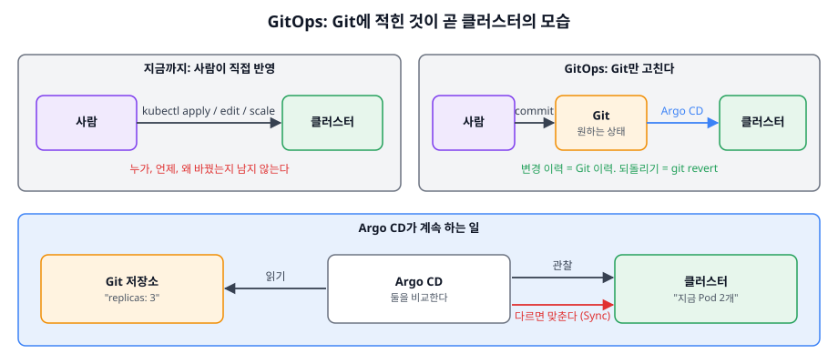
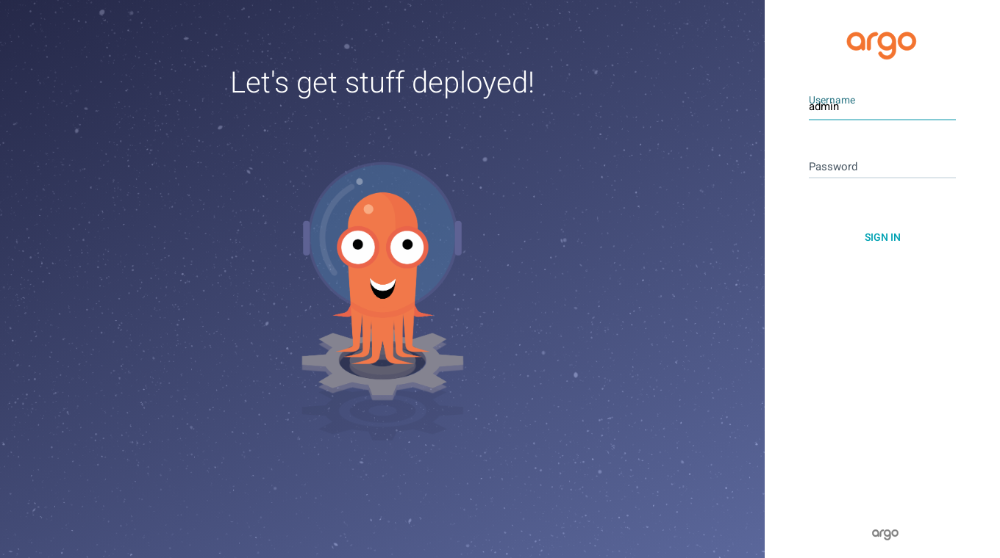
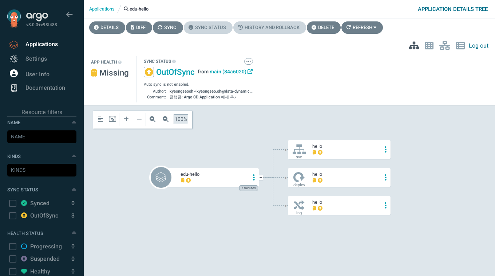
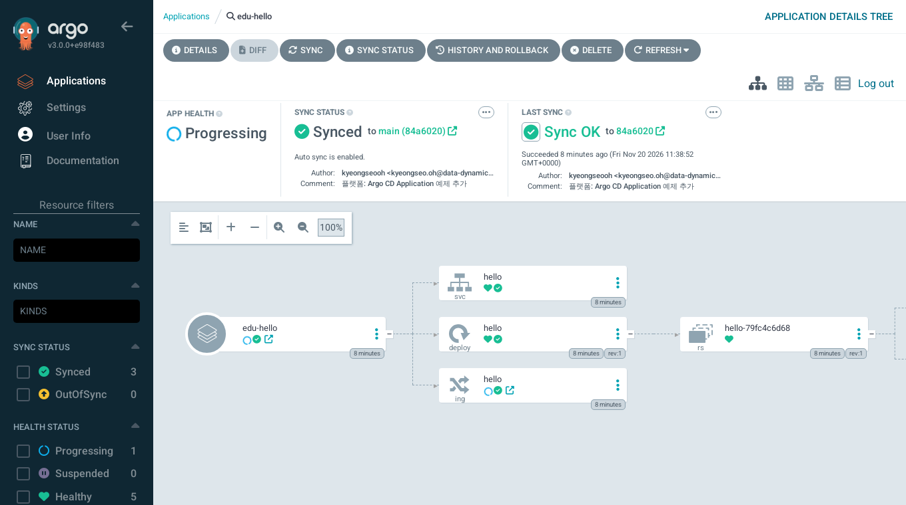
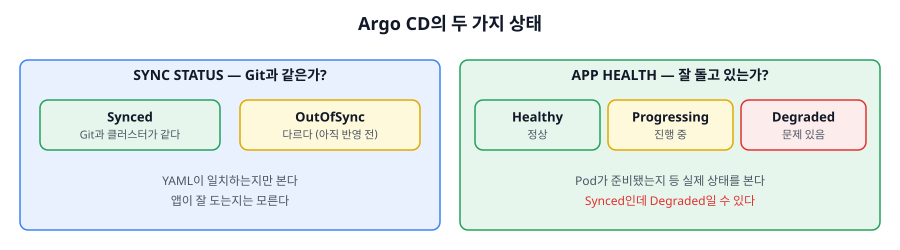
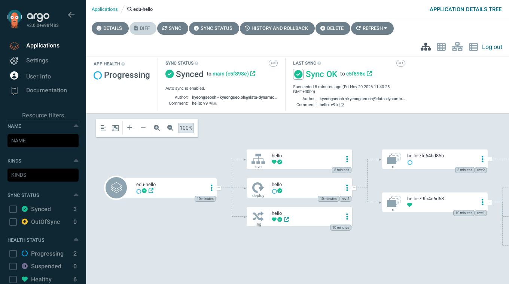

# 02. Argo CD — Git에 적은 대로 배포하기

**이 장을 마치면**

- GitOps가 무엇이고 `kubectl apply`로 직접 배포하는 것과 무엇이 다른지 설명할 수 있습니다.
- Argo CD Application을 만들어 Git 저장소의 YAML을 클러스터에 배포할 수 있습니다.
- Git을 고쳐서 변경하고, Git을 되돌려서 복구할 수 있습니다.
- `Synced`와 `Healthy`가 서로 다른 뜻이라는 것을 압니다.

---

## 1. 왜 필요한가

지금까지는 `kubectl apply`, `kubectl scale`, `kubectl set image`로 클러스터를 직접 바꿨습니다. 혼자 연습할 때는 편하지만 여럿이 운영하면 문제가 생깁니다.

- 지금 클러스터가 **왜 이 상태인지** 아무도 모른다. 누가 언제 `replicas`를 5로 바꿨는지 기록이 없다.
- YAML 파일과 실제 클러스터가 **조금씩 달라진다.** 급하게 `kubectl edit`으로 고치고 파일은 안 고쳤다.
- 문제가 생겼을 때 **어제 상태로 되돌리기** 어렵다.

**GitOps**는 이 문제를 이렇게 풉니다. "클러스터의 원하는 상태를 전부 Git에 적어 두고, **Git만 고친다.** 클러스터에 반영하는 일은 도구가 한다."
**Argo CD**가 그 도구입니다.



기초 과정 [00장](../../docs/00-시작하기-전에.md)의 "선언형" 그림과 같은 구조입니다. 쿠버네티스 컨트롤러가 "YAML에 적힌 상태"와 "현재 상태"를 맞추듯,
Argo CD는 "**Git에 적힌 상태**"와 "**클러스터의 상태**"를 맞춥니다.

| | `kubectl`로 직접 | GitOps (Argo CD) |
|---|---|---|
| 변경 방법 | 명령 실행 | Git에 commit |
| 변경 이력 | 남지 않음 | Git 이력에 누가·언제·무엇을·왜 |
| 되돌리기 | 예전 YAML을 찾아서 다시 적용 | `git revert` |
| 누가 몰래 바꾸면 | 모름 | 감지하고 되돌림 |
| 검토 | 없음 | Pull Request로 리뷰 |

## 2. Argo CD 둘러보기

브라우저에서 `http://argocd.10.0.1.230.nip.io`에 접속해 로그인합니다.



Argo CD에서 배포 단위는 **Application**입니다. Application 하나는 "**이 Git 경로**의 내용을 **이 클러스터의 이 네임스페이스**에 맞춰라"라는 약속입니다.

이미 `airflow`라는 Application이 하나 있습니다. 공용 Airflow가 Argo CD로 설치되어 있습니다([03장](03-airflow.md)에서 같은 방식으로 직접 만들어 봅니다).

Application도 쿠버네티스 리소스입니다. `kubectl`로도 볼 수 있습니다.

```bash
kubectl -n argocd get applications
```

```
NAME      SYNC STATUS   HEALTH STATUS
airflow   Synced        Healthy
```

## 3. 실습 준비 — 내 저장소 확인

이 장에서는 Git 파일을 고칩니다. [00장 3-4](00-overview.md)에서 만든 **내 fork**를 사용합니다. 계정 이름을 변수에 담아 둡니다.

```text
GH_USER=<내 GitHub 계정>
```

Argo CD가 읽을 디렉터리는 `platform/gitops/hello`입니다. [01장](01-harbor.md)에서 만든 `hello-app`을 배포하는 YAML 세 개가 들어 있습니다.

```bash
ls platform/gitops/hello
```

```
deployment.yaml  ingress.yaml  service.yaml
```

| 파일 | 내용 |
|---|---|
| [deployment.yaml](../gitops/hello/deployment.yaml) | Harbor의 `edu/hello-app:v1` 이미지로 Pod 2개 |
| [service.yaml](../gitops/hello/service.yaml) | Service `hello` |
| [ingress.yaml](../gitops/hello/ingress.yaml) | `http://hello.10.0.1.230.nip.io`로 접속 |

01장에서 만든 `harbor-pull` Secret이 `edu-platform` 네임스페이스에 남아 있어야 합니다.

```bash
kubectl get secret harbor-pull
```

> **Secret은 Git에 넣지 않았습니다.** 비밀번호가 담긴 파일을 Git에 올리면 이력에 영원히 남습니다. Secret은 직접 만들거나 별도의 비밀 관리 도구를 씁니다.

## 4. 실습 ① — Application 만들기

### 4-1. Application YAML

([examples/argocd/app-hello.yaml](../examples/argocd/app-hello.yaml))

```yaml
apiVersion: argoproj.io/v1alpha1
kind: Application
metadata:
  name: edu-hello
  namespace: argocd                    # Application은 Argo CD가 설치된 네임스페이스에 만든다
  finalizers:                          # Application을 지울 때 배포했던 리소스도 함께 지운다
  - resources-finalizer.argocd.argoproj.io
spec:
  project: default
  source:                              # 어디에서 읽어 올 것인가 (Git)
    repoURL: https://github.com/kyeongseooh/k8s_edu.git
    targetRevision: main               # 브랜치 (또는 태그, 커밋)
    path: platform/gitops/hello        # 저장소 안의 디렉터리
  destination:                         # 어디에 만들 것인가 (클러스터)
    server: https://kubernetes.default.svc
    namespace: edu-platform
```

핵심은 두 덩어리입니다. **`source`**(Git의 어디)와 **`destination`**(클러스터의 어디).

`repoURL`을 내 fork 주소로 바꿔서 적용합니다.

```text
sed "s#kyeongseooh/k8s_edu#$GH_USER/k8s_edu#" platform/examples/argocd/app-hello.yaml | kubectl apply -f -
```

```
application.argoproj.io/edu-hello created
```

> 화면에서 만들 수도 있습니다. **+ NEW APP**을 누르고 같은 값을 입력하면 됩니다. 결과는 같은 Application 리소스입니다.
> fork를 만들지 않았다면 `sed` 없이 `kubectl apply -f platform/examples/argocd/app-hello.yaml`로 원본 저장소를 그대로 쓸 수 있습니다. 다만 5절의 Git 수정 실습은 할 수 없습니다.

### 4-2. 아직 아무것도 만들어지지 않았다

```bash
kubectl -n argocd get application edu-hello
kubectl get deployment,service,ingress
```

```
NAME        SYNC STATUS   HEALTH STATUS
edu-hello   OutOfSync     Missing

No resources found in edu-platform namespace.
```

**`OutOfSync`** — Git에는 YAML이 있는데 클러스터에는 없습니다. "Git과 클러스터가 다르다"는 뜻입니다. 화면에서도 확인합니다.



Argo CD는 Git을 읽어서 "Deployment, Service, Ingress가 있어야 한다"는 것까지 파악했고, 셋 다 노란색(없음)으로 표시하고 있습니다.
자동 반영을 켜지 않았기 때문에 **차이를 알려 줄 뿐 반영하지는 않습니다.**

### 4-3. 동기화 (Sync)

화면 위쪽의 **SYNC** → **SYNCHRONIZE**를 누릅니다. 터미널에서는 이렇게 합니다.

```bash
kubectl -n argocd patch application edu-hello --type merge -p '{"operation":{"sync":{}}}'
sleep 25
kubectl -n argocd get application edu-hello
kubectl get deployment,service,ingress
```

```
NAME        SYNC STATUS   HEALTH STATUS
edu-hello   Synced        Healthy

NAME                    READY   UP-TO-DATE   AVAILABLE   AGE
deployment.apps/hello   2/2     2            2           25s

NAME            TYPE        CLUSTER-IP       EXTERNAL-IP   PORT(S)   AGE
service/hello   ClusterIP   10.104.208.114   <none>        80/TCP    25s

NAME                              CLASS   HOSTS                     ADDRESS      PORTS   AGE
ingress.networking.k8s.io/hello   nginx   hello.10.0.1.230.nip.io   10.0.1.230   80      25s
```

`kubectl apply`를 한 번도 하지 않았는데 리소스 세 개가 만들어졌습니다. Argo CD가 Git을 읽어서 대신 적용했습니다.

> `HEALTH STATUS`가 잠깐 `Progressing`으로 보일 수 있습니다. Pod가 준비되고 Ingress에 주소가 붙으면 `Healthy`가 됩니다.



화면의 트리는 Application → Deployment → ReplicaSet → Pod의 관계를 보여 줍니다. 기초 과정 [02장](../../docs/02-deployment.md)의 그림 그대로입니다.
위쪽에는 **어느 커밋이 반영됐는지**(`Synced to main (84a6020)`)와 그 커밋의 작성자·메시지가 나옵니다.

Ingress가 있으므로 바로 접속할 수 있습니다.

```bash
curl http://hello.10.0.1.230.nip.io/
```

```
Hello from Harbor | version=v1 | host=hello-79fc4c6d68-5f5j8
```

### 4-4. 두 가지 상태



| 상태 | 묻는 것 | 값 |
|---|---|---|
| **SYNC STATUS** | Git과 클러스터가 같은가? | `Synced`, `OutOfSync` |
| **HEALTH STATUS** | 배포된 것이 잘 돌고 있는가? | `Healthy`, `Progressing`, `Degraded`, `Missing` |

**둘은 서로 다른 질문입니다.** 6절에서 "`Synced`인데 정상이 아닌" 경우를 직접 만들어 봅니다.

## 5. 실습 ② — Git을 고쳐서 클러스터 바꾸기

### 5-1. 자동 동기화 켜기

매번 SYNC를 누르지 않도록 자동 동기화를 켭니다. ([examples/argocd/app-hello-auto.yaml](../examples/argocd/app-hello-auto.yaml))

```yaml
  syncPolicy:
    automated:                         # Git이 바뀌면 사람이 누르지 않아도 자동으로 반영한다
      prune: true                      # Git에서 지운 리소스는 클러스터에서도 지운다
      selfHeal: true                   # 누가 클러스터를 직접 고치면 Git 내용으로 되돌린다
```

```text
sed "s#kyeongseooh/k8s_edu#$GH_USER/k8s_edu#" platform/examples/argocd/app-hello-auto.yaml | kubectl apply -f -
```

### 5-2. Git에서 replicas를 3으로

**kubectl을 쓰지 않고** Pod를 3개로 늘려 봅니다.

1. 브라우저에서 내 fork의 `platform/gitops/hello/deployment.yaml`을 엽니다.
2. 오른쪽 위의 연필 아이콘(Edit)을 누릅니다.
3. `replicas: 2`를 `replicas: 3`으로 고칩니다.
4. **Commit changes**를 누르고, 메시지에 `hello: replicas 2 -> 3`이라고 적어 commit합니다.

<details><summary>git 명령으로 하려면</summary>

```text
git clone https://github.com/<내 계정>/k8s_edu.git && cd k8s_edu
sed -i 's/replicas: 2/replicas: 3/' platform/gitops/hello/deployment.yaml
git commit -am "hello: replicas 2 -> 3"
git push
```

</details>

Argo CD는 **3분마다** Git을 확인합니다. 기다리기 싫다면 화면의 **REFRESH**를 누르거나 아래 명령으로 지금 확인하게 합니다.

```bash
kubectl -n argocd annotate application edu-hello argocd.argoproj.io/refresh=normal --overwrite
sleep 20
kubectl -n argocd get application edu-hello
kubectl get deployment hello
```

```
NAME        SYNC STATUS   HEALTH STATUS
edu-hello   Synced        Healthy

NAME    READY   UP-TO-DATE   AVAILABLE   AGE
hello   3/3     3            3           59s
```

Git의 숫자 하나를 고쳤더니 Pod가 3개가 됐습니다. 그리고 **누가 언제 왜 3으로 바꿨는지가 Git 이력에 남았습니다.**

### 5-3. 클러스터를 직접 고치면? (self-heal)

누군가 급한 마음에 `kubectl`로 직접 Pod를 1개로 줄였다고 합시다.

```bash
kubectl scale deployment hello --replicas=1
sleep 8
kubectl get deployment hello
```

```
deployment.apps/hello scaled

NAME    READY   UP-TO-DATE   AVAILABLE   AGE
hello   3/3     3            3           67s
```

**다시 3개입니다.** Argo CD가 "Git에는 3인데 클러스터가 1이 됐다"는 것을 감지하고 되돌렸습니다(`selfHeal: true`).

Service를 지워도 마찬가지입니다.

```bash
kubectl delete service hello
sleep 8
kubectl get service hello
```

```
service "hello" deleted

NAME    TYPE        CLUSTER-IP     EXTERNAL-IP   PORT(S)   AGE
hello   ClusterIP   10.99.232.11   <none>        80/TCP    8s
```

`AGE`가 8초입니다. 지워진 것을 Argo CD가 다시 만들었습니다.

GitOps에서는 **Git이 유일한 기준**입니다. 클러스터를 직접 고친 것은 "잘못된 상태"로 취급되어 사라집니다. 바꾸고 싶으면 Git을 고쳐야 합니다.

## 6. 고장 내고 고쳐 보기 — 잘못된 버전을 배포했다

새 버전 `v9`를 배포하기로 했습니다. 5-2와 같은 방법으로 Git에서 `deployment.yaml`의 이미지 태그를 고칩니다.

- `image: harbor.10.0.1.230.nip.io/edu/hello-app:v1` → `...hello-app:v9`
- commit 메시지: `hello: v9 배포`

반영을 기다린 뒤 상태를 봅니다.

```bash
kubectl -n argocd annotate application edu-hello argocd.argoproj.io/refresh=normal --overwrite
sleep 45
kubectl -n argocd get application edu-hello
kubectl get deployment,pod
```

```
NAME        SYNC STATUS   HEALTH STATUS
edu-hello   Synced        Progressing

NAME                    READY   UP-TO-DATE   AVAILABLE   AGE
deployment.apps/hello   3/3     1            3           2m16s

NAME                         READY   STATUS             RESTARTS   AGE
pod/hello-79fc4c6d68-ldf5l   1/1     Running            0          76s
pod/hello-79fc4c6d68-txct9   1/1     Running            0          76s
pod/hello-79fc4c6d68-zdm8h   1/1     Running            0          2m16s
pod/hello-7fc64bd85b-4vb85   0/1     ImagePullBackOff   0          43s
```



무슨 일이 일어났는지, 어떻게 고쳐야 하는지 생각해 보세요.

<details><summary>원인과 해결 방법</summary>

**`SYNC STATUS: Synced`** — Argo CD는 할 일을 다 했습니다. Git에 적힌 대로(`v9`) 클러스터에 반영했습니다.

**`HEALTH STATUS: Progressing`** — 하지만 배포가 끝나지 않습니다. 새 Pod가 `ImagePullBackOff`입니다. Harbor에 `v9`라는 태그가 없기 때문입니다(01장에서 `v1`, `v2`만 올렸습니다). 이 상태가 10분쯤 이어지면 `Degraded`로 바뀝니다.

**`Synced`는 "Git대로 반영했다"는 뜻이지 "잘 돌고 있다"는 뜻이 아닙니다.** Git에 잘못된 내용을 적으면, Argo CD는 그 잘못된 내용을 충실하게 반영합니다.

다행히 기존 Pod 3개는 살아 있습니다. 롤링 업데이트는 새 Pod가 준비되어야 옛 Pod를 내리기 때문입니다(기초 과정 [02장](../../docs/02-deployment.md)). 서비스는 계속됩니다.

```bash
curl http://hello.10.0.1.230.nip.io/
```

**고치는 방법: Git을 되돌린다.** `kubectl rollout undo`를 하면 안 됩니다. self-heal이 다시 `v9`로 되돌려 놓습니다.

GitHub 화면에서: 저장소의 **Commits** → `hello: v9 배포` 커밋 → 오른쪽 위 **⋯** → **Revert** → Pull Request를 만들어 merge.
또는 5-2처럼 파일을 열어 `v9`를 `v1`로 다시 고쳐 commit해도 됩니다.

<details><summary>git 명령으로 하려면</summary>

```text
git pull
git revert --no-edit HEAD
git push
```

</details>

```bash
kubectl -n argocd annotate application edu-hello argocd.argoproj.io/refresh=normal --overwrite
sleep 30
kubectl -n argocd get application edu-hello
kubectl get pod
```

```
NAME        SYNC STATUS   HEALTH STATUS
edu-hello   Synced        Healthy

NAME                     READY   STATUS    RESTARTS   AGE
hello-79fc4c6d68-ldf5l   1/1     Running   0          2m20s
hello-79fc4c6d68-txct9   1/1     Running   0          2m20s
hello-79fc4c6d68-zdm8h   1/1     Running   0          3m20s
```

실패하던 Pod가 사라지고 `Healthy`로 돌아왔습니다.

</details>

지금까지 무엇이 배포됐는지는 Application의 이력에 남아 있습니다. 화면에서는 **HISTORY AND ROLLBACK**입니다.

```bash
kubectl -n argocd get application edu-hello \
  -o jsonpath='{range .status.history[*]}{.id}  {.revision}  {.deployedAt}{"\n"}{end}'
```

```
0  84a6020fac579ba9aab75491c357d5be33f7fd3f  2026-11-20T11:38:52Z
1  a783e7a1db59f06bcb9448b4eb603da9ff16ee2b  2026-11-20T11:39:32Z
2  c5f898ec0ecdcffc7c75ffefe65bb7ff292f4d4b  2026-11-20T11:40:25Z
3  eb7873c8df795a1c571a00174acf84f78090700c  2026-11-20T11:41:43Z
```

각 줄의 긴 문자열은 Git 커밋 번호입니다. "지금 클러스터에 어떤 커밋이 반영되어 있는가"를 정확히 알 수 있습니다.

### 상태 조합 읽는 법

| SYNC | HEALTH | 상황 | 할 일 |
|---|---|---|---|
| `Synced` | `Healthy` | 정상 | — |
| `OutOfSync` | — | Git과 클러스터가 다름 | 자동 동기화가 꺼져 있으면 SYNC. 켜져 있는데도 계속 이 상태면 화면의 오류 메시지 확인 |
| `Synced` | `Progressing` / `Degraded` | Git대로 반영했지만 앱이 정상이 아님 | `kubectl get pod`, `describe`로 원인 확인 → **Git을 고친다** |
| `Unknown` | — | Git을 읽지 못함 | `repoURL`, `path`, 브랜치 이름, YAML 문법 |

## 7. 정리

Git의 `replicas`를 다시 2로 되돌려 둡니다(5-2와 같은 방법, 메시지 `hello: replicas 3 -> 2`). 그다음 Application을 지웁니다.

```bash
kubectl -n argocd delete application edu-hello
sleep 5
kubectl get deployment,service,ingress
```

```
application.argoproj.io "edu-hello" deleted

No resources found in edu-platform namespace.
```

Application을 지웠더니 **배포했던 Deployment, Service, Ingress도 함께 지워졌습니다.** 4-1의 YAML에 `finalizers`를 넣었기 때문입니다.
이 줄이 없으면 Application만 사라지고 리소스는 그대로 남습니다.

`harbor-pull` Secret은 Argo CD가 만든 것이 아니므로 남아 있습니다. [04장](04-airflow-dag.md)에서 다시 씁니다.

## 8. 알아 두면 좋은 것

- **`prune`**: Git에서 파일을 지우면 클러스터의 리소스도 지웁니다. 이 옵션이 꺼져 있으면 Git에서 지워도 클러스터에는 남고, 화면에 "삭제 대상"으로만 표시됩니다.
- **비공개 저장소**: 이 실습은 공개 저장소라 인증이 필요 없었습니다. 비공개 저장소는 **Settings → Repositories**에서 접근 정보(토큰이나 SSH 키)를 등록해야 합니다.
- **YAML만 되는 것이 아닙니다.** `path`의 내용이 Helm 차트나 Kustomize여도 됩니다. 다음 장에서 Helm 차트로 Airflow를 설치합니다.
- **Application이 반영되지 않을 때** 원인은 Application의 상태에 적혀 있습니다.

  ```text
  kubectl -n argocd get application <이름> -o jsonpath='{.status.conditions}{"\n"}{.status.operationState.message}{"\n"}'
  ```

## 핵심 요약

- GitOps는 원하는 상태를 Git에 적고, Git만 고치는 운영 방식이다. 반영은 Argo CD가 한다.
- Application = "Git의 어디(`source`)를 클러스터의 어디(`destination`)에 맞출 것인가".
- `Synced`는 Git과 같다는 뜻, `Healthy`는 잘 돌고 있다는 뜻. 둘은 다르다.
- 자동 동기화 + `selfHeal`이 켜져 있으면 클러스터를 직접 고쳐도 Git 내용으로 되돌아간다.
- 잘못 배포했으면 `kubectl`로 고치지 말고 Git을 되돌린다.

## 확인 문제

1. `kubectl apply`로 직접 배포하는 것과 비교해 GitOps의 장점을 두 가지 말해 보세요.
2. Application의 `source`와 `destination`은 각각 무엇을 가리키나요?
3. `SYNC STATUS`가 `Synced`인데 `HEALTH STATUS`가 `Degraded`입니다. 어떤 상황인가요?
4. `selfHeal`이 켜진 Application이 관리하는 Deployment를 `kubectl scale`로 바꾸면 어떻게 되나요?
5. 잘못된 이미지 태그를 Git에 commit해서 배포가 멈췄습니다. `kubectl rollout undo`로 고치면 안 되는 이유는 무엇인가요?

<details><summary>정답 보기</summary>

1. 변경 이력이 Git에 남는다, `git revert`로 쉽게 되돌린다, 클러스터가 Git과 달라지면 감지하고 되돌린다, Pull Request로 검토할 수 있다 중 두 가지.
2. `source`는 원하는 상태가 적힌 Git 저장소·브랜치·경로이고, `destination`은 그것을 반영할 클러스터와 네임스페이스입니다.
3. Git에 적힌 내용은 클러스터에 그대로 반영됐지만, 그 내용대로 띄운 앱이 정상적으로 동작하지 않는 상황입니다. Git에 적힌 내용 자체가 잘못됐을 가능성이 큽니다.
4. Argo CD가 Git과 다르다는 것을 감지하고 Git에 적힌 값으로 되돌립니다.
5. 클러스터를 직접 고치면 Git과 달라지므로 self-heal이 다시 잘못된 태그로 되돌립니다. 기준인 Git을 고쳐야 합니다.
</details>

---

다음 장: [03. Airflow 설치 — Argo CD와 Helm으로 Airflow 만들기](03-airflow.md)
