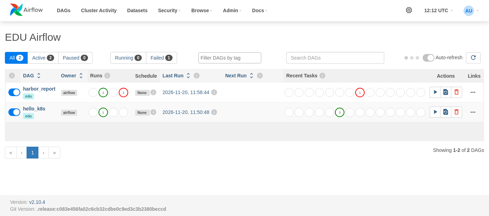
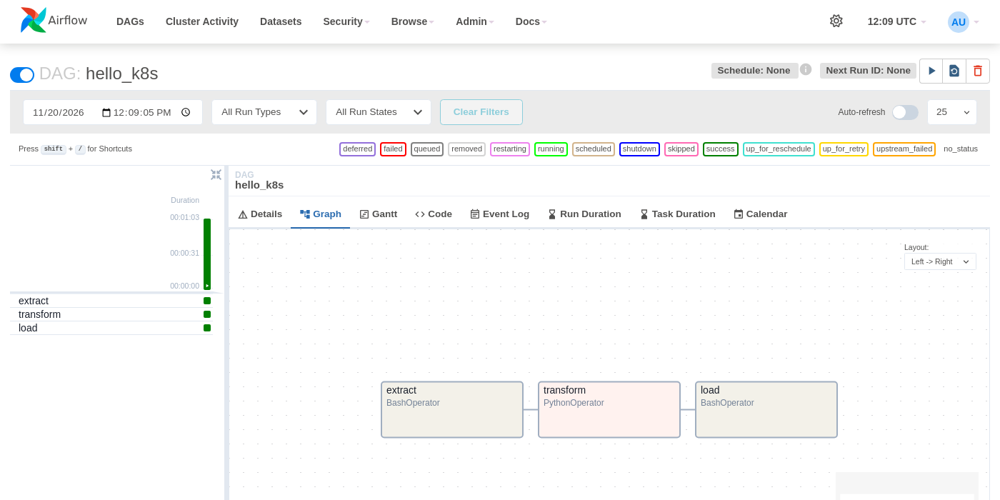
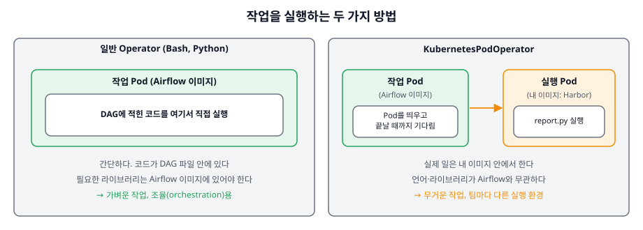
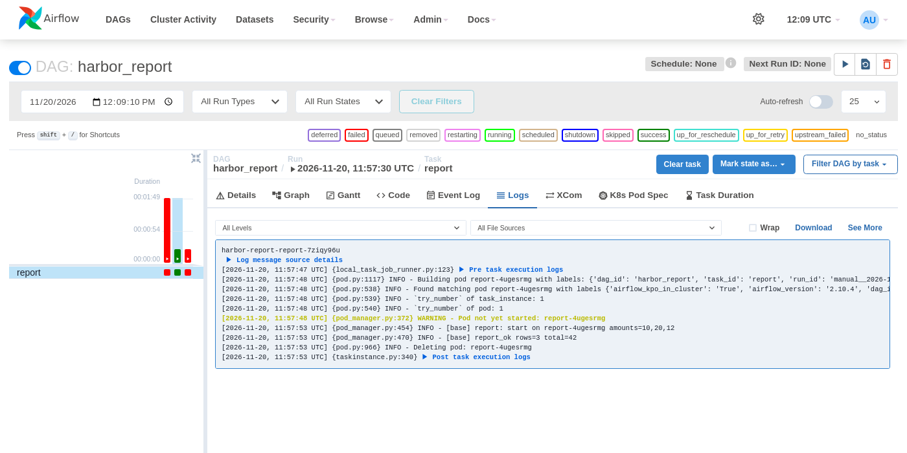

# 04. Airflow DAG — 작업을 Pod로 실행하기

**이 장을 마치면**

- DAG를 실행하고, 작업 하나하나가 Pod로 뜨는 것을 관찰할 수 있습니다.
- Git에 DAG 파일을 올려서 Airflow에 배포할 수 있습니다.
- Harbor에 올린 내 이미지를 Airflow 작업으로 실행할 수 있습니다.
- 작업이 실패했을 때 Airflow 화면과 `kubectl` 양쪽에서 원인을 찾을 수 있습니다.

---

## 1. DAG 읽어 보기

[03장](03-airflow.md)에서 만든 Airflow에는 DAG가 두 개 들어 있습니다.



먼저 `hello_k8s`를 봅니다. ([dags/hello_k8s.py](../dags/hello_k8s.py))

```python
with DAG(
    dag_id="hello_k8s",
    start_date=datetime(2024, 1, 1),
    schedule=None,              # 자동으로 돌지 않는다. 화면에서 직접 실행한다
    catchup=False,
    tags=["edu"],
) as dag:
    extract = BashOperator(
        task_id="extract",
        bash_command='echo "extract: running on pod $(hostname)"; sleep 10',
    )
    transform_task = PythonOperator(task_id="transform", python_callable=transform)
    load = BashOperator(
        task_id="load",
        bash_command='echo "load: running on pod $(hostname)"; sleep 5; echo done',
    )

    extract >> transform_task >> load      # 실행 순서
```

| 부분 | 의미 |
|---|---|
| `dag_id` | DAG의 이름. 화면에 이 이름으로 나온다 |
| `schedule` | 언제 실행할지. `None`은 수동 실행만, `"0 2 * * *"`는 매일 02:00 (기초 과정 [18장](../../docs/18-batch.md)의 cron 형식과 같다) |
| `BashOperator`, `PythonOperator` | 작업의 종류. 셸 명령을 실행하거나 Python 함수를 실행한다 |
| `task_id` | 작업의 이름 |
| `extract >> transform_task >> load` | 실행 순서. `>>`는 "이것 다음에 저것" |

DAG 파일은 **"무엇을 어떤 순서로 실행할지"를 적은 Python 코드**입니다.

## 2. 실습 ① — DAG 실행하고 Pod 관찰하기

터미널을 두 개 준비하면 좋습니다. 하나에서는 Pod를 지켜봅니다. (`-w`는 변화를 계속 보여 주는 옵션입니다. 끝낼 때는 `Ctrl+C`)

```text
kubectl -n edu-airflow get pod -w
```

### 2-1. 실행

Airflow 화면에서:

1. `hello_k8s` 왼쪽의 **토글 스위치를 켭니다.** 새 DAG는 일시 정지(paused) 상태로 등록됩니다. 켜지 않으면 실행해도 대기만 합니다.
2. 오른쪽의 **▶ (Trigger DAG)** 버튼을 누릅니다.

터미널에서 실행하려면 이렇게 합니다.

```bash
AF="kubectl -n edu-airflow exec deploy/airflow-scheduler -c scheduler --"

$AF airflow dags unpause hello_k8s
$AF airflow dags trigger hello_k8s
```

### 2-2. 작업마다 Pod가 생긴다

Pod를 지켜보던 터미널에 이런 흐름이 나타납니다.

```
hello-k8s-extract-6osau6lb     0/1   Init:0/1    0     0s
hello-k8s-extract-6osau6lb     1/1   Running     0     8s
hello-k8s-extract-6osau6lb     0/1   Completed   0     24s
hello-k8s-transform-mo73yh55   1/1   Running     0     7s
hello-k8s-transform-mo73yh55   0/1   Completed   0     12s
hello-k8s-load-csve567o        1/1   Running     0     6s
...
```

- 작업 `extract`가 시작되자 **`hello-k8s-extract-…` Pod가 생겼고**, 끝나자 사라졌습니다.
- 그다음 `transform`, 그다음 `load`가 **차례로** 각자의 Pod에서 실행됐습니다. DAG에 적은 순서 그대로입니다.
- `Init:0/1`은 작업을 시작하기 전에 Git에서 DAG 파일을 받아 오는 단계입니다(`git-sync-init` 컨테이너).

이것이 **KubernetesExecutor**입니다. Scheduler가 쿠버네티스에 "이 작업을 실행할 Pod를 만들어 달라"고 요청합니다. 작업이 없을 때는 Scheduler와 Webserver만 떠 있습니다.

### 2-3. 결과 확인

화면에서 `hello_k8s`를 누르고 **Graph** 탭을 보면 작업 세 개가 초록색(success)으로 표시됩니다.



작업을 누르고 **Logs** 탭을 열면 그 작업의 출력이 보입니다. 터미널에서는 이렇게 확인합니다.

```bash
$AF airflow dags list-runs -d hello_k8s
```

```
dag_id    | run_id                            | state   | execution_date            | start_date                       | end_date
==========+===================================+=========+===========================+==================================+=========
hello_k8s | manual__2026-11-20T11:50:48+00:00 | success | 2026-11-20T11:50:48+00:00 | 2026-11-20T11:51:21.207794+00:00 | ...
```

**Pod는 이미 사라졌는데 로그는 어떻게 볼 수 있을까요?** 작업 Pod가 로그를 **공유 볼륨(PVC `airflow-logs`)** 에 써 두었기 때문입니다. Webserver가 같은 볼륨을 읽어서 보여 줍니다.
[03장](03-airflow.md)의 `values.yaml`에서 `logs.persistence.enabled: true`로 설정한 부분입니다. 이 설정이 없으면 Pod가 사라질 때 로그도 함께 사라집니다.

```bash
kubectl -n edu-airflow exec deploy/airflow-webserver -c webserver -- \
  sh -c 'ls /opt/airflow/logs/dag_id=hello_k8s/*/'
```

```
task_id=extract  task_id=load  task_id=transform
```

## 3. 실습 ② — 내 DAG를 Git으로 배포하기

DAG를 Airflow에 넣는 방법은 **Git에 올리는 것**입니다. `git-sync`가 30초마다 저장소를 확인해서 받아 옵니다.

### 3-1. Airflow가 내 저장소를 보게 하기

지금 Airflow는 원본 저장소의 DAG를 보고 있습니다. 내 fork의 DAG를 보도록 바꿉니다. **이것도 Git으로 합니다**([03장 6절](03-airflow.md)과 같은 방법).

내 fork의 `platform/gitops/airflow/values.yaml`에서 `dags.gitSync.repo`를 내 저장소 주소로 고쳐 commit합니다.

```yaml
dags:
  gitSync:
    enabled: true
    repo: https://github.com/<내 계정>/k8s_edu.git      # ← 여기
```

```bash
kubectl -n argocd annotate application edu-airflow argocd.argoproj.io/refresh=normal --overwrite
kubectl -n edu-airflow rollout status deployment/airflow-scheduler --timeout=300s
```

> 03장에서 fork 없이 원본 저장소로 설치했다면 이 절(3절)은 읽기만 하고 4절로 넘어가세요.

### 3-2. DAG 파일 추가 — 일부러 틀리게

내 fork의 `platform/dags/` 아래에 `my_first.py`라는 새 파일을 만들고 아래 내용을 **그대로** 넣어 commit합니다.
(GitHub 화면: `platform/dags` 디렉터리 → **Add file → Create new file**)

```python
from datetime import datetime

from airflow import DAG
from airflow.operators.bash import BashOperator

with DAG(dag_id="my_first", start_date=datetime(2024, 1, 1), schedule=None, catchup=False, tags=["edu"]) as dag:
    hello = BashOperator(task_id="hello", bash_command='echo "hello from $(hostname)"')
    bye = BashOperator(task_id="bye", bash_command='echo "bye"'
    hello >> bye
```

1분쯤 기다린 뒤 DAG 목록을 봅니다.

```bash
$AF airflow dags list
```

```
dag_id        | fileloc                                               | owners  | is_paused
==============+=======================================================+=========+==========
harbor_report | /opt/airflow/dags/repo/platform/dags/harbor_report.py | airflow | False
hello_k8s     | /opt/airflow/dags/repo/platform/dags/hello_k8s.py     | airflow | False
```

`my_first`가 없습니다. 화면에도 나타나지 않고, 대신 맨 위에 **DAG Import Errors** 라는 빨간 줄이 생깁니다. 터미널에서는 이렇게 확인합니다.

```bash
$AF airflow dags list-import-errors
```

<details><summary>원인과 해결 방법</summary>

```
filepath                                         | error
=================================================+===============================================================================
/opt/airflow/dags/repo/platform/dags/my_first.py | Traceback (most recent call last):
                                                 |   ...
                                                 |   File "/opt/airflow/dags/repo/platform/dags/my_first.py", line 8
                                                 |     bye = BashOperator(task_id="bye", bash_command='echo "bye"'
                                                 |                       ^
                                                 | SyntaxError: '(' was never closed
```

8번째 줄의 괄호가 닫히지 않았습니다. DAG 파일은 Python 코드이므로, **문법 오류가 있으면 DAG 자체가 등록되지 않습니다.**

파일이 Airflow까지 도착했는지는 `git-sync`의 로그로 확인할 수 있습니다. `updated successfully`가 보이면 받아 온 것입니다.

```bash
kubectl -n edu-airflow logs deploy/airflow-scheduler -c git-sync --tail=2
```

Git에서 8번째 줄 끝에 `)`를 붙여 commit합니다.

```python
    bye = BashOperator(task_id="bye", bash_command='echo "bye"')
```

1분쯤 뒤 다시 확인하면 `my_first`가 나타나고, 오류 목록은 비어 있습니다.

```bash
$AF airflow dags list
$AF airflow dags list-import-errors
```

```
my_first      | /opt/airflow/dags/repo/platform/dags/my_first.py      | airflow | True
...
No data found
```

</details>

`is_paused`가 `True`입니다. 켜고 실행합니다.

```bash
$AF airflow dags unpause my_first
$AF airflow dags trigger my_first
sleep 90
$AF airflow dags list-runs -d my_first
```

> **DAG를 올렸는데 화면에 안 보일 때 확인 순서**: ① Git에 push됐나 → ② `git-sync` 로그에 `updated successfully`가 있나 → ③ `airflow dags list-import-errors`에 오류가 있나 → ④ `subPath`(DAG 디렉터리) 설정이 맞나.

## 4. 실습 ③ — Harbor의 내 이미지를 작업으로 실행하기

지금까지의 작업은 **Airflow 이미지 안에서** 실행됐습니다. 간단한 작업에는 충분하지만, 실제 데이터 처리에는 문제가 있습니다.

- 작업에 필요한 라이브러리(pandas, spark 등)를 Airflow 이미지에 전부 넣어야 한다.
- 팀마다 필요한 버전이 다르면 충돌한다.
- Python이 아닌 프로그램은 실행하기 어렵다.

**KubernetesPodOperator**는 "**이 이미지로** Pod를 하나 띄워서 끝날 때까지 기다려라"는 작업입니다. 실제 일은 내가 만든 이미지 안에서 합니다.



### 4-1. 작업용 이미지 만들기

숫자 목록을 받아 합계를 출력하는 작은 배치 프로그램입니다. ([examples/report-job/report.py](../examples/report-job/report.py), [Dockerfile](../examples/report-job/Dockerfile))

[01장](01-harbor.md)에서 한 것과 같은 순서입니다. 빌드 → 실행해 보기 → push.

```bash
cd platform/examples/report-job
docker build -t harbor.10.0.1.230.nip.io/edu/report:v1 .

docker run --rm harbor.10.0.1.230.nip.io/edu/report:v1
docker run --rm harbor.10.0.1.230.nip.io/edu/report:v1 --amounts 1,2,3
```

```
report: start on 6045091548ba amounts=10,20,12
report_ok rows=3 total=42

report: start on f40bddab5385 amounts=1,2,3
report_ok rows=3 total=6
```

잘못된 값을 넣으면 **종료 코드 2로 실패**합니다. 기초 과정 [18장](../../docs/18-batch.md)에서 배운 대로, 배치 작업은 실패를 종료 코드로 알려야 합니다.

```bash
docker run --rm harbor.10.0.1.230.nip.io/edu/report:v1 --amounts 1,x; echo "exit=$?"
```

```
report: start on 6cb67be11a6b amounts=1,x
report: ERROR bad input: invalid literal for int() with base 10: 'x'
exit=2
```

Harbor에 올립니다.

```bash
docker push harbor.10.0.1.230.nip.io/edu/report:v1
cd ../../..
```

### 4-2. DAG 읽어 보기

([dags/harbor_report.py](../dags/harbor_report.py))

```python
    KubernetesPodOperator(
        task_id="report",
        name="report",                                   # 만들어질 Pod 이름의 앞부분
        namespace="edu-airflow",
        image="harbor.10.0.1.230.nip.io/edu/report:v1",  # 01장과 같은 방법으로 올린 이미지
        image_pull_secrets=[k8s.V1LocalObjectReference("harbor-pull")],
        arguments=["--amounts", "{{ params.amounts }}"],  # 실행할 때 입력한 값이 들어간다
        get_logs=True,                                   # 작업 Pod의 출력을 Airflow 로그로 가져온다
        startup_timeout_seconds=90,                      # 90초 안에 Pod가 시작하지 못하면 실패 처리
        on_finish_action="delete_pod",                   # 끝나면 Pod를 지운다
        ...
    )
```

Pod의 YAML에서 보던 것들(`image`, `imagePullSecrets`, `args`, `resources`)을 Python으로 적은 것입니다.

### 4-3. 실행 — 그리고 실패

Pod를 지켜보는 터미널을 켜 두고(`kubectl -n edu-airflow get pod -w`), DAG를 실행합니다.

```bash
$AF airflow dags unpause harbor_report
$AF airflow dags trigger harbor_report
```

1분쯤 지나면 이런 모습이 됩니다.

```
harbor-report-report-z21gqdk2   1/1   Running            0     29s
report-cl6shwbg                 0/1   ImagePullBackOff   0     11s
```

Pod가 **두 개**입니다.

| Pod | 정체 |
|---|---|
| `harbor-report-report-…` | Airflow의 작업 Pod. KubernetesPodOperator 코드가 여기서 돈다 (Airflow 이미지) |
| `report-…` | 그 작업이 띄운 **내 이미지의 Pod**. 실제 일을 하는 곳 |

그런데 `report-…`가 `ImagePullBackOff`입니다. 2분쯤 뒤 DAG는 `failed`가 됩니다. 원인을 찾아보세요.

```bash
kubectl -n edu-airflow get events --sort-by=.lastTimestamp | grep 'pod/report-' | tail -5
$AF airflow dags list-runs -d harbor_report
```

<details><summary>원인과 해결 방법</summary>

```
Warning   FailedToRetrieveImagePullSecret   pod/report-cl6shwbg   Unable to retrieve some image pull secrets (harbor-pull); attempting to pull the image may not succeed.
Warning   Failed                            pod/report-cl6shwbg   Error: ImagePullBackOff
```

`Unable to retrieve some image pull secrets (harbor-pull)` — `harbor-pull`이라는 Secret을 찾지 못했습니다.

[01장](01-harbor.md)에서 `harbor-pull`을 만들었지만 그것은 **`edu-platform` 네임스페이스**에 있습니다. 이 Pod는 **`edu-airflow` 네임스페이스**에서 뜹니다.
**Secret은 같은 네임스페이스의 Pod만 쓸 수 있습니다**(기초 과정 [05장](../../docs/05-secret.md)).

`edu-airflow`에도 같은 Secret을 만듭니다. 01장에서 복사해 둔 로봇 계정의 secret을 넣습니다.

```text
kubectl -n edu-airflow create secret docker-registry harbor-pull \
  --docker-server=harbor.10.0.1.230.nip.io \
  --docker-username='robot$edu+puller' \
  --docker-password='<복사한 secret>'
```

> secret 값을 잃어버렸다면 Harbor의 **Projects → edu → Robot Accounts**에서 `puller`를 선택하고 **ACTION → REFRESH SECRET**으로 새로 발급받습니다. 이 경우 `edu-platform`의 Secret도 같은 값으로 다시 만들어야 합니다.

다시 실행합니다.

```bash
$AF airflow dags trigger harbor_report
```

```
harbor-report-report-7ziqy96u   1/1   Running     0     9s
report-4ugesrmg                 1/1   Running     0     2s
report-4ugesrmg                 0/1   Completed   0     5s
harbor-report-report-7ziqy96u   0/1   Completed   0     25s
```

</details>

### 4-4. 결과 확인

화면에서 `harbor_report` → 성공한 실행(초록색)의 `report` 작업 → **Logs** 탭을 엽니다.



```
INFO - [base] report: start on report-4ugesrmg amounts=10,20,12
INFO - [base] report_ok rows=3 total=42
INFO - Deleting pod: report-4ugesrmg
```

`[base]`로 시작하는 줄이 **내 이미지의 Pod가 출력한 내용**입니다. `get_logs=True` 설정 덕분에 Airflow 로그로 옮겨졌습니다. 내 코드가 Harbor를 거쳐 Airflow 작업으로 실행됐습니다.

### 4-5. 입력값을 바꿔서 실행하기

이 DAG는 실행할 때 값을 받을 수 있습니다(`params`). 화면에서 ▶ 버튼을 누르면 `amounts` 입력란이 나옵니다. 터미널에서는 `--conf`로 넘깁니다.

```bash
$AF airflow dags trigger harbor_report --conf '{"amounts":"100,200,300"}'
```

## 5. 고장 내고 고쳐 보기 — 작업이 실패했다

잘못된 값으로 실행합니다.

```bash
$AF airflow dags trigger harbor_report --conf '{"amounts":"1,x"}'
sleep 60
$AF airflow dags list-runs -d harbor_report
```

```
harbor_report | manual__2026-11-20T11:58:44+00:00 | failed  | ...
harbor_report | manual__2026-11-20T11:57:30+00:00 | success | ...
harbor_report | manual__2026-11-20T11:54:09+00:00 | failed  | ...
```

`failed`가 두 개입니다. 하나는 4-3의 이미지 문제였고, 하나는 방금 것입니다. **같은 `failed`라도 원인이 다릅니다.** 화면에서 방금 실패한 실행의 Logs를 열어 원인을 찾아보세요.

<details><summary>원인과 두 실패의 차이</summary>

방금 실패한 실행의 로그에는 내 프로그램이 출력한 오류가 그대로 있습니다.

```
INFO - [base] report: start on report-xxxxx amounts=1,x
INFO - [base] report: ERROR bad input: invalid literal for int() with base 10: 'x'
ERROR - Pod report-xxxxx returned a failure.
```

프로그램은 **실행됐고**, 입력이 잘못되어 종료 코드 2로 끝났습니다. Airflow는 0이 아닌 종료 코드를 보고 작업을 실패로 처리했습니다.

| | 4-3의 실패 | 이번 실패 |
|---|---|---|
| 내 프로그램이 실행됐나 | **아니오** (이미지를 받지 못함) | **예** |
| Airflow 로그 | Pod가 시작되지 못했다는 내용 (`Pending`, `ContainerCreating`) | `[base]`로 시작하는 내 프로그램의 오류 메시지 |
| 원인을 찾는 곳 | `kubectl get pod`, `kubectl get events` | Airflow 화면의 Logs |
| 고치는 곳 | 쿠버네티스 (Secret, 이미지 이름) | 입력값 또는 내 코드 |

</details>

### 작업이 실패했을 때

| Airflow에서 보이는 것 | 의심할 것 | 확인 |
|---|---|---|
| 작업이 `queued`에서 넘어가지 않음 | DAG가 일시 정지 상태. 또는 작업 Pod가 `Pending` | 토글 스위치, `kubectl -n edu-airflow get pod` |
| 로그에 `[base]` 줄이 없이 실패 | 실행 Pod가 시작되지 못함 (이미지, Secret, 자원) | `kubectl -n edu-airflow get events --sort-by=.lastTimestamp` |
| 로그에 내 프로그램의 오류가 있음 | 내 코드나 입력값 | 로그의 오류 메시지 |
| 로그가 아예 없음 | 작업 Pod 자체가 뜨지 못함 | `kubectl -n edu-airflow describe pod <작업 Pod>` |
| DAG가 목록에 없음 | DAG 파일 오류, git-sync | `airflow dags list-import-errors` |

Airflow 문제의 절반은 쿠버네티스 문제입니다. **Airflow 화면과 `kubectl`을 함께** 봐야 합니다.

## 6. 정리

이 Airflow는 [06장](06-monitoring.md)에서 모니터링 대상으로 씁니다. **지우지 않습니다.**

끝난 작업 Pod는 자동으로 지워지므로 따로 정리할 것이 없습니다.

```bash
kubectl -n edu-airflow get pod
```

## 핵심 요약

- DAG는 작업과 실행 순서를 적은 Python 파일이다. Git에 올리면 `git-sync`가 Airflow로 가져온다.
- KubernetesExecutor에서는 작업 하나가 Pod 하나로 실행되고, 끝나면 사라진다. 로그는 PVC에 남는다.
- 새 DAG는 일시 정지 상태로 등록된다. 켜야 실행된다.
- DAG 파일에 문법 오류가 있으면 등록되지 않는다. `airflow dags list-import-errors`로 확인한다.
- KubernetesPodOperator는 내 이미지를 Pod로 실행한다. 작업의 실행 환경을 Airflow와 분리할 수 있다.
- `imagePullSecrets`용 Secret은 Pod가 뜨는 네임스페이스에 있어야 한다.
- 작업 실패의 원인은 "Pod가 시작하지 못했다"와 "프로그램이 실패했다"로 나눠서 찾는다.

## 확인 문제

1. KubernetesExecutor에서 작업 3개짜리 DAG를 실행하면 Pod는 몇 개 생기나요? 끝나면 어떻게 되나요?
2. DAG 파일을 Git에 올렸는데 화면에 나타나지 않습니다. 무엇을 확인해야 하나요?
3. 작업 Pod가 사라진 뒤에도 로그를 볼 수 있는 이유는 무엇인가요?
4. `edu-platform` 네임스페이스에 `harbor-pull` Secret이 있는데도 `edu-airflow`의 Pod가 이미지를 받지 못한 이유는 무엇인가요?
5. BashOperator와 KubernetesPodOperator는 각각 언제 쓰면 좋을까요?

<details><summary>정답 보기</summary>

1. 작업마다 하나씩, 순서대로 3개가 생깁니다. 각 Pod는 작업이 끝나면 지워집니다.
2. Git에 push됐는지, `git-sync` 로그에 `updated successfully`가 있는지, `airflow dags list-import-errors`에 오류가 있는지, DAG 디렉터리(`subPath`) 설정이 맞는지 확인합니다.
3. 작업 Pod가 로그를 공유 볼륨(PVC)에 저장했고, Webserver가 그 볼륨을 읽기 때문입니다.
4. Secret은 같은 네임스페이스의 Pod만 사용할 수 있습니다. Pod가 뜨는 `edu-airflow`에도 Secret을 만들어야 합니다.
5. BashOperator는 간단한 명령이나 조율 작업에, KubernetesPodOperator는 별도의 라이브러리·언어·자원이 필요한 실제 처리 작업에 씁니다.
</details>

---

다음 장: [05. Keycloak과 kubectl — 로그인과 권한](05-keycloak-kubectl.md)
