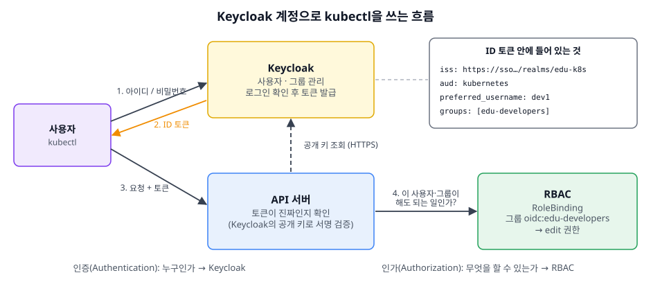
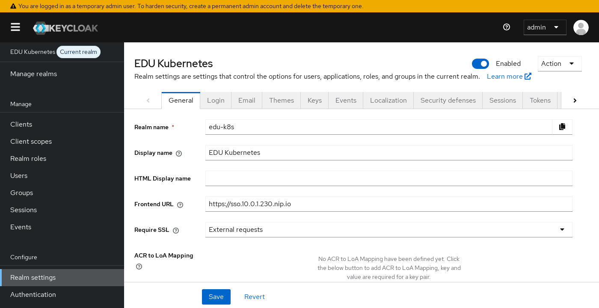
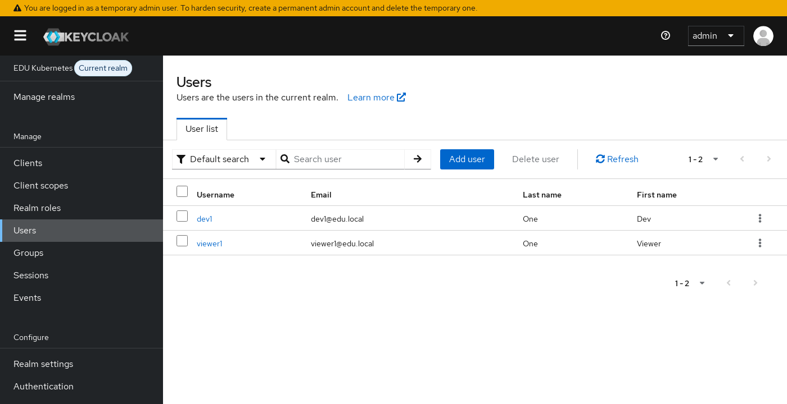

# 05. Keycloak과 kubectl — 로그인과 권한

**이 장을 마치면**

- 인증(누구인가)과 인가(무엇을 할 수 있는가)를 구분해서 설명할 수 있습니다.
- Keycloak에 사용자와 그룹을 만들고, 그 계정으로 kubectl을 쓸 수 있습니다.
- Keycloak 그룹에 쿠버네티스 권한을 연결할 수 있습니다.
- `Unauthorized`와 `Forbidden`의 차이로 원인을 찾을 수 있습니다.

---

## 1. 왜 필요한가

지금까지는 관리자용 접속 정보(kubeconfig) 하나를 모두가 같이 썼습니다. 실제 운영에서는 곤란합니다.

- 누가 무엇을 했는지 구분할 수 없다. 모두 같은 "관리자"다.
- 한 사람이 퇴사하면 모두의 접속 정보를 바꿔야 한다.
- 신입에게도 클러스터 전체 권한이 생긴다.

**사람마다 자기 계정으로 로그인**하고, **소속 그룹에 따라 권한**을 받게 하면 됩니다.
기초 과정 [11장 RBAC](../../docs/11-rbac.md)에서 ServiceAccount(프로그램용 계정)에 권한을 줬습니다. 이번에는 **사람**입니다.

쿠버네티스는 사람 계정을 직접 관리하지 않습니다. "이 사람이 누구인지"는 외부 시스템에 맡깁니다. 여기서는 **Keycloak**이 그 역할을 합니다.
Keycloak은 로그인과 사용자·그룹을 한곳에서 관리하는 도구이고, 이 플랫폼에서는 Kubeflow의 로그인도 Keycloak이 처리합니다(SSO).



| 단계 | 질문 | 누가 답하나 | 실패하면 |
|---|---|---|---|
| **인증** (Authentication) | 당신은 누구인가? | Keycloak이 발급한 토큰 | `Unauthorized` (401) |
| **인가** (Authorization) | 그 일을 해도 되는가? | 쿠버네티스 RBAC | `Forbidden` (403) |

이 방식의 표준 이름이 **OIDC(OpenID Connect)** 입니다. Keycloak이 로그인을 확인하고 **ID 토큰**이라는 서명된 문서를 발급하면,
API 서버는 그 서명을 확인해서 "Keycloak이 보증한 사용자"로 받아들입니다. API 서버는 비밀번호를 알 필요가 없습니다.

## 2. 이 환경의 구성 (관리자가 해 둔 설정)

Keycloak 로그인을 kubectl에 연결하려면 관리자가 **세 가지**를 미리 설정해야 합니다. 이 환경에는 이미 적용되어 있습니다. 무엇이 설정되어 있는지 확인하면서 읽어 보세요.

### 2-1. Keycloak의 HTTPS 주소

API 서버는 **HTTPS로 접속할 수 있는 발급자(issuer)만** 받아들입니다. 토큰을 발급하는 곳을 믿을 수 있어야 하기 때문입니다.
그래서 Keycloak에 HTTPS 주소 `https://sso.10.0.1.230.nip.io`를 하나 더 열어 두었습니다. ([examples/keycloak/ingress-https.yaml](../examples/keycloak/ingress-https.yaml))

```bash
kubectl -n keycloak get ingress
```

```
NAME             CLASS   HOSTS                        ADDRESS      PORTS     AGE
keycloak         nginx   keycloak.10.0.1.230.nip.io   10.0.1.230   80        2d
keycloak-https   nginx   sso.10.0.1.230.nip.io        10.0.1.230   80, 443   20m
```

같은 Keycloak에 주소가 두 개 연결되어 있습니다. 기초 과정 [10장](../../docs/10-ingress.md)에서 배운 호스트 기반 라우팅입니다.

### 2-2. kubectl 전용 realm

Keycloak은 사용자와 설정을 **realm**이라는 단위로 나눕니다. 서로 다른 회사나 용도를 분리하는 칸막이입니다.

| realm | 용도 | 발급자 주소 |
|---|---|---|
| `datalake` | 기존 서비스(Kubeflow 등)의 로그인. 사내 LDAP 사용자 | `http://keycloak.10.0.1.230.nip.io/realms/datalake` |
| **`edu-k8s`** | **kubectl 로그인 실습용** | `https://sso.10.0.1.230.nip.io/realms/edu-k8s` |

`datalake` realm은 발급자 주소가 `http://`라서 API 서버에 연결할 수 없습니다. 그래서 HTTPS 발급자를 쓰는 `edu-k8s` realm을 따로 만들었습니다.
(realm 설정의 **Frontend URL**에 HTTPS 주소를 넣으면 그 realm의 발급자 주소가 바뀝니다.)



발급자 정보는 누구나 조회할 수 있습니다.

```bash
curl -s --cacert /root/edu-oidc/ca.crt \
  https://sso.10.0.1.230.nip.io/realms/edu-k8s/.well-known/openid-configuration | jq -r '.issuer, .jwks_uri'
```

```
https://sso.10.0.1.230.nip.io/realms/edu-k8s
https://sso.10.0.1.230.nip.io/realms/edu-k8s/protocol/openid-connect/certs
```

`jwks_uri`가 토큰의 서명을 확인할 **공개 키**가 있는 곳입니다. API 서버가 여기서 키를 가져갑니다.

> `--cacert /root/edu-oidc/ca.crt`는 이 HTTPS 주소의 인증서를 서명한 CA입니다. [01장](01-harbor.md)에서 Harbor의 CA를 Docker에 등록했던 것과 같은 이유로 필요합니다.

이 realm에는 `kubernetes`라는 **클라이언트**가 등록되어 있습니다. "kubectl이라는 프로그램이 이 realm으로 로그인한다"는 등록입니다.
그리고 토큰에 사용자의 **그룹 목록**이 들어가도록 설정(mapper)되어 있습니다.

### 2-3. API 서버의 OIDC 설정

API 서버에 "이 발급자가 서명한 토큰을 믿어라"라고 알려 주는 설정입니다. 컨트롤 플레인 노드의 API 서버 설정 파일에 들어 있습니다.

```bash
grep oidc /etc/kubernetes/manifests/kube-apiserver.yaml
```

```
    - --oidc-issuer-url=https://sso.10.0.1.230.nip.io/realms/edu-k8s
    - --oidc-client-id=kubernetes
    - --oidc-username-claim=preferred_username
    - "--oidc-username-prefix=oidc:"
    - --oidc-groups-claim=groups
    - "--oidc-groups-prefix=oidc:"
    - --oidc-ca-file=/etc/kubernetes/pki/edu-oidc-ca.crt
```

| 설정 | 의미 |
|---|---|
| `oidc-issuer-url` | 믿을 발급자. 토큰의 `iss` 값과 **글자 하나까지** 같아야 한다 |
| `oidc-client-id` | 토큰의 `aud`(누구를 위한 토큰인가) 값과 같아야 한다 |
| `oidc-username-claim` | 토큰의 어느 항목을 사용자 이름으로 쓸지 |
| `oidc-groups-claim` | 토큰의 어느 항목을 그룹 목록으로 쓸지 |
| `oidc-username-prefix`, `oidc-groups-prefix` | 이름 앞에 붙일 표시. `dev1` → `oidc:dev1` |
| `oidc-ca-file` | 발급자의 HTTPS 인증서를 확인할 CA |

**`oidc:` 접두사를 붙이는 이유**: Keycloak에서 누군가 `system:masters`(쿠버네티스의 최고 관리자 그룹)라는 이름의 그룹을 만들어도 `oidc:system:masters`가 되어 아무 권한도 얻지 못합니다. 바깥에서 온 이름과 쿠버네티스 내부 이름이 섞이지 않게 하는 안전장치입니다.

<details><summary>관리자가 이 설정을 적용한 방법 (운영 담당자용)</summary>

```text
# 1) CA와 서버 인증서 만들기
mkdir -p /root/edu-oidc && cd /root/edu-oidc
openssl genrsa -out ca.key 2048
openssl req -x509 -new -key ca.key -days 3650 -subj "/CN=edu-oidc-ca" -out ca.crt
openssl genrsa -out tls.key 2048
openssl req -new -key tls.key -subj "/CN=sso.10.0.1.230.nip.io" -out tls.csr
printf "subjectAltName=DNS:sso.10.0.1.230.nip.io\n" > san.ext
openssl x509 -req -in tls.csr -CA ca.crt -CAkey ca.key -CAcreateserial -days 825 -extfile san.ext -out tls.crt

# 2) 인증서를 Secret으로 만들고 HTTPS Ingress 추가
kubectl -n keycloak create secret tls keycloak-https-tls --cert=tls.crt --key=tls.key
kubectl apply -f platform/examples/keycloak/ingress-https.yaml

# 3) Keycloak 관리 콘솔에서: realm "edu-k8s" 생성 → Realm settings → Frontend URL = https://sso.10.0.1.230.nip.io
#    Clients → Create client: Client ID "kubernetes", Client authentication Off, Direct access grants On
#    Clients → kubernetes → Client scopes → kubernetes-dedicated → Add mapper → Group Membership
#      (Token Claim Name "groups", Full group path Off)

# 4) API 서버에 CA를 전달하고 설정 추가
cp ca.crt /etc/kubernetes/pki/edu-oidc-ca.crt
cp -p /etc/kubernetes/manifests/kube-apiserver.yaml /root/edu-oidc/kube-apiserver.yaml.bak   # 반드시 manifests 디렉터리 "밖"에 백업
vi /etc/kubernetes/manifests/kube-apiserver.yaml      # "- kube-apiserver" 아래에 위의 --oidc-* 일곱 줄 추가
```

파일을 저장하면 kubelet이 API 서버를 자동으로 다시 시작합니다(30~60초). 그동안 `kubectl`은 응답하지 않지만 실행 중인 Pod에는 영향이 없습니다.
설정이 잘못되어 API 서버가 올라오지 않으면 백업 파일을 다시 복사해 되돌립니다.

**백업 파일을 `manifests` 디렉터리 안에 두면 안 됩니다.** kubelet이 그 파일도 Pod 정의로 읽어서 API 서버를 하나 더 띄우려고 합니다.

</details>

## 3. 실습 ① — Keycloak에 사용자와 그룹 만들기

Keycloak 관리 콘솔(`http://keycloak.10.0.1.230.nip.io/admin/master/console/#/edu-k8s`)에 관리자 계정으로 로그인합니다.
왼쪽 위에 **EDU Kubernetes**(realm `edu-k8s`)가 선택되어 있는지 확인합니다. 다른 realm이면 **Manage realms**에서 바꿉니다.

### 3-1. 그룹

**Groups**에 두 그룹이 준비되어 있습니다.

| 그룹 | 줄 권한 |
|---|---|
| `edu-developers` | 실습 네임스페이스에서 만들기·고치기·지우기 |
| `edu-viewers` | 실습 네임스페이스에서 읽기만 |

### 3-2. 내 사용자 만들기

**Users → Add user**

1. **Username**에 자기 이름(예: `hong`)을 입력하고, **Email verified**를 켭니다. Email, First name, Last name도 채웁니다.
2. 아래쪽 **Join Groups**를 눌러 `edu-developers`를 선택합니다. → **Create**
3. 만들어진 사용자의 **Credentials** 탭 → **Set password** → 비밀번호를 입력하고 **Temporary를 끕니다** → **Save**



같은 방법으로 읽기 전용 사용자를 하나 더 만듭니다(예: `hong-view`, 그룹은 `edu-viewers`).

> 이 교재의 출력 예시는 `dev1`(`edu-developers`)과 `viewer1`(`edu-viewers`)이라는 사용자로 실행한 것입니다. 명령의 `dev1`, `viewer1`을 자기가 만든 이름으로 바꿔서 실행하세요.

> **Temporary**를 켜 두면 첫 로그인 때 비밀번호를 바꾸라고 요구합니다. 브라우저 로그인에서는 좋은 기능이지만, 이 실습처럼 명령으로 로그인할 때는 `Account is not fully set up` 오류로 실패합니다.

## 4. 실습 ② — 토큰을 받아서 들여다보기

Keycloak에 사용자 이름과 비밀번호를 보내면 토큰을 돌려줍니다. 그 과정을 스크립트로 만들어 두었습니다. ([examples/keycloak/get-token.sh](../examples/keycloak/get-token.sh))

```text
TOKEN=$(platform/examples/keycloak/get-token.sh dev1)
```

```
Password for dev1:
```

비밀번호를 입력하면 `TOKEN` 변수에 ID 토큰이 담깁니다. 비밀번호가 틀리면 `로그인 실패: Invalid user credentials`가 나옵니다.

토큰은 점(`.`)으로 구분된 세 부분입니다. 가운데 부분에 내용이 들어 있고, base64로 인코딩되어 있을 뿐이라 누구나 읽을 수 있습니다(기초 과정 [05장](../../docs/05-secret.md)의 base64와 같습니다).

```text
echo "$TOKEN" | cut -d. -f2 | tr '_-' '/+' |
  awk '{l=length($0)%4; if(l==2)$0=$0"=="; if(l==3)$0=$0"="; print}' | base64 -d |
  jq '{iss, aud, preferred_username, groups, exp: (.exp|todate)}'
```

```json
{
  "iss": "https://sso.10.0.1.230.nip.io/realms/edu-k8s",
  "aud": "kubernetes",
  "preferred_username": "dev1",
  "groups": [
    "edu-developers"
  ],
  "exp": "2026-11-20T13:26:58Z"
}
```

2-3절의 API 서버 설정과 하나씩 맞춰 보세요.

| 토큰의 항목 | API 서버 설정 | 결과 |
|---|---|---|
| `iss` | `oidc-issuer-url`과 같은가 | 같으면 이 발급자의 공개 키로 서명을 검증 |
| `aud` | `oidc-client-id`와 같은가 | 다르면 거부 |
| `preferred_username: dev1` | `oidc-username-claim` + prefix | 사용자 이름 `oidc:dev1` |
| `groups: [edu-developers]` | `oidc-groups-claim` + prefix | 그룹 `oidc:edu-developers` |
| `exp` | — | 이 시각이 지나면 토큰이 무효 |

**토큰은 읽을 수는 있지만 고칠 수는 없습니다.** 세 번째 부분이 Keycloak의 서명이라서, 내용을 한 글자라도 바꾸면 서명 검증에 실패합니다.

## 5. 실습 ③ — 내 계정으로 kubectl 쓰기

### 5-1. 접속 정보 파일 만들기

관리자용 설정과 섞이지 않도록 **별도의 kubeconfig 파일**을 만듭니다. kubeconfig에는 "어느 클러스터에(cluster)", "누구로(user)" 접속할지가 들어갑니다.

```text
export KUBECONFIG=$HOME/kubeconfig-oidc      # 이 터미널에서는 이 파일을 쓴다

# 어느 클러스터에
kubectl config set-cluster edu --server=https://10.0.1.181:6443 \
  --certificate-authority=/etc/kubernetes/pki/ca.crt --embed-certs=true

# 누구로 (방금 받은 토큰)
kubectl config set-credentials dev1 --token="$TOKEN"

# 둘을 묶어 "컨텍스트"로 만들고 선택한다
kubectl config set-context dev1 --cluster=edu --user=dev1 --namespace=edu-platform
kubectl config use-context dev1
```

> `export KUBECONFIG=...`는 **그 터미널에서만** 유효합니다. 관리자 권한으로 돌아가려면 `unset KUBECONFIG`를 실행하거나 새 터미널을 엽니다.
> 이 장에서는 **터미널 두 개**를 쓰면 편합니다. 하나는 내 계정용(`KUBECONFIG` 설정), 하나는 관리자용.

### 5-2. 나는 누구인가

```text
kubectl auth whoami
```

```
ATTRIBUTE   VALUE
Username    oidc:dev1
Groups      [oidc:edu-developers system:authenticated]
```

API 서버가 나를 **`oidc:dev1`**, 그룹 **`oidc:edu-developers`** 로 알아봤습니다. Keycloak에서 만든 사용자와 그룹 그대로입니다. **인증에 성공**했습니다.

### 5-3. 그런데 아무것도 할 수 없다

```text
kubectl get pod
```

```
Error from server (Forbidden): pods is forbidden: User "oidc:dev1" cannot list resource "pods" in API group "" in the namespace "edu-platform"
```

`Forbidden`입니다. **누구인지는 확인됐지만(인증), 아무 권한도 받지 못했습니다(인가).** 기초 과정 [11장](../../docs/11-rbac.md)에서 배운 대로, RBAC은 허용한 것만 됩니다.

### 5-4. 그룹에 권한 주기 (관리자 터미널에서)

**관리자 터미널**에서 Keycloak 그룹에 권한을 연결합니다. ([examples/keycloak/rbac-oidc.yaml](../examples/keycloak/rbac-oidc.yaml))

```yaml
apiVersion: rbac.authorization.k8s.io/v1
kind: RoleBinding
metadata:
  name: oidc-developers-edit
  namespace: edu-platform
subjects:
- kind: Group
  name: oidc:edu-developers          # Keycloak의 edu-developers 그룹
  apiGroup: rbac.authorization.k8s.io
roleRef:
  kind: ClusterRole
  name: edit                         # 만들기·고치기·지우기 (기초 과정 11장)
  apiGroup: rbac.authorization.k8s.io
---
# (같은 방식으로 oidc:edu-viewers → view)
```

기초 과정 11장과 다른 점은 `subjects`의 종류가 `ServiceAccount`가 아니라 **`Group`** 이라는 것뿐입니다.
**사람이 아니라 그룹에 권한을 줍니다.** 새 사람이 오면 Keycloak에서 그룹에 넣기만 하면 되고, 쿠버네티스 쪽은 건드릴 필요가 없습니다.

```bash
kubectl apply -f platform/examples/keycloak/rbac-oidc.yaml
```

### 5-5. 다시 해 보기 (내 계정 터미널에서)

```text
kubectl get pod
kubectl create deployment oidc-test --image=nginx:1.27-alpine
kubectl get deployment
```

```
No resources found in edu-platform namespace.
deployment.apps/oidc-test created

NAME        READY   UP-TO-DATE   AVAILABLE   AGE
oidc-test   1/1     1            1           5s
```

이제 됩니다. 하지만 **허용된 범위 밖**은 여전히 안 됩니다.

```text
kubectl get pod -n kube-system
kubectl get nodes
```

```
Error from server (Forbidden): pods is forbidden: User "oidc:dev1" cannot list resource "pods" in API group "" in the namespace "kube-system"
Error from server (Forbidden): nodes is forbidden: User "oidc:dev1" cannot list resource "nodes" in API group "" at the cluster scope
```

RoleBinding이 `edu-platform` 네임스페이스에만 있기 때문입니다.

## 6. 실습 ④ — 그룹이 다르면 권한이 다르다

읽기 전용 사용자로 같은 일을 해 봅니다. 토큰을 받고 컨텍스트를 하나 더 만듭니다.

```text
TOKEN2=$(platform/examples/keycloak/get-token.sh viewer1)
kubectl config set-credentials viewer1 --token="$TOKEN2"
kubectl config set-context viewer1 --cluster=edu --user=viewer1 --namespace=edu-platform
kubectl config use-context viewer1

kubectl auth whoami
kubectl get deployment
kubectl delete deployment oidc-test
```

```
ATTRIBUTE   VALUE
Username    oidc:viewer1
Groups      [oidc:edu-viewers system:authenticated]

NAME        READY   UP-TO-DATE   AVAILABLE   AGE
oidc-test   1/1     1            1           40s

Error from server (Forbidden): deployments.apps "oidc-test" is forbidden: User "oidc:viewer1" cannot delete resource "deployments" in API group "apps" in the namespace "edu-platform"
```

볼 수는 있지만 지울 수는 없습니다. 같은 클러스터, 같은 명령인데 **Keycloak의 소속 그룹에 따라 결과가 다릅니다.**

`dev1`로 돌아가서 지웁니다.

```text
kubectl config use-context dev1
kubectl delete deployment oidc-test
```

| | `dev1` (edu-developers) | `viewer1` (edu-viewers) |
|---|---|---|
| 연결된 ClusterRole | `edit` | `view` |
| Pod·Deployment 조회 | 가능 | 가능 |
| 만들기·지우기 | 가능 | **Forbidden** |
| Secret 조회 | 가능 | **Forbidden** (`view`에는 Secret이 없다) |
| 다른 네임스페이스 | Forbidden | Forbidden |

## 7. 고장 내고 고쳐 보기

### 7-1. 잘 되던 명령이 갑자기 안 된다

5분쯤 기다린 뒤 같은 명령을 다시 실행합니다.

```text
kubectl get pod
```

```
error: You must be logged in to the server (Unauthorized)
```

이번에는 `Forbidden`이 아니라 **`Unauthorized`** 입니다. 무엇이 달라졌을까요?

<details><summary>원인과 해결 방법</summary>

`Unauthorized`는 **인증 실패**입니다. API 서버가 "당신이 누구인지 모르겠다"고 하는 것입니다. 권한 문제(`Forbidden`)와 다릅니다.

원인은 **토큰 만료**입니다. 4절에서 본 토큰의 `exp`(만료 시각)가 지났습니다. 이 realm의 토큰 유효 시간은 5분입니다. API 서버 로그에 이유가 남습니다(관리자 터미널에서).

```text
kubectl -n kube-system logs -l component=kube-apiserver --since=1m | grep oidc
```

```
"Unable to authenticate the request" err="[invalid bearer token, oidc: verify token: oidc: token is expired (Token Expiry: 2026-11-20 13:26:58 +0000 UTC)]"
```

토큰을 다시 받아 넣으면 됩니다.

```text
TOKEN=$(platform/examples/keycloak/get-token.sh dev1)
kubectl config set-credentials dev1 --token="$TOKEN"
kubectl get pod
```

**토큰이 짧게 살도록 한 것은 일부러 그런 것입니다.** 토큰이 유출되어도 5분 뒤에는 쓸모가 없어집니다.
매번 다시 받는 것은 불편하므로, 실제로는 토큰을 자동으로 갱신해 주는 도구를 씁니다(9절).

</details>

### 7-2. 그룹을 바꿨는데 권한이 그대로다

Keycloak 관리 콘솔에서 `viewer1`을 `edu-developers` 그룹에 추가합니다(**Users → viewer1 → Groups → Join Group**). 그리고 `viewer1`로 Deployment를 만들 수 있는지 확인합니다.

```text
kubectl config use-context viewer1
kubectl auth can-i create deployments
```

```
no
```

<details><summary>원인과 해결 방법</summary>

API 서버는 Keycloak에 "지금 이 사람이 어느 그룹인가"를 매번 물어보지 않습니다. **토큰에 적힌 그룹**을 봅니다.
지금 kubeconfig에 들어 있는 토큰은 그룹을 바꾸기 **전에** 발급된 것이라 `edu-viewers`만 적혀 있습니다(만료됐다면 `Unauthorized`가 먼저 나옵니다).

토큰을 새로 받으면 바뀐 그룹이 들어옵니다.

```text
TOKEN2=$(platform/examples/keycloak/get-token.sh viewer1)
kubectl config set-credentials viewer1 --token="$TOKEN2"
kubectl auth whoami
kubectl auth can-i create deployments
```

```
ATTRIBUTE   VALUE
Username    oidc:viewer1
Groups      [oidc:edu-developers oidc:edu-viewers system:authenticated]

yes
```

반대로, **그룹에서 뺀 사람도 지금 가진 토큰이 만료될 때까지는 예전 권한을 유지**합니다. 토큰 유효 시간이 짧아야 하는 또 하나의 이유입니다.
확인했으면 Keycloak에서 `viewer1`을 `edu-developers` 그룹에서 다시 빼 둡니다.

</details>

### `Unauthorized`와 `Forbidden`

| 오류 | 단계 | 의미 | 확인할 것 |
|---|---|---|---|
| `Unauthorized` (401) | 인증 | 누구인지 확인할 수 없다 | 토큰 만료, 토큰의 `iss`/`aud`가 API 서버 설정과 같은지, kubeconfig에 토큰이 들어 있는지 |
| `Forbidden` (403) | 인가 | 누구인지는 알지만 권한이 없다 | `kubectl auth whoami`의 그룹, RoleBinding의 `subjects`(접두사 `oidc:` 포함), 네임스페이스 |

`Forbidden` 메시지의 `User "oidc:dev1"`처럼 **이름이 나오면 인증은 통과한 것**입니다.

## 8. 정리

내 계정 터미널을 닫거나 `unset KUBECONFIG`로 관리자 설정으로 돌아옵니다.

```bash
unset KUBECONFIG
kubectl delete -f platform/examples/keycloak/rbac-oidc.yaml
rm -f $HOME/kubeconfig-oidc
```

Keycloak에서 만든 사용자는 **Users**에서 선택해 **Delete user**로 지웁니다.
API 서버의 OIDC 설정과 `edu-k8s` realm은 공용 설정이므로 그대로 둡니다.

## 9. 알아 두면 좋은 것

- **토큰 자동 갱신**: 실무에서는 [kubelogin](https://github.com/int128/kubelogin)(`kubectl oidc-login`) 같은 도구를 kubeconfig에 연결합니다. kubectl을 실행하면 브라우저로 Keycloak 로그인 화면이 열리고, 이후에는 토큰을 알아서 갱신합니다. 이 장에서 손으로 한 "토큰 받기 → kubeconfig에 넣기"를 대신해 주는 것입니다.
- **비밀번호를 명령으로 보내는 방식**(이 장의 `get-token.sh`)은 원리를 보기 위한 것입니다. 실제로는 브라우저 로그인 방식을 쓰고, 2단계 인증 등도 Keycloak에서 붙일 수 있습니다.
- **관리자용 kubeconfig는 비상용으로만** 남겨 둡니다. OIDC 설정이 잘못되거나 Keycloak이 죽어도 관리자 인증서로는 접속할 수 있어야 합니다.
- **사내 계정 연동**: Keycloak은 LDAP이나 Active Directory의 사용자·그룹을 그대로 가져올 수 있습니다(`datalake` realm이 그렇게 되어 있습니다). 그러면 사내 그룹이 곧 쿠버네티스 권한 그룹이 됩니다.

## 핵심 요약

- 인증은 "누구인가"(Keycloak), 인가는 "무엇을 할 수 있는가"(RBAC)이다.
- Keycloak이 발급한 ID 토큰에는 사용자 이름과 그룹이 들어 있고, API 서버는 서명을 검증해서 믿는다.
- API 서버의 `--oidc-*` 설정이 "어느 발급자의 토큰을, 어떻게 읽을지"를 정한다. 발급자는 HTTPS여야 한다.
- 권한은 사람이 아니라 **그룹**에 준다. RoleBinding의 `subjects`에 `kind: Group`, 이름은 접두사를 포함해서 적는다.
- `Unauthorized`는 인증 실패(토큰 문제), `Forbidden`은 인가 실패(RBAC 문제)다.
- 그룹을 바꾸면 **새 토큰부터** 반영된다.

## 확인 문제

1. 인증과 인가의 차이는 무엇이고, 이 장에서 각각 누가 담당했나요?
2. API 서버는 사용자의 비밀번호를 알고 있나요? 토큰이 진짜인지 어떻게 확인하나요?
3. Keycloak의 `edu-developers` 그룹에 권한을 주려면 RoleBinding의 `subjects`에 무엇을 적어야 하나요?
4. `kubectl auth whoami`는 잘 되는데 `kubectl get pod`가 `Forbidden`입니다. 무엇을 확인해야 하나요?
5. 어제까지 되던 kubectl이 오늘 `Unauthorized`입니다. 가장 먼저 의심할 것은 무엇인가요?
6. 퇴사자를 Keycloak 그룹에서 뺐습니다. 그 사람의 kubectl 권한은 언제 사라지나요?

<details><summary>정답 보기</summary>

1. 인증은 누구인지 확인하는 것(Keycloak이 토큰을 발급하고 API 서버가 검증), 인가는 그 사용자가 요청한 일을 해도 되는지 판단하는 것(RBAC)입니다.
2. 모릅니다. Keycloak의 공개 키로 토큰의 서명을 검증하고, 발급자(`iss`)·대상(`aud`)·만료 시각(`exp`)을 확인합니다.
3. `kind: Group`, `name: oidc:edu-developers`입니다. API 서버가 그룹 이름에 `oidc:` 접두사를 붙이도록 설정되어 있기 때문입니다.
4. `whoami`에 나온 그룹 이름과 RoleBinding의 `subjects`가 정확히 같은지(접두사 포함), RoleBinding이 요청한 네임스페이스에 있는지, 연결된 Role에 그 동작이 있는지 확인합니다.
5. 토큰 만료입니다. 토큰을 다시 받습니다.
6. 지금 가지고 있는 토큰이 만료될 때입니다(이 환경에서는 최대 5분). 그 뒤에 받는 토큰에는 그 그룹이 들어 있지 않습니다. 계정 자체를 비활성화하면 새 토큰을 받을 수 없습니다.
</details>

---

다음 장: [06. Prometheus · Grafana — 쿠버네티스와 Airflow 모니터링](06-monitoring.md)
