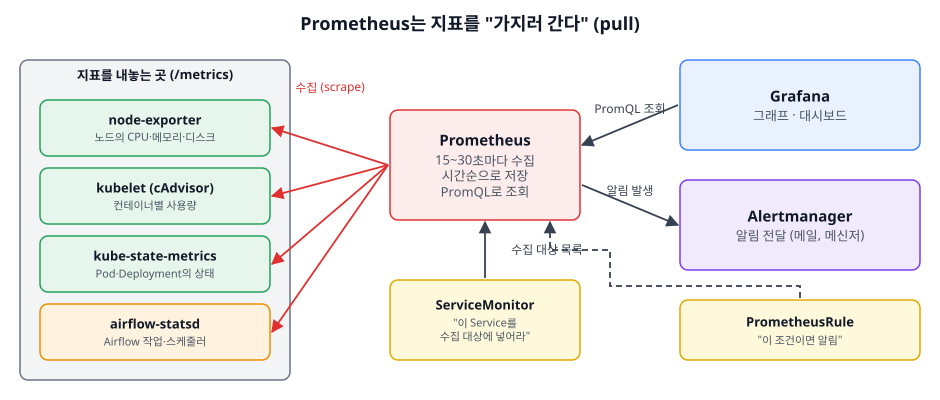
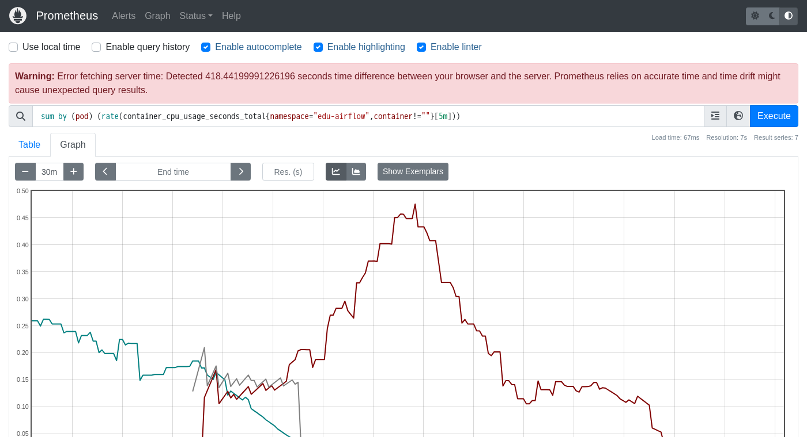
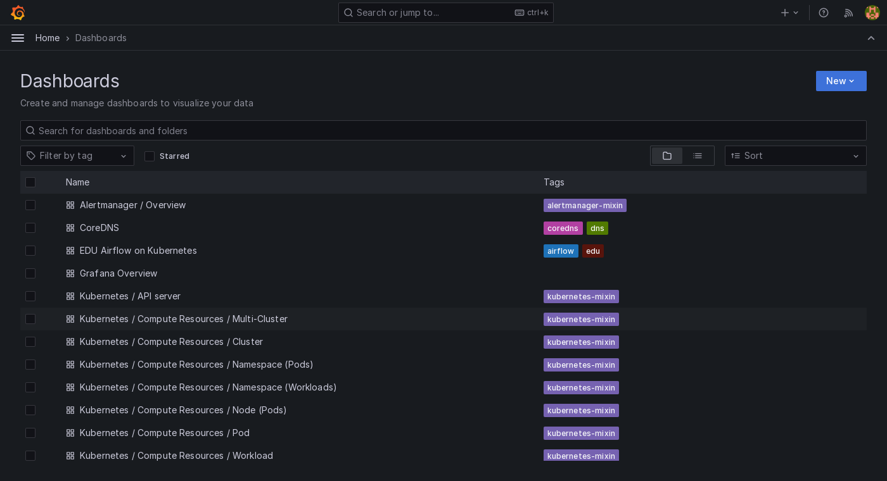
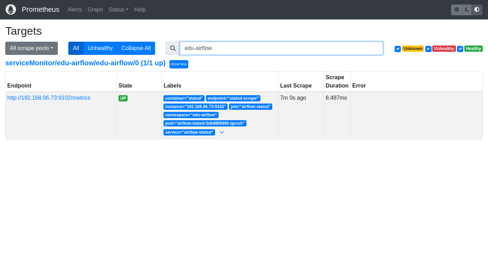
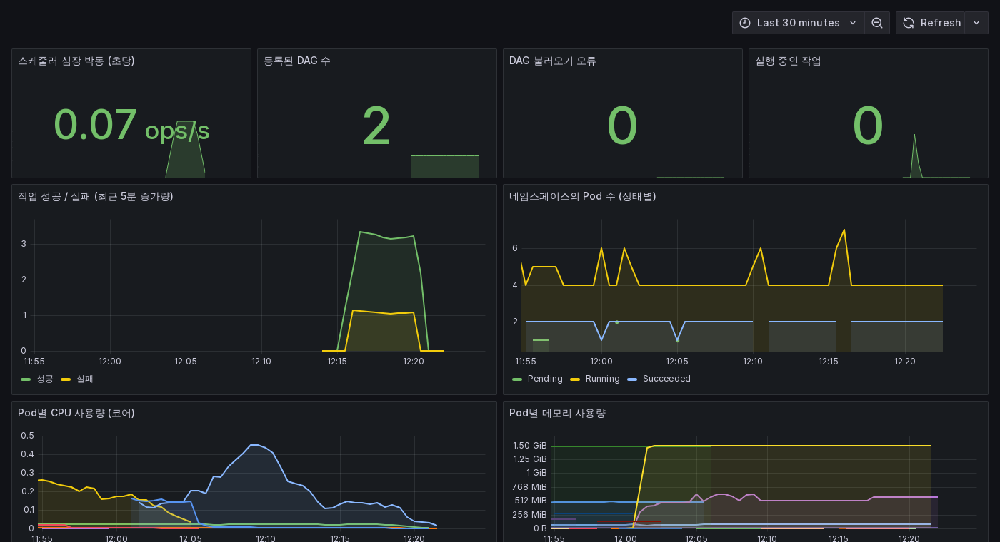
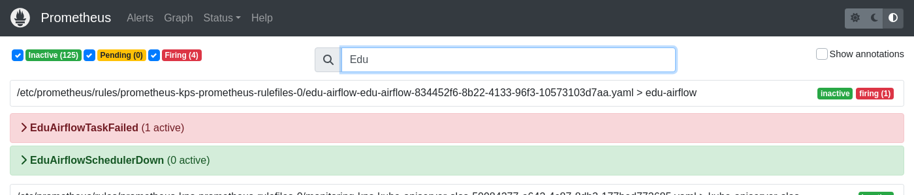

# 06. Prometheus · Grafana — 쿠버네티스와 Airflow 모니터링

**이 장을 마치면**

- Prometheus가 지표를 모으는 방식과 Grafana의 역할을 설명할 수 있습니다.
- PromQL로 노드, Pod, 네임스페이스의 상태를 조회할 수 있습니다.
- Airflow의 지표를 Prometheus에 연결하고, 대시보드와 알림을 만들 수 있습니다.

---

## 1. 왜 필요한가

`kubectl get pod`는 **지금 이 순간**만 보여 줍니다. 이런 질문에는 답하지 못합니다.

- 어젯밤 3시에 CPU가 얼마나 올라갔나?
- 이 Pod의 메모리가 지난 일주일 동안 계속 늘고 있나?
- Airflow 작업이 하루에 몇 개 실패하나?
- 문제가 생기면 사람이 보고 있지 않아도 알려 줄 수 있나?

이런 질문에 답하려면 **숫자를 계속 모아서 저장**해야 합니다. 이 숫자를 **지표(metric)** 라고 합니다.

| 도구 | 역할 |
|---|---|
| **Prometheus** | 지표를 주기적으로 모아 시간순으로 저장하고, 조회 언어(PromQL)를 제공 |
| **Grafana** | Prometheus의 지표를 그래프와 대시보드로 보여 줌 |
| **Alertmanager** | Prometheus가 발생시킨 알림을 메일이나 메신저로 전달 |



**Prometheus는 지표를 "가지러 갑니다"(pull).** 각 프로그램은 `/metrics`라는 주소에 자기 지표를 텍스트로 내놓기만 하고, Prometheus가 15~30초마다 돌아다니며 읽어 갑니다.

| 지표를 내놓는 곳 | 알려 주는 것 |
|---|---|
| node-exporter (DaemonSet — 기초 과정 [09장](../../docs/09-daemonset.md)) | 노드의 CPU, 메모리, 디스크, 네트워크 |
| kubelet (cAdvisor) | 컨테이너별 CPU, 메모리 사용량 |
| kube-state-metrics | 쿠버네티스 리소스의 상태 (Pod 단계, Deployment의 replicas, 재시작 횟수 …) |
| airflow-statsd | Airflow의 작업 성공/실패, 스케줄러 상태 ([03장](03-airflow.md)에서 켜 둔 것) |

## 2. 실습 ① — Prometheus 둘러보기

브라우저에서 `http://prometheus.10.0.1.230.nip.io`에 접속합니다(로그인 없음).

### 2-1. 수집 대상 (Targets)

**Status → Targets**에 Prometheus가 지표를 읽어 오는 곳들이 나옵니다. 각 대상의 `State`가 `UP`이면 정상적으로 읽고 있는 것입니다.

터미널에서는 Prometheus의 HTTP API로 같은 것을 볼 수 있습니다. 쿼리를 편하게 보내도록 함수를 하나 만들어 둡니다.

```bash
PROM=http://prometheus.10.0.1.230.nip.io

# 사용법: pq '<PromQL>'  → "레이블 값" 형태로 출력
pq() {
  curl -s "$PROM/api/v1/query" --data-urlencode "query=$1" |
    jq -r '.data.result[] | "\(.metric | to_entries | map("\(.key)=\(.value)") | join(",")) \(.value[1])"'
}

pq 'count by (job) (up)'
```

```
job=kubelet 15
job=node-exporter 5
job=kps-prometheus 2
job=kps-alertmanager 2
job=apiserver 1
job=coredns 2
job=kube-state-metrics 1
job=kps-grafana 1
job=kps-operator 1
```

`up`은 Prometheus가 자동으로 만드는 지표입니다. 수집에 성공하면 1, 실패하면 0입니다. **"무엇이 죽었나"를 가장 먼저 알려 주는 지표**입니다.

### 2-2. PromQL 맛보기

지표는 **이름 + 레이블 + 값**으로 이루어집니다.

```
kube_pod_info{namespace="edu-airflow", pod="airflow-postgres-0", node="oks5.dd.io"}  1
└── 이름 ──┘ └────────────── 레이블 (조건으로 고를 수 있다) ───────────────┘   값
```

기초 과정에서 `kubectl get pod -l app=web`처럼 레이블로 골랐던 것과 같은 방식입니다.

**네임스페이스별 Pod 수**

```bash
pq 'sum by (namespace) (kube_pod_info{namespace=~"edu.*"})'
```

```
namespace=edu-airflow 6
namespace=edu-platform 0
```

`{namespace=~"edu.*"}`는 "namespace가 `edu`로 시작하는 것"(정규식), `sum by (namespace)`는 "네임스페이스별로 합쳐라"입니다.

**노드별 CPU 사용률(%)**

```bash
pq '100 * (1 - avg by (instance) (rate(node_cpu_seconds_total{mode="idle"}[5m])))'
```

```
instance=10.0.1.185:9100 13.132407407414304
instance=10.0.1.182:9100 19.100000000024142
instance=10.0.1.184:9100 8.488888888947521
instance=10.0.1.181:9100 10.367592592568442
instance=10.0.1.183:9100 7.728703703679551
```

**`rate(...[5m])`** 는 PromQL에서 가장 많이 쓰는 함수입니다. `node_cpu_seconds_total`처럼 **계속 늘어나기만 하는 숫자**(카운터)를 "최근 5분 동안 초당 얼마나 늘었나"로 바꿔 줍니다.
위 식은 "쉬고 있던(idle) 비율"을 구한 뒤 100%에서 뺀 것입니다.

**Pod별 CPU 사용량 (코어 단위)**

```bash
pq 'sum by (pod) (rate(container_cpu_usage_seconds_total{namespace="edu-airflow",container!=""}[5m]))'
```

```
pod=airflow-postgres-0 0.020281407045316467
pod=airflow-statsd-5db88f8465-qpnsh 0.00277260540200103
pod=airflow-webserver-6c554f948b-ch5p6 0.0023631098344010937
pod=airflow-scheduler-b8bf8cbff-pd87k 0.18329750901342323
```

Scheduler가 0.18코어를 쓰고 있습니다. 기초 과정 [17장](../../docs/17-resources.md)에서 "실제 사용량을 보고 requests를 정한다"고 했는데, 그 실제 사용량이 이것입니다.

화면에서는 **Graph** 메뉴에 같은 식을 넣고 **Execute → Graph** 탭을 누르면 시간에 따른 변화를 그래프로 볼 수 있습니다.



### 자주 쓰는 PromQL

| 알고 싶은 것 | PromQL |
|---|---|
| 죽은 수집 대상 | `up == 0` |
| 준비되지 않은 노드 | `kube_node_status_condition{condition="Ready",status="true"} == 0` |
| `Running`이 아닌 Pod | `kube_pod_status_phase{phase=~"Pending\|Failed"} == 1` |
| 최근 1시간 동안 재시작한 컨테이너 | `increase(kube_pod_container_status_restarts_total[1h]) > 0` |
| Pod별 메모리 사용량 | `sum by (pod) (container_memory_working_set_bytes{namespace="edu-airflow",container!=""})` |
| 노드별 남은 메모리 비율(%) | `100 * node_memory_MemAvailable_bytes / node_memory_MemTotal_bytes` |
| 노드의 디스크 사용률(%) | `100 * (1 - node_filesystem_avail_bytes{mountpoint="/"} / node_filesystem_size_bytes{mountpoint="/"})` |
| OOMKilled로 죽은 컨테이너 | `kube_pod_container_status_last_terminated_reason{reason="OOMKilled"} == 1` |

## 3. 실습 ② — Grafana 둘러보기

`http://grafana.10.0.1.230.nip.io`에 접속해 로그인합니다. 왼쪽 메뉴의 **Dashboards**에 미리 만들어진 대시보드가 들어 있습니다.



| 대시보드 | 볼 수 있는 것 |
|---|---|
| Kubernetes / Compute Resources / Cluster | 클러스터 전체의 CPU·메모리 사용량과 예약량 |
| Kubernetes / Compute Resources / Namespace (Pods) | 네임스페이스 하나의 Pod별 사용량. 위쪽 `namespace`에서 `edu-airflow`를 고른다 |
| Kubernetes / Compute Resources / Pod | Pod 하나의 컨테이너별 사용량, requests/limits 대비 |
| Node Exporter / Nodes | 노드의 CPU, 메모리, 디스크, 네트워크 |

**Namespace (Pods)** 대시보드에서 `edu-airflow`를 선택해 보세요. [04장](04-airflow-dag.md)에서 DAG를 실행했던 시각에 작업 Pod들이 나타났다 사라진 흔적이 그래프에 보입니다.

패널 제목 → **Edit**을 누르면 그 그래프를 그리는 PromQL을 볼 수 있습니다. 잘 만들어진 대시보드의 쿼리를 읽는 것이 PromQL을 배우는 가장 빠른 방법입니다.

> 왼쪽 메뉴의 **Explore**는 대시보드를 만들지 않고 PromQL을 바로 실행해 보는 곳입니다. 2절의 식을 여기에 넣어도 됩니다.

## 4. 실습 ③ — Airflow 지표를 Prometheus에 연결하기

### 4-1. 지금은 수집되지 않는다

[03장](03-airflow.md)의 Airflow에는 `airflow-statsd`라는 Pod가 있습니다. Airflow가 보내는 지표를 Prometheus가 읽을 수 있는 형태로 바꿔 `/metrics`에 내놓습니다. 직접 확인해 봅니다.

```bash
kubectl -n edu-airflow run mcurl --rm -i --restart=Never --image=busybox:1.36 -- \
  sh -c 'wget -qO- http://airflow-statsd:9102/metrics | grep -E "^airflow_(dagbag_size|ti_successes|ti_failures) "'
```

```
airflow_dagbag_size 2
airflow_ti_failures 3
airflow_ti_successes 9
```

지표는 나오고 있습니다. 그런데 Prometheus에는 없습니다.

```bash
pq 'airflow_dagbag_size'
```

(아무것도 출력되지 않습니다)

지표를 내놓는 것만으로는 부족합니다. **Prometheus에게 "여기도 읽어 가라"고 알려 줘야** 합니다.

### 4-2. ServiceMonitor 만들기

그 역할을 하는 리소스가 **ServiceMonitor**입니다. ([examples/monitoring/airflow-servicemonitor.yaml](../examples/monitoring/airflow-servicemonitor.yaml))

```yaml
apiVersion: monitoring.coreos.com/v1
kind: ServiceMonitor
metadata:
  name: edu-airflow
  namespace: edu-airflow
spec:
  selector:                    # 어떤 Service를 수집 대상으로 할지 (Service의 레이블)
    matchLabels:
      component: statsd
      release: airflow
  endpoints:
  - port: statsd-scrape        # Service의 포트 "이름" (9102번)
    path: /metrics
    interval: 15s              # 15초마다 수집
```

Service가 레이블로 Pod를 찾았듯이(기초 과정 [03장](../../docs/03-service.md)), ServiceMonitor는 **레이블로 Service를 찾습니다.** 대상 Service의 레이블과 포트 이름을 확인합니다.

```bash
kubectl -n edu-airflow get service airflow-statsd --show-labels
kubectl -n edu-airflow get service airflow-statsd -o jsonpath='{range .spec.ports[*]}{.name}  {.port}{"\n"}{end}'
```

```
NAME             TYPE        CLUSTER-IP      EXTERNAL-IP   PORT(S)             AGE   LABELS
airflow-statsd   ClusterIP   10.98.215.120   <none>        9125/UDP,9102/TCP   24m   chart=airflow-1.16.0,component=statsd,heritage=Helm,release=airflow,tier=airflow

statsd-ingest  9125
statsd-scrape  9102
```

```bash
kubectl apply -f platform/examples/monitoring/airflow-servicemonitor.yaml
```

Prometheus가 새 수집 대상을 반영하는 데 **2~3분** 걸립니다. 대상이 나타날 때까지 기다립니다.

```bash
until [ "$(curl -s "$PROM/api/v1/targets?state=active" | jq '[.data.activeTargets[] | select(.labels.namespace=="edu-airflow")] | length')" = "1" ]; do
  echo "아직 반영되지 않음..."; sleep 15
done

curl -s "$PROM/api/v1/targets?state=active" |
  jq -r '.data.activeTargets[] | select(.labels.namespace=="edu-airflow") | "\(.scrapePool)  \(.scrapeUrl)  \(.health)"'
```

```
serviceMonitor/edu-airflow/edu-airflow/0  http://192.168.96.73:9102/metrics  up
```

화면의 **Status → Targets**에서도 `serviceMonitor/edu-airflow/edu-airflow/0`이 보입니다.



> `health`가 잠깐 `unknown`으로 나올 수 있습니다. 아직 첫 수집을 하기 전입니다. 15초 뒤 다시 보면 `up`이 됩니다.

### 4-3. Airflow 지표 조회

```bash
pq 'airflow_dagbag_size' | cut -c1-200
```

```
__name__=airflow_dagbag_size,container=statsd,endpoint=statsd-scrape,instance=192.168.96.73:9102,job=airflow-statsd,namespace=edu-airflow,pod=airflow-statsd-5db88f8465-qpnsh,service=airflow-statsd 2
```

이제 Prometheus에 Airflow 지표가 들어옵니다. `namespace`, `pod` 같은 레이블은 Prometheus가 수집하면서 붙여 준 것입니다.

| 지표 | 의미 |
|---|---|
| `airflow_scheduler_heartbeat` | 스케줄러가 살아 있다는 신호. 계속 늘어나야 한다 |
| `airflow_dagbag_size` | 등록된 DAG 수 |
| `airflow_dag_processing_import_errors` | 불러오지 못한 DAG 파일 수 ([04장](04-airflow-dag.md)의 문법 오류) |
| `airflow_ti_successes` / `airflow_ti_failures` | 성공 / 실패한 작업 수 (누적) |
| `airflow_executor_running_tasks` | 지금 실행 중인 작업 수 |
| `airflow_dagrun_duration_success_sum` | DAG 실행에 걸린 시간 |

[04장](04-airflow-dag.md)의 DAG를 다시 실행해서 숫자가 변하는 것을 봅니다. 하나는 성공, 하나는 일부러 실패시킵니다.

```bash
AF="kubectl -n edu-airflow exec deploy/airflow-scheduler -c scheduler --"
$AF airflow dags trigger hello_k8s
$AF airflow dags trigger harbor_report --conf '{"amounts":"1,x"}'
sleep 120

pq 'sum(increase(airflow_ti_successes[5m]))'
pq 'sum(increase(airflow_ti_failures[5m]))'
```

```
 3.2
 1.06
```

`increase(...[5m])`는 "최근 5분 동안 늘어난 양"입니다. 성공 약 3건, 실패 약 1건입니다(수집 간격 사이를 추정해서 계산하므로 소수점이 붙습니다).

## 5. 실습 ④ — Airflow 대시보드 만들기

Grafana 대시보드는 화면에서 직접 만들 수도 있지만, **파일로 관리**하는 것이 좋습니다. 이 Grafana는 `grafana_dashboard: "1"` 레이블이 붙은 **ConfigMap**을 자동으로 읽어 대시보드로 등록합니다.
([examples/monitoring/airflow-dashboard.yaml](../examples/monitoring/airflow-dashboard.yaml))

```yaml
apiVersion: v1
kind: ConfigMap
metadata:
  name: edu-airflow-dashboard
  namespace: edu-airflow
  labels:
    grafana_dashboard: "1"          # 이 레이블이 붙은 ConfigMap을 Grafana가 자동으로 읽어 들인다
data:
  edu-airflow.json: |
    { "title": "EDU Airflow on Kubernetes", "panels": [ ... ] }
```

```bash
kubectl apply -f platform/examples/monitoring/airflow-dashboard.yaml
```

1분쯤 뒤 Grafana의 **Dashboards**에서 `EDU Airflow on Kubernetes`를 엽니다.



| 패널 | PromQL | 읽는 법 |
|---|---|---|
| 스케줄러 심장 박동 | `rate(airflow_scheduler_heartbeat[2m])` | 0이면 스케줄러가 멈춘 것 |
| 등록된 DAG 수 | `airflow_dagbag_size` | 갑자기 줄면 DAG 파일에 문제가 생긴 것 |
| DAG 불러오기 오류 | `airflow_dag_processing_import_errors` | 0이 아니면 문법 오류가 있는 DAG가 있다 |
| 작업 성공 / 실패 | `increase(airflow_ti_successes[5m])` 등 | 실패 선이 올라오면 확인 필요 |
| Pod 수 (상태별) | `kube_pod_status_phase{namespace="edu-airflow"}` | 작업 Pod가 생겼다 사라지는 모습 |
| Pod별 CPU / 메모리 | `container_cpu_usage_seconds_total` 등 | 어떤 Pod가 자원을 많이 쓰는지 |

위 네 개는 **Airflow가 알려 주는 지표**, 아래는 **쿠버네티스가 알려 주는 지표**입니다. 둘을 한 화면에 놓으면 "작업이 실패한 시각에 Pod에 무슨 일이 있었나"를 함께 볼 수 있습니다.

> 화면에서 고친 내용은 ConfigMap에 반영되지 않습니다. 파일의 JSON을 고쳐 다시 `apply`해야 남습니다. 화면에서 만든 뒤 **Share → Export**로 JSON을 받아 ConfigMap에 넣는 방법을 많이 씁니다.

## 6. 실습 ⑤ — 알림 규칙 만들기

대시보드는 사람이 보고 있어야 의미가 있습니다. **알림 규칙**은 조건을 Prometheus가 계속 검사하다가 맞으면 알려 줍니다.
([examples/monitoring/airflow-alert.yaml](../examples/monitoring/airflow-alert.yaml))

```yaml
apiVersion: monitoring.coreos.com/v1
kind: PrometheusRule
metadata:
  name: edu-airflow
  namespace: edu-airflow
spec:
  groups:
  - name: edu-airflow
    rules:
    - alert: EduAirflowTaskFailed
      expr: increase(airflow_ti_failures[5m]) > 0          # 최근 5분 동안 실패한 작업이 있으면
      labels:
        severity: warning
      annotations:
        summary: "Airflow 작업이 실패했습니다"
        description: "최근 5분 동안 실패한 작업 수: {{ $value }}"
    - alert: EduAirflowSchedulerDown
      expr: absent(airflow_scheduler_heartbeat) or rate(airflow_scheduler_heartbeat[2m]) == 0
      for: 2m                                               # 2분 동안 계속되면
      labels:
        severity: critical
```

`expr`는 2절에서 연습한 PromQL입니다. **결과가 하나라도 나오면 알림**이 됩니다. `for: 2m`은 "그 상태가 2분 동안 이어져야 알림"이라는 뜻으로, 순간적인 흔들림에 반응하지 않게 합니다.

```bash
kubectl apply -f platform/examples/monitoring/airflow-alert.yaml

$AF airflow dags trigger harbor_report --conf '{"amounts":"1,x"}'     # 실패하는 작업을 하나 더 만든다
sleep 150

curl -s "$PROM/api/v1/rules" |
  jq -r '.data.groups[] | select(.name=="edu-airflow") | .rules[] | "\(.name)  \(.state)"'
```

```
EduAirflowTaskFailed  firing
EduAirflowSchedulerDown  inactive
```

| 상태 | 의미 |
|---|---|
| `inactive` | 조건에 해당하지 않음 (정상) |
| `pending` | 조건에 해당하지만 `for`에 적은 시간이 아직 지나지 않음 |
| `firing` | 알림 발생 중 |

화면에서는 **Alerts** 메뉴에서 봅니다.



`firing`이 된 알림은 Alertmanager로 넘어가고, Alertmanager가 설정에 따라 메일이나 메신저로 보냅니다(`http://alertmanager.10.0.1.230.nip.io`에서 도착한 알림을 볼 수 있습니다).
5분이 지나 실패가 더 없으면 알림은 스스로 `inactive`로 돌아갑니다.

## 7. 고장 내고 고쳐 보기 — 지표가 들어오지 않는다

누군가 ServiceMonitor를 수정했습니다.

```bash
kubectl apply -f platform/examples/monitoring/airflow-servicemonitor-broken.yaml
```

3분쯤 뒤 확인합니다.

```bash
sleep 180
curl -s "$PROM/api/v1/targets?state=active" |
  jq -r '.data.activeTargets[] | select(.labels.namespace=="edu-airflow") | "\(.scrapePool)  \(.health)"'
pq 'airflow_dagbag_size' | cut -c1-80
```

(둘 다 아무것도 출력되지 않습니다)

수집 대상이 **사라졌습니다.** 오류 표시도 없습니다. 대시보드는 "No data"가 됩니다. 원인을 찾아보세요.

```bash
kubectl -n edu-airflow get servicemonitor edu-airflow -o yaml | grep -A8 'spec:'
kubectl -n edu-airflow get service airflow-statsd -o jsonpath='{range .spec.ports[*]}{.name}  {.port}{"\n"}{end}'
```

<details><summary>원인과 해결 방법</summary>

```
spec:
  endpoints:
  - interval: 15s
    path: /metrics
    port: metrics
  selector:
    matchLabels:
      component: statsd
      release: airflow

statsd-ingest  9125
statsd-scrape  9102
```

ServiceMonitor는 `metrics`라는 이름의 포트를 찾는데, Service에는 `statsd-ingest`와 `statsd-scrape`만 있습니다.
**맞는 포트가 없으면 오류를 내지 않고 조용히 대상에서 빠집니다.** 기초 과정에서 여러 번 본 "레이블/이름이 안 맞으면 조용히 아무 일도 안 일어나는" 함정입니다.

`port`에는 포트 **번호가 아니라 이름**을 적습니다. 올바른 ServiceMonitor를 다시 적용합니다.

```bash
kubectl apply -f platform/examples/monitoring/airflow-servicemonitor.yaml

until [ "$(curl -s "$PROM/api/v1/targets?state=active" | jq '[.data.activeTargets[] | select(.labels.namespace=="edu-airflow")] | length')" = "1" ]; do
  echo "아직 반영되지 않음..."; sleep 15
done
pq 'airflow_dagbag_size' | cut -c1-80
```

</details>

### 지표가 안 보일 때 확인 순서

| 순서 | 확인할 것 | 방법 |
|---|---|---|
| 1 | 프로그램이 지표를 내놓고 있나 | Pod 안에서 `/metrics`를 직접 호출 (4-1) |
| 2 | Prometheus의 수집 대상에 있나 | **Status → Targets** |
| 3 | 없다면: ServiceMonitor의 `selector`가 Service의 레이블과 같은가 | `kubectl get svc --show-labels` |
| 4 | ServiceMonitor의 `port`가 Service의 포트 **이름**과 같은가 | `kubectl get svc -o yaml` |
| 5 | 있는데 `DOWN`이라면: 오류 메시지 확인 | Targets 화면의 `Error` 열 (연결 거부, 시간 초과 → NetworkPolicy 등) |
| 6 | 반영될 때까지 기다렸나 | 설정 변경은 2~3분 뒤에 반영된다 |

## 8. 정리

```bash
kubectl delete -f platform/examples/monitoring/airflow-alert.yaml
kubectl delete -f platform/examples/monitoring/airflow-dashboard.yaml
kubectl delete -f platform/examples/monitoring/airflow-servicemonitor.yaml
```

> ServiceMonitor, PrometheusRule, 대시보드 ConfigMap도 모두 YAML입니다. [02장](02-argocd.md)에서 배운 대로 Git에 넣고 Argo CD로 배포하면 "어떤 알림 규칙이 언제 왜 바뀌었는지"까지 이력으로 남습니다. `platform/gitops/airflow/manifests/`에 이 파일들을 넣는 것으로 직접 해 볼 수 있습니다.

## 핵심 요약

- Prometheus는 각 프로그램의 `/metrics`를 주기적으로 읽어 가서 저장한다(pull 방식).
- 지표는 이름 + 레이블 + 값이다. PromQL에서 레이블로 고르고, `rate()`로 변화율을, `sum by ()`로 묶음별 합계를 구한다.
- `up == 0`은 "죽은 것"을 찾는 가장 기본적인 쿼리다.
- 새 수집 대상은 ServiceMonitor로 등록한다. Service의 **레이블**과 **포트 이름**이 맞아야 한다.
- Grafana 대시보드와 알림 규칙도 쿠버네티스 리소스(ConfigMap, PrometheusRule)로 관리할 수 있다.
- Airflow 지표와 쿠버네티스 지표를 함께 봐야 원인을 찾을 수 있다.

## 확인 문제

1. Prometheus는 지표를 어떻게 모으나요?
2. `rate(node_cpu_seconds_total[5m])`에서 `rate`는 왜 필요한가요?
3. 프로그램이 `/metrics`로 지표를 내놓고 있는데 Prometheus에서 조회되지 않습니다. 무엇이 빠졌을까요?
4. ServiceMonitor를 만들었는데 Targets에 나타나지 않습니다. 확인할 것 두 가지는 무엇인가요?
5. 알림 규칙의 `for: 2m`은 무슨 뜻이고 왜 넣나요?

<details><summary>정답 보기</summary>

1. 각 수집 대상의 `/metrics` 주소를 주기적으로 호출해서 읽어 옵니다(pull). 프로그램이 Prometheus로 보내는 것이 아닙니다.
2. `node_cpu_seconds_total`은 시작부터 누적된 값이라 그 자체로는 의미가 없습니다. `rate`가 "최근 5분 동안 초당 얼마나 늘었는가"로 바꿔 줍니다.
3. Prometheus에게 그곳을 수집하라고 알려 주는 설정(ServiceMonitor)이 없습니다.
4. ServiceMonitor의 `selector`가 Service의 레이블과 일치하는지, `endpoints.port`가 Service의 포트 이름과 일치하는지 확인합니다. 그리고 반영까지 2~3분을 기다립니다.
5. 조건이 2분 동안 계속되어야 알림을 발생시킨다는 뜻입니다. 순간적인 변동 때문에 불필요한 알림이 오는 것을 막습니다.
</details>

---

다음 장: [07. MinIO — S3 호환 저장소 사용하기](07-minio.md)
