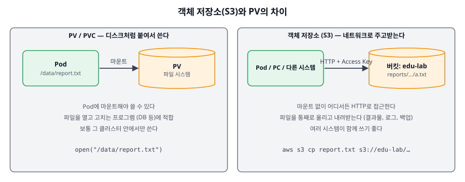
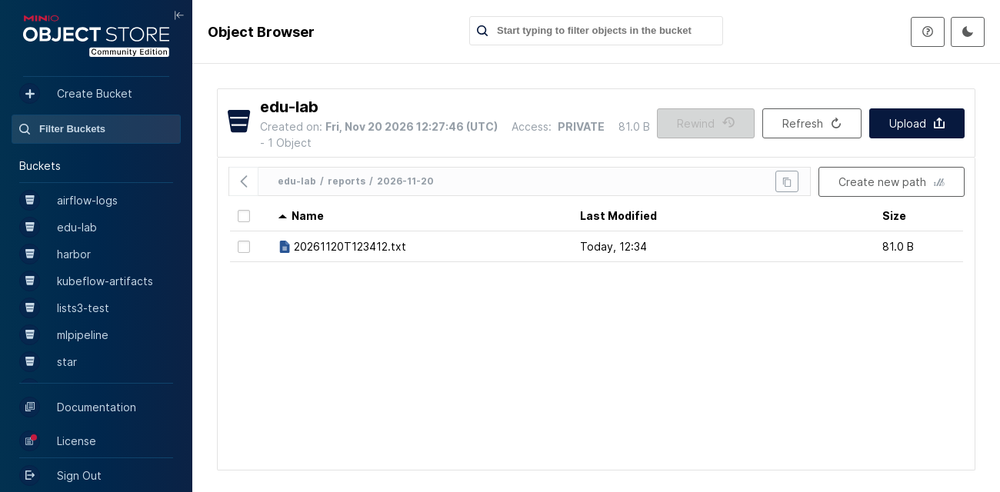

# 07. MinIO — S3 호환 저장소 사용하기

**이 장을 마치면**

- 객체 저장소가 무엇이고 PV와 어떻게 다른지 설명할 수 있습니다.
- 버킷과 전용 계정을 만들고, 필요한 권한만 줄 수 있습니다.
- Pod와 Airflow 작업에서 S3로 파일을 올리고 내려받을 수 있습니다.

---

## 1. 왜 필요한가

[04장](04-airflow-dag.md)에서 작업 Pod는 끝나면 사라졌습니다. 작업이 만든 결과 파일도 함께 사라집니다.
기초 과정 [06장](../../docs/06-pv-pvc.md)의 PV에 저장할 수도 있지만, PV는 **Pod에 붙여야만** 쓸 수 있습니다. 다른 시스템이나 내 PC에서 그 파일을 꺼내 보기 어렵습니다.

**객체 저장소(Object Storage)** 는 파일을 네트워크(HTTP)로 올리고 내려받는 저장소입니다. Amazon S3가 대표적이고, 그 사용 방법(S3 API)이 사실상의 표준이 됐습니다.
**MinIO**는 S3 API와 호환되는 저장소를 직접 운영할 수 있게 해 주는 소프트웨어입니다. S3용으로 만든 도구와 라이브러리를 그대로 쓸 수 있습니다.



| | PV / PVC | 객체 저장소 (S3) |
|---|---|---|
| 접근 방법 | Pod에 마운트해서 파일 경로로 | HTTP 요청으로 (Access Key 필요) |
| 어디에서 | 그 클러스터의 Pod | 네트워크가 닿는 어디서든 |
| 어울리는 데이터 | DB 파일처럼 계속 고쳐 쓰는 것 | 결과 파일, 로그, 백업, 이미지처럼 통째로 저장하는 것 |
| 이 플랫폼에서 쓰는 곳 | Airflow 로그, PostgreSQL | Harbor의 이미지, Kubeflow의 결과물 |

| 용어 | 뜻 |
|---|---|
| **버킷(Bucket)** | 객체를 담는 최상위 통. 이름이 저장소 전체에서 하나뿐이어야 한다 |
| **객체(Object)** | 저장된 파일 하나 |
| **키(Key)** | 버킷 안에서 객체의 이름. `reports/2026-11-20/a.txt`처럼 `/`를 넣어 폴더처럼 쓴다 |
| **Access Key / Secret Key** | 접속용 아이디와 비밀번호 |
| **정책(Policy)** | 계정이 어떤 버킷에 무엇을 할 수 있는지 |

## 2. 주소가 두 개다

| | 주소 | 용도 |
|---|---|---|
| **콘솔** | `http://10.0.1.185:9025` | 사람이 브라우저로 보는 화면 |
| **S3 API** | `http://10.0.1.185:9555` | 프로그램이 요청을 보내는 곳 (`aws` 명령, 라이브러리, Airflow) |

**프로그램에는 반드시 S3 API 주소를 넣어야 합니다.** 콘솔 주소를 넣는 것이 가장 흔한 실수입니다(6절에서 직접 해 봅니다).

브라우저로 콘솔에 접속하면 버킷 목록이 보입니다. `harbor` 버킷에는 [01장](01-harbor.md)에서 올린 이미지가 들어 있습니다. Harbor가 이미지를 MinIO에 저장하기 때문입니다.

## 3. 실습 ① — 버킷과 전용 계정 만들기 (관리 작업)

관리자 계정(`minioadmin`)으로 모든 것을 할 수 있지만, 그 계정을 프로그램에 넣어 주면 안 됩니다. [01장](01-harbor.md)의 로봇 계정과 같은 이유입니다.
**실습용 버킷 하나에만 접근할 수 있는 전용 계정**을 만듭니다.

MinIO의 관리 작업은 `mc`(MinIO Client) 명령으로 합니다. 이 환경에서는 **MinIO 서버(`10.0.1.185`)에 접속해서** 실행합니다. 서버에는 `local`이라는 이름으로 접속 설정이 되어 있습니다.

> 이 절의 명령은 MinIO 서버에서 실행합니다. 나머지 절은 다시 작업 서버에서 실행합니다.

```text
# MinIO 서버에서

mc ls local                       # 버킷 목록
mc mb local/edu-lab               # 버킷 만들기
```

```
Bucket created successfully `local/edu-lab`.
```

정책 파일을 만듭니다. "`edu-lab` 버킷의 목록을 보고, 그 안의 객체를 읽고 쓰고 지울 수 있다"는 내용입니다. ([examples/minio/edu-lab-policy.json](../examples/minio/edu-lab-policy.json))

```text
cat > /tmp/edu-lab-policy.json <<'EOF'
{
  "Version": "2012-10-17",
  "Statement": [
    {
      "Effect": "Allow",
      "Action": ["s3:ListBucket", "s3:GetBucketLocation"],
      "Resource": ["arn:aws:s3:::edu-lab"]
    },
    {
      "Effect": "Allow",
      "Action": ["s3:GetObject", "s3:PutObject", "s3:DeleteObject"],
      "Resource": ["arn:aws:s3:::edu-lab/*"]
    }
  ]
}
EOF
```

| 부분 | 의미 |
|---|---|
| `Action` | 허용할 동작. 버킷에 대한 것(`ListBucket`)과 객체에 대한 것(`GetObject` 등)이 따로 있다 |
| `Resource` | 대상. `arn:aws:s3:::edu-lab`은 버킷 자체, `arn:aws:s3:::edu-lab/*`는 그 안의 모든 객체 |

기초 과정 [11장 RBAC](../../docs/11-rbac.md)의 Role과 구조가 같습니다. **허용할 것만 적고, 적지 않은 것은 모두 거부**됩니다.

정책을 등록하고, 계정을 만들어 정책을 붙입니다. 비밀번호는 무작위로 만듭니다.

```text
mc admin policy create local edu-lab-rw /tmp/edu-lab-policy.json

S3_PW=$(openssl rand -hex 16)
mc admin user add local edu-user "$S3_PW"
mc admin policy attach local edu-lab-rw --user edu-user
mc admin user info local edu-user

echo "$S3_PW"        # 이 값을 복사해 둔다 (작업 서버에서 Secret을 만들 때 쓴다)
```

```
Created policy `edu-lab-rw` successfully.
Attached Policies: [edu-lab-rw]
To User: edu-user

AccessKey: edu-user
Status: enabled
PolicyName: edu-lab-rw
MemberOf: []
```

| RBAC (기초 11장) | MinIO |
|---|---|
| ServiceAccount | 사용자 (`edu-user`) |
| Role | 정책 (`edu-lab-rw`) |
| RoleBinding | `mc admin policy attach` |

## 4. 실습 ② — Pod에서 S3 사용하기

다시 **작업 서버**입니다.

### 4-1. 접속 정보를 Secret으로

`<복사한 비밀번호>` 자리에 3절에서 복사한 값을 넣습니다. 이 Secret은 5절에서 Airflow도 써야 하므로 네임스페이스 두 곳에 만듭니다.

```text
for ns in edu-platform edu-airflow; do
  kubectl -n $ns create secret generic s3-cred \
    --from-literal=AWS_ACCESS_KEY_ID=edu-user \
    --from-literal=AWS_SECRET_ACCESS_KEY='<복사한 비밀번호>'
done
```

key 이름을 `AWS_ACCESS_KEY_ID`, `AWS_SECRET_ACCESS_KEY`로 한 것은 S3 도구들이 이 이름의 환경변수를 자동으로 읽기 때문입니다.

### 4-2. S3 클라이언트 Pod

AWS 명령줄 도구(`aws`)가 든 Pod를 띄웁니다. ([examples/minio/s3-client.yaml](../examples/minio/s3-client.yaml))

```yaml
    envFrom:
    - secretRef:
        name: s3-cred                 # AWS_ACCESS_KEY_ID, AWS_SECRET_ACCESS_KEY
    env:
    - name: AWS_ENDPOINT_URL          # S3 요청을 보낼 주소 (AWS가 아니라 MinIO)
      value: http://10.0.1.185:9555
    - name: AWS_DEFAULT_REGION
      value: us-east-1
```

`AWS_ENDPOINT_URL`이 없으면 `aws` 명령은 진짜 Amazon으로 요청을 보냅니다. **MinIO를 쓸 때는 항상 주소를 지정**해야 합니다.

```bash
kubectl apply -f platform/examples/minio/s3-client.yaml
kubectl wait --for=condition=Ready pod/s3-client --timeout=180s

S3="kubectl exec s3-client --"
$S3 aws s3 ls
```

```
2026-11-20 12:27:46 edu-lab
```

MinIO에는 버킷이 여러 개 있지만 **`edu-lab`만 보입니다.** 이 계정에게 허용된 버킷만 나옵니다.

### 4-3. 올리고, 보고, 내려받기

```bash
# 파일을 만들어 올린다
$S3 sh -c 'echo "hello minio $(date +%F)" > /tmp/hello.txt && aws s3 cp /tmp/hello.txt s3://edu-lab/demo/hello.txt'

# 목록
$S3 aws s3 ls s3://edu-lab/ --recursive

# 내용을 화면으로 내려받기 (- 는 표준 출력)
$S3 aws s3 cp s3://edu-lab/demo/hello.txt -
```

```
upload: ../tmp/hello.txt to s3://edu-lab/demo/hello.txt

2026-11-20 12:28:07         23 demo/hello.txt

hello minio 2026-11-20
```

`demo/`라는 폴더를 만든 적이 없습니다. 객체의 키가 `demo/hello.txt`일 뿐이고, 도구들이 `/`를 폴더처럼 보여 주는 것입니다.

| 명령 | 하는 일 |
|---|---|
| `aws s3 ls s3://버킷/경로/` | 목록 |
| `aws s3 cp 파일 s3://버킷/키` | 올리기 |
| `aws s3 cp s3://버킷/키 파일` | 내려받기 |
| `aws s3 sync 디렉터리 s3://버킷/경로/` | 디렉터리 통째로 맞추기 |
| `aws s3 rm s3://버킷/키` | 지우기 |

### 4-4. 허용되지 않은 것

다른 버킷을 보거나 새 버킷을 만들어 봅니다.

```bash
$S3 aws s3 ls s3://harbor/
$S3 aws s3 mb s3://edu-other
```

```
An error occurred (AccessDenied) when calling the ListObjectsV2 operation: Access Denied.
command terminated with exit code 254

make_bucket failed: s3://edu-other An error occurred (AccessDenied) when calling the CreateBucket operation: Access Denied.
command terminated with exit code 1
```

**`AccessDenied`** — 3절의 정책에 적지 않은 동작은 거부됩니다. 이 계정이 유출되더라도 Harbor의 이미지나 다른 팀의 데이터는 안전합니다.

## 5. 실습 ③ — Airflow 작업의 결과를 S3에 저장하기

작업 결과를 MinIO에 저장하는 DAG입니다. ([dags/s3_report.py](../dags/s3_report.py))

```python
    KubernetesPodOperator(
        task_id="write_report",
        name="s3-report",
        namespace="edu-airflow",
        image="amazon/aws-cli:2.17.0",
        cmds=["sh", "-c"],
        arguments=[
            'echo "run={{ run_id }} generated_at=$(date -u +%FT%TZ) total=42" > /tmp/report.txt && '
            "aws s3 cp /tmp/report.txt s3://edu-lab/reports/{{ ds }}/{{ ts_nodash }}.txt && "
            "aws s3 ls s3://edu-lab/reports/ --recursive"
        ],
        env_from=[k8s.V1EnvFromSource(secret_ref=k8s.V1SecretEnvSource(name="s3-cred"))],
        env_vars={"AWS_ENDPOINT_URL": "http://10.0.1.185:9555", "AWS_DEFAULT_REGION": "us-east-1"},
        ...
    )
```

- `env_from`으로 `s3-cred` Secret을 환경변수로 넣습니다. **DAG 코드에는 비밀번호가 없습니다.** DAG 파일은 Git에 올라가므로 여기에 비밀 값을 적으면 안 됩니다.
- `{{ ds }}`(실행 날짜)와 `{{ ts_nodash }}`(실행 시각)는 Airflow가 실행할 때 채워 주는 값입니다. 실행할 때마다 다른 키로 저장됩니다.

```bash
AF="kubectl -n edu-airflow exec deploy/airflow-scheduler -c scheduler --"
$AF airflow dags unpause s3_report
$AF airflow dags trigger s3_report
sleep 90
$AF airflow dags list-runs -d s3_report
```

```
s3_report | manual__2026-11-20T12:34:12+00:00 | success | ...
```

> `unpause`에서 `No paused DAGs were found`가 나오면 DAG가 아직 등록되는 중입니다. 30초쯤 뒤에 다시 실행하세요.

작업 Pod는 사라졌지만 결과는 MinIO에 남아 있습니다.

```bash
$S3 aws s3 ls s3://edu-lab/reports/ --recursive
```

```
2026-11-20 12:34:59         81 reports/2026-11-20/20261120T123412.txt
```

```text
$S3 aws s3 cp s3://edu-lab/reports/2026-11-20/20261120T123412.txt -
```

```
run=manual__2026-11-20T12:34:12+00:00 generated_at=2026-11-20T12:34:43Z total=42
```

콘솔에서도 같은 파일을 볼 수 있습니다.



## 6. 고장 내고 고쳐 보기 — 주소를 잘못 넣었다

S3 주소 대신 콘솔 주소(`9025`)를 넣어 봅니다. `--endpoint-url` 옵션은 이번 한 번만 주소를 바꿉니다.

```bash
$S3 aws --endpoint-url http://10.0.1.185:9025 s3 ls s3://edu-lab/
```

<details><summary>결과와 해석</summary>

```
An error occurred (InvalidArgument) when calling the ListObjectsV2 operation: S3 API Requests must be made to API port.
```

`S3 API Requests must be made to API port` — S3 요청은 API 포트로 보내야 한다는 뜻입니다. 9025는 사람이 보는 콘솔이고, 프로그램은 9555로 요청해야 합니다.

MinIO는 이렇게 친절하게 알려 주지만, 도구에 따라서는 알아보기 어려운 XML/HTML 파싱 오류로 나타나기도 합니다. **S3 연동이 안 될 때는 주소(엔드포인트)부터 확인**하세요.

</details>

### S3 오류 읽는 법

| 오류 | 뜻 | 확인할 것 |
|---|---|---|
| `Could not connect to the endpoint URL` | 그 주소에 연결할 수 없음 | 주소·포트, 네트워크 |
| `S3 API Requests must be made to API port` | 콘솔 주소로 요청함 | S3 API 주소로 바꾼다 |
| `InvalidAccessKeyId` | 그런 계정이 없음 | Access Key 오타, Secret의 key 이름 |
| `SignatureDoesNotMatch` | 비밀번호가 틀림 | Secret Key. 값 끝에 줄바꿈이나 공백이 들어가지 않았는지 |
| `AccessDenied` | 계정은 맞지만 권한이 없음 | 정책의 `Action`과 `Resource` |
| `NoSuchBucket` | 버킷이 없음 | 버킷 이름 오타 |
| `Unable to locate credentials` | 접속 정보가 전달되지 않음 | Pod의 환경변수 (`kubectl exec … -- env`), Secret 이름과 네임스페이스 |

## 7. 정리

```bash
$S3 aws s3 rm s3://edu-lab/ --recursive
kubectl delete -f platform/examples/minio/s3-client.yaml
kubectl delete secret s3-cred
kubectl -n edu-airflow delete secret s3-cred
```

버킷과 계정은 **MinIO 서버에서** 지웁니다.

```text
# MinIO 서버에서
mc admin user remove local edu-user
mc admin policy remove local edu-lab-rw
mc rb local/edu-lab
```

## 8. 알아 두면 좋은 것

- **Python에서는 `boto3`** 라이브러리를 씁니다. `aws` 명령과 같은 환경변수를 읽으므로 코드에 접속 정보를 적을 필요가 없습니다.

  ```python
  import boto3
  s3 = boto3.client("s3")                       # 주소·계정은 환경변수에서 읽는다
  s3.upload_file("/tmp/report.txt", "edu-lab", "reports/report.txt")
  ```

- **Airflow 로그도 S3에 보관할 수 있습니다.** [03장](03-airflow.md)에서는 로그를 PVC에 저장했지만, `values.yaml`에 원격 로그 설정을 넣으면 MinIO에 저장됩니다. 로그가 많아질 때 쓰는 방식입니다.
- **임시 링크(presigned URL)**: 계정이 없는 사람에게 파일 하나를 잠깐 공유할 때 씁니다. 정해진 시간이 지나면 만료됩니다.

  ```text
  aws s3 presign s3://edu-lab/reports/report.txt --expires-in 300
  ```

## 핵심 요약

- 객체 저장소는 HTTP로 파일을 올리고 내려받는 저장소다. 마운트 없이 어디서든 접근한다.
- 버킷 안에 객체가 있고, 객체는 키로 구분한다. `/`는 폴더처럼 보일 뿐이다.
- MinIO는 주소가 둘이다. 사람은 콘솔, 프로그램은 S3 API.
- 프로그램에는 관리자 계정이 아니라 필요한 버킷에만 접근하는 전용 계정을 준다.
- 접속 정보는 Secret으로 만들어 환경변수로 넣는다. 코드나 DAG에 적지 않는다.
- 작업 결과처럼 Pod가 사라진 뒤에도 남아야 하는 파일은 S3에 저장한다.

## 확인 문제

1. PV와 객체 저장소는 각각 어떤 데이터에 어울리나요?
2. `aws s3 ls`를 실행했더니 진짜 Amazon에 접속하려다 실패했습니다. 무엇이 빠졌나요?
3. `edu-user`로 `aws s3 ls s3://harbor/`를 실행하면 `AccessDenied`가 나는 이유는 무엇인가요?
4. DAG 코드에 Access Key를 직접 적으면 안 되는 이유는 무엇인가요?
5. S3 연동이 실패할 때 `SignatureDoesNotMatch`와 `AccessDenied`는 각각 무엇을 뜻하나요?

<details><summary>정답 보기</summary>

1. PV는 DB 파일처럼 계속 열어 두고 고쳐 쓰는 데이터에, 객체 저장소는 결과 파일·로그·백업처럼 통째로 저장하고 여러 곳에서 꺼내 쓰는 데이터에 어울립니다.
2. 엔드포인트 주소입니다. `AWS_ENDPOINT_URL` 환경변수나 `--endpoint-url` 옵션으로 MinIO의 S3 API 주소를 지정해야 합니다.
3. `edu-user`에 붙은 정책이 `edu-lab` 버킷에 대한 동작만 허용하기 때문입니다. 적지 않은 것은 모두 거부됩니다.
4. DAG 파일은 Git에 올라가므로 저장소를 볼 수 있는 모든 사람에게 노출되고 이력에 영원히 남습니다. Secret으로 만들어 환경변수로 전달해야 합니다.
5. `SignatureDoesNotMatch`는 Secret Key(비밀번호)가 틀린 것이고, `AccessDenied`는 계정은 맞지만 그 동작을 할 권한이 없는 것입니다.
</details>

---

다음 장: [08. Kubeflow — Notebook과 Pipeline](08-kubeflow.md)
