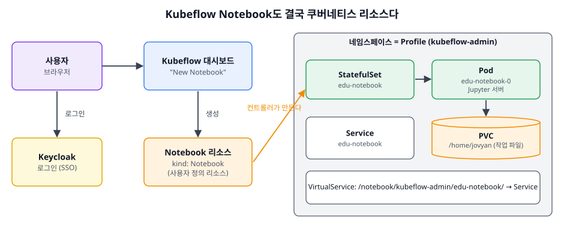
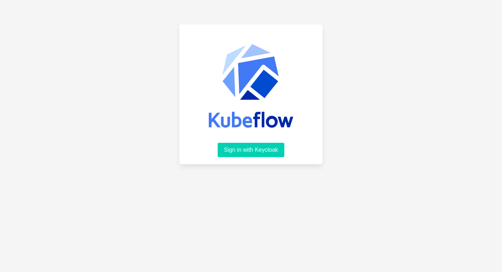
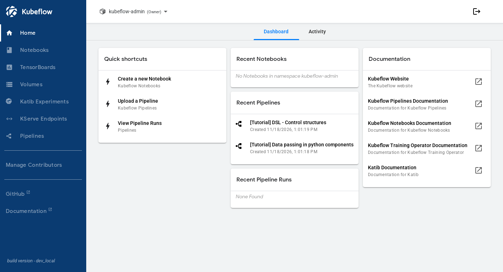
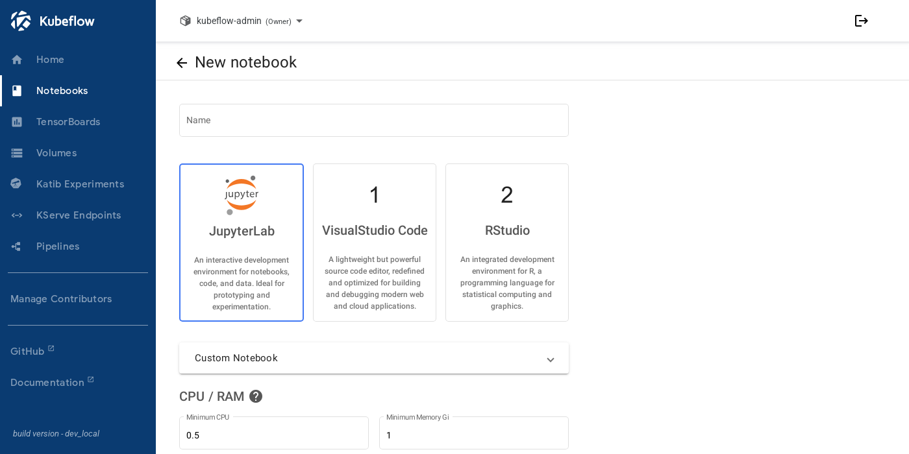
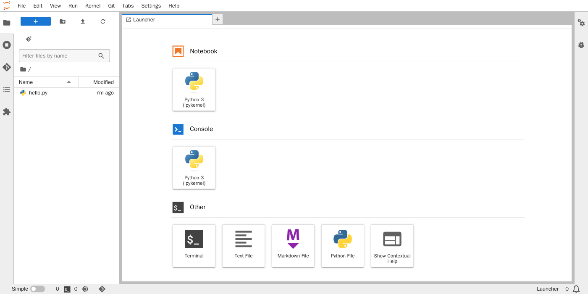

# 08. Kubeflow — Notebook 사용하기

**이 장을 마치면**

- Kubeflow가 무엇이고 Profile, Notebook이 쿠버네티스의 무엇에 해당하는지 설명할 수 있습니다.
- Keycloak 계정으로 Kubeflow에 로그인하고 Notebook을 만들 수 있습니다.
- Notebook이 뜨지 않거나 파일이 사라졌을 때 `kubectl`로 원인을 찾을 수 있습니다.

---

## 1. Kubeflow란

**Kubeflow**는 쿠버네티스 위에서 머신러닝 작업을 하기 위한 도구 모음입니다. 여러 기능이 하나의 화면(대시보드)에 묶여 있습니다.

| 기능 | 하는 일 |
|---|---|
| **Notebooks** | 브라우저에서 쓰는 개발 환경(JupyterLab 등)을 Pod로 띄워 준다 |
| **Pipelines** | 여러 단계로 된 ML 작업을 순서대로 실행한다. 각 단계가 Pod다 ([04장](04-airflow-dag.md)의 Airflow와 비슷한 역할) |
| Katib | 모델의 설정값을 자동으로 바꿔 가며 실험한다 |
| KServe | 학습한 모델을 API로 서비스한다 |

이 장에서는 가장 많이 쓰는 **Notebook**을 다룹니다.

> **이 환경의 Pipelines에 대해**: 현재 이 클러스터에서는 Pipeline 실행 단계가 쓰는 일부 이미지를 내려받을 수 없어 실행이 실패합니다(4절에서 원인을 직접 확인합니다). 그래서 실습은 Notebook 중심으로 하고, Pipeline은 구조만 살펴봅니다.

### Kubeflow의 말과 쿠버네티스의 말

Kubeflow는 새로운 용어를 쓰지만, 그 아래는 기초 과정에서 배운 리소스들입니다.

| Kubeflow | 쿠버네티스 |
|---|---|
| **Profile** (사용자의 작업 공간) | 네임스페이스 + 그 사용자에게 권한을 주는 RoleBinding |
| **Notebook** | StatefulSet + Pod + Service + PVC |
| Notebook의 Workspace Volume | PVC |
| Pipeline의 한 단계 | Pod |



## 2. 실습 ① — 로그인과 내 작업 공간

브라우저에서 `http://kubeflow.10.0.1.231.nip.io`에 접속합니다.



**Sign in with Keycloak**을 누르면 Keycloak 로그인 화면으로 넘어갑니다. Kubeflow는 자체 계정이 없고 **로그인을 Keycloak에 맡깁니다**([05장](05-keycloak-kubectl.md)에서 kubectl 로그인을 Keycloak에 맡긴 것과 같은 구조입니다).
이렇게 여러 서비스가 하나의 로그인을 함께 쓰는 것을 **SSO(Single Sign-On)** 라고 합니다.

로그인하면 대시보드가 나옵니다.



왼쪽 위의 **`kubeflow-admin (Owner)`** 가 지금 선택된 **Profile**입니다. Profile은 사용자마다 주어지는 작업 공간이고, 실체는 네임스페이스입니다.

```bash
kubectl get profiles.kubeflow.org
kubectl get namespace | grep kubeflow-
```

```
NAME                        AGE
kubeflow-admin              2d
kubeflow-data-analyst       2d
kubeflow-platform-admin     2d
kubeflow-user-example-com   2d

kubeflow-admin              Active   2d
kubeflow-data-analyst       Active   2d
kubeflow-platform-admin     Active   2d
kubeflow-user-example-com   Active   2d
```

Profile마다 같은 이름의 네임스페이스가 있습니다. Profile의 주인이 누구인지, 그 네임스페이스에 어떤 권한이 연결됐는지 봅니다.

```bash
kubectl get profiles.kubeflow.org kubeflow-admin -o jsonpath='{.spec.owner.name}{"\n"}'
kubectl -n kubeflow-admin get rolebinding
```

```
admin@datalake.net

NAME             ROLE                         AGE
default-editor   ClusterRole/kubeflow-edit    2d
default-viewer   ClusterRole/kubeflow-view    2d
namespaceAdmin   ClusterRole/kubeflow-admin   2d
```

주인은 Keycloak 사용자의 이메일(`admin@datalake.net`)이고, 그 사용자에게 이 네임스페이스의 권한이 **RoleBinding**으로 주어져 있습니다. 기초 과정 [11장](../../docs/11-rbac.md)의 구조 그대로입니다.
다른 사용자의 Profile은 보이지 않습니다.

> 아래 실습 명령은 `kubeflow-admin` Profile 기준입니다. 다른 계정으로 로그인했다면 `-n kubeflow-admin`을 자기 Profile의 네임스페이스로 바꾸세요.

## 3. 실습 ② — Notebook 만들기

### 3-1. 화면에서 만들기

왼쪽 메뉴 **Notebooks → + New Notebook**



| 항목 | 입력 | 쿠버네티스에서는 |
|---|---|---|
| **Name** | `edu-notebook` | 리소스 이름 |
| 종류 | JupyterLab | 컨테이너 이미지 (`jupyter-scipy`) |
| **Minimum CPU / Memory** | `0.2` / `0.5` | `resources.requests` (기초 과정 [17장](../../docs/17-resources.md)) |
| Maximum CPU / Memory | `1` / `1` | `resources.limits` |
| **Workspace Volume** | 새 볼륨, 1Gi | PVC (기초 과정 [06장](../../docs/06-pv-pvc.md)) |

**LAUNCH**를 누릅니다. 처음에는 이미지를 내려받느라 2~3분 걸립니다.

화면에서 입력한 내용은 `Notebook`이라는 리소스 하나로 저장됩니다. 같은 것을 YAML로 쓰면 이렇습니다. ([examples/kubeflow/notebook.yaml](../examples/kubeflow/notebook.yaml))

```yaml
apiVersion: kubeflow.org/v1
kind: Notebook
metadata:
  name: edu-notebook
spec:
  template:
    spec:
      serviceAccountName: default-editor
      containers:
      - name: edu-notebook
        image: kubeflownotebookswg/jupyter-scipy:v1.9.2
        resources:
          requests: {cpu: 200m, memory: 512Mi}
          limits: {cpu: "1", memory: 1Gi}
        volumeMounts:
        - name: workspace
          mountPath: /home/jovyan          # 노트북 파일이 저장되는 곳
      volumes:
      - name: workspace
        persistentVolumeClaim:
          claimName: edu-notebook-workspace
```

`spec.template.spec` 아래는 Pod 정의와 같습니다. 화면 대신 이 파일로 만들 수도 있습니다.

```text
kubectl -n kubeflow-admin apply -f platform/examples/kubeflow/notebook.yaml
```

### 3-2. 무엇이 만들어졌나

```bash
kubectl -n kubeflow-admin get notebook,statefulset,pod,service,pvc | grep -E 'NAME|edu-notebook'
```

```
NAME                                 AGE
notebook.kubeflow.org/edu-notebook   4m30s
NAME                            READY   AGE
statefulset.apps/edu-notebook   1/1     4m30s
NAME                 READY   STATUS    RESTARTS   AGE
pod/edu-notebook-0   2/2     Running   0          4m30s
NAME                   TYPE        CLUSTER-IP     EXTERNAL-IP   PORT(S)   AGE
service/edu-notebook   ClusterIP   10.108.223.4   <none>        80/TCP    4m30s
NAME                                           STATUS   VOLUME        CAPACITY   ACCESS MODES   STORAGECLASS   AGE
persistentvolumeclaim/edu-notebook-workspace   Bound    pvc-bed9...   1Gi        RWO            nfs-client     4m30s
```

`Notebook` 하나를 만들었더니 Kubeflow의 컨트롤러가 **StatefulSet, Pod, Service**를 만들었습니다. Pod 이름이 `edu-notebook-0`인 것은 StatefulSet이기 때문입니다(기초 과정 [07장](../../docs/07-statefulset.md)).

`READY 2/2` — 컨테이너가 2개입니다.

```bash
kubectl -n kubeflow-admin get pod edu-notebook-0 -o jsonpath='{.spec.containers[*].name}{"\n"}'
```

```
edu-notebook istio-proxy
```

`edu-notebook`이 Jupyter이고, `istio-proxy`는 Kubeflow가 자동으로 붙이는 **사이드카**입니다(기초 과정 [01장](../../docs/01-pod.md)). 이 Pod로 오가는 통신을 가로채서 "로그인한 사용자가 자기 Notebook에만 접속하는지" 검사합니다.
그래서 이 Pod에 `kubectl logs`나 `exec`를 할 때는 `-c edu-notebook`으로 컨테이너를 지정해야 합니다.

### 3-3. 접속해서 써 보기

Notebooks 목록에서 `edu-notebook` 오른쪽의 **CONNECT**를 누르면 JupyterLab이 열립니다.



**Python 3** 노트북을 하나 열고 셀에 아래 코드를 넣어 실행(`Shift+Enter`)해 보세요.

```python
import pandas as pd
df = pd.DataFrame({"name": ["a", "b", "c"], "amount": [10, 20, 12]})
print(df["amount"].sum())
df.to_csv("result.csv", index=False)
```

`42`가 출력되고 왼쪽 파일 목록에 `result.csv`가 생깁니다. 이 코드는 내 PC가 아니라 **클러스터의 Pod 안에서** 실행된 것입니다. 터미널에서 확인합니다.

```bash
kubectl -n kubeflow-admin exec edu-notebook-0 -c edu-notebook -- ls -la /home/jovyan
kubectl -n kubeflow-admin exec edu-notebook-0 -c edu-notebook -- df -h /home/jovyan
```

```
Filesystem                                                              Size  Used Avail Use% Mounted on
10.0.1.185:/root/nfs/kubeflow-admin-edu-notebook-workspace-pvc-bed9...   92G   31G   61G  34% /home/jovyan
```

`/home/jovyan`은 PVC입니다. **이 디렉터리에 저장한 파일만 남습니다.**

## 4. 실습 ③ — 멈추기, 다시 켜기, 그리고 남는 것

Notebook은 쓰지 않을 때도 CPU와 메모리를 예약하고 있습니다. 쓰지 않을 때는 멈춰 둡니다.

Notebooks 목록에서 **■ (Stop)** 버튼을 누르고, 터미널에서 봅니다.

```bash
kubectl -n kubeflow-admin get statefulset edu-notebook
kubectl -n kubeflow-admin get pod | grep edu-notebook
kubectl -n kubeflow-admin get pvc edu-notebook-workspace
```

```
NAME           READY   AGE
edu-notebook   0/0     48m

NAME                     STATUS   VOLUME        CAPACITY   ACCESS MODES   STORAGECLASS   AGE
edu-notebook-workspace   Bound    pvc-bed9...   1Gi        RWO            nfs-client     48m
```

"멈춘다"는 것은 **StatefulSet의 replicas를 0으로 줄이는 것**이었습니다. Pod는 사라졌지만 **PVC는 그대로**입니다.

**▶ (Start)** 를 누르면 replicas가 1로 돌아가고 Pod가 다시 뜹니다. 다시 접속하면 `result.csv`가 그대로 있습니다.

```bash
kubectl -n kubeflow-admin rollout status statefulset/edu-notebook --timeout=180s
kubectl -n kubeflow-admin exec edu-notebook-0 -c edu-notebook -- ls /home/jovyan
```

| | 남는다 | 사라진다 |
|---|---|---|
| Stop → Start, Pod 재시작 | `/home/jovyan` 아래의 파일 (PVC) | 실행 중이던 변수, `pip install`로 설치한 패키지, `/home/jovyan` 밖에 쓴 파일 |

`pip install`로 설치한 패키지가 사라지는 이유는 기초 과정 [01장](../../docs/01-pod.md)에서 본 것과 같습니다. 컨테이너 안의 변경은 Pod와 함께 사라집니다.
항상 필요한 패키지는 [01장](01-harbor.md)에서 배운 대로 **이미지로 만들어** Harbor에 올리고, Notebook을 만들 때 **Custom Notebook**에 그 이미지를 지정합니다.

## 5. 고장 내고 고쳐 보기

### 5-1. Notebook이 뜨지 않는다

Notebook 목록에서 상태가 계속 노란색(대기 중)이면, 화면만 봐서는 이유를 알기 어렵습니다. **Notebook은 Pod**이므로 Pod를 보면 됩니다.

```text
kubectl -n kubeflow-admin get pod
kubectl -n kubeflow-admin describe pod edu-notebook-0
```

| Pod의 상태 | 원인 | 다룬 곳 |
|---|---|---|
| `Pending` + `Insufficient cpu/memory` | 요청한 CPU·메모리를 줄 노드가 없다. 값을 줄이거나 안 쓰는 Notebook을 멈춘다 | 기초 [17장](../../docs/17-resources.md) |
| `Pending` + `unbound PersistentVolumeClaims` | Workspace Volume(PVC)이 만들어지지 못했다 | 기초 [06장](../../docs/06-pv-pvc.md) |
| `ContainerCreating`이 오래 감 | 이미지를 내려받는 중 (Notebook 이미지는 수 GB). Events에 `Pulling image`가 보이면 기다린다 | 기초 [01장](../../docs/01-pod.md) |
| `ImagePullBackOff` | 이미지 이름이 틀렸거나 받을 수 없다 | [01장](01-harbor.md) |
| `OOMKilled`로 재시작 | 노트북에서 메모리 상한보다 큰 데이터를 읽었다. Memory를 늘려 다시 만든다 | 기초 [17장](../../docs/17-resources.md) |

### 5-2. Pipeline 실행이 실패하는 이유 찾기

1절에서 "이 환경에서는 Pipeline 실행이 실패한다"고 했습니다. 지금까지 배운 것으로 원인을 직접 찾아볼 수 있습니다.

Pipeline을 실행하면 각 단계가 Profile 네임스페이스에 Pod로 뜹니다. 실행을 시도했을 때의 상태는 이렇습니다.

```text
kubectl -n kubeflow-admin get pod
```

```
NAME                                                       READY   STATUS              RESTARTS   AGE
tutorial-data-passing-587zr-system-dag-driver-2787664644   0/2     Init:ErrImagePull   0          10s
```

```text
kubectl -n kubeflow-admin describe pod tutorial-data-passing-587zr-system-dag-driver-2787664644
```

```
Warning  Failed  kubelet  Failed to pull image "gcr.io/ml-pipeline/argoexec:v3.4.17-license-compliance": rpc error: code = NotFound ...
```

<details><summary>무슨 뜻인가요?</summary>

`ErrImagePull` + `NotFound` — [01장](01-harbor.md)에서 본 것과 같은 오류입니다. Pipeline의 각 단계를 실행하는 데 쓰는 이미지(`gcr.io/ml-pipeline/argoexec` 등)가 **원래 있던 공개 저장소에서 삭제**되어 더 이상 내려받을 수 없습니다.

Pipeline을 정의한 내용이나 권한의 문제가 아니라, **플랫폼을 구성하는 이미지의 문제**입니다. 해결은 플랫폼 관리자가 Kubeflow 설정에서 이 이미지들의 주소를 현재 받을 수 있는 저장소로 바꾸는 것입니다.

이 사례가 보여 주는 것:

- **공개 저장소의 이미지는 언제든 사라질 수 있습니다.** 운영에 쓰는 이미지는 Harbor 같은 사내 저장소에 복사해 두고 거기서 받아 쓰는 것이 안전합니다. Harbor의 **Proxy Cache** 프로젝트나 **Replication** 기능이 이 용도입니다.
- 플랫폼 도구가 복잡해 보여도, 문제가 생기면 결국 **`kubectl get pod` → `describe` → Events**에서 시작합니다.

</details>

## 6. 정리

화면의 Notebooks 목록에서 휴지통 아이콘을 누르거나 터미널에서 지웁니다.

```bash
kubectl -n kubeflow-admin delete notebook edu-notebook
kubectl -n kubeflow-admin get statefulset,pod | grep edu-notebook
```

Notebook을 지우면 StatefulSet, Pod, Service가 함께 사라집니다. **PVC는 남습니다**(작업 파일을 실수로 잃지 않게 하기 위해서입니다). 필요 없으면 따로 지웁니다.

```bash
kubectl -n kubeflow-admin delete pvc edu-notebook-workspace

# 회수 정책이 Retain이라 남은 PV 정리 (기초 과정 06장 7절)
for pv in $(kubectl get pv -o jsonpath='{range .items[?(@.spec.claimRef.namespace=="kubeflow-admin")]}{.metadata.name}{" "}{.status.phase}{"\n"}{end}' | awk '$2=="Released"{print $1}'); do
  kubectl patch pv $pv -p '{"spec":{"persistentVolumeReclaimPolicy":"Delete"}}'
done
```

화면에서는 **Volumes** 메뉴에서 PVC를 지울 수 있습니다.

## 핵심 요약

- Kubeflow는 쿠버네티스 위의 ML 도구 모음이다. 로그인은 Keycloak에 맡긴다(SSO).
- Profile은 사용자의 작업 공간이고, 실체는 네임스페이스와 RoleBinding이다.
- Notebook 하나는 StatefulSet + Pod + Service + PVC로 이루어진다.
- `/home/jovyan`(PVC)에 저장한 파일만 남는다. 설치한 패키지는 Pod가 다시 뜨면 사라진다.
- Stop은 replicas를 0으로 줄이는 것이다. 쓰지 않는 Notebook은 멈춰서 자원을 돌려준다.
- Notebook이나 Pipeline에 문제가 생기면 그 네임스페이스의 Pod를 본다.

## 확인 문제

1. Kubeflow의 Profile은 쿠버네티스의 무엇에 해당하나요?
2. Notebook을 하나 만들면 어떤 쿠버네티스 리소스들이 생기나요?
3. Notebook에서 `pip install`로 설치한 패키지가 Stop/Start 뒤에 사라졌습니다. 왜 그런가요? 어떻게 해야 하나요?
4. Notebook Pod의 `READY`가 `2/2`입니다. 컨테이너 두 개는 각각 무엇인가요?
5. Notebook 상태가 계속 대기 중입니다. 무엇부터 확인해야 하나요?

<details><summary>정답 보기</summary>

1. 네임스페이스와, 그 네임스페이스에서 Profile 주인에게 권한을 주는 RoleBinding입니다.
2. Notebook 리소스를 바탕으로 StatefulSet, Pod, Service(그리고 접속 경로를 위한 VirtualService)가 만들어지고, Workspace Volume은 PVC입니다.
3. 패키지는 컨테이너의 파일 시스템에 설치되므로 Pod가 다시 만들어지면 사라집니다. PVC인 `/home/jovyan`만 남습니다. 필요한 패키지를 넣은 이미지를 만들어 Custom Notebook으로 지정합니다.
4. Jupyter가 실행되는 컨테이너와, 통신을 가로채 접근을 검사하는 `istio-proxy` 사이드카입니다.
5. Profile 네임스페이스에서 `kubectl get pod`로 Notebook Pod의 상태를 보고, `describe`의 Events에서 원인(자원 부족, PVC, 이미지)을 확인합니다.
</details>

---

플랫폼 과정은 여기까지입니다. [목차로 돌아가기](../README.md) · [기초 과정](../../README.md)
